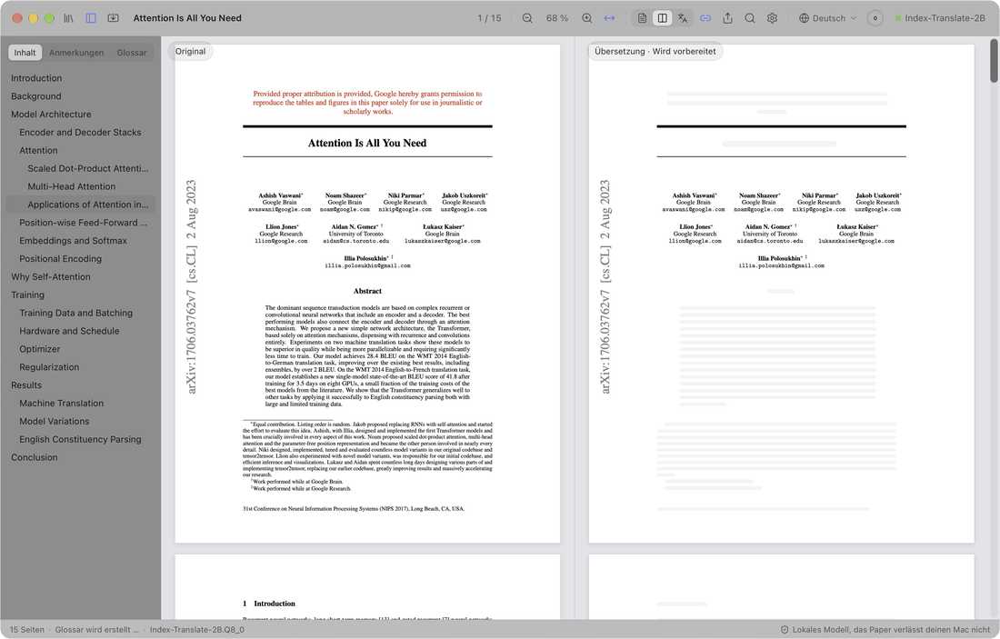
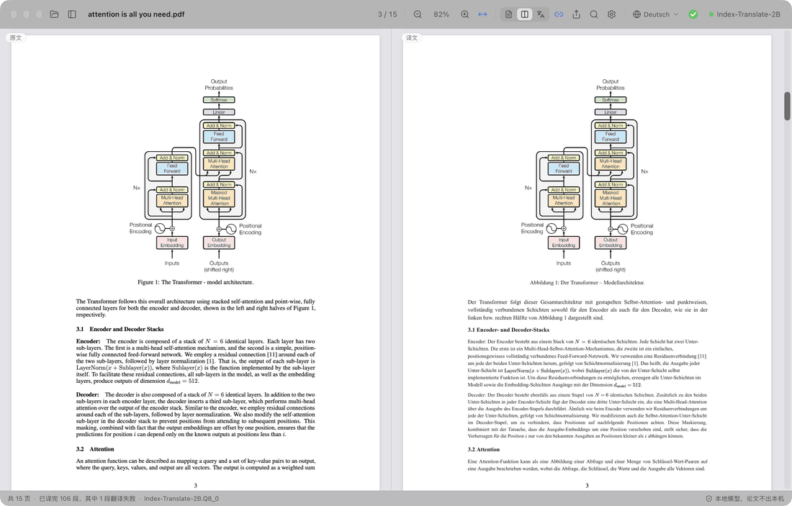
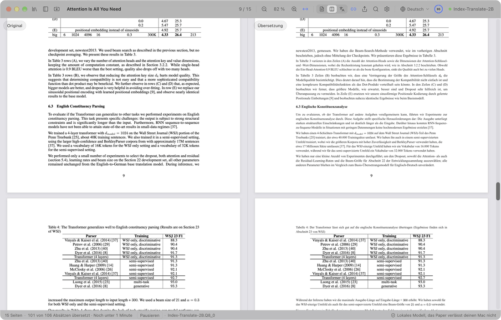
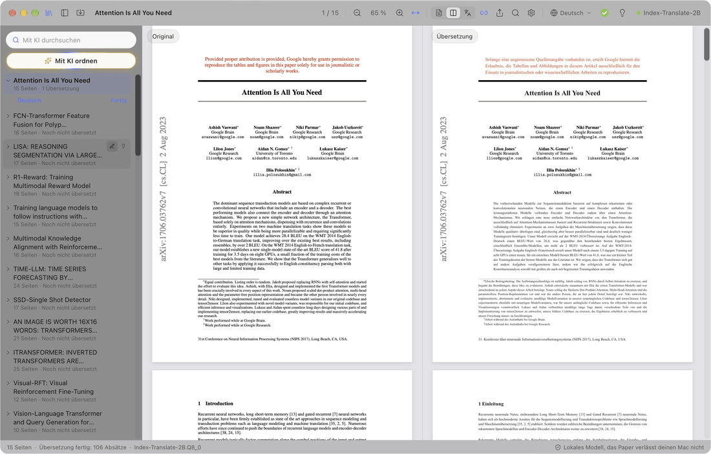
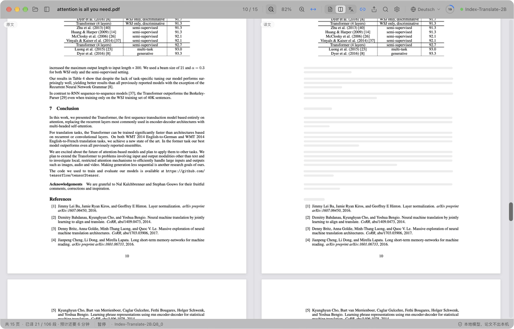
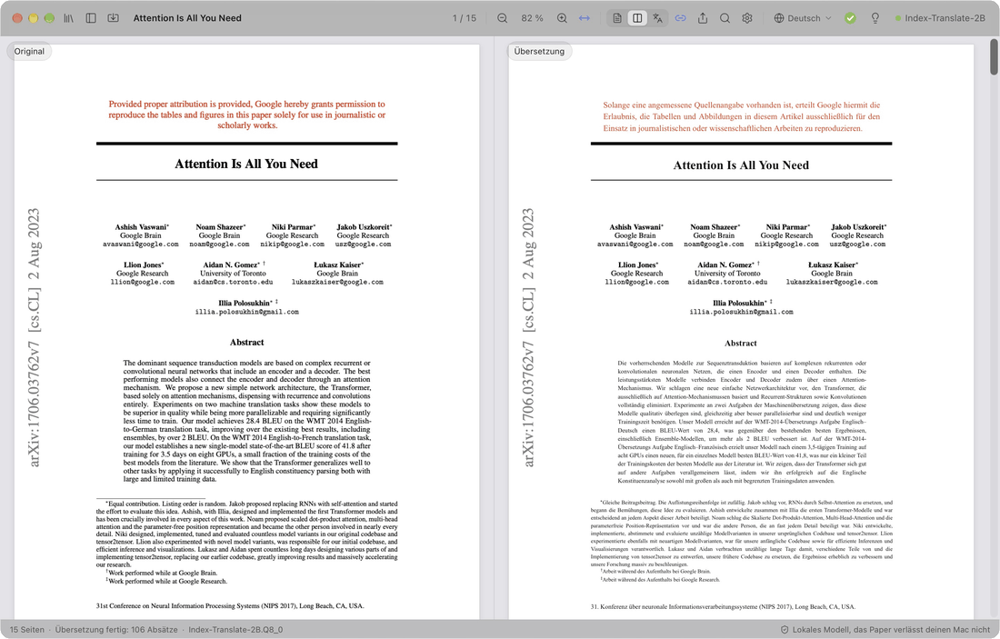

  

<h1 align="center">PaperDuet</h1>

  <em>Ein schlanker KI-Übersetzer für Fachartikel, gemacht für Forschende!</em> 
  <a href="https://paperduet.com">paperduet.com</a>

  <a href="README.md">English</a> &middot; <a href="README.zh-CN.md">简体中文</a> &middot; <a href="README.zh-TW.md">繁體中文</a> &middot; <a href="README.ja.md">日本語</a> &middot; <a href="README.ko.md">한국어</a> &middot; <a href="README.fr.md">Français</a> &middot; <b>Deutsch</b> &middot; <a href="README.es.md">Español</a> &middot; <a href="README.it.md">Italiano</a> &middot; <a href="README.pl.md">Polski</a> &middot; <a href="README.ru.md">Русский</a>

  
  

  
  
  
  
  
  

  <strong>PaperDuet ist ein schlanker KI-Spiegelübersetzer für Fachartikel, der das ursprüngliche Layout beibehält.</strong> 
  Fünf Open-Source-KI-Übersetzungsmodelle zur Auswahl. 
  Keine Kosten, komplett lokal!

   
  Aufnahme: Attention Is All You Need (15 Seiten) wird von Grund auf übersetzt

PaperDuet ist ein schlanker KI-Spiegelübersetzer für Fachartikel. Original und Übersetzung stehen sich wie Spiegelbilder gegenüber, Formeln, Abbildungen und Tabellen werden Seite für Seite korrigiert und ausgerichtet. Kein API-Schlüssel, keine Kosten, und alles läuft auf deinem Computer!

## Jede Seite, ganz einfach

  

Links steht der Originalartikel, rechts seine Übersetzung, und beide Seiten scrollen und zoomen gemeinsam. Spalten, Überschriften, Bildunterschriften, Fußnoten und Literaturangaben werden automatisch erkannt, und Absätze, die in der nächsten Spalte oder auf der nächsten Seite weitergehen, werden zusammengeführt. Beide Seiten stehen exakt nebeneinander, das macht den Vergleich leicht.

## Speichern? Zusammenfassen? Erledigt.

  

Die Symbolleiste zeigt, wie weit die Übersetzung ist. Ist der ganze Artikel übersetzt, wird der Ring zum grünen Haken, und ein Klick speichert die Übersetzung als PDF neben dem Original. Die Glühbirne daneben öffnet die KI-Zusammenfassung: was das Modell nach dem ganzen Artikel festhält, Fragestellung, Methode und Ergebnisse inklusive. Dazu wählst du aus fünf Modellen, passend zu deinem Computer und deinen Ansprüchen.

## Denken. Finden.

  

Alle Artikel, die du gelesen hast, liegen in der Bibliothek. „Mit KI ordnen“ versieht sie mit Schlagwörtern zu Fachgebiet und Thema, und die gewählten rücken nach oben. Die KI-Suche findet einen Artikel über Titel, Text, Übersetzung oder Zusammenfassung, auf Deutsch wie auf Englisch.

## Nicht verstanden? Einfach klicken.

  

Zuerst werden die Überschriften übersetzt, damit du den Aufbau sofort siehst; dann Titel, Abstract und Einleitung. Du willst eine spätere Stelle jetzt lesen? Doppelklick darauf, und sie kommt sofort dran, ohne auf den Fortschritt zu warten.

## Notizen? Kein Problem.

  

Markiere, unterstreiche und notiere direkt in der Übersetzung; die passenden Sätze im Original werden mitmarkiert. Das Original-PDF mit deinen Notizen wird mit Standard-PDF-Anmerkungen exportiert und ist in Vorschau, Zotero und anderen Apps zu sehen.

## Und noch mehr

- **Zehn Zielsprachen.** Wechsle mit einem Klick in der Symbolleiste zwischen 简体中文, 繁體中文, 日本語, 한국어, Français, Deutsch, Español, Italiano, Polski und Русский.
- **Ein übersetztes PDF mit einem Klick.** Ist ein Artikel vollständig übersetzt, speichert ein Klick die Übersetzung im Originallayout daneben.
- **Eingebaute Qualitätsprüfung.** Formeln, Zahlen und Satzreihenfolge werden in jeder Antwort geprüft, bei Fehlern wird automatisch neu angefragt, und ein Glossar pro Artikel hält die Begriffe einheitlich.
- **Du bestimmst, was übersetzt wird.** Rechtsklick auf einen beliebigen Block, um ihn zu übersetzen oder im Original zu lassen.
- **Lies, wie du willst.** Durchsuche Original und Übersetzung gleichzeitig, blättere im zweisprachigen Inhaltsverzeichnis, zeige auf einen Absatz, um sein Gegenstück zu finden, und lass dir das Original, die Übersetzung oder beides anzeigen. PaperDuet merkt sich, wo du aufgehört hast.
- **Deine Bibliothek, mit KI-Suche.** Alle gelesenen und importierten Artikel liegen in der Bibliothek. Die KI-Suche findet einen Artikel über Titel, Text, Übersetzung oder Zusammenfassung wieder, auf Deutsch wie auf Englisch, und „Mit KI ordnen“ sortiert nach Fachgebiet und Thema.
- **Eine Zusammenfassung zu jedem Artikel.** Ist ein Artikel übersetzt, klick auf die Glühbirne: Das Übersetzungsmodell schreibt eine kurze Zusammenfassung in der Sprache der Oberfläche und speichert sie mit dem Artikel.
- **Exportiere, wohin du willst.** Das Original-PDF mit deinen Markierungen, das übersetzte PDF und deine Notizen als Markdown, die sich auch in anderen Apps öffnen lassen.
- **Updates mit einem Klick.** Aktualisieren ist einfach: Ein Klick installiert die neue Version.
- **Schön anzusehen.** Ein klares Glas-Design mit hellem, dunklem und Nachtlese-Modus.

  

## Fünf Modelle, alle auf deinem Computer

Wähle beim ersten Start von PaperDuet ein Modell und wechsle jederzeit unter Einstellungen › Modell › Modell wechseln. Alle sind für die Übersetzung gebaut und laufen nach dem Download komplett offline.

| Modell | Von | Größe | Am besten für |
| --- | --- | --- | --- |
| [Index-Translate-2B](https://huggingface.co/IndexTeam/Index-Translate-2B) **(empfohlen)** | bilibili-Index-Team | 2.1 GB | Der beste Allrounder, abgestimmt auf die Prüfungen und das Glossar von PaperDuet |
| [Hy-MT2-1.8B](https://huggingface.co/tencent/Hy-MT2-1.8B-GGUF) | Tencent Hunyuan | 1.9 GB | Tempo: das schnellste und leichteste |
| [LMT-60-4B](https://huggingface.co/NiuTrans/LMT-60-4B) | NiuTrans | 4.7 GB | Übersetzungen nah am Ausgangstext |
| [Hy-MT2-7B](https://huggingface.co/tencent/Hy-MT2-7B-GGUF) | Tencent Hunyuan | 8.0 GB | Die flüssigsten Übersetzungen, auf Computern mit 16 GB Arbeitsspeicher oder mehr |
| [TranslateGemma-4B](https://huggingface.co/mradermacher/translategemma-4b-it-GGUF) (experimentell) | Google | 4.1 GB | Googles Übersetzungsmodell ausprobieren |

Mit dem empfohlenen Modell braucht ein 15-seitiger Artikel auf einem M5 Pro etwa 2 Minuten, oder etwa 1 Minute, wenn „Absätze gleichzeitig“ unter Einstellungen › Modell auf 2 oder 3 steht.

Du hast eines dieser Modelle schon über LM Studio, llama.cpp oder Hugging Face? PaperDuet findet es und nutzt es an Ort und Stelle, ohne zweiten Download.

Ist dein Computer mit den lokalen Modellen überfordert? Wähle in der Modellauswahl „API verwenden“ und gib deinen eigenen API-Schlüssel ein, um OpenAI, Claude, DeepSeek, Qwen, Kimi, GLM, Doubao oder einen beliebigen OpenAI-kompatiblen Dienst zu nutzen. Die lokalen Modelle klappen sich weg, und Übersetzung, Zusammenfassungen, KI-Ordnen und KI-Suche laufen dann über diesen Dienst. Dein Schlüssel bleibt auf deinem Computer.

## Privatsphäre von Anfang an

- Deine Artikel, Übersetzungen und Notizen bleiben auf deinem Computer. Mit einer API wird der zu übersetzende Text an den gewählten Dienst gesendet.
- Nur wenn du zustimmst, sendet PaperDuet anonyme Nutzungs- und Diagnosedaten (Version, System, Sprache der Oberfläche, Modell und Arten von Fehlern), nie Inhalte von Artikeln, und du kannst das jederzeit in den Einstellungen abschalten.
- Bei Fehlern sendet PaperDuet einen Fehlerbericht an den Entwickler: was schiefging, Version und System, ohne Dateipfade und ohne Inhalte von Artikeln. Abschalten lässt sich das unter Einstellungen › Daten.
- Mit einem lokalen Modell geht PaperDuet nur online, um ein Modell herunterzuladen, nach Updates zu suchen und diese Daten und Berichte zu senden; alles außer dem Modell-Download lässt sich abschalten.

## Los geht's

Auf dem Mac brauchst du Apple Silicon (M1 oder neuer) und macOS 13.3 oder neuer, auf dem PC Windows 10 oder 11 in 64 Bit.

**Mac**

1. Lade die neueste `.dmg` unter [Releases](https://github.com/KalenHwei/PaperDuet/releases/latest) herunter.
2. Zieh PaperDuet in den Ordner „Programme“ und öffne es von dort.
3. Nur beim ersten Start: PaperDuet ist noch nicht von Apple notarisiert, deshalb fragt macOS nach einer Bestätigung. Öffne Systemeinstellungen › Datenschutz & Sicherheit und klicke auf **Dennoch öffnen**. (Oder führe `xattr -dr com.apple.quarantine /Applications/PaperDuet.app` im Terminal aus.)
4. Wähle ein Modell. PaperDuet lädt es herunter oder findet die Kopie, die du schon hast, und beginnt sofort mit der Übersetzung.

**Windows**

1. Lade das neueste Windows-Installationsprogramm (`_x64-setup.exe`) unter [Releases](https://github.com/KalenHwei/PaperDuet/releases/latest) herunter.
2. Starte es. Nur beim ersten Mal: Zeigt Windows „Der Computer wurde durch Windows geschützt“, klicke auf **Weitere Informationen** und dann auf **Trotzdem ausführen**.
3. Wähle ein Modell. PaperDuet lädt es herunter oder findet die Kopie, die du schon hast, und beginnt sofort mit der Übersetzung.

Das war's. Die Übersetzungs-Engine ist in die App eingebaut, und Updates brauchen nur einen Klick.

<b>Tastenkürzel</b>

| Aktion | Kürzel |
| --- | --- |
| PDF öffnen | ⌘O |
| Artikel schließen | ⌘W |
| Beide Seiten durchsuchen | ⌘F |
| Nächster / vorheriger Treffer | ⌘G / ⇧⌘G |
| Vergrößern / verkleinern / an Breite anpassen | ⌘+ / ⌘− / ⌘0 |
| Um den Zeiger zoomen | ⌘ + Scrollen oder Aufziehen auf dem Trackpad |
| Seiten verschieben | ⌘ + Ziehen |
| Diesen Teil als Nächstes übersetzen | Doppelklick auf noch nicht übersetzten Text |
| Auswahl hervorheben | H |
| Notiz zur Auswahl hinzufügen | N |
| Farbe der Hervorhebung | 1 bis 5 |
| Widerrufen / wiederholen | ⌘Z / ⇧⌘Z |
| Seitenleiste ein- oder ausblenden | ⌘\ |
| Synchrones Scrollen ein oder aus | ⌘L |
| Alle Tastenkürzel | ⌘/ |

H, N und 1 bis 5 wirken auf markierten Text. Unter Windows steht Strg für ⌘ und Umschalt für ⇧.

## FAQ

### Welches Modell soll ich nehmen?

Fang mit Index-Translate-2B an. Für mehr Tempo nimm Hy-MT2-1.8B. Für die flüssigsten Übersetzungen auf einem Computer mit 16 GB Arbeitsspeicher oder mehr nimm Hy-MT2-7B. Ist dein Computer überfordert, wähle „API verwenden“.

### Ist es kostenlos?

Ja, für persönliches Lernen und Forschen sowie für Universitäten, Schulen, Forschungsinstitute und andere gemeinnützige Einrichtungen. Wer PaperDuet in einem Unternehmen oder für ein Unternehmen nutzt, braucht eine kommerzielle Lizenz: Schreib an [junystugh@gmail.com](mailto:junystugh@gmail.com).

## Roadmap

- **Gesetzte Übersetzungen aus arXiv.** Den LaTeX-Quelltext eines Artikels übersetzen und mit Schriften der Zielsprache kompilieren, für eine vollständig gesetzte Übersetzung.

## Änderungen

- **0.5.15** (2026-10-28): Formelzeichen in Elsevier-Zeitschriften werden nicht mehr verstümmelt: Griechische Buchstaben, ≤, ∀, ≠ und Buchstaben mit Dach (Ŝ, q̂) erscheinen nicht mehr als gewöhnliche Buchstaben, und ein hochgestellter Exponent rutscht nicht mehr in die Zeile darüber.
- **0.5.14** (2026-10-28): Einige bekannte Formatierungsfehler behoben.
- **0.5.13** (2026-10-28): Formeln werden nicht mehr verstümmelt: Abgesetzte Formeln mit Brüchen und Summen bleiben als Ganzes erhalten, statt stückweise über sich selbst übersetzt zu werden, und Summen im Fließtext, Wurzeln sowie weit gesperrte Formelzeilen trennen den Satz nicht mehr auf.
- **0.5.12** (2026-10-27): Zeitschriftenartikel werden genauer wiedergegeben: Statistikzeilen, nummerierte Zwischenüberschriften, Sätze, die in der nächsten Spalte weitergehen, griechische Buchstaben wie χ², Namen mit Akzenten und Minuszeichen in Tabellen kommen nicht mehr durcheinander; das exportierte übersetzte PDF hat einen gleichmäßigen Zeichenabstand. Danke an momo auf RedNote für die Vorschläge.
- **0.5.11** (2026-10-27): Pseudocode wird Zeile für Zeile übersetzt; Zeilennummern, Einrückung und Schlüsselwörter bleiben erhalten. Tabellen werden zuverlässiger erkannt, ihr Inhalt bleibt im Original und nur Titel und Anmerkungen werden übersetzt, sodass sie nicht mehr durcheinandergeraten. Summen im Fließtext fehlen nicht mehr in der Übersetzung.
- **0.5.10** (2026-10-27): Übersetzung über eine Online-API: Ist dein Computer mit den lokalen Modellen überfordert, wähle in der Modellauswahl „API verwenden“ für OpenAI, Claude, DeepSeek, Qwen, Kimi, GLM, Doubao oder einen beliebigen OpenAI-kompatiblen Dienst; die Liste der lokalen Modelle klappt sich dann weg.
- **0.5.9** (2026-10-26): Behebung bestehender Fehler.
- **0.5.8** (2026-10-26): Polnisch als Ziel- und Oberflächensprache; Fehlerbehebungen: Unter macOS 26 und älter konnten Artikel weder gelesen noch übersetzt werden; unter macOS 27 schlug bei manchen Artikeln das Speichern des übersetzten PDFs fehl.
- **0.5.7** (2026-10-26): Zeitschriftenartikel werden genauer gelesen und übersetzt (geprüft an Artikeln aus 20 führenden Zeitschriften): Spalten, Überschriften, Literaturverzeichnisse, Tabellen, Bildunterschriften und verlagseigene Symbole; Artikel aus Science bleiben nicht mehr größtenteils unübersetzt, und Anhänge nach dem Literaturverzeichnis werden übersetzt.
- **0.5.6** (2026-10-25): Italienisch als Ziel- und Oberflächensprache; bei Fehlern geht ein Fehlerbericht an den Entwickler, damit sich Probleme beheben lassen (standardmäßig an, abschaltbar unter Einstellungen › Daten).
- **0.5.5** (2026-10-25): Zeilen mit stark gedehnten Wortabständen in Zeitschriftenartikeln zerfallen nicht mehr in einzelne Wörter, die in der Übersetzung fehlten oder verrutschten; die Zusammenfassung wird direkt nach dem Titel übersetzt; seltener „Layoutanalyse fehlgeschlagen“; Gedankenstriche in Elsevier-Artikeln erscheinen nicht mehr als „e“.
- **0.5.4** (2026-10-24): Schlankere Oberfläche: überflüssige Erklärtexte sind weg; das KI-Suchfeld zeigt „Mit KI durchsuchen“.
- **0.5.3** (2026-10-24): PaperDuet fragt einmal, ob du anonyme Nutzungs- und Diagnosedaten teilen möchtest, um die App zu verbessern; nie Inhalte von Artikeln, jederzeit abschaltbar unter Einstellungen › Daten.
- **0.5.2** (2026-10-24): „KI-Suche“ 🔍 in der Bibliothek findet gelesene Paper über Titel, Originaltext, Übersetzung, Zusammenfassung oder Schlagwörter, auf Deutsch wie auf Englisch; Suche und „Mit KI ordnen“ holen die Treffer nach oben und machen die übrigen grau.
- **0.5.1** (2026-10-24): eine Bibliothek statt des Ordnerbereichs, mit allen gelesenen und importierten Papern, direkt umbenennbar und mit Zusammenfassung; Import mehrerer PDFs oder ganzer Ordner; „Mit KI ordnen“ ✨ filtert nach Fachgebiet und Thema; Korrekturen für zerstückelte Tabellen und nicht übersetzte Absätze in manchen Papern.
- **0.5.0** (2026-10-24): Zusammenfassung des Artikels 💡 hinter der Glühbirne, sobald alles übersetzt ist; der Dateibereich öffnet seinen Ordner mit einem Klick; Windows-Version.
- **0.4.1** (2026-10-23): klarere Beschreibungen in der Modellliste und in den Einstellungen.
- **0.4.0** (2026-10-23): die Oberfläche gibt es in 9 Sprachen. Standardmäßig folgt sie der Systemsprache; umstellen lässt sie sich unter Einstellungen › Darstellung › Sprache der Oberfläche.
- **0.3.2** (2026-10-23): weitere Korrekturen an der Ausrichtung beim Übersetzen in andere Sprachen.
- **0.3.1** (2026-10-23): Fortschrittsring und Symbolleiste überarbeitet.
- **0.3.0** (2026-10-23): acht Zielsprachen 🎉, mit einem Klick in der Symbolleiste umschaltbar; Fortschrittsring und Bedienung überarbeitet.
- **0.2.1** (2026-10-23): fünf Übersetzungsmodelle zur Auswahl; neuer Startbildschirm.
- **0.2.0** (2026-10-23): Update-Prüfung und Updates mit einem Klick in der App.
- **0.1.0** (2026-10-22): erste Version.

Vollständige Liste: [CHANGELOG.md](CHANGELOG.md).

## Lizenz

PaperDuet ist für nichtkommerzielle Nutzung kostenlos, unter der [PolyForm Noncommercial License 1.0.0](LICENSE). Nutze und teile es für private, Lern-, Forschungs- oder gemeinnützige Zwecke; wenn du es weitergibst, leg die Lizenz und die Zeile `Required Notice: Copyright (c) 2026 Kalen Yongda Wei` bei. Für kommerzielle Nutzung schreib an [junystugh@gmail.com](mailto:junystugh@gmail.com).

Copyright © 2026 Kalen Yongda Wei.

## Danksagung

PaperDuet basiert auf [Tauri](https://tauri.app), [pdf.js](https://mozilla.github.io/pdf.js/), [pdf-lib](https://pdf-lib.js.org), [llama.cpp](https://github.com/ggml-org/llama.cpp), [React](https://react.dev), [Zustand](https://github.com/pmndrs/zustand) und [Lucide](https://lucide.dev). Die Übersetzungsmodelle stammen vom bilibili-Index-Team (Index-Translate-2B), von Tencent Hunyuan (Hy-MT2), NiuTrans (LMT) und Google (TranslateGemma). Sie stehen unter Apache-2.0, außer TranslateGemma, für das die [Gemma-Nutzungsbedingungen](https://ai.google.dev/gemma/terms) gelten. Die vollständigen Lizenztexte findest du in der App (Einstellungen › Info › Lizenzen von Drittanbietern).

Der Artikel in den Animationen ist [_Attention Is All You Need_](https://arxiv.org/abs/1706.03762) von Vaswani et al.
