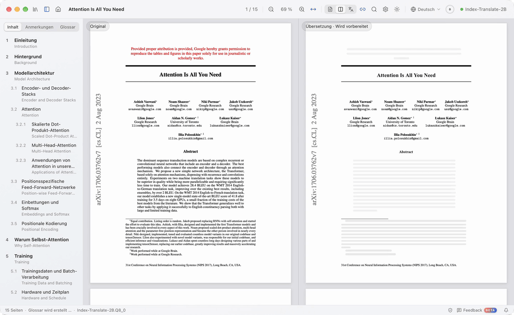
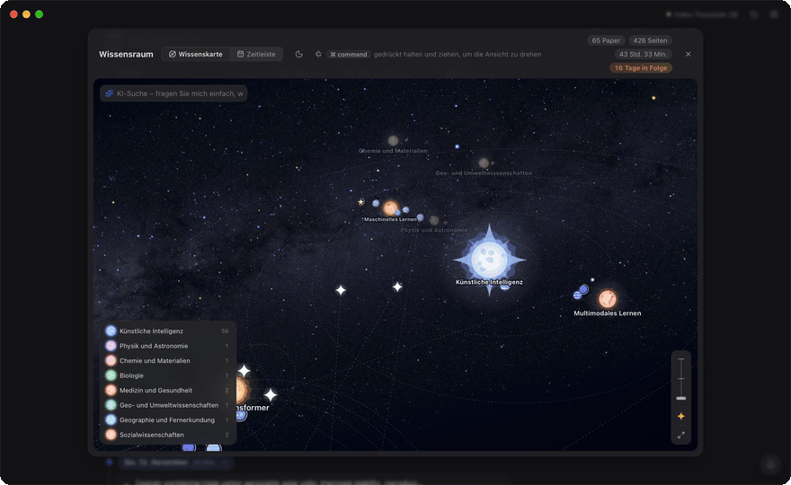
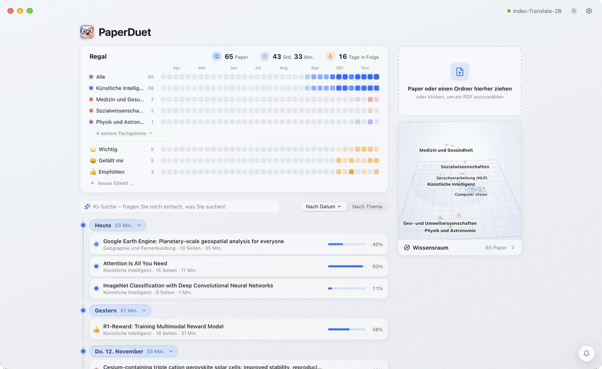
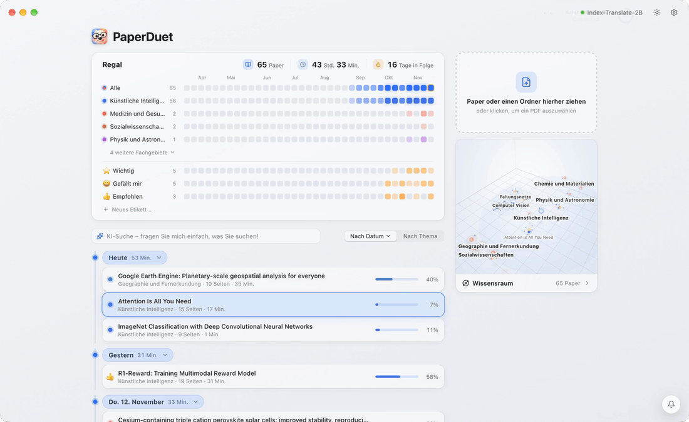
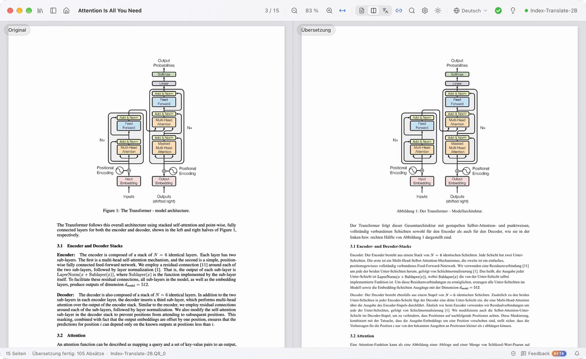
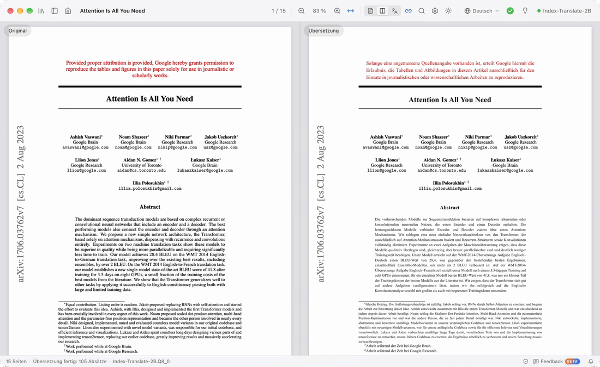
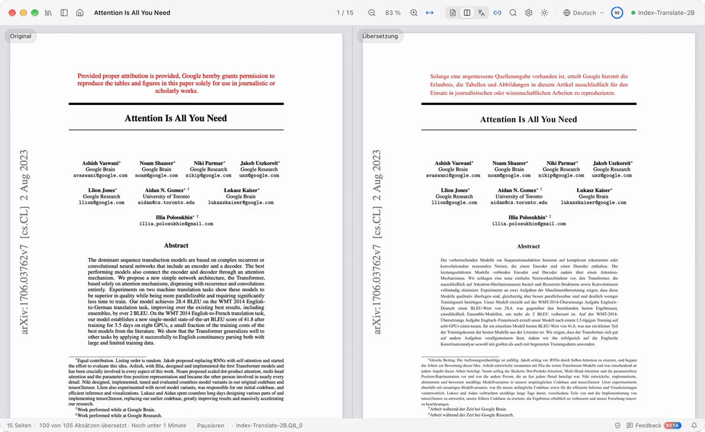

  

<h1 align="center">PaperDuet</h1>

  <em>Das Werkzeug für Forschende, um Paper zu verwalten, zu lernen und zu verstehen!</em> 
  <a href="https://paperduet.com">paperduet.com</a>

  <a href="README.md">English</a> &middot; <a href="README.zh-CN.md">简体中文</a> &middot; <a href="README.zh-TW.md">繁體中文</a> &middot; <a href="README.ja.md">日本語</a> &middot; <a href="README.ko.md">한국어</a> &middot; <a href="README.fr.md">Français</a> &middot; <b>Deutsch</b> &middot; <a href="README.es.md">Español</a> &middot; <a href="README.it.md">Italiano</a> &middot; <a href="README.pl.md">Polski</a> &middot; <a href="README.ru.md">Русский</a>

  
  
  

  
  
  
  
  
  

  <strong>PaperDuet hilft dir, jedes Paper zu verwalten, zu lernen und zu verstehen.</strong> 
  Sechs Open-Source-KI-Übersetzungsmodelle laufen auf deinem Computer, oder du bindest eine Online-API an. 
  Kostenlos, ohne Anmeldung!

PaperDuet ist ein Werkzeug zum Verwalten, Lernen und Verstehen von Papern: Original und Übersetzung stehen spiegelbildlich nebeneinander, Formeln, Abbildungen und Tabellen sind Seite für Seite ausgerichtet, und die gelesenen Paper liegen im Regal und im Wissensraum, wo die KI sie wiederfindet. PaperDuet ist kostenlos: Mit einem lokalen Modell läuft alles auf deinem Computer, bei Bedarf lässt sich eine Online-API anbinden.

## Öffnen – schon auf Deutsch

  

PDF hineinziehen, und die Übersetzung beginnt. Zuerst kommen die Überschriften: Die Gliederung in der Seitenleiste ist sofort deutsch, und du siehst, wie das Paper aufgebaut ist; es folgen Titel, Abstract und Einleitung. Sechs quelloffene Übersetzungsmodelle laufen auf deinem Computer, oder du bindest eine Online-API an.

## Deine Bibliothek ist dein Sternenhimmel

  

Wir stellen Space vor: Deine Paper breiten sich jetzt wie ein Sternenhimmel vor dir aus. So baust du dir anschaulicher eine eigene, sichtbare Wissensbasis auf.

## Jeder Fortschritt, festgehalten

  

Das Regal auf der Startseite hält fest, wie viele Paper du gelesen hast, wie lange insgesamt und wie viele Tage in Folge. Jedes Feld ist eine Woche, dunkler, je länger du gelesen hast; klick auf ein Fachgebiet, und die Paper und die Zeitleiste darunter folgen. Per Rechtsklick gibst du einem Paper eigene Etiketten.

## Paper nicht zu finden? Frag die KI!

  

Den Titel musst du dir nicht merken: Sag in einem Satz, was du suchst, und die KI-Suche findet es in Titeln, Originalen, Übersetzungen und Zusammenfassungen und zeigt die gefundene Stelle. Frag auf Deutsch oder auf Englisch.

## Jede Seite, so wie sie war

  

Links das Original, rechts die Übersetzung; beide scrollen und zoomen gemeinsam. Spalten, Überschriften, Bildunterschriften, Fußnoten und Literaturangaben werden von selbst erkannt, und Formeln, Abbildungen und Tabellen bleiben an ihrem Platz; zeig auf einen Absatz, und sein Gegenstück auf der anderen Seite leuchtet auf. Wechsle die Übersetzungssprache: Das Layout bleibt gleich.

## Notizen machen? Erledigt!

  

Markiere, unterstreiche und notiere direkt in der Übersetzung; der passende Satz im Original wird von selbst mitmarkiert. Das mit deinen Notizen exportierte Original trägt normale PDF-Anmerkungen, sodass Vorschau, Zotero und andere Apps sie unverändert zeigen.

## Fertig gelesen? Nimm es mit.

  

Ist das ganze Paper übersetzt, wird der Ring in der Symbolleiste zum grünen Haken: Ein Klick sichert die übersetzte PDF, das Markdown und das Original mit Anmerkungen zusammen im Ordner des Papers. Die Glühbirne daneben ist die KI-Zusammenfassung, vom Modell geschrieben, nachdem es das ganze Paper gelesen hat: Fragestellung, Methode und Ergebnisse auf einen Blick.

## Und noch mehr

- **Zehn Zielsprachen.** Wechsle mit einem Klick in der Symbolleiste zwischen 简体中文, 繁體中文, 日本語, 한국어, Français, Deutsch, Español, Italiano, Polski und Русский.
- **Per Doppelklick vorziehen.** Du willst einen späteren Absatz zuerst lesen? Klick ihn im Original doppelt an, und er wird als Nächstes übersetzt, ohne auf den Fortschritt zu warten.
- **Eingebaute Qualitätsprüfung.** Formeln, Zahlen und Satzreihenfolge werden in jeder Antwort geprüft, bei Fehlern wird automatisch neu angefragt, und ein Glossar pro Artikel hält die Begriffe einheitlich.
- **Du bestimmst, was übersetzt wird.** Rechtsklick auf einen beliebigen Block, um ihn zu übersetzen oder im Original zu lassen.
- **Lies, wie du willst.** Durchsuche Original und Übersetzung gleichzeitig, blättere im zweisprachigen Inhaltsverzeichnis, zeige auf einen Absatz, um sein Gegenstück zu finden, und lass dir das Original, die Übersetzung oder beides anzeigen. PaperDuet merkt sich, wo du aufgehört hast.
- **Eigene Begriffe.** Leg fest, wie ein Fachbegriff übersetzt werden soll, und das ganze Paper hält sich daran.
- **Auch Scans lesbar.** PDFs, deren Text als Formen gezeichnet statt als Text gespeichert ist, liest auf dem Mac und unter Windows die Texterkennung des Systems, dann werden sie übersetzt.
- **Ordner, die aktuell bleiben.** Importiere einen Ordner einmal, und später hineingelegte Paper erscheinen von selbst in der Bibliothek.
- **Ein Klick zum Aktualisieren, einer zum Aufräumen.** Eine neue Version ist mit einem Klick installiert; den Cache leerst du mit einem Klick in den Einstellungen.
- **Schön anzusehen.** Ein klares Glas-Design mit hellem, dunklem und Nachtlese-Modus.

  

## Sechs Modelle, alle auf deinem Computer

Wähle beim ersten Start von PaperDuet ein Modell und wechsle jederzeit unter Einstellungen › Modell › Modell wechseln. Alle sind für die Übersetzung gebaut und laufen nach dem Download komplett offline.

| Modell | Von | Größe | Am besten für |
| --- | --- | --- | --- |
| [Index-Translate-2B](https://huggingface.co/IndexTeam/Index-Translate-2B) **(empfohlen)** | bilibili-Index-Team | 2.1 GB | Der beste Allrounder, abgestimmt auf die Prüfungen und das Glossar von PaperDuet |
| [Hy-MT2-1.8B](https://huggingface.co/tencent/Hy-MT2-1.8B-GGUF) | Tencent Hunyuan | 1.9 GB | Schnell und leicht |
| [LMT-60-4B](https://huggingface.co/NiuTrans/LMT-60-4B) | NiuTrans | 4.7 GB | Übersetzungen nah am Ausgangstext |
| [LMT-60-0.6B](https://huggingface.co/NiuTrans/LMT-60-0.6B) | NiuTrans | 0.8 GB | Einfachere Computer: das kleinste und schnellste |
| [Hy-MT2-7B](https://huggingface.co/tencent/Hy-MT2-7B-GGUF) | Tencent Hunyuan | 8.0 GB | Die flüssigsten Übersetzungen, auf Computern mit 16 GB Arbeitsspeicher oder mehr |
| [TranslateGemma-4B](https://huggingface.co/mradermacher/translategemma-4b-it-GGUF) (experimentell) | Google | 4.1 GB | Googles Übersetzungsmodell ausprobieren |

Mit dem empfohlenen Modell braucht ein 15-seitiger Artikel auf einem M5 Pro etwa 2 Minuten, oder etwa 1 Minute, wenn „Absätze gleichzeitig“ unter Einstellungen › Modell auf 2 oder 3 steht.

Du hast eines dieser Modelle schon über LM Studio, llama.cpp oder Hugging Face? PaperDuet findet es und nutzt es an Ort und Stelle, ohne zweiten Download.

Ist dein Computer mit den lokalen Modellen überfordert? Wähle in der Modellauswahl „API verwenden“ und gib deinen eigenen API-Schlüssel ein, um OpenAI, Claude, DeepSeek, Qwen, Kimi, GLM, Doubao oder einen beliebigen OpenAI-kompatiblen Dienst zu nutzen. Die lokalen Modelle klappen sich weg, und Übersetzung, Zusammenfassungen, KI-Ordnen und KI-Suche laufen dann über diesen Dienst. Dein Schlüssel bleibt auf deinem Computer.

## Privatsphäre von Anfang an

- Deine Artikel, Übersetzungen und Notizen bleiben auf deinem Computer. Mit einer API wird der zu übersetzende Text an den gewählten Dienst gesendet.
- Nur wenn du zustimmst, sendet PaperDuet anonyme Nutzungs- und Diagnosedaten (Version, System, Sprache der Oberfläche, Modell und Arten von Fehlern), nie Inhalte von Artikeln, und du kannst das jederzeit in den Einstellungen abschalten.
- Bei Fehlern sendet PaperDuet einen Fehlerbericht an den Entwickler: was schiefging, Version und System, ohne Dateipfade und ohne Inhalte von Artikeln. Abschalten lässt sich das unter Einstellungen › Daten.
- Wenn du in der App Feedback schreibst und auf Senden klickst, geht dein Text (und deine E-Mail-Adresse, falls angegeben) mit Version und System an den Entwickler.
- Mit einem lokalen Modell geht PaperDuet nur online, um ein Modell herunterzuladen, nach Updates zu suchen und diese Daten, Berichte und dein Feedback zu senden; alles außer dem Modell-Download lässt sich abschalten.

## Los geht's

Auf dem Mac brauchst du Apple Silicon (M1 oder neuer) und macOS 13.3 oder neuer, auf dem PC Windows 10 oder 11 in 64 Bit, unter Linux Ubuntu 22.04 oder neuer in 64 Bit (oder eine ähnlich aktuelle Distribution).

**Mac**

1. Lade die neueste `.dmg` unter [Releases](https://github.com/KalenHwei/PaperDuet/releases/latest) herunter.
2. Zieh PaperDuet in den Ordner „Programme“ und öffne es von dort.
3. Nur beim ersten Start: PaperDuet ist noch nicht von Apple notarisiert, deshalb fragt macOS nach einer Bestätigung. Öffne Systemeinstellungen › Datenschutz & Sicherheit und klicke auf **Dennoch öffnen**. (Oder führe `xattr -dr com.apple.quarantine /Applications/PaperDuet.app` im Terminal aus.)
4. Wähle ein Modell. PaperDuet lädt es herunter oder findet die Kopie, die du schon hast, und beginnt sofort mit der Übersetzung.

**Windows**

1. Lade das neueste Windows-Installationsprogramm (`_x64-setup.exe`) unter [Releases](https://github.com/KalenHwei/PaperDuet/releases/latest) herunter.
2. Starte es. Nur beim ersten Mal: Zeigt Windows „Der Computer wurde durch Windows geschützt“, klicke auf **Weitere Informationen** und dann auf **Trotzdem ausführen**.
3. Wähle ein Modell. PaperDuet lädt es herunter oder findet die Kopie, die du schon hast, und beginnt sofort mit der Übersetzung.

**Linux**

1. Lade das neueste `.deb` (Ubuntu, Debian) oder `.AppImage` (andere Distributionen oder ohne Administratorrechte) unter [Releases](https://github.com/KalenHwei/PaperDuet/releases/latest) herunter.
2. `.deb`: Führe im Terminal `sudo apt install ./PaperDuet_*_amd64.deb` aus und öffne PaperDuet dann über das Anwendungsmenü. `.AppImage`: Keine Installation nötig; führe `chmod +x PaperDuet_*_amd64.AppImage` aus und öffne die Datei.
3. Wähle ein Modell. PaperDuet lädt es herunter oder findet die Kopie, die du schon hast, und beginnt sofort mit der Übersetzung.

Das war's. Die Übersetzungs-Engine ist in die App eingebaut, und Updates brauchen nur einen Klick.

<b>Tastenkürzel</b>

| Aktion | Kürzel |
| --- | --- |
| PDF öffnen | ⌘O |
| Artikel schließen | ⌘W |
| Beide Seiten durchsuchen | ⌘F |
| Nächster / vorheriger Treffer | ⌘G / ⇧⌘G |
| Vergrößern / verkleinern / an Breite anpassen | ⌘+ / ⌘− / ⌘0 |
| Um den Zeiger zoomen | ⌘ + Scrollen oder Aufziehen auf dem Trackpad |
| Seiten verschieben | ⌘ + Ziehen |
| Diesen Teil als Nächstes übersetzen | Doppelklick auf noch nicht übersetzten Text |
| Auswahl hervorheben | H |
| Notiz zur Auswahl hinzufügen | N |
| Farbe der Hervorhebung | 1 bis 5 |
| Widerrufen / wiederholen | ⌘Z / ⇧⌘Z |
| Seitenleiste ein- oder ausblenden | ⌘\ |
| Synchrones Scrollen ein oder aus | ⌘L |
| Alle Tastenkürzel | ⌘/ |

H, N und 1 bis 5 wirken auf markierten Text. Unter Windows und Linux steht Strg für ⌘ und Umschalt für ⇧.

## FAQ

### Welches Modell soll ich nehmen?

Fang mit Index-Translate-2B an. Für mehr Tempo nimm Hy-MT2-1.8B. Für die flüssigsten Übersetzungen auf einem Computer mit 16 GB Arbeitsspeicher oder mehr nimm Hy-MT2-7B. Ist dein Computer überfordert, wähle „API verwenden“.

### Ist es kostenlos?

Ja, für persönliches Lernen und Forschen sowie für Universitäten, Schulen, Forschungsinstitute und andere gemeinnützige Einrichtungen. Wer PaperDuet in einem Unternehmen oder für ein Unternehmen nutzt, braucht eine kommerzielle Lizenz: Schreib an [support@paperduet.com](mailto:support@paperduet.com).

## Roadmap

- **Gesetzte Übersetzungen aus arXiv.** Den LaTeX-Quelltext eines Artikels übersetzen und mit Schriften der Zielsprache kompilieren, für eine vollständig gesetzte Übersetzung.

## Änderungen

- **0.8.6** (2026-11-13): Bekannte Fehler behoben.
- **0.8.5** (2026-11-13): PaperDuet 0.8.5 ist da🎉! Der Wissensraum besteht jetzt aus Galaxien🌌. Je mehr Paper, desto größer und heller der Stern, und wenn du genug gelesen hast, wird er zum Schwarzen Loch! Die Sterne lassen sich auch ziehen: Probier es aus und sieh zu, wie sie sich bewegen. Du kannst eigene Kategorien anlegen: Per Rechtsklick auf eine Kategorie im Wissensraum oder im Regal fügst du eine neue hinzu. Zieh Paper auf eine Kategorie oder wähle sie im Kontextmenü unter „Verschieben nach“, und sie sind einsortiert📂. Automatische KI-Unterteilung✨: Rechtsklick auf eine Kategorie, dann „Automatisch unterteilen“, und die eingebaute KI von PaperDuet gruppiert ihre Paper nach Inhalt in einige Unterkategorien und benennt sie. Natürlich kannst du die Namen nach Belieben ändern! Außerdem behoben: unleserliche oder fehlende Übersetzungen bei manchen PDFs. Und der Wissensraum wirkt aufgeräumter. Probier es aus🚀!
- **0.8.4** (2026-11-12): PaperDuet 0.8.4 ist da 🎉! Tabs: mehrere Paper gleichzeitig öffnen. Beim Darüberfahren zeigt ein Tab eine Vorschau, per Ziehen ändert sich die Reihenfolge, und ein Rechtsklick öffnet das vollständige Menü. Tabs über der eingestellten Anzahl schlafen automatisch, um Speicher zu sparen, und wachen per Klick wieder auf ⚡️. Die Wissenskarte ist praktischer: KI-Suche direkt oben links, und die Sterne der Themen lassen sich einblenden. Ein Rechtsklick auf ein Fachgebiet, ein Teilgebiet oder einen Stern exportiert alle Zitate auf einmal oder speichert sie als Datei 📚. Paper auswählen: Klick zum Auswählen, mit gedrückter ⌘- oder Strg-Taste mehrere, Doppelklick zum Öffnen. Per Rechtsklick gemeinsam taggen, verschieben oder Zitate exportieren (BibTeX / EndNote / RefMan / RefWorks). PDFs, deren Text als Formen gezeichnet ist (etwa manche CVPR-Paper), lassen sich jetzt übersetzen: Auf Mac und Windows liest die Texterkennung des Systems den Text 🔍. Neu im Rechtsklick-Menü eines Papers: „Neu übersetzen“ übersetzt das ganze Paper mit dem ausgewählten Modell noch einmal von vorn. Außerdem behoben, unter anderem: Unter älterem macOS fehlte die Übersetzung nach dem Zoomen mit synchronem Scrollen, und der Prompt von TranslateGemma erschien in der Übersetzung; dazu weniger Speicherverbrauch. Probier es aus 🚀!
- **0.8.2** (2026-11-11): In der Wissenskarte gibt es jetzt eine Leiste, mit der sich die sichtbaren Ebenen einstellen lassen.
- **0.8.1** (2026-11-11): Bekannte Fehler behoben.
- **0.8.0** (2026-11-11): PaperDuet 0.8 ist da 🎉! Neue KI-Komponente: Ihre Bibliothek ordnet sich nach Inhalt, die KI-Suche findet Paper nach ihrer Bedeutung und springt direkt zur passendsten Stelle, und ähnliche Paper sind im Wissensraum verbunden 🧠! Viel schnellerer Import: Paper oder einen Ordner hineinziehen, und Regal und Wissensraum ordnen sie sofort grob ein; die feinere Einordnung läuft still im Hintergrund weiter und pausiert, während Sie übersetzen ⚡️. Der Wissensraum zeigt nur die Namen der Fachgebiete; den Titel eines Papers sehen Sie, wenn Sie darauf zeigen – kein Gedränge mehr. Neu unten rechts: eine kleine Glocke 🔔 mit Ankündigungen, Umfragen und den Neuerungen jedes Updates. Außerdem einige Fehler mit Flackern und Abstürzen behoben. Probieren Sie es aus 🚀!
- **0.7.9** (2026-11-10): Eigene Glossarbegriffe: Begriffe im Glossar hinzufügen, ändern oder löschen; als „In allen Papern verwenden“ markierte gelten für jedes Paper; die Bibliotheksleiste zeigt das Regal direkt, und das erste Etikett eines Papers steht vor ihm; in den Einstellungen lässt sich der Cache mit einem Klick leeren und jede Tastenkombination ansehen; behoben: Zoomen mit Control auf dem Mac.
- **0.7.8** (2026-11-10): Gescannte Paper werden richtig übersetzt; ein hinzugefügter Ordner kann aktuell gehalten werden, neue PDFs darin werden mit einem eigenen Etikett im Regal importiert; in den Einstellungen lassen sich die Dateinamen der PDFs als Namen behalten; eigene APIs funktionieren mit lokalen Diensten wie Ollama; behoben: unübersetzter Text in Formularen und nach dem Ändern der Fenstergröße.
- **0.7.7** (2026-11-09): Bekannte Probleme in der Bedienlogik behoben.
- **0.7.6** (2026-11-09): Neue Tour durch die Startseite: das Regal, die KI-Suche, Nach Datum / Nach Thema, der Rechtsklick auf ein Paper und der Wissensraum.
- **0.7.5** (2026-11-09): Wir haben die gesamte Startseite neu gebaut 🎉! Das neue Regal bringt Leseverlauf, Fachgebiete und Labels zusammen – so sehen Sie auf einen Blick, was Sie jede Woche gelesen haben. Der Wissensraum wird zu einem kleinen Universum: Fachgebiete sind Sonnen, Paper sind Planeten, und im dunklen Modus leuchtet dahinter die echte Milchstraße 🌌! Mit einem Rechtsklick auf ein Paper ändern Sie die Kategorie, vergeben Labels, benennen es um oder schreiben eine Notiz. Die KI-Suche versteht ganz normale Fragen wie „Ich habe mal ein Paper über Transformer gelesen“ und findet es sofort 🔍! Nach der Übersetzung landen übersetztes PDF, übersetztes Markdown und Ihre Notizen zusammen im eigenen Ordner des Papers. Probieren Sie es gleich aus 🚀!
- **0.7.4** (2026-11-08): Das auf GitHub gemeldete Problem mit dem Markieren ist behoben.
- **0.7.3** (2026-11-08): Textmarker (Umschalttaste für die Farbe) und Hell/Dunkel-Umschalter; die Übersetzung versucht es selbst erneut, statt anzuhalten; Feedback mit Screenshots.
- **0.7.2** (2026-11-05): Flüssigere Animationen.
- **0.7.1** (2026-11-05): Wir haben die Bedienung der Bibliothek verbessert.
- **0.7.0** (2026-11-05): Wir haben die AI Library neu gebaut 🎉! Neu ist der Wissensraum, und die AI Library lässt sich deutlich angenehmer bedienen. Außerdem sind die Schaltflächen der oberen Symbolleiste schlanker und praktischer.
- **0.6.12** (2026-11-05): Gegen Layoutprobleme prüft jetzt ein visuelles Layoutmodell jede Seite: Tabellen, Formeln, Abbildungen, Kopf- und Fußzeilen werden nicht mehr versehentlich übersetzt, und für Tabellen gehaltener Text wird übersetzt; die Übersetzung wird dadurch deutlich genauer und robuster. Das Layoutmodell wird mit dem Übersetzungsmodell im Hintergrund heruntergeladen.
- **0.6.11** (2026-11-04): Vielen Dank an die vielen Nutzerinnen und Nutzer, die uns sehr wertvolle Fehlerberichte geschickt haben; aus Datenschutzgründen können wir uns nicht öffentlich bei ihnen bedanken. Dieses Update behebt vor allem ganze Artikel, die wegen eines Rekursionsfehlers nicht übersetzt wurden, Absätze, die teilweise unübersetzt blieben, weil eine Prüfregel sie falsch beurteilte, und Ungenauigkeiten bei der Layouterkennung. Wir hoffen, dass dieses Update allen ein besseres Erlebnis bringt.
- **0.6.10** (2026-11-04): Probleme mit der API-Verbindung behoben.
- **0.6.9** (2026-11-03): Ruckelndes Scrollen in der Linux-Version behoben.
- **0.6.8** (2026-11-03): Neues Modell LMT-60-0.6B: das kleinste (805 MB) und schnellste, für einfachere Computer.
- **0.6.7** (2026-11-03): Wir freuen uns, die Linux-Version zu veröffentlichen!
- **0.6.6** (2026-11-03): Layout mancher Zeitschriftenartikel besser erkannt: Die beiden Spalten vermischen sich nicht mehr, eine Zusammenfassung auf farbigem Hintergrund wird übersetzt, und das Inhaltsverzeichnis zeigt nur die Abschnittsüberschriften.
- **0.6.5** (2026-10-31): Artikel mit Zeilennummern (etwa eingereichte Manuskripte): Die Nummern geraten nicht mehr in die Übersetzung und zerteilen keine Absätze mehr.
- **0.6.4** (2026-10-30): Einige bekannte Formatierungsprobleme behoben.
- **0.6.3** (2026-10-29): Bekannte Probleme in der Logik der Oberfläche behoben.
- **0.6.2** (2026-10-28): Unter Windows lässt sich der Speicherort der Modelle wählen; bereits geladene Modelle ziehen mit um.
- **0.6.1** (2026-10-28): Einige bekannte Formatierungsprobleme behoben.
- **0.6.0** (2026-10-28): Kurze Einführung in die wichtigsten Funktionen beim ersten geöffneten Paper und Beta-Feedback: Schick uns deine Meinung direkt aus der Statusleiste.
- **0.5.17** (2026-10-28): Einige bekannte Formatierungsprobleme behoben.
- **0.5.16** (2026-10-28): Absätze von Manuskripten (aus Word exportiert, mit doppeltem Zeilenabstand) bleiben nicht mehr auf Englisch: Hinterlegte Zeilen werden übersetzt, Absätze mit doppeltem Zeilenabstand werden als Ganzes statt Zeile für Zeile übersetzt, und Abbildungslegenden nach dem Literaturverzeichnis werden übersetzt.
- **0.5.15** (2026-10-28): Formelzeichen in Elsevier-Zeitschriften werden nicht mehr verstümmelt: Griechische Buchstaben, ≤, ∀, ≠ und Buchstaben mit Dach (Ŝ, q̂) erscheinen nicht mehr als gewöhnliche Buchstaben, und ein hochgestellter Exponent rutscht nicht mehr in die Zeile darüber.
- **0.5.14** (2026-10-28): Einige bekannte Formatierungsfehler behoben.
- **0.5.13** (2026-10-28): Formeln werden nicht mehr verstümmelt: Abgesetzte Formeln mit Brüchen und Summen bleiben als Ganzes erhalten, statt stückweise über sich selbst übersetzt zu werden, und Summen im Fließtext, Wurzeln sowie weit gesperrte Formelzeilen trennen den Satz nicht mehr auf.
- **0.5.12** (2026-10-27): Zeitschriftenartikel werden genauer wiedergegeben: Statistikzeilen, nummerierte Zwischenüberschriften, Sätze, die in der nächsten Spalte weitergehen, griechische Buchstaben wie χ², Namen mit Akzenten und Minuszeichen in Tabellen kommen nicht mehr durcheinander; das exportierte übersetzte PDF hat einen gleichmäßigen Zeichenabstand. Danke an momo auf RedNote für die Vorschläge.
- **0.5.11** (2026-10-27): Pseudocode wird Zeile für Zeile übersetzt; Zeilennummern, Einrückung und Schlüsselwörter bleiben erhalten. Tabellen werden zuverlässiger erkannt, ihr Inhalt bleibt im Original und nur Titel und Anmerkungen werden übersetzt, sodass sie nicht mehr durcheinandergeraten. Summen im Fließtext fehlen nicht mehr in der Übersetzung.
- **0.5.10** (2026-10-27): Übersetzung über eine Online-API: Ist dein Computer mit den lokalen Modellen überfordert, wähle in der Modellauswahl „API verwenden“ für OpenAI, Claude, DeepSeek, Qwen, Kimi, GLM, Doubao oder einen beliebigen OpenAI-kompatiblen Dienst; die Liste der lokalen Modelle klappt sich dann weg.
- **0.5.9** (2026-10-26): Behebung bestehender Fehler.
- **0.5.8** (2026-10-26): Polnisch als Ziel- und Oberflächensprache; Fehlerbehebungen: Unter macOS 26 und älter konnten Artikel weder gelesen noch übersetzt werden; unter macOS 27 schlug bei manchen Artikeln das Speichern des übersetzten PDFs fehl.
- **0.5.7** (2026-10-26): Zeitschriftenartikel werden genauer gelesen und übersetzt (geprüft an Artikeln aus 20 führenden Zeitschriften): Spalten, Überschriften, Literaturverzeichnisse, Tabellen, Bildunterschriften und verlagseigene Symbole; Artikel aus Science bleiben nicht mehr größtenteils unübersetzt, und Anhänge nach dem Literaturverzeichnis werden übersetzt.
- **0.5.6** (2026-10-25): Italienisch als Ziel- und Oberflächensprache; bei Fehlern geht ein Fehlerbericht an den Entwickler, damit sich Probleme beheben lassen (standardmäßig an, abschaltbar unter Einstellungen › Daten).
- **0.5.5** (2026-10-25): Zeilen mit stark gedehnten Wortabständen in Zeitschriftenartikeln zerfallen nicht mehr in einzelne Wörter, die in der Übersetzung fehlten oder verrutschten; die Zusammenfassung wird direkt nach dem Titel übersetzt; seltener „Layoutanalyse fehlgeschlagen“; Gedankenstriche in Elsevier-Artikeln erscheinen nicht mehr als „e“.
- **0.5.4** (2026-10-24): Schlankere Oberfläche: überflüssige Erklärtexte sind weg; das KI-Suchfeld zeigt „Mit KI durchsuchen“.
- **0.5.3** (2026-10-24): PaperDuet fragt einmal, ob du anonyme Nutzungs- und Diagnosedaten teilen möchtest, um die App zu verbessern; nie Inhalte von Artikeln, jederzeit abschaltbar unter Einstellungen › Daten.
- **0.5.2** (2026-10-24): „KI-Suche“ 🔍 in der Bibliothek findet gelesene Paper über Titel, Originaltext, Übersetzung, Zusammenfassung oder Schlagwörter, auf Deutsch wie auf Englisch; Suche und „Mit KI ordnen“ holen die Treffer nach oben und machen die übrigen grau.
- **0.5.1** (2026-10-24): eine Bibliothek statt des Ordnerbereichs, mit allen gelesenen und importierten Papern, direkt umbenennbar und mit Zusammenfassung; Import mehrerer PDFs oder ganzer Ordner; „Mit KI ordnen“ ✨ filtert nach Fachgebiet und Thema; Korrekturen für zerstückelte Tabellen und nicht übersetzte Absätze in manchen Papern.
- **0.5.0** (2026-10-24): Zusammenfassung des Artikels 💡 hinter der Glühbirne, sobald alles übersetzt ist; der Dateibereich öffnet seinen Ordner mit einem Klick; Windows-Version.
- **0.4.1** (2026-10-23): klarere Beschreibungen in der Modellliste und in den Einstellungen.
- **0.4.0** (2026-10-23): die Oberfläche gibt es in 9 Sprachen. Standardmäßig folgt sie der Systemsprache; umstellen lässt sie sich unter Einstellungen › Darstellung › Sprache der Oberfläche.
- **0.3.2** (2026-10-23): weitere Korrekturen an der Ausrichtung beim Übersetzen in andere Sprachen.
- **0.3.1** (2026-10-23): Fortschrittsring und Symbolleiste überarbeitet.
- **0.3.0** (2026-10-23): acht Zielsprachen 🎉, mit einem Klick in der Symbolleiste umschaltbar; Fortschrittsring und Bedienung überarbeitet.
- **0.2.1** (2026-10-23): fünf Übersetzungsmodelle zur Auswahl; neuer Startbildschirm.
- **0.2.0** (2026-10-23): Update-Prüfung und Updates mit einem Klick in der App.
- **0.1.0** (2026-10-22): erste Version.

Vollständige Liste: [CHANGELOG.md](CHANGELOG.md).

## Lizenz

PaperDuet ist für nichtkommerzielle Nutzung kostenlos, unter der [PolyForm Noncommercial License 1.0.0](LICENSE). Nutze und teile es für private, Lern-, Forschungs- oder gemeinnützige Zwecke; wenn du es weitergibst, leg die Lizenz und die Zeile `Required Notice: Copyright (c) 2026 Kalen Yongda Wei` bei. Für kommerzielle Nutzung schreib an [support@paperduet.com](mailto:support@paperduet.com).

Copyright © 2026 Kalen Yongda Wei.

## Danksagung

PaperDuet basiert auf [Tauri](https://tauri.app), [pdf.js](https://mozilla.github.io/pdf.js/), [pdf-lib](https://pdf-lib.js.org), [llama.cpp](https://github.com/ggml-org/llama.cpp), [React](https://react.dev), [Zustand](https://github.com/pmndrs/zustand) und [Lucide](https://lucide.dev). Die Übersetzungsmodelle stammen vom bilibili-Index-Team (Index-Translate-2B), von Tencent Hunyuan (Hy-MT2), NiuTrans (LMT) und Google (TranslateGemma). Sie stehen unter Apache-2.0, außer TranslateGemma, für das die [Gemma-Nutzungsbedingungen](https://ai.google.dev/gemma/terms) gelten. Die vollständigen Lizenztexte findest du in der App (Einstellungen › Info › Lizenzen von Drittanbietern).

Der Artikel in den Animationen ist [_Attention Is All You Need_](https://arxiv.org/abs/1706.03762) von Vaswani et al.
