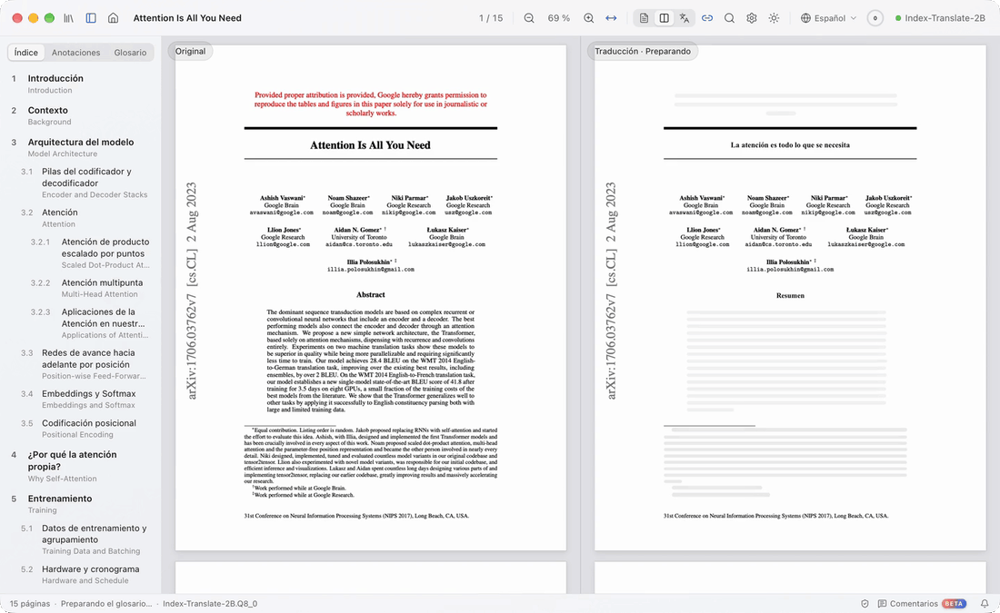
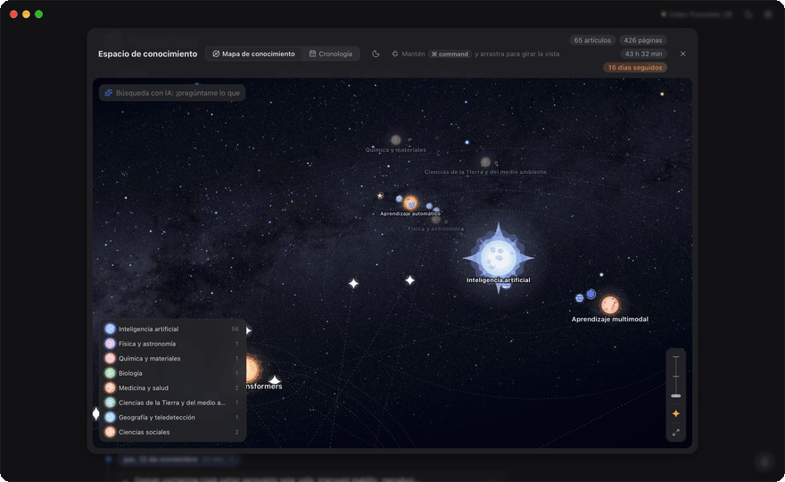
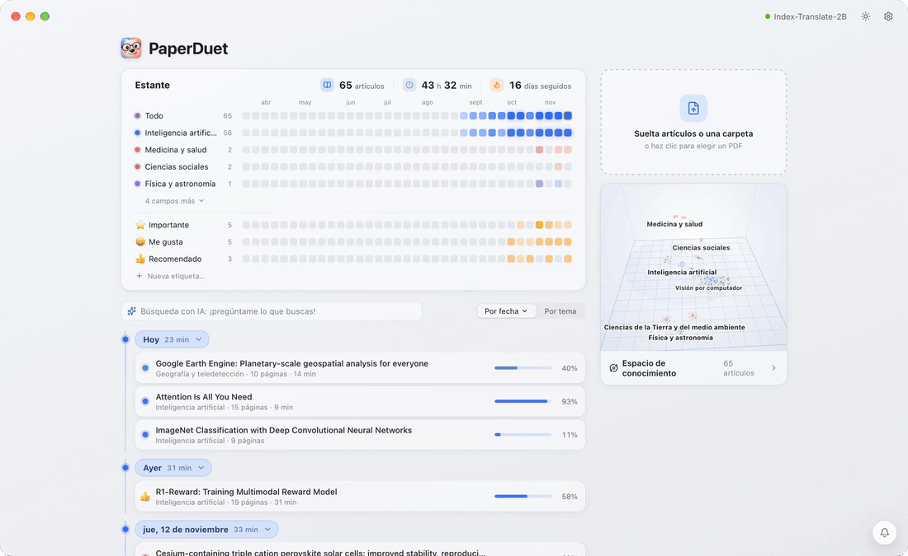
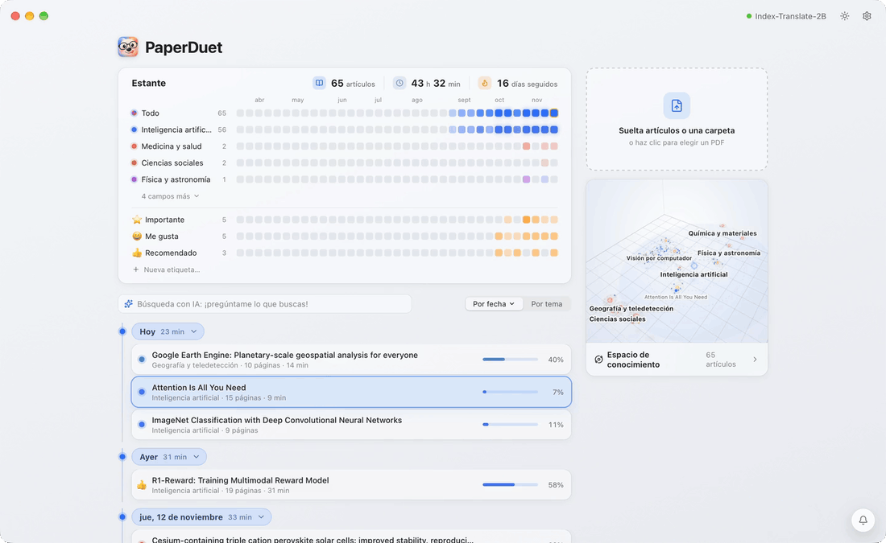
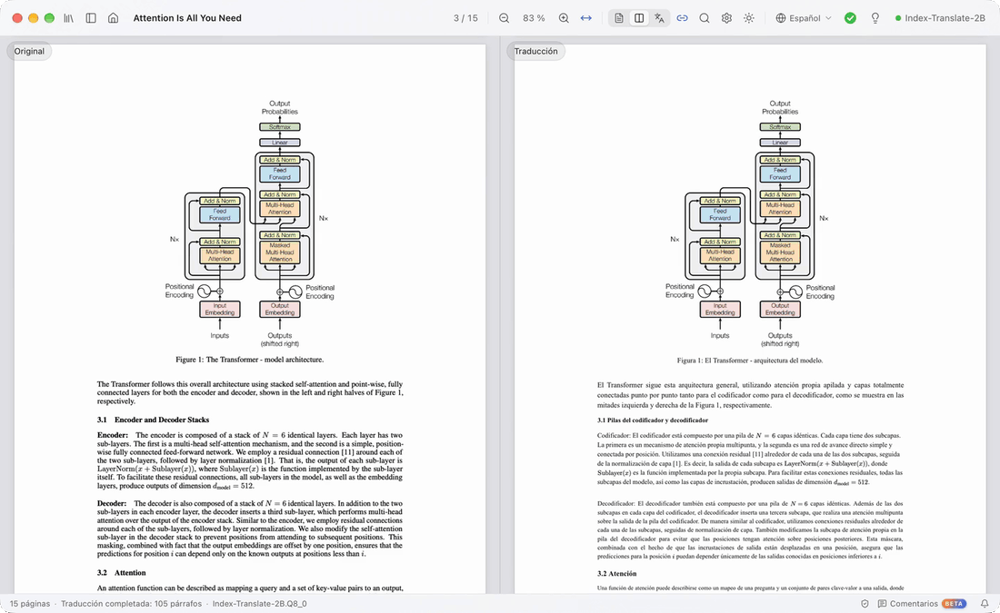
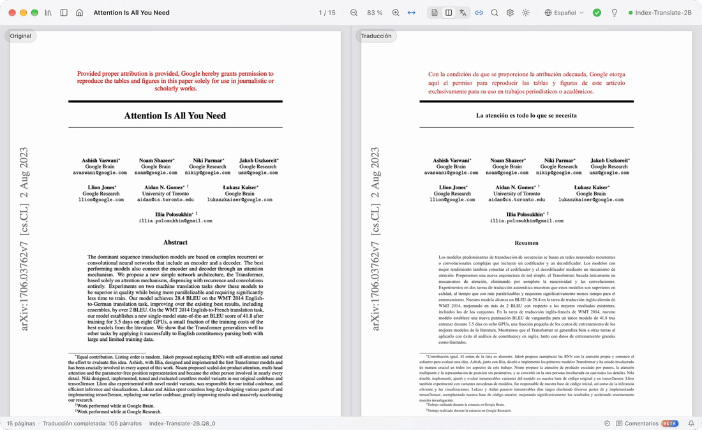
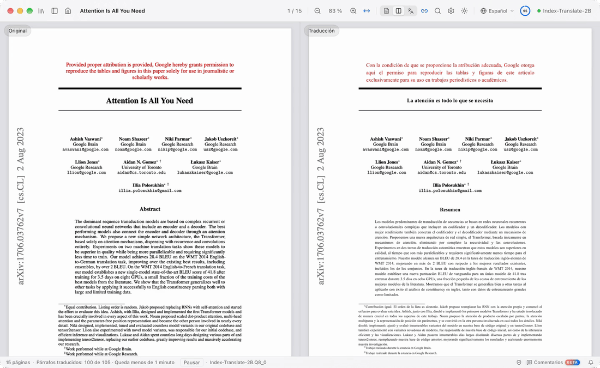
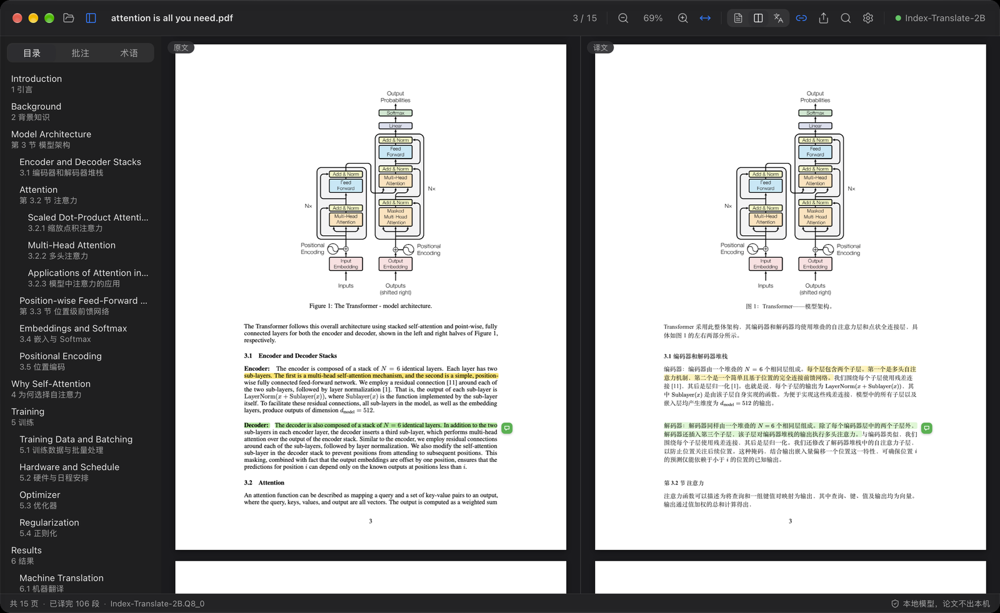

  

<h1 align="center">PaperDuet</h1>

  <em>¡La herramienta de los investigadores para gestionar, estudiar y entender artículos!</em> 
  <a href="https://paperduet.com">paperduet.com</a>

  <a href="README.md">English</a> &middot; <a href="README.zh-CN.md">简体中文</a> &middot; <a href="README.zh-TW.md">繁體中文</a> &middot; <a href="README.ja.md">日本語</a> &middot; <a href="README.ko.md">한국어</a> &middot; <a href="README.fr.md">Français</a> &middot; <a href="README.de.md">Deutsch</a> &middot; <b>Español</b> &middot; <a href="README.it.md">Italiano</a> &middot; <a href="README.pl.md">Polski</a> &middot; <a href="README.ru.md">Русский</a>

  
  
  

  
  
  
  
  
  

  <strong>PaperDuet te ayuda a gestionar, estudiar y entender cada artículo.</strong> 
  Seis modelos de traducción con IA de código abierto funcionan en tu ordenador, o conecta una API en línea. 
  ¡Gratis y sin registrarte!

PaperDuet es una herramienta para gestionar, estudiar y entender artículos: el original y su traducción se disponen en espejo, con fórmulas, figuras y tablas alineadas página a página, y los artículos que has leído quedan en una estantería y en un espacio donde la IA los vuelve a encontrar. PaperDuet es gratis: con un modelo local todo se ejecuta en tu ordenador, y puedes conectar una API en línea cuando quieras.

## Ábrelo y ya está en español

  

Suelta un PDF y empieza la traducción. Primero van los títulos: el esquema de la barra lateral está en español al instante y ves cómo se organiza el artículo; después, el título, el resumen y la introducción. Seis modelos de traducción de código abierto se ejecutan en tu ordenador, o puedes conectar una API en línea.

## Tu biblioteca es tu cielo estrellado

  

Presentamos Space: ahora tus artículos se despliegan ante ti como un cielo estrellado. Puedes construir, de forma más intuitiva, una base de conocimiento visual que es solo tuya.

## Cada progreso, registrado

  

La estantería de la página de inicio lleva la cuenta de cuántos artículos has leído, durante cuánto tiempo en total y cuántos días seguidos. Cada casilla es una semana, más oscura cuanto más has leído; haz clic en un campo y los artículos y la cronología de abajo lo siguen. Con clic derecho pones tus propias etiquetas a un artículo.

## ¿No encuentras un artículo? ¡Pregúntale a la IA!

  

No hace falta recordar el título: di en una frase lo que buscas y la búsqueda con IA lo encuentra en títulos, originales, traducciones y resúmenes, y muestra el pasaje encontrado. Pregunta en español o en inglés.

## Cada página, tal cual

  

El original a la izquierda, la traducción a la derecha; los dos se desplazan y se amplían a la vez. Columnas, títulos, pies de figura, notas al pie y referencias se reconocen solos, y fórmulas, figuras y tablas se quedan en su sitio; señala un párrafo y el que le corresponde en el otro lado se ilumina. Cambia de idioma de traducción y la maquetación sigue igual.

## ¿Tomar notas? ¡Hecho!

  

Resalta, subraya y escribe notas directamente en la traducción; la frase correspondiente del original se marca sola. El original exportado con tus notas lleva anotaciones PDF estándar, así que Vista Previa, Zotero y otras apps las muestran tal cual.

## ¿Terminado? Llévatelo.

  

Cuando todo el artículo está traducido, el anillo de la barra de herramientas se convierte en una marca verde: un clic guarda juntos el PDF traducido, el Markdown y el original anotado en la carpeta del artículo. La bombilla de al lado es el resumen con IA, escrito por el modelo tras leer el artículo entero: la pregunta, el método y los resultados de un vistazo.

## Y hay más

- **Diez idiomas de traducción.** Cambia entre 简体中文, 繁體中文, 日本語, 한국어, Français, Deutsch, Español, Italiano, Polski y Русский con un clic desde la barra de herramientas.
- **Doble clic para adelantarlo.** ¿Quieres leer antes un párrafo de más adelante? Haz doble clic en él en el original y se traduce a continuación, sin esperar a que llegue el progreso.
- **Controles de calidad integrados.** Se revisan las fórmulas, los números y el orden de las frases en cada respuesta, con reintentos automáticos, y un glosario propio de cada artículo mantiene los términos coherentes.
- **Tú decides qué se traduce.** Haz clic derecho en cualquier bloque para traducirlo o dejar el original.
- **Lee como prefieras.** Busca en el original y la traducción a la vez, recorre un índice bilingüe, señala un párrafo para encontrar su gemelo y muestra el original, la traducción o ambos. PaperDuet recuerda dónde lo dejaste.
- **Tus propios términos.** Indica cómo quieres traducir un término y todo el artículo lo sigue.
- **También los escaneados.** Los PDF cuyo texto está dibujado como formas en lugar de guardado como texto se leen con el reconocimiento de texto del sistema, en Mac y en Windows, y luego se traducen.
- **Carpetas siempre al día.** Importa una carpeta una vez y los artículos que pongas después aparecen solos en la biblioteca.
- **Un clic para actualizar, otro para limpiar.** Una versión nueva se instala con un clic; la caché se vacía con un clic en Ajustes.
- **Cuidado hasta el último detalle.** Un diseño limpio de cristal esmerilado, con modos claro, oscuro y de lectura nocturna.

  

## Seis modelos, todos en tu ordenador

Elige un modelo la primera vez que abras PaperDuet y cámbialo cuando quieras en Ajustes › Modelo › Cambiar de modelo. Todos están hechos para traducir y funcionan totalmente sin conexión una vez descargados.

| Modelo | De | Tamaño | Ideal para |
| --- | --- | --- | --- |
| [Index-Translate-2B](https://huggingface.co/IndexTeam/Index-Translate-2B) **(recomendado)** | equipo Index de bilibili | 2.1 GB | El mejor en general, ajustado a las comprobaciones y el glosario de PaperDuet |
| [Hy-MT3-1.8B](https://huggingface.co/tencent/Hy-MT3-1.8B-GGUF) | Tencent Hunyuan | 1.3 GB | Rápido y ligero |
| [Hy-MT2-1.8B](https://huggingface.co/tencent/Hy-MT2-1.8B-GGUF) | Tencent Hunyuan | 1.9 GB | Rápido y ligero |
| [LMT-60-4B](https://huggingface.co/NiuTrans/LMT-60-4B) | NiuTrans | 4.7 GB | Traducciones fieles al texto original |
| [LMT-60-0.6B](https://huggingface.co/NiuTrans/LMT-60-0.6B) | NiuTrans | 0.8 GB | Ordenadores modestos: el más pequeño y rápido |
| [Hy-MT2-7B](https://huggingface.co/tencent/Hy-MT2-7B-GGUF) | Tencent Hunyuan | 8.0 GB | Las traducciones más fluidas, en ordenadores con 16 GB de memoria o más |
| [TranslateGemma-4B](https://huggingface.co/mradermacher/translategemma-4b-it-GGUF) (experimental) | Google | 4.1 GB | Probar el modelo de traducción de Google |

Con el modelo recomendado, un artículo de 15 páginas tarda unos 2 minutos en un M5 Pro, o alrededor de 1 minuto con «Párrafos simultáneos» en 2 o 3 en Ajustes › Modelo.

¿Ya tienes alguno de estos modelos por LM Studio, llama.cpp o Hugging Face? PaperDuet lo encuentra y lo usa donde está, sin volver a descargarlo.

¿Tu ordenador no puede con los modelos locales? Elige «Usar una API» en la selección de modelo e introduce tu propia clave de API para usar OpenAI, Claude, DeepSeek, Qwen, Kimi, GLM, Doubao o cualquier servicio compatible con OpenAI. Los modelos locales se pliegan, y la traducción, los resúmenes y la organización y búsqueda con IA pasan por ese servicio. Tu clave se queda en tu ordenador.

## Privacidad desde el diseño

- Tus artículos, traducciones y notas se quedan en tu ordenador. Con una API, el texto que se traduce se envía al servicio que elijas. Cuando un modelo en línea (tu API o PaperDuet Pro) organiza la biblioteca, también se le envía el texto de los artículos para resumirlos y clasificarlos; puedes desactivarlo en los ajustes.
- Solo si aceptas, PaperDuet envía datos anónimos de uso y diagnóstico (versión, sistema, idioma de la interfaz, modelo y tipos de errores), nunca el contenido de los artículos, y puedes desactivarlo cuando quieras en los ajustes.
- Cuando algo falla, PaperDuet envía un informe de error al desarrollador: qué falló, la versión y el sistema, sin rutas de archivos ni contenido de los artículos. Puedes desactivarlo en Ajustes › Datos. Incluye también los nombres de las últimas acciones y algunos datos como el rango de páginas del artículo.
- Cuando escribes comentarios en la app y pulsas Enviar, lo que escribiste (y tu correo, si lo das) se envía al desarrollador junto con la versión y el sistema.
- Con un modelo local, PaperDuet solo se conecta para descargar un modelo, buscar actualizaciones y enviar esos datos e informes y tus comentarios; puedes desactivar todo salvo la descarga del modelo.

## Primeros pasos

En Mac necesitas Apple silicon (M1 o posterior) y macOS 13.3 o posterior; en PC, Windows 10 u 11 de 64 bits; en Linux, Ubuntu 22.04 o posterior de 64 bits (u otra distribución igual de reciente).

**Mac**

1. Descarga el `.dmg` más reciente desde [Releases](https://github.com/KalenHwei/PaperDuet/releases/latest).
2. Arrastra PaperDuet a Aplicaciones y ábrelo desde ahí.
3. Solo la primera vez: PaperDuet todavía no está notarizado por Apple, así que macOS te pedirá confirmación. Abre Ajustes del Sistema › Privacidad y seguridad y haz clic en **Abrir igualmente**. (O ejecuta `xattr -dr com.apple.quarantine /Applications/PaperDuet.app` en Terminal.)
4. Elige un modelo. PaperDuet lo descarga, o encuentra la copia que ya tienes, y empieza a traducir enseguida.

**Windows**

1. Descarga el instalador de Windows más reciente (`_x64-setup.exe`) desde [Releases](https://github.com/KalenHwei/PaperDuet/releases/latest).
2. Ejecútalo. Solo la primera vez: si Windows muestra «Windows protegió su PC», haz clic en **Más información** y luego en **Ejecutar de todas formas**.
3. Elige un modelo. PaperDuet lo descarga, o encuentra la copia que ya tienes, y empieza a traducir enseguida.

**Linux**

1. Descarga el `.deb` (Ubuntu, Debian) o el `.AppImage` (otras distribuciones, o si no tienes permisos de administrador) más reciente desde [Releases](https://github.com/KalenHwei/PaperDuet/releases/latest).
2. `.deb`: ejecuta `sudo apt install ./PaperDuet_*_amd64.deb` en una terminal y abre PaperDuet desde el menú de aplicaciones. `.AppImage`: no hace falta instalarlo; ejecuta `chmod +x PaperDuet_*_amd64.AppImage` y ábrelo.
3. Elige un modelo. PaperDuet lo descarga, o encuentra la copia que ya tienes, y empieza a traducir enseguida.

Eso es todo. El motor de traducción viene integrado en la app y las actualizaciones se hacen con un clic.

<b>Atajos de teclado</b>

| Acción | Atajo |
| --- | --- |
| Abrir un PDF | ⌘O |
| Cerrar el artículo | ⌘W |
| Buscar en ambos lados | ⌘F |
| Resultado siguiente / anterior | ⌘G / ⇧⌘G |
| Acercar / alejar / ajustar al ancho | ⌘+ / ⌘− / ⌘0 |
| Zoom alrededor del puntero | ⌘ + desplazamiento, o pellizcar en el trackpad |
| Mover las páginas | ⌘ + arrastrar |
| Traducir esta parte a continuación | Doble clic en un texto aún sin traducir |
| Resaltar la selección | H |
| Añadir una nota a la selección | N |
| Color de resaltado | 1 a 5 |
| Deshacer / rehacer | ⌘Z / ⇧⌘Z |
| Mostrar u ocultar la barra lateral | ⌘\ |
| Activar o desactivar el desplazamiento sincronizado | ⌘L |
| Todos los atajos | ⌘/ |

H, N y 1 a 5 actúan sobre el texto seleccionado. En Windows y Linux, Ctrl sustituye a ⌘ y Mayús a ⇧.

## Preguntas frecuentes

### ¿Qué modelo elijo?

Empieza con Index-Translate-2B. Si quieres más velocidad, elige Hy-MT2-1.8B. Para las traducciones más fluidas en un ordenador con 16 GB de memoria o más, elige Hy-MT2-7B. Si tu ordenador no puede, elige «Usar una API».

### ¿Es gratis?

Sí, para el estudio y la investigación personales, y para universidades, escuelas, centros de investigación y otras organizaciones sin ánimo de lucro. Usar PaperDuet en una empresa o para ella requiere una licencia comercial: escribe a [support@paperduet.com](mailto:support@paperduet.com).

## Hoja de ruta

- **Traducciones maquetadas desde arXiv.** Traducir el código LaTeX de un artículo y compilarlo con fuentes del idioma de destino, para obtener una edición traducida totalmente maquetada.

## Registro de cambios

- **0.8.16** (2026-11-27): ¡PaperDuet 0.8.16 ya está aquí🎉! Novedad: guardar tras traducir; actívalo en Ajustes › Traducción. Se pueden pegar varios enlaces de arXiv a la vez y se descargan en cola; la marca amarilla del Estante muestra la cola y permite pausar o cancelar. Nuevo modelo de traducción local: Tencent Hunyuan Hy-MT3-1.8B. Nuevo en el menú contextual de un artículo: Marcar como leído. Botón de IA del campo de búsqueda mejorado: se muestra con un modelo en línea (tu API o PaperDuet Pro). Indicador de progreso de la traducción mejorado. Mejor reconocimiento de los artículos a dos columnas. Corregido: las imágenes de fórmulas quedaban descolocadas tras «Volver a traducir». Corregido: el texto se superponía en Ajustes en algunos idiomas.
- **0.8.15** (2026-11-24): ¡PaperDuet 0.8.15 ya está aquí🎉! Campo de búsqueda mejorado: activa el botón de IA a la derecha, describe con una frase el artículo que buscas y pulsa Intro. Con un modelo en línea (tu API o PaperDuet Pro), cada artículo se lee entero al entrar en la biblioteca: resumen y puntos clave, clasificación y agrupación automáticas, y los artículos parecidos se unen en el Espacio. Se puede desactivar en los ajustes. Progreso de lectura mejorado: ahora sigue el tiempo real de lectura, y un artículo leído se convierte en una pequeña chispa. PaperDuet Pro mejorado: una página de cuenta con el uso del mes y el cambio de contraseña. Modelos locales mejorados: la memoria se libera al terminar la traducción. Mejor reconocimiento de los subtítulos de sección. Corregido: en algunos artículos de IEEE quedaba texto original dentro de la traducción y las palabras se superponían. Corregido: un artículo ya traducido, al abrirlo de nuevo, mostraba siempre «Preparando la traducción». Corregido: en Windows, una actualización podía detenerse con «no se puede escribir ggml-base.dll». Corregido: en Windows, un archivo exportado no se podía mostrar en el Explorador de archivos.
- **0.8.14** (2026-11-23): ¡PaperDuet 0.8.14 ya está aquí🎉! Página de elección del modelo mejorada: el rendimiento de cada modelo y la carga para tu ordenador se ven de un vistazo. Novedad: «Probar PaperDuet Pro (versión en desarrollo)», nuestro propio servicio de IA en la nube, abierto por ahora solo a quienes participan en la beta. Si te interesa, apúntate desde Comentarios~ Notas de resaltado mejoradas: deja el puntero sobre un resaltado, o haz clic en él, para leer su nota, y edítala en el mismo globo. Las páginas de índice se traducen mejor. Biblioteca mejorada. Corregido: problemas de formato en los índices. Corregido: no se podía guardar la traducción de algunos PDF protegidos.
- **0.8.13** (2026-11-23): ¡PaperDuet 0.8.13 ya está aquí🎉! Por fin se pueden traducir las tablas. En algunas versiones anteriores, las limitaciones del compilador dejaban siempre en su traducción errores de formato imposibles de controlar. El nuevo compilador se ha comportado bien en pruebas con las tablas de cerca de 200 artículos, así que la traducción de tablas vuelve a estar disponible. Si aún ves errores, puedes desactivarla en Ajustes → Qué se traduce. Las páginas de índice se traducen mejor. La letra de la traducción se lee mejor en el modo nocturno. Al hacer clic en el marcador de una figura o tabla en el esquema, se va a su lugar en la página. «Traducir de nuevo», en el menú de un artículo, ahora vuelve a analizar su maquetación. Corregido: las referencias de algunos artículos de revistas de ACS se traducían como texto corrido. Corregido: en algunos artículos a dos columnas, las traducciones de ambas columnas se solapaban. Corregido: las traducciones llegaban vacías con qwen-mt-plus de Tongyi Qianwen. Corregido: en Windows, la actualización podía fallar con «no se puede escribir ggml-base.dll».
- **0.8.12** (2026-11-21): ¡PaperDuet 0.8.12 ya está aquí🎉! Novedad: gestión de etiquetas: cambia su nombre o su emoji, o elimínalas. Compatibilidad con los modelos de traducción de Qwen, qwen-mt (qwen-mt-plus, qwen-mt-flash y otros). Mejor reconocimiento de los títulos: títulos numerados, títulos en forma de pregunta, numeración de los apéndices, subtítulos de las revistas y más. Las líneas Keywords y clasificación JEL bajo el resumen se traducen por separado en lugar de juntarse en un solo párrafo. Corregido: los apéndices de algunos artículos se tomaban por la bibliografía y no se traducían. Corregido: con el chino simplificado elegido, algunos artículos salían en chino tradicional.
- **0.8.11** (2026-11-20): ¡PaperDuet 0.8.11 ya está aquí🎉! Nuevo: notas sobre un artículo. Lleva el puntero sobre una página y haz clic en el botón de notas junto al resaltador para abrir la ventana de notas. Las notas se guardan automáticamente y se pueden exportar a Markdown. Desde «Sugerencias», a la izquierda de la ventana, tus resaltados y anotaciones pasan a la nota con un clic. El Estante y la Galaxia tienen una nueva agrupación, «Emoji»: mira tus artículos según las etiquetas emoji que les has puesto. El estante de la barra lateral de la biblioteca también puede cambiar de agrupación. Glosario: los términos se pueden eliminar; un cambio o una eliminación se deshace con ⌘Z / Ctrl+Z, y los párrafos afectados se vuelven a traducir con un clic. Al pasar el ratón, la frase correspondiente ahora se marca con un contorno en lugar de un relleno: ya no se confunde con el resaltador, y el contorno sigue mejor al puntero. Las barras de desplazamiento son más finas y no ocupan espacio; el desplazamiento con la rueda del ratón en Mac es más suave. Las capturas de pantalla se pueden pegar directamente en el texto de tus comentarios. Corregido: con un proxy o una VPN activos, el modelo se quedaba en «Iniciando» y no se traducía nada. Corregido: en Windows, la actualización podía fallar con «no se puede escribir ggml.dll». Corregido: tras una actualización, se volvía a analizar la maquetación de los artículos ya traducidos.
- **0.8.10** (2026-11-19): ¡PaperDuet 0.8.10 ya está aquí🎉! El Estante y la Galaxia ahora pueden agrupar los artículos por «Autor» o por «Revista», además de por «Campos (IA)»; se cambia con un clic. Bajo el título de cada artículo se muestran los autores, la revista y el año, y la búsqueda con IA también encuentra por autor y revista. Estos datos se consultan en línea; puedes desactivarlo en Ajustes → Datos. El glosario cambia un poco: haz doble clic en un término en inglés para localizarlo en el original; haz doble clic en su traducción para modificarla. Al pasar el ratón se resalta la frase correspondiente en ambos lados, y su párrafo se marca con un recuadro tenue. Un artículo ya traducido muestra la traducción al instante al volver a abrirlo, sin analizar de nuevo su maquetación. También se ha mejorado la maquetación de algunos artículos.
- **0.8.9** (2026-11-18): ¡PaperDuet 0.8.9 ya está aquí🎉! El «Espacio de conocimiento» ahora se llama «Espacio», y el «Mapa de conocimiento» que contiene, «Galaxia»🌌. Haz doble clic en una categoría de la Galaxia y se abrirá un cajón bajo el campo de búsqueda con IA con sus artículos y subcategorías. La cámara de la Galaxia se mueve con más naturalidad.
- **0.8.8** (2026-11-18): ¡PaperDuet 0.8.8 ya está aquí🎉! Novedad: descarga por enlace de arXiv. Pega un enlace de arXiv en el recuadro «Suelta artículos o una carpeta» de la página de inicio y PaperDuet guardará el artículo en la carpeta que elijas y lo abrirá; se pueden pegar varios enlaces a la vez. Un artículo ya escrito en el idioma de traducción deja de traducirse automáticamente: ambos lados lo muestran tal cual, y «Traducir de todos modos» sigue disponible. Una API personalizada tiene la opción «Desactivar el razonamiento» (activada por omisión), que ahorra tokens y tiempo con los modelos con razonamiento. Un índice más preciso: las palabras clave, los nombres de revistas y similares ya no se toman por títulos de sección. Corregido: en Windows, la ventana quedaba en blanco tras editar un término y hacer clic en otro lugar. Corregido: el cuerpo de los artículos de algunas revistas no se podía traducir.
- **0.8.7** (2026-11-17): ¡PaperDuet 0.8.7 ya está aquí🎉! Novedad: traducción en segundo plano. Activa «Permitir que la IA traduzca en segundo plano todos los artículos de la estantería» en Ajustes › Traducción y PaperDuet traducirá discretamente tus demás artículos uno a uno mientras lees, guardando los archivos que elijas; al abrir uno más tarde, su traducción ya está ahí. Organización de la biblioteca con IA, actualizada✨: los artículos nuevos se archivan en la categoría adecuada, y cinco artículos parecidos forman por sí solos una nueva subcategoría. Tus propias categorías y los artículos que archivaste a mano nunca se modifican; cuando hay dudas, un pequeño signo de exclamación a la derecha del campo de búsqueda con IA te deja decidir. Funciona sin tarjeta gráfica dedicada: se usa automáticamente la integrada, o elige «Calcular en la CPU» en los ajustes. El resaltador ahora subraya✏️; el menú de guardado de una traducción terminada añade «PDF original» y «PDF bilingüe en paralelo». La estantería tiene un grupo «Sin leer»; el idioma de traducción pasa a Ajustes › Traducción; los artículos de Ajustes › Datos se pueden buscar. Corregido: artículos con marca de agua que no se podían traducir, y diseños en los que quedaban pasajes sin traducir o ilegibles.
- **0.8.6** (2026-11-13): Se corrigieron errores conocidos.
- **0.8.5** (2026-11-13): ¡PaperDuet 0.8.5 ya está aquí🎉! El espacio de conocimiento ahora se muestra como galaxias🌌. Cuantos más artículos, más grande y brillante es la estrella, y cuando hayas leído suficientes ¡se convierte en un agujero negro! También puedes arrastrar las estrellas: pruébalo y mira cómo se mueven. Ya puedes crear tus propias categorías: clic derecho en una categoría del espacio de conocimiento o de la estantería para añadir una nueva. Arrastra artículos a una categoría, o elígela en «Mover a» en el menú contextual, y quedan archivados📂. Subdivisión automática con IA✨: clic derecho en una categoría y pulsa «Subdividir automáticamente»; la IA integrada de PaperDuet agrupa sus artículos por contenido en unas cuantas subcategorías y les pone nombre. Por supuesto, ¡puedes cambiarlos por los que más te gusten! Además, se han corregido las traducciones ilegibles o ausentes en algunos PDF, y el espacio de conocimiento se ve más limpio. ¡Ven a probarlo🚀!
- **0.8.4** (2026-11-12): ¡Llegó PaperDuet 0.8.4 🎉! Pestañas: abre varios artículos a la vez. Pasa el puntero por una pestaña para verla en vista previa, arrástrala para cambiar el orden y haz clic derecho para el menú completo. Las pestañas que superan el número elegido se duermen para ahorrar memoria y despiertan con un clic ⚡️. El Mapa de conocimiento es más cómodo: búsqueda con IA directamente arriba a la izquierda, y se pueden mostrar las estrellas de los temas. Con clic derecho en un campo, un subcampo o una estrella se exportan todas sus citas de una vez, o se guardan en un archivo 📚. Seleccionar artículos: clic para seleccionar, ⌘ o Ctrl para varios, doble clic para abrir. Con clic derecho se etiquetan, se mueven o se exportan sus citas (BibTeX / EndNote / RefMan / RefWorks) juntos. Los PDF cuyo texto está dibujado como formas (como algunos artículos de CVPR) ya se pueden traducir: en Mac y Windows, el reconocimiento de texto del sistema lee el texto 🔍. Nuevo «Volver a traducir» en el menú contextual de un artículo: vuelve a traducir todo el artículo desde el principio con el modelo seleccionado. Además, se corrigieron, entre otros, la traducción que no aparecía tras ampliar con el desplazamiento sincronizado en macOS antiguos y el prompt de TranslateGemma que aparecía en la traducción, y se usa menos memoria. ¡Pruébalo ya 🚀!
- **0.8.2** (2026-11-11): Se añadió una barra en el Mapa de conocimiento para ajustar los niveles visibles.
- **0.8.1** (2026-11-11): Se corrigieron errores conocidos.
- **0.8.0** (2026-11-11): ¡Llega PaperDuet 0.8 🎉! Nuevo componente de IA: tu biblioteca se ordena sola según el contenido, la Búsqueda con IA encuentra artículos por su significado y te lleva directo al pasaje más relevante, y los artículos parecidos quedan enlazados en el Espacio de conocimiento 🧠. Importar es mucho más rápido: suelta artículos o una carpeta y el Estante y el Espacio de conocimiento los clasifican al momento; la clasificación fina termina en silencio en segundo plano y se pausa mientras traduces ⚡️. El Espacio de conocimiento muestra solo los nombres de los campos y el título de un artículo aparece al señalarlo, así que ya no se amontona. Abajo a la derecha hay una campanita 🔔 con los anuncios, las encuestas y las novedades de cada actualización. Además, corregimos algunos parpadeos y cierres inesperados. ¡Pruébalo ya 🚀!
- **0.7.9** (2026-11-10): Glosario personalizable: añade, cambia o elimina términos en el Glosario, y los marcados como «Usar en todos los artículos» se usan en cada artículo; el panel de la biblioteca muestra el Estante directamente y la primera etiqueta de un artículo aparece delante de él; en Ajustes se puede vaciar la caché con un clic y ver todos los atajos; se corrigió el zoom con Control en Mac.
- **0.7.8** (2026-11-10): Los artículos escaneados se traducen correctamente; una carpeta añadida puede mantenerse al día y sus PDF nuevos se importan con una etiqueta propia en el Estante; en Ajustes se puede conservar el nombre de los PDF como nombre del artículo; las API personalizadas funcionan con servicios locales como Ollama; se corrigió texto sin traducir en formularios y al cambiar el tamaño de la ventana.
- **0.7.7** (2026-11-09): Se corrigieron problemas conocidos en la lógica de interacción.
- **0.7.6** (2026-11-09): Nuevo recorrido por la página de inicio: el Estante, la búsqueda con IA, Por fecha / Por tema, el clic derecho en un artículo y el Espacio de conocimiento.
- **0.7.5** (2026-11-09): ¡Hemos rehecho por completo la página de inicio 🎉! El nuevo Estante reúne tu historial de lectura, tus campos y tus etiquetas, para que veas de un vistazo qué leíste cada semana. El Espacio de conocimiento se convierte en un pequeño universo: los campos son soles, los artículos son planetas y, en modo oscuro, detrás brilla la auténtica Vía Láctea 🌌. Con un clic derecho en un artículo puedes cambiar su categoría, ponerle etiquetas, renombrarlo o escribir una nota. La búsqueda con IA entiende preguntas normales como «una vez leí un artículo sobre Transformers» y lo encuentra al instante 🔍. Al terminar una traducción, el PDF traducido, el Markdown traducido y tus notas se guardan juntos en la carpeta del artículo. ¡Pruébalo ya 🚀!
- **0.7.4** (2026-11-08): Corregido el problema de resaltado informado en GitHub.
- **0.7.3** (2026-11-08): Resaltador (Mayús para cambiar el color) y cambio claro/oscuro; la traducción reintenta sola en vez de detenerse; capturas de pantalla en los comentarios.
- **0.7.2** (2026-11-05): Animaciones mejoradas.
- **0.7.1** (2026-11-05): Hemos mejorado la experiencia de uso de la biblioteca.
- **0.7.0** (2026-11-05): ¡Hemos rehecho la AI Library 🎉! Incorpora el Espacio de conocimiento y es mucho más cómoda de usar. Además, los botones de la barra superior son más sencillos y prácticos.
- **0.6.12** (2026-11-05): Para resolver los problemas de maquetación, un modelo visual de maquetación revisa ahora cada página: tablas, fórmulas, figuras, encabezados y pies de página ya no se traducen por error, y el texto confundido con una tabla se traduce, lo que hace la traducción mucho más precisa y robusta. El modelo se descarga en segundo plano junto con el modelo de traducción.
- **0.6.11** (2026-11-04): Gracias a los muchos usuarios que nos han enviado informes de errores muy valiosos; por motivos de privacidad no podemos agradecérselo públicamente. Esta actualización corrige sobre todo los artículos completos que no se traducían por un error de recursión, los párrafos que quedaban en parte sin traducir porque una regla de comprobación los juzgaba mal y la imprecisión en el reconocimiento del diseño de página. Esperamos que les ofrezca a todos una mejor experiencia.
- **0.6.10** (2026-11-04): Corregidos los problemas de conexión con la API.
- **0.6.9** (2026-11-03): Corregido el desplazamiento entrecortado en la versión para Linux.
- **0.6.8** (2026-11-03): Nuevo modelo LMT-60-0.6B: el más pequeño (805 MB) y el más rápido, para ordenadores modestos.
- **0.6.7** (2026-11-03): ¡Nos alegra publicar la versión para Linux!
- **0.6.6** (2026-11-03): Mejor reconocimiento del diseño de algunos artículos de revista: las dos columnas ya no se mezclan, el resumen sobre un fondo de color se traduce y el índice muestra solo los títulos de sección.
- **0.6.5** (2026-10-31): En artículos con números de línea (manuscritos enviados, por ejemplo), los números ya no se mezclan con la traducción ni parten los párrafos.
- **0.6.4** (2026-10-30): Se corrigieron algunos problemas de formato conocidos.
- **0.6.3** (2026-10-29): Se resolvieron problemas conocidos de lógica de la interfaz.
- **0.6.2** (2026-10-28): En Windows puedes elegir dónde se guardan los modelos; los ya descargados se mueven allí.
- **0.6.1** (2026-10-28): Se corrigieron algunos problemas de formato conocidos.
- **0.6.0** (2026-10-28): Un recorrido breve por las funciones principales la primera vez que abres un artículo, y comentarios beta: envíanos tu opinión directamente desde la barra de estado.
- **0.5.17** (2026-10-28): Se corrigieron algunos problemas de formato conocidos.
- **0.5.16** (2026-10-28): Los párrafos de manuscritos (exportados de Word, a doble espacio) ya no se quedan en inglés: las líneas resaltadas se traducen, los párrafos a doble espacio se traducen enteros y no línea por línea, y las leyendas de las figuras situadas después de las referencias se traducen.
- **0.5.15** (2026-10-28): Los símbolos de las fórmulas en revistas de Elsevier ya no salen desordenados: las letras griegas, ≤, ∀, ≠ y las letras con circunflejo (Ŝ, q̂) ya no aparecen como letras normales, y un superíndice colocado muy alto ya no pasa a la línea de arriba.
- **0.5.14** (2026-10-28): Se corrigieron algunos errores de formato conocidos.
- **0.5.13** (2026-10-28): Las fórmulas ya no salen desordenadas: las ecuaciones en línea aparte con fracciones y sumatorios se conservan enteras en lugar de traducirse a trozos encima de sí mismas, y los sumatorios dentro del texto, las raíces y las líneas de fórmulas muy espaciadas ya no parten la frase.
- **0.5.12** (2026-10-27): Los artículos de revistas salen con más precisión: las líneas de estadísticas, los subtítulos numerados, las frases que siguen en la columna siguiente, letras griegas como χ², los nombres con tilde y los signos menos de las tablas ya no se estropean; el PDF traducido exportado tiene un espaciado entre letras uniforme. Gracias a momo en RedNote por sus sugerencias.
- **0.5.11** (2026-10-27): El pseudocódigo se traduce línea a línea y conserva la numeración, la sangría y las palabras clave; las tablas se detectan mejor, su contenido queda en el original y solo se traducen títulos y notas, así que ya no se desordenan; los sumatorios dentro del texto ya no desaparecen de la traducción.
- **0.5.10** (2026-10-27): Traducción mediante una API en línea: si tu ordenador no puede con los modelos locales, elige «Usar una API» en la selección de modelo para usar OpenAI, Claude, DeepSeek, Qwen, Kimi, GLM, Doubao o cualquier servicio compatible con OpenAI; la lista de modelos locales se pliega al hacerlo.
- **0.5.9** (2026-10-26): Corrección de problemas existentes.
- **0.5.8** (2026-10-26): Polaco como idioma de traducción y de la interfaz; correcciones: en macOS 26 y anteriores no se podían leer ni traducir los artículos; en macOS 27 no se podía guardar el PDF traducido de algunos artículos.
- **0.5.7** (2026-10-26): Lectura más precisa de artículos de revistas, probada con artículos de 20 revistas de referencia: columnas, títulos, referencias, tablas, pies de figura y símbolos propios de cada editorial; los artículos de Science ya no quedan en gran parte sin traducir, y los apéndices tras las referencias se traducen.
- **0.5.6** (2026-10-25): Italiano como idioma de traducción y de la interfaz; cuando algo falla, se envía un informe de error al desarrollador para corregirlo (activado por defecto, se puede desactivar en Ajustes › Datos).
- **0.5.5** (2026-10-25): Las líneas muy espaciadas de los artículos de revista ya no se parten en palabras sueltas, que faltaban o quedaban fuera de sitio en la traducción; el resumen se traduce justo después del título; menos «Error en el análisis del diseño»; los guiones de los artículos de Elsevier ya no aparecen como «e».
- **0.5.4** (2026-10-24): Interfaz más limpia: se quitan los textos de explicación innecesarios; el campo de búsqueda con IA muestra «Buscar con IA».
- **0.5.3** (2026-10-24): PaperDuet pregunta una vez si quieres compartir datos anónimos de uso y diagnóstico para mejorarlo; nunca el contenido de los artículos, y se puede desactivar en Ajustes › Datos.
- **0.5.2** (2026-10-24): «Búsqueda con IA» 🔍 en la biblioteca: encuentra artículos leídos por título, texto original, traducción, resumen o etiquetas, en español o en inglés; la búsqueda y «Organizar con IA» suben los artículos encontrados y ponen en gris los demás.
- **0.5.1** (2026-10-24): una biblioteca en lugar del panel de archivos, con todos los artículos leídos o importados, que se renombran ahí mismo y tienen su resumen; importación de varios PDF o de una carpeta entera; «Organizar con IA» ✨ filtra los artículos por campo y tema; correcciones de tablas ilegibles y de párrafos sin traducir en algunos artículos.
- **0.5.0** (2026-10-24): resumen del artículo 💡 tras la bombilla cuando todo está traducido; el panel de archivos abre su carpeta con un clic; versión para Windows.
- **0.4.1** (2026-10-23): descripciones más claras en la lista de modelos y en los ajustes.
- **0.4.0** (2026-10-23): la interfaz está en 9 idiomas. Por defecto sigue el idioma del sistema, y se cambia en Ajustes › Aspecto › Idioma de la interfaz.
- **0.3.2** (2026-10-23): más correcciones de alineación al traducir a otros idiomas.
- **0.3.1** (2026-10-23): mejoras en el anillo de progreso y en la barra de herramientas.
- **0.3.0** (2026-10-23): ocho idiomas de traducción 🎉, que se cambian con un clic en la barra de herramientas; mejoras en el anillo de progreso y en la interacción.
- **0.2.1** (2026-10-23): cinco modelos de traducción para elegir; nueva pantalla de inicio.
- **0.2.0** (2026-10-23): búsqueda de actualizaciones y actualización en un clic dentro de la app.
- **0.1.0** (2026-10-22): primera versión.

Historial completo: [CHANGELOG.md](CHANGELOG.md).

## Licencia

PaperDuet es gratis para uso no comercial bajo la [PolyForm Noncommercial License 1.0.0](LICENSE). Úsalo y compártelo con fines personales, de estudio, de investigación o sin ánimo de lucro; si lo compartes, incluye la licencia y la línea `Required Notice: Copyright (c) 2026 Kalen Yongda Wei`. Para uso comercial, escribe a [support@paperduet.com](mailto:support@paperduet.com).

Copyright © 2026 Kalen Yongda Wei.

## Agradecimientos

PaperDuet está hecho con [Tauri](https://tauri.app), [pdf.js](https://mozilla.github.io/pdf.js/), [pdf-lib](https://pdf-lib.js.org), [llama.cpp](https://github.com/ggml-org/llama.cpp), [React](https://react.dev), [Zustand](https://github.com/pmndrs/zustand) y [Lucide](https://lucide.dev). Los modelos de traducción son del equipo Index de bilibili (Index-Translate-2B), Tencent Hunyuan (Hy-MT2), NiuTrans (LMT) y Google (TranslateGemma). Se publican bajo Apache-2.0, salvo TranslateGemma, que se rige por los [términos de uso de Gemma](https://ai.google.dev/gemma/terms). Los textos completos de las licencias están en la app (Ajustes › Acerca de › Licencias de terceros).

El artículo de las animaciones es [_Attention Is All You Need_](https://arxiv.org/abs/1706.03762), de Vaswani et al.
