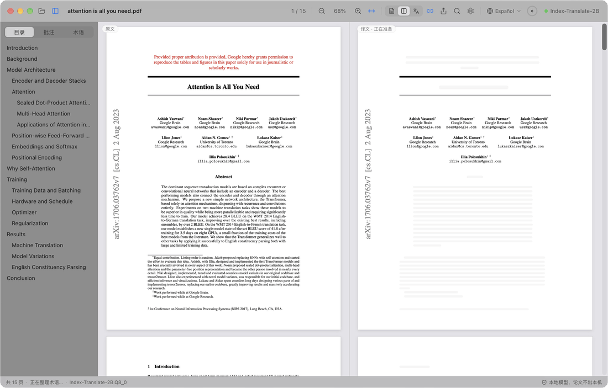
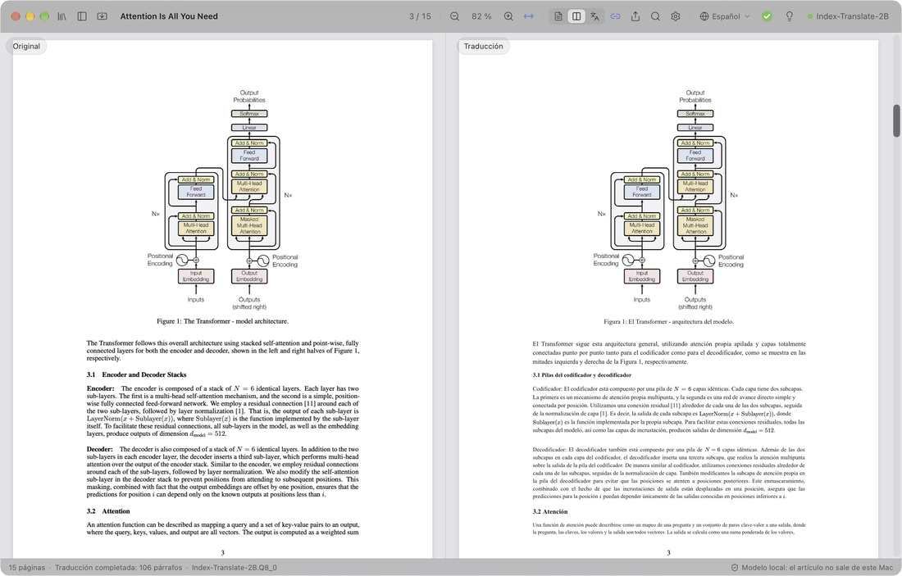
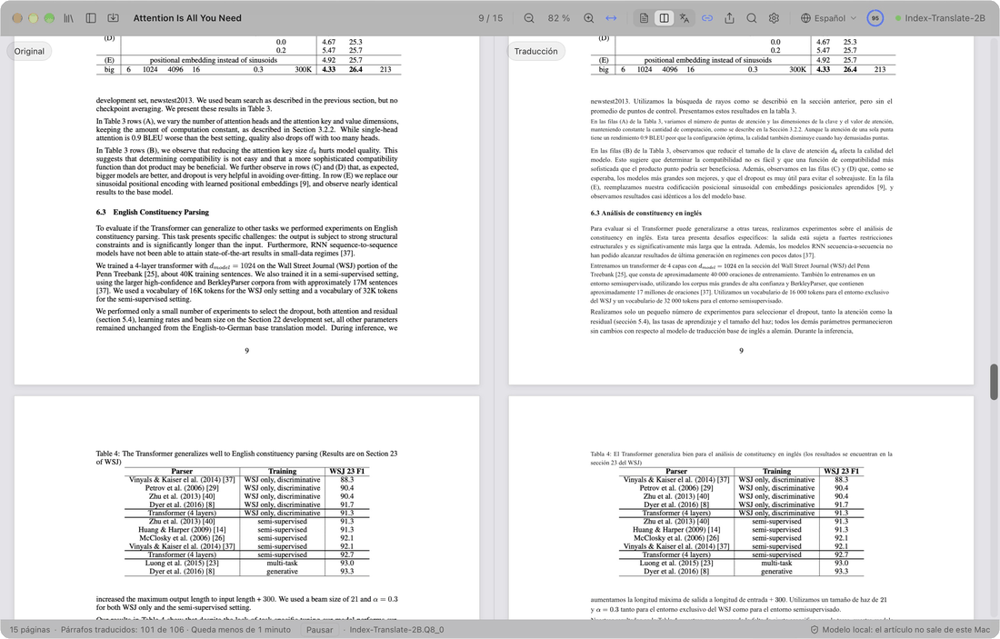
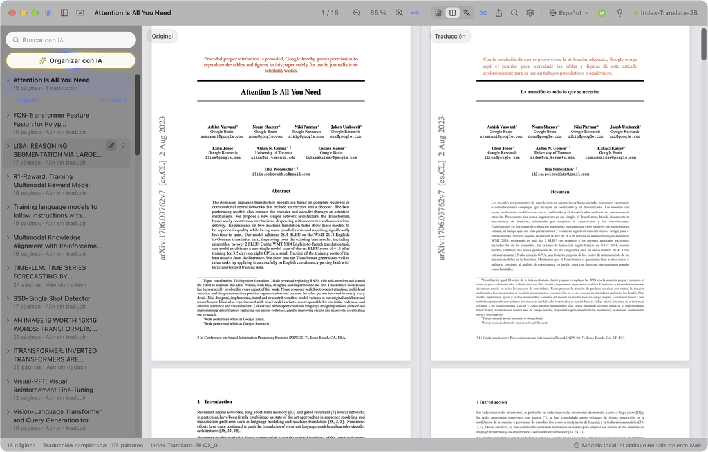
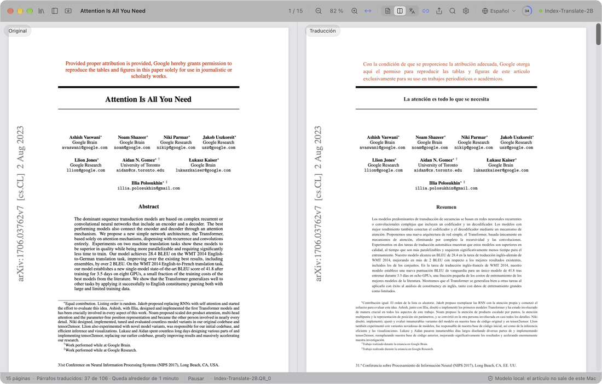
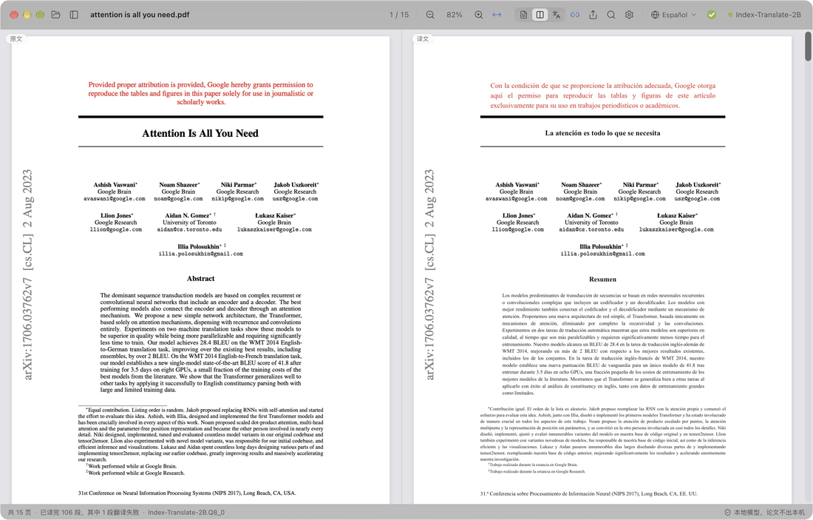

  

<h1 align="center">PaperDuet</h1>

  <em>¡Un traductor ligero de artículos con IA, hecho para investigadores!</em> 
  <a href="https://paperduet.com">paperduet.com</a>

  <a href="README.md">English</a> &middot; <a href="README.zh-CN.md">简体中文</a> &middot; <a href="README.zh-TW.md">繁體中文</a> &middot; <a href="README.ja.md">日本語</a> &middot; <a href="README.ko.md">한국어</a> &middot; <a href="README.fr.md">Français</a> &middot; <a href="README.de.md">Deutsch</a> &middot; <b>Español</b> &middot; <a href="README.it.md">Italiano</a> &middot; <a href="README.pl.md">Polski</a> &middot; <a href="README.ru.md">Русский</a>

  
  

  
  
  
  
  
  

  <strong>PaperDuet es un traductor espejo ligero con IA para artículos que conserva el formato original.</strong> 
  Cinco modelos de traducción con IA de código abierto para elegir. 
  Sin pagar, ¡todo en local!

   
  Grabación de la traducción completa de Attention Is All You Need (15 páginas)

PaperDuet es un traductor espejo ligero con IA para artículos científicos. Coloca el original y la traducción uno frente al otro, como en un espejo, y corrige y alinea fórmulas, figuras y tablas página a página. Sin clave de API, sin pagar nada, ¡y todo funciona en tu ordenador!

## Cada página, sin esfuerzo

  

A la izquierda está el artículo original y a la derecha su traducción; los dos lados se desplazan y hacen zoom a la vez. Columnas, títulos, pies de figura, notas al pie y referencias se reconocen automáticamente, y los párrafos que siguen en la columna o la página siguiente se vuelven a unir. Los dos lados quedan perfectamente alineados, así que compararlos es muy fácil.

## ¿Guardar? ¿Resumir? Hecho.

  

La barra de herramientas muestra cómo va la traducción. Cuando el artículo está traducido entero, el anillo se convierte en una marca verde y un clic guarda la traducción en PDF junto al original. La bombilla de al lado abre el resumen con IA: lo que el modelo saca tras leer todo el artículo, con la pregunta, el método y los resultados. Y eliges entre cinco modelos según tu ordenador y lo que necesites.

## Piénsalo. Encuéntralo.

  

Todos los artículos que has leído están en la biblioteca. «Organizar con IA» los etiqueta por campo y tema, y los que eliges suben arriba. La búsqueda con IA encuentra un artículo por su título, su texto, su traducción o su resumen, en español o en inglés.

## ¿No lo entiendes? Haz clic.

  

Primero se traducen los títulos de sección, para ver enseguida la estructura del artículo; luego el título, el resumen y la introducción. ¿Quieres leer ya un pasaje de más adelante? Haz doble clic en él y se adelanta, sin esperar a que llegue el progreso.

## ¿Apuntes? Claro que sí.

  

Resalta, subraya y anota directamente sobre la traducción; las frases correspondientes del original se marcan también. El PDF original con tus notas se exporta con anotaciones PDF estándar, visibles en Vista Previa, Zotero y otras apps.

## Y hay más

- **Diez idiomas de traducción.** Cambia entre 简体中文, 繁體中文, 日本語, 한국어, Français, Deutsch, Español, Italiano, Polski y Русский con un clic desde la barra de herramientas.
- **Un PDF traducido en un clic.** Cuando el artículo está traducido entero, un clic guarda la traducción a su lado con el formato original.
- **Controles de calidad integrados.** Se revisan las fórmulas, los números y el orden de las frases en cada respuesta, con reintentos automáticos, y un glosario propio de cada artículo mantiene los términos coherentes.
- **Tú decides qué se traduce.** Haz clic derecho en cualquier bloque para traducirlo o dejar el original.
- **Lee como prefieras.** Busca en el original y la traducción a la vez, recorre un índice bilingüe, señala un párrafo para encontrar su gemelo y muestra el original, la traducción o ambos. PaperDuet recuerda dónde lo dejaste.
- **Tu biblioteca, con búsqueda con IA.** Todos los artículos que lees o importas están en la biblioteca. La búsqueda con IA encuentra un artículo por su título, texto, traducción o resumen, en español o en inglés, y «Organizar con IA» los ordena por campo y tema.
- **Un resumen de cada artículo.** Cuando un artículo está traducido, haz clic en la bombilla: el modelo de traducción escribe un resumen breve en el idioma de la interfaz y lo guarda con el artículo.
- **Exporta adonde quieras.** El PDF original con tus marcas, el PDF traducido y tus notas en Markdown, que también se abren en otras apps.
- **Actualizaciones en un clic.** Actualizar es fácil: un clic instala la versión nueva.
- **Cuidado hasta el último detalle.** Un diseño limpio de cristal esmerilado, con modos claro, oscuro y de lectura nocturna.

  

## Cinco modelos, todos en tu ordenador

Elige un modelo la primera vez que abras PaperDuet y cámbialo cuando quieras en Ajustes › Modelo › Cambiar de modelo. Todos están hechos para traducir y funcionan totalmente sin conexión una vez descargados.

| Modelo | De | Tamaño | Ideal para |
| --- | --- | --- | --- |
| [Index-Translate-2B](https://huggingface.co/IndexTeam/Index-Translate-2B) **(recomendado)** | equipo Index de bilibili | 2.1 GB | El mejor en general, ajustado a las comprobaciones y el glosario de PaperDuet |
| [Hy-MT2-1.8B](https://huggingface.co/tencent/Hy-MT2-1.8B-GGUF) | Tencent Hunyuan | 1.9 GB | La velocidad: el más rápido y ligero |
| [LMT-60-4B](https://huggingface.co/NiuTrans/LMT-60-4B) | NiuTrans | 4.7 GB | Traducciones fieles al texto original |
| [Hy-MT2-7B](https://huggingface.co/tencent/Hy-MT2-7B-GGUF) | Tencent Hunyuan | 8.0 GB | Las traducciones más fluidas, en ordenadores con 16 GB de memoria o más |
| [TranslateGemma-4B](https://huggingface.co/mradermacher/translategemma-4b-it-GGUF) (experimental) | Google | 4.1 GB | Probar el modelo de traducción de Google |

Con el modelo recomendado, un artículo de 15 páginas tarda unos 2 minutos en un M5 Pro, o alrededor de 1 minuto con «Párrafos simultáneos» en 2 o 3 en Ajustes › Modelo.

¿Ya tienes alguno de estos modelos por LM Studio, llama.cpp o Hugging Face? PaperDuet lo encuentra y lo usa donde está, sin volver a descargarlo.

¿Tu ordenador no puede con los modelos locales? Elige «Usar una API» en la selección de modelo e introduce tu propia clave de API para usar OpenAI, Claude, DeepSeek, Qwen, Kimi, GLM, Doubao o cualquier servicio compatible con OpenAI. Los modelos locales se pliegan, y la traducción, los resúmenes y la organización y búsqueda con IA pasan por ese servicio. Tu clave se queda en tu ordenador.

## Privacidad desde el diseño

- Tus artículos, traducciones y notas se quedan en tu ordenador. Con una API, el texto que se traduce se envía al servicio que elijas.
- Solo si aceptas, PaperDuet envía datos anónimos de uso y diagnóstico (versión, sistema, idioma de la interfaz, modelo y tipos de errores), nunca el contenido de los artículos, y puedes desactivarlo cuando quieras en los ajustes.
- Cuando algo falla, PaperDuet envía un informe de error al desarrollador: qué falló, la versión y el sistema, sin rutas de archivos ni contenido de los artículos. Puedes desactivarlo en Ajustes › Datos.
- Con un modelo local, PaperDuet solo se conecta para descargar un modelo, buscar actualizaciones y enviar esos datos e informes; puedes desactivar todo salvo la descarga del modelo.

## Primeros pasos

En Mac necesitas Apple silicon (M1 o posterior) y macOS 13.3 o posterior; en PC, Windows 10 u 11 de 64 bits.

**Mac**

1. Descarga el `.dmg` más reciente desde [Releases](https://github.com/KalenHwei/PaperDuet/releases/latest).
2. Arrastra PaperDuet a Aplicaciones y ábrelo desde ahí.
3. Solo la primera vez: PaperDuet todavía no está notarizado por Apple, así que macOS te pedirá confirmación. Abre Ajustes del Sistema › Privacidad y seguridad y haz clic en **Abrir igualmente**. (O ejecuta `xattr -dr com.apple.quarantine /Applications/PaperDuet.app` en Terminal.)
4. Elige un modelo. PaperDuet lo descarga, o encuentra la copia que ya tienes, y empieza a traducir enseguida.

**Windows**

1. Descarga el instalador de Windows más reciente (`_x64-setup.exe`) desde [Releases](https://github.com/KalenHwei/PaperDuet/releases/latest).
2. Ejecútalo. Solo la primera vez: si Windows muestra «Windows protegió su PC», haz clic en **Más información** y luego en **Ejecutar de todas formas**.
3. Elige un modelo. PaperDuet lo descarga, o encuentra la copia que ya tienes, y empieza a traducir enseguida.

Eso es todo. El motor de traducción viene integrado en la app y las actualizaciones se hacen con un clic.

<b>Atajos de teclado</b>

| Acción | Atajo |
| --- | --- |
| Abrir un PDF | ⌘O |
| Cerrar el artículo | ⌘W |
| Buscar en ambos lados | ⌘F |
| Resultado siguiente / anterior | ⌘G / ⇧⌘G |
| Acercar / alejar / ajustar al ancho | ⌘+ / ⌘− / ⌘0 |
| Zoom alrededor del puntero | ⌘ + desplazamiento, o pellizcar en el trackpad |
| Mover las páginas | ⌘ + arrastrar |
| Traducir esta parte a continuación | Doble clic en un texto aún sin traducir |
| Resaltar la selección | H |
| Añadir una nota a la selección | N |
| Color de resaltado | 1 a 5 |
| Deshacer / rehacer | ⌘Z / ⇧⌘Z |
| Mostrar u ocultar la barra lateral | ⌘\ |
| Activar o desactivar el desplazamiento sincronizado | ⌘L |
| Todos los atajos | ⌘/ |

H, N y 1 a 5 actúan sobre el texto seleccionado. En Windows, Ctrl sustituye a ⌘ y Mayús a ⇧.

## Preguntas frecuentes

### ¿Qué modelo elijo?

Empieza con Index-Translate-2B. Si quieres más velocidad, elige Hy-MT2-1.8B. Para las traducciones más fluidas en un ordenador con 16 GB de memoria o más, elige Hy-MT2-7B. Si tu ordenador no puede, elige «Usar una API».

### ¿Es gratis?

Sí, para el estudio y la investigación personales, y para universidades, escuelas, centros de investigación y otras organizaciones sin ánimo de lucro. Usar PaperDuet en una empresa o para ella requiere una licencia comercial: escribe a [junystugh@gmail.com](mailto:junystugh@gmail.com).

## Hoja de ruta

- **Traducciones maquetadas desde arXiv.** Traducir el código LaTeX de un artículo y compilarlo con fuentes del idioma de destino, para obtener una edición traducida totalmente maquetada.

## Registro de cambios

- **0.5.13** (2026-10-28): Las fórmulas ya no salen desordenadas: las ecuaciones en línea aparte con fracciones y sumatorios se conservan enteras en lugar de traducirse a trozos encima de sí mismas, y los sumatorios dentro del texto, las raíces y las líneas de fórmulas muy espaciadas ya no parten la frase.
- **0.5.12** (2026-10-27): Los artículos de revistas salen con más precisión: las líneas de estadísticas, los subtítulos numerados, las frases que siguen en la columna siguiente, letras griegas como χ², los nombres con tilde y los signos menos de las tablas ya no se estropean; el PDF traducido exportado tiene un espaciado entre letras uniforme. Gracias a momo en RedNote por sus sugerencias.
- **0.5.11** (2026-10-27): El pseudocódigo se traduce línea a línea y conserva la numeración, la sangría y las palabras clave; las tablas se detectan mejor, su contenido queda en el original y solo se traducen títulos y notas, así que ya no se desordenan; los sumatorios dentro del texto ya no desaparecen de la traducción.
- **0.5.10** (2026-10-27): Traducción mediante una API en línea: si tu ordenador no puede con los modelos locales, elige «Usar una API» en la selección de modelo para usar OpenAI, Claude, DeepSeek, Qwen, Kimi, GLM, Doubao o cualquier servicio compatible con OpenAI; la lista de modelos locales se pliega al hacerlo.
- **0.5.9** (2026-10-26): Corrección de problemas existentes.
- **0.5.8** (2026-10-26): Polaco como idioma de traducción y de la interfaz; correcciones: en macOS 26 y anteriores no se podían leer ni traducir los artículos; en macOS 27 no se podía guardar el PDF traducido de algunos artículos.
- **0.5.7** (2026-10-26): Lectura más precisa de artículos de revistas, probada con artículos de 20 revistas de referencia: columnas, títulos, referencias, tablas, pies de figura y símbolos propios de cada editorial; los artículos de Science ya no quedan en gran parte sin traducir, y los apéndices tras las referencias se traducen.
- **0.5.6** (2026-10-25): Italiano como idioma de traducción y de la interfaz; cuando algo falla, se envía un informe de error al desarrollador para corregirlo (activado por defecto, se puede desactivar en Ajustes › Datos).
- **0.5.5** (2026-10-25): Las líneas muy espaciadas de los artículos de revista ya no se parten en palabras sueltas, que faltaban o quedaban fuera de sitio en la traducción; el resumen se traduce justo después del título; menos «Error en el análisis del diseño»; los guiones de los artículos de Elsevier ya no aparecen como «e».
- **0.5.4** (2026-10-24): Interfaz más limpia: se quitan los textos de explicación innecesarios; el campo de búsqueda con IA muestra «Buscar con IA».
- **0.5.3** (2026-10-24): PaperDuet pregunta una vez si quieres compartir datos anónimos de uso y diagnóstico para mejorarlo; nunca el contenido de los artículos, y se puede desactivar en Ajustes › Datos.
- **0.5.2** (2026-10-24): «Búsqueda con IA» 🔍 en la biblioteca: encuentra artículos leídos por título, texto original, traducción, resumen o etiquetas, en español o en inglés; la búsqueda y «Organizar con IA» suben los artículos encontrados y ponen en gris los demás.
- **0.5.1** (2026-10-24): una biblioteca en lugar del panel de archivos, con todos los artículos leídos o importados, que se renombran ahí mismo y tienen su resumen; importación de varios PDF o de una carpeta entera; «Organizar con IA» ✨ filtra los artículos por campo y tema; correcciones de tablas ilegibles y de párrafos sin traducir en algunos artículos.
- **0.5.0** (2026-10-24): resumen del artículo 💡 tras la bombilla cuando todo está traducido; el panel de archivos abre su carpeta con un clic; versión para Windows.
- **0.4.1** (2026-10-23): descripciones más claras en la lista de modelos y en los ajustes.
- **0.4.0** (2026-10-23): la interfaz está en 9 idiomas. Por defecto sigue el idioma del sistema, y se cambia en Ajustes › Aspecto › Idioma de la interfaz.
- **0.3.2** (2026-10-23): más correcciones de alineación al traducir a otros idiomas.
- **0.3.1** (2026-10-23): mejoras en el anillo de progreso y en la barra de herramientas.
- **0.3.0** (2026-10-23): ocho idiomas de traducción 🎉, que se cambian con un clic en la barra de herramientas; mejoras en el anillo de progreso y en la interacción.
- **0.2.1** (2026-10-23): cinco modelos de traducción para elegir; nueva pantalla de inicio.
- **0.2.0** (2026-10-23): búsqueda de actualizaciones y actualización en un clic dentro de la app.
- **0.1.0** (2026-10-22): primera versión.

Historial completo: [CHANGELOG.md](CHANGELOG.md).

## Licencia

PaperDuet es gratis para uso no comercial bajo la [PolyForm Noncommercial License 1.0.0](LICENSE). Úsalo y compártelo con fines personales, de estudio, de investigación o sin ánimo de lucro; si lo compartes, incluye la licencia y la línea `Required Notice: Copyright (c) 2026 Kalen Yongda Wei`. Para uso comercial, escribe a [junystugh@gmail.com](mailto:junystugh@gmail.com).

Copyright © 2026 Kalen Yongda Wei.

## Agradecimientos

PaperDuet está hecho con [Tauri](https://tauri.app), [pdf.js](https://mozilla.github.io/pdf.js/), [pdf-lib](https://pdf-lib.js.org), [llama.cpp](https://github.com/ggml-org/llama.cpp), [React](https://react.dev), [Zustand](https://github.com/pmndrs/zustand) y [Lucide](https://lucide.dev). Los modelos de traducción son del equipo Index de bilibili (Index-Translate-2B), Tencent Hunyuan (Hy-MT2), NiuTrans (LMT) y Google (TranslateGemma). Se publican bajo Apache-2.0, salvo TranslateGemma, que se rige por los [términos de uso de Gemma](https://ai.google.dev/gemma/terms). Los textos completos de las licencias están en la app (Ajustes › Acerca de › Licencias de terceros).

El artículo de las animaciones es [_Attention Is All You Need_](https://arxiv.org/abs/1706.03762), de Vaswani et al.
