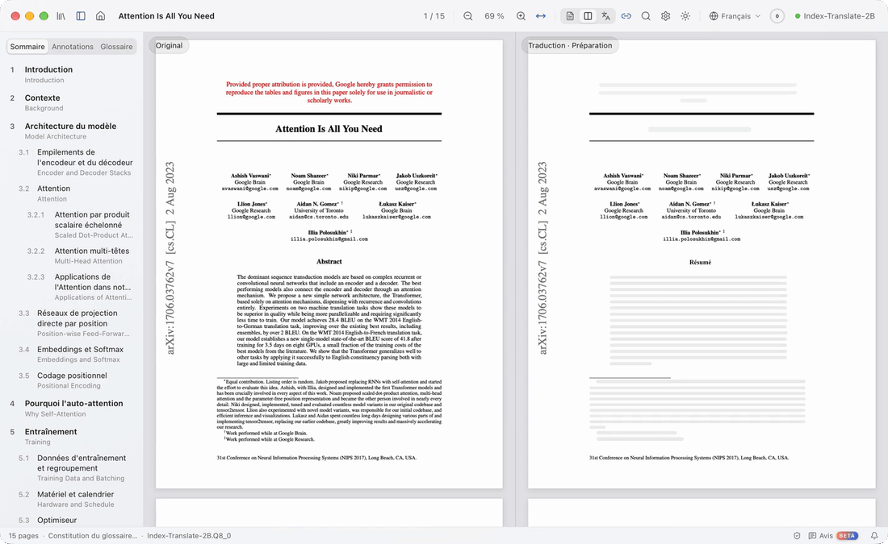
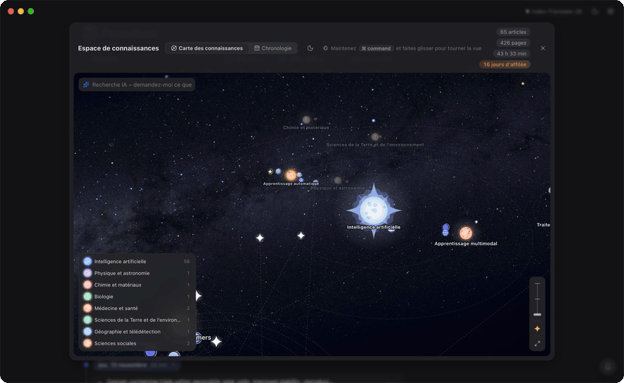
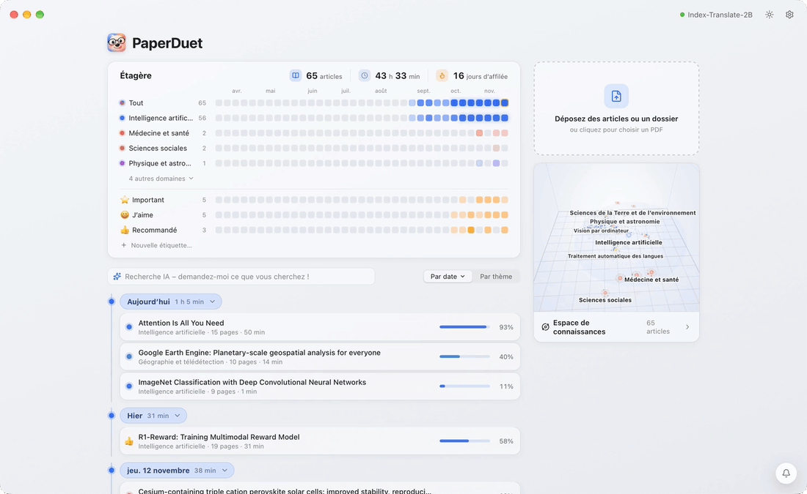
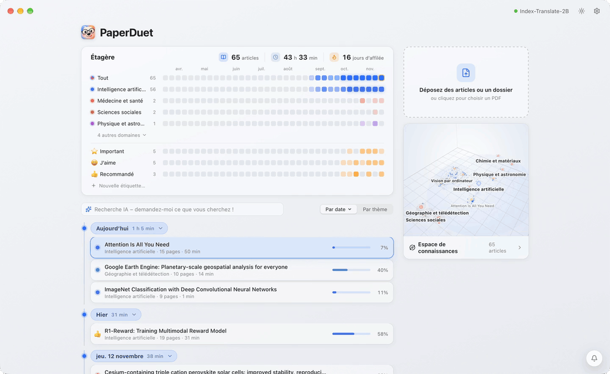
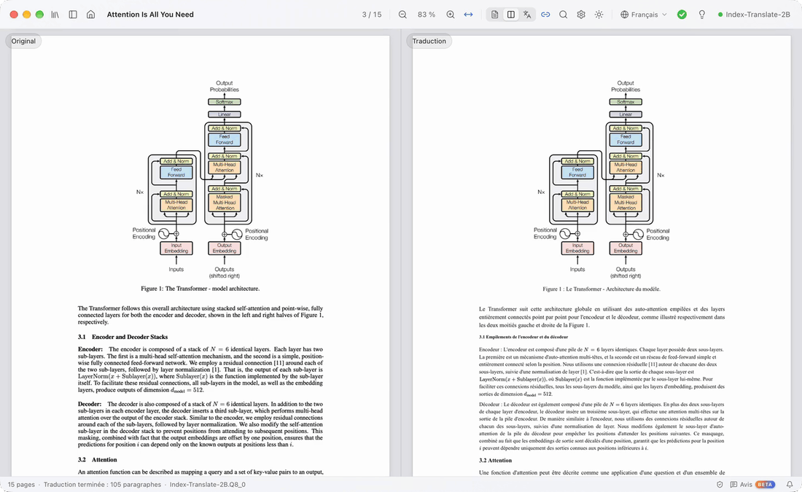
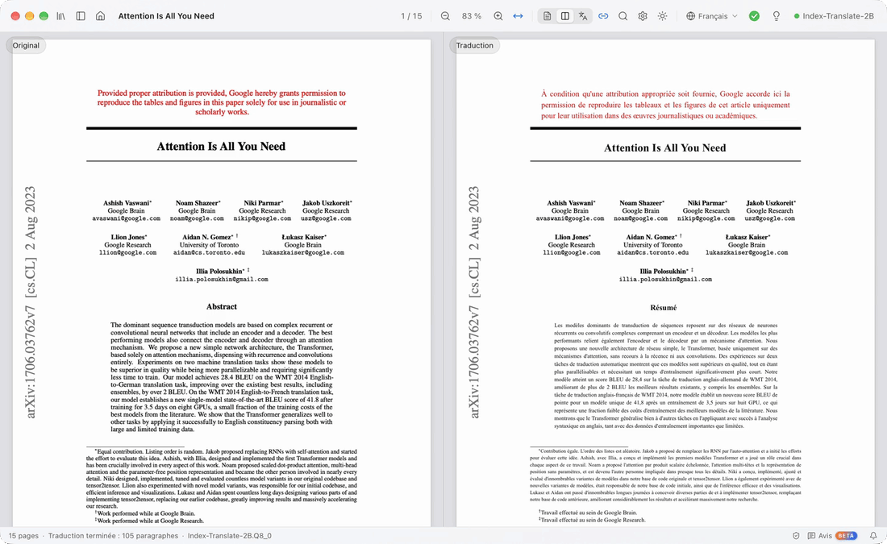
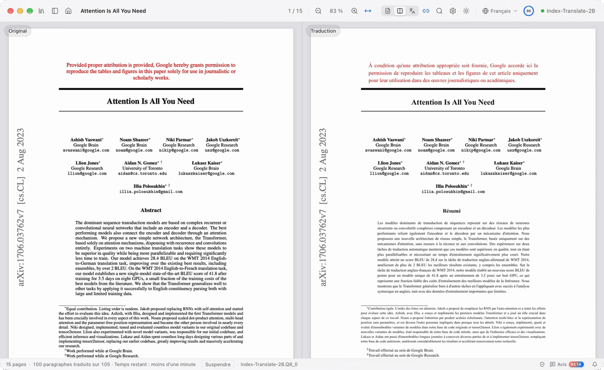
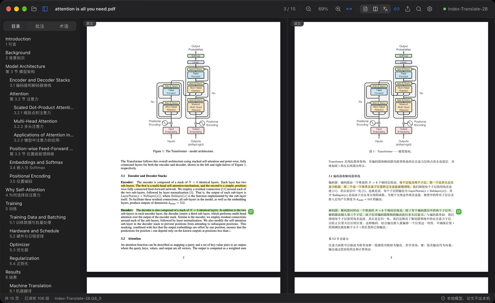

  

<h1 align="center">PaperDuet</h1>

  <em>L’outil des chercheurs pour gérer, étudier et comprendre les articles !</em> 
  <a href="https://paperduet.com">paperduet.com</a>

  <a href="README.md">English</a> &middot; <a href="README.zh-CN.md">简体中文</a> &middot; <a href="README.zh-TW.md">繁體中文</a> &middot; <a href="README.ja.md">日本語</a> &middot; <a href="README.ko.md">한국어</a> &middot; <b>Français</b> &middot; <a href="README.de.md">Deutsch</a> &middot; <a href="README.es.md">Español</a> &middot; <a href="README.it.md">Italiano</a> &middot; <a href="README.pl.md">Polski</a> &middot; <a href="README.ru.md">Русский</a>

  
  
  

  
  
  
  
  
  

  <strong>PaperDuet vous aide à gérer, étudier et comprendre chaque article.</strong> 
  Six modèles de traduction IA open source tournent sur votre ordinateur, ou connectez une API en ligne. 
  Gratuit, sans inscription !

PaperDuet est un outil pour gérer, étudier et comprendre les articles : l’original et sa traduction sont disposés en miroir, formules, figures et tableaux alignés page par page, et les articles que vous avez lus sont rangés sur une étagère et dans un espace de connaissances, où l’IA les retrouve. PaperDuet est gratuit : avec un modèle local, tout tourne sur votre ordinateur, et vous pouvez brancher une API en ligne si besoin.

## Ouvrez-le, c’est en français

  

Déposez un PDF et la traduction commence. Les titres viennent d’abord : le plan dans la barre latérale est aussitôt en français et vous voyez comment l’article est construit ; suivent le titre, le résumé et l’introduction. Six modèles de traduction open source tournent sur votre ordinateur, ou vous pouvez brancher une API en ligne.

## Votre bibliothèque, c’est votre ciel étoilé

  

Voici Space : vos articles s’étendent désormais devant vous comme un ciel étoilé. Vous pouvez construire, de façon plus intuitive, une base de connaissances visuelle qui n’appartient qu’à vous.

## Chaque progrès, consigné

  

L’étagère de la page d’accueil note combien d’articles vous avez lus, pendant combien de temps en tout, et combien de jours d’affilée. Chaque case est une semaine, plus sombre quand vous avez lu plus longtemps ; cliquez sur un domaine et les articles comme la chronologie en dessous suivent. Un clic droit met vos propres étiquettes sur un article.

## Article introuvable ? Demandez à l’IA !

  

Inutile de retenir le titre : dites en une phrase ce que vous cherchez, et la recherche IA le retrouve dans les titres, les originaux, les traductions et les résumés, en montrant le passage trouvé. Posez la question en français ou en anglais.

## Chaque page, telle quelle

  

L’original à gauche, la traduction à droite ; les deux défilent et se zooment ensemble. Colonnes, titres, légendes, notes de bas de page et références sont reconnus automatiquement, et formules, figures et tableaux restent à leur place ; pointez un paragraphe et celui qui lui correspond de l’autre côté s’éclaire. Changez de langue de traduction : la mise en page ne bouge pas.

## Envie de prendre des notes ? C’est réglé !

  

Surlignez, soulignez et annotez directement la traduction ; la phrase correspondante de l’original est marquée automatiquement. L’original exporté avec vos notes porte des annotations PDF standard : Aperçu, Zotero et d’autres apps les affichent telles quelles.

## Terminé ? Emportez-le.

  

Quand tout l’article est traduit, l’anneau de la barre d’outils devient une coche verte : un clic enregistre ensemble le PDF traduit, le Markdown et l’original annoté dans le dossier de l’article. L’ampoule voisine, c’est le résumé IA, écrit par le modèle une fois l’article lu en entier : la question, la méthode et les résultats d’un coup d’œil.

## Et ce n'est pas tout

- **Dix langues de traduction.** Passez en un clic, depuis la barre d'outils, d'une langue à l'autre : 简体中文, 繁體中文, 日本語, 한국어, Français, Deutsch, Español, Italiano, Polski et Русский.
- **Double-clic pour passer devant.** Envie de lire d’abord un paragraphe plus loin ? Double-cliquez dessus dans l’original : il est traduit tout de suite, sans attendre que la progression y arrive.
- **Contrôles de qualité intégrés.** Formules, nombres et ordre des phrases sont vérifiés dans chaque réponse, avec de nouvelles tentatives automatiques, et un glossaire propre à chaque article garde les termes cohérents.
- **Vous décidez de ce qui est traduit.** Clic droit sur n'importe quel bloc pour le traduire ou garder l'original.
- **Lisez à votre façon.** Cherchez dans l'original et la traduction en même temps, parcourez un sommaire bilingue, pointez un paragraphe pour trouver son jumeau, et affichez l'original, la traduction ou les deux. PaperDuet se souvient de l'endroit où vous vous êtes arrêté.
- **Vos propres termes.** Indiquez comment traduire un terme, et tout l’article s’y conforme.
- **Les scans aussi.** Les PDF dont le texte est dessiné sous forme de tracés sont lus par la reconnaissance de texte du système, sur Mac et sur Windows, puis traduits.
- **Des dossiers tenus à jour.** Importez un dossier une fois : les articles que vous y mettez ensuite apparaissent d’eux-mêmes dans la bibliothèque.
- **Un clic pour mettre à jour, un clic pour nettoyer.** Une nouvelle version s’installe en un clic ; le cache se vide en un clic dans les Réglages.
- **Soigné jusque dans l'apparence.** Un design épuré en verre dépoli, avec modes clair, sombre et lecture de nuit.

  

## Six modèles, tous sur votre ordinateur

Choisissez un modèle au premier lancement de PaperDuet, et changez quand vous voulez dans Réglages › Modèle › Changer de modèle. Tous sont conçus pour la traduction et fonctionnent entièrement hors ligne une fois téléchargés.

| Modèle | Par | Taille | Idéal pour |
| --- | --- | --- | --- |
| [Index-Translate-2B](https://huggingface.co/IndexTeam/Index-Translate-2B) **(recommandé)** | équipe Index de bilibili | 2.1 GB | Le meilleur polyvalent, réglé pour les contrôles et le glossaire de PaperDuet |
| [Hy-MT2-1.8B](https://huggingface.co/tencent/Hy-MT2-1.8B-GGUF) | Tencent Hunyuan | 1.9 GB | Rapide et léger |
| [LMT-60-4B](https://huggingface.co/NiuTrans/LMT-60-4B) | NiuTrans | 4.7 GB | Des traductions proches du texte source |
| [LMT-60-0.6B](https://huggingface.co/NiuTrans/LMT-60-0.6B) | NiuTrans | 0.8 GB | Les ordinateurs modestes : le plus petit et le plus rapide |
| [Hy-MT2-7B](https://huggingface.co/tencent/Hy-MT2-7B-GGUF) | Tencent Hunyuan | 8.0 GB | Les traductions les plus fluides, sur un ordinateur avec 16 Go de mémoire ou plus |
| [TranslateGemma-4B](https://huggingface.co/mradermacher/translategemma-4b-it-GGUF) (expérimental) | Google | 4.1 GB | Essayer le modèle de traduction de Google |

Avec le modèle recommandé, un article de 15 pages prend environ 2 minutes sur un M5 Pro, ou environ 1 minute avec « Paragraphes traduits simultanément » réglé sur 2 ou 3 dans Réglages › Modèle.

Vous avez déjà l'un de ces modèles grâce à LM Studio, llama.cpp ou Hugging Face ? PaperDuet le trouve et l'utilise sur place, sans second téléchargement.

Votre ordinateur peine avec les modèles locaux ? Choisissez « Utiliser une API » dans le choix du modèle et saisissez votre propre clé d'API pour passer par OpenAI, Claude, DeepSeek, Qwen, Kimi, GLM, Doubao ou tout service compatible OpenAI. Les modèles locaux se replient, et la traduction, les résumés, le rangement et la recherche par IA passent tous par ce service. Votre clé reste sur votre ordinateur.

## La confidentialité dès la conception

- Vos articles, traductions et notes restent sur votre ordinateur. Avec une API, le texte à traduire est envoyé au service choisi.
- Seulement si vous l'acceptez, PaperDuet envoie des données d'utilisation et de diagnostic anonymes (version, système, langue de l'interface, modèle et types d'erreurs), jamais le contenu des articles, et vous pouvez les désactiver à tout moment dans les réglages.
- En cas d’erreur, PaperDuet envoie un rapport au développeur : ce qui s’est passé, la version et le système, sans chemins de fichiers ni contenu des articles. Vous pouvez le désactiver dans Réglages › Données.
- Quand vous écrivez un avis dans l’application et cliquez sur Envoyer, votre texte (et votre e-mail, si vous l’indiquez) est envoyé au développeur avec la version et le système.
- Avec un modèle local, PaperDuet ne se connecte que pour télécharger un modèle, vérifier les mises à jour et envoyer ces données et rapports, ainsi que vos avis ; tout sauf le téléchargement du modèle peut être désactivé.

## Pour commencer

Sur Mac, il faut une puce Apple (M1 ou plus récent) et macOS 13.3 ou plus récent ; sur PC, Windows 10 ou 11 en 64 bits ; sous Linux, Ubuntu 22.04 ou plus récent en 64 bits (ou une distribution aussi récente).

**Mac**

1. Téléchargez le dernier `.dmg` depuis les [Releases](https://github.com/KalenHwei/PaperDuet/releases/latest).
2. Glissez PaperDuet dans Applications et ouvrez-le depuis là.
3. Au premier lancement seulement : PaperDuet n'est pas encore notarié par Apple, donc macOS vous demande de confirmer. Ouvrez Réglages Système › Confidentialité et sécurité, puis cliquez sur **Ouvrir quand même**. (Ou exécutez `xattr -dr com.apple.quarantine /Applications/PaperDuet.app` dans le Terminal.)
4. Choisissez un modèle. PaperDuet le télécharge, ou trouve la copie que vous avez déjà, et commence à traduire aussitôt.

**Windows**

1. Téléchargez le dernier programme d'installation Windows (`_x64-setup.exe`) depuis les [Releases](https://github.com/KalenHwei/PaperDuet/releases/latest).
2. Lancez-le. La première fois seulement : si Windows affiche « Windows a protégé votre ordinateur », cliquez sur **Informations complémentaires**, puis sur **Exécuter quand même**.
3. Choisissez un modèle. PaperDuet le télécharge, ou trouve la copie que vous avez déjà, et commence à traduire aussitôt.

**Linux**

1. Téléchargez le dernier `.deb` (Ubuntu, Debian) ou le dernier `.AppImage` (autres distributions, ou sans droits d'administrateur) depuis les [Releases](https://github.com/KalenHwei/PaperDuet/releases/latest).
2. `.deb` : lancez `sudo apt install ./PaperDuet_*_amd64.deb` dans un terminal, puis ouvrez PaperDuet depuis le menu des applications. `.AppImage` : rien à installer ; lancez `chmod +x PaperDuet_*_amd64.AppImage`, puis ouvrez le fichier.
3. Choisissez un modèle. PaperDuet le télécharge, ou trouve la copie que vous avez déjà, et commence à traduire aussitôt.

C'est tout. Le moteur de traduction est intégré à l'app, et les mises à jour se font en un clic.

<b>Raccourcis clavier</b>

| Action | Raccourci |
| --- | --- |
| Ouvrir un PDF | ⌘O |
| Fermer l'article | ⌘W |
| Chercher des deux côtés | ⌘F |
| Résultat suivant / précédent | ⌘G / ⇧⌘G |
| Zoom avant / arrière / pleine largeur | ⌘+ / ⌘− / ⌘0 |
| Zoomer autour du pointeur | ⌘ + défilement, ou pincement sur le trackpad |
| Déplacer les pages | ⌘ + glisser |
| Traduire cette partie ensuite | Double-clic sur un texte pas encore traduit |
| Surligner la sélection | H |
| Ajouter une note à la sélection | N |
| Couleur de surlignage | 1 à 5 |
| Annuler / rétablir | ⌘Z / ⇧⌘Z |
| Afficher ou masquer la barre latérale | ⌘\ |
| Activer ou désactiver le défilement synchronisé | ⌘L |
| Tous les raccourcis | ⌘/ |

H, N et 1 à 5 agissent sur le texte sélectionné. Sous Windows et Linux, Ctrl remplace ⌘ et Maj remplace ⇧.

## FAQ

### Quel modèle choisir ?

Commencez par Index-Translate-2B. Pour plus de vitesse, prenez Hy-MT2-1.8B. Pour les traductions les plus fluides sur un ordinateur avec 16 Go de mémoire ou plus, prenez Hy-MT2-7B. Si votre ordinateur peine, choisissez « Utiliser une API ».

### Est-ce gratuit ?

Oui, pour les études et la recherche personnelles, ainsi que pour les universités, écoles, instituts de recherche et autres organismes à but non lucratif. Utiliser PaperDuet dans une entreprise ou pour son compte demande une licence commerciale : écrivez à [support@paperduet.com](mailto:support@paperduet.com).

## Feuille de route

- **Des traductions composées à partir d'arXiv.** Traduire la source LaTeX d'un article et la compiler avec les polices de la langue cible, pour une édition traduite entièrement composée.

## Journal des modifications

- **0.8.6** (2026-11-13) : Correction de bugs connus.
- **0.8.5** (2026-11-13) : PaperDuet 0.8.5 est là🎉 ! L’espace de connaissances prend maintenant la forme de galaxies🌌. Plus il y a d’articles, plus l’étoile est grande et brillante, et quand vous en avez lu assez, elle devient un trou noir ! Vous pouvez aussi faire glisser les étoiles : essayez pour voir le mouvement. Vous pouvez créer vos propres catégories : clic droit sur une catégorie dans l’espace de connaissances ou sur l’étagère pour en ajouter une. Faites glisser des articles sur une catégorie, ou choisissez-la sous « Classer dans » dans le menu contextuel, et ils y sont rangés📂. Subdivision automatique par IA✨ : clic droit sur une catégorie, puis « Subdiviser automatiquement », et l’IA intégrée de PaperDuet regroupe ses articles par contenu en quelques sous-catégories et leur donne un nom. Bien sûr, vous pouvez choisir les noms qui vous plaisent ! Par ailleurs, les traductions illisibles ou absentes de certains PDF sont corrigées, et l’espace de connaissances est plus net. Venez l’essayer🚀 !
- **0.8.4** (2026-11-12) : PaperDuet 0.8.4 est là 🎉 ! Onglets : ouvrez plusieurs articles à la fois. Survolez un onglet pour l’aperçu, faites-le glisser pour changer l’ordre, et un clic droit ouvre le menu complet. Au-delà du nombre choisi, les onglets se mettent en veille pour économiser la mémoire et se réveillent d’un clic ⚡️. La Carte des connaissances est plus pratique : la recherche IA est directement en haut à gauche, et les étoiles des thèmes peuvent être affichées. Un clic droit sur un domaine, un sous-domaine ou une étoile exporte toutes ses références d’un coup, ou les enregistre dans un fichier 📚. Sélection d’articles : un clic pour sélectionner, ⌘ ou Ctrl pour en sélectionner plusieurs, un double-clic pour ouvrir. Le clic droit permet de les étiqueter, de les déplacer ou d’exporter leurs références (BibTeX / EndNote / RefMan / RefWorks) ensemble. Les PDF dont le texte est dessiné sous forme de tracés (comme certains articles CVPR) peuvent désormais être traduits : sur Mac et Windows, la reconnaissance de texte du système lit le texte 🔍. Nouveau « Retraduire » dans le menu contextuel d’un article : tout l’article est retraduit depuis le début avec le modèle sélectionné. Enfin, corrections, entre autres, de la traduction absente après un zoom avec le défilement synchronisé sur les anciens macOS et de l’invite de TranslateGemma qui apparaissait dans la traduction ; et moins de mémoire utilisée. Essayez-le vite 🚀 !
- **0.8.2** (2026-11-11) : Ajout d’une barre dans la Carte des connaissances pour régler les niveaux visibles.
- **0.8.1** (2026-11-11) : Correction de bugs connus.
- **0.8.0** (2026-11-11) : Voici PaperDuet 0.8 🎉 ! Nouveau composant IA : votre bibliothèque se classe toute seule selon le contenu, la Recherche IA trouve les articles par le sens et mène droit au passage le plus pertinent, et les articles proches sont reliés dans l’Espace de connaissances 🧠 ! Des imports bien plus rapides : déposez des articles ou un dossier, l’Étagère et l’Espace de connaissances les classent aussitôt ; le classement fin se termine discrètement en arrière-plan et se met en pause pendant que vous traduisez ⚡️. L’Espace de connaissances n’affiche que les noms des domaines, et le titre d’un article apparaît quand on le survole : fini l’encombrement. Une petite cloche 🔔 en bas à droite réunit les annonces, les sondages et les notes de chaque mise à jour. Et quelques corrections de scintillements et de plantages. Essayez-la vite 🚀 !
- **0.7.9** (2026-11-10) : Glossaire personnalisable : ajoutez, modifiez ou supprimez des termes dans le Glossaire, et ceux marqués « Utiliser dans tous les articles » servent dans chaque article ; le panneau de la bibliothèque montre directement l’Étagère, et la première étiquette d’un article s’affiche devant lui ; les Réglages permettent de vider le cache en un clic et de voir tous les raccourcis ; correction du zoom avec Contrôle sur Mac.
- **0.7.8** (2026-11-10) : Les articles numérisés se traduisent correctement ; un dossier ajouté peut être tenu à jour, ses nouveaux PDF importés sous une étiquette à lui sur l’Étagère ; les Réglages peuvent garder le nom des fichiers PDF comme nom des articles ; les API personnalisées fonctionnent avec des services locaux comme Ollama ; correction de textes non traduits dans les formulaires et après un redimensionnement de la fenêtre.
- **0.7.7** (2026-11-09) : Correction de problèmes connus dans la logique des interactions.
- **0.7.6** (2026-11-09) : Nouvelle visite guidée de la page d’accueil : l’Étagère, la recherche IA, Par date / Par thème, le clic droit sur un article et l’Espace de connaissances.
- **0.7.5** (2026-11-09) : Nous avons entièrement repensé la page d’accueil 🎉 ! La nouvelle Étagère réunit votre historique de lecture, vos domaines et vos étiquettes : vous voyez d’un coup d’œil ce que vous avez lu chaque semaine. L’Espace de connaissances devient un petit univers — les domaines sont des soleils, les articles des planètes, et en mode sombre la vraie Voie lactée brille derrière eux 🌌 ! Un clic droit sur un article suffit pour changer sa catégorie, ajouter des étiquettes, le renommer ou écrire une note. La recherche IA comprend les questions de tous les jours, comme « j’ai lu un article sur les Transformers », et le retrouve aussitôt 🔍 ! À la fin d’une traduction, le PDF traduit, le Markdown traduit et vos notes sont enregistrés ensemble dans le dossier de l’article. Essayez-le vite 🚀 !
- **0.7.4** (2026-11-08) : Correction du problème de surlignage signalé sur GitHub.
- **0.7.3** (2026-11-08) : Surligneur (Maj pour changer de couleur) et bascule clair/sombre ; la traduction réessaie d’elle-même au lieu de s’arrêter ; captures d’écran dans les retours.
- **0.7.2** (2026-11-05) : Animations améliorées.
- **0.7.1** (2026-11-05) : Nous avons rendu la bibliothèque plus agréable à utiliser.
- **0.7.0** (2026-11-05) : Nous avons repensé l’AI Library 🎉 ! Elle accueille l’Espace de connaissances et devient bien plus agréable à utiliser. Les boutons de la barre d’outils sont aussi plus simples et plus pratiques.
- **0.6.12** (2026-11-05) : Pour résoudre les problèmes de mise en page, un modèle visuel de mise en page contrôle désormais chaque page : les tableaux, formules, figures, en-têtes et pieds de page ne sont plus traduits par erreur, et le texte pris pour un tableau est bien traduit, ce qui rend la traduction bien plus précise et robuste. Le modèle se télécharge en arrière-plan avec le modèle de traduction.
- **0.6.11** (2026-11-04) : Merci aux nombreux utilisateurs qui nous ont envoyé de très précieux rapports d'erreur ; pour des raisons de confidentialité, nous ne pouvons pas les remercier publiquement. Cette mise à jour corrige surtout des articles entiers qui ne se traduisaient pas à cause d'un bogue de récursion, des paragraphes en partie non traduits parce qu'une règle de vérification se trompait, et des imprécisions dans la reconnaissance de la mise en page. Nous espérons qu'elle vous offrira à tous une meilleure expérience.
- **0.6.10** (2026-11-04) : Problèmes de connexion à l’API corrigés.
- **0.6.9** (2026-11-03) : Défilement saccadé corrigé dans la version Linux.
- **0.6.8** (2026-11-03) : Nouveau modèle LMT-60-0.6B : le plus petit (805 Mo) et le plus rapide, pour les ordinateurs modestes.
- **0.6.7** (2026-11-03) : Nous sommes heureux de publier la version Linux !
- **0.6.6** (2026-11-03) : Mise en page de certains articles de revue mieux reconnue : les deux colonnes ne se mélangent plus, un résumé sur fond coloré est traduit et la table des matières ne montre que les titres de section.
- **0.6.5** (2026-10-31) : Articles avec numéros de ligne (manuscrits soumis, par exemple) : les numéros ne se mêlent plus à la traduction et ne coupent plus les paragraphes.
- **0.6.4** (2026-10-30) : Correction de quelques problèmes de mise en forme connus.
- **0.6.3** (2026-10-29) : Correction de problèmes connus dans la logique de l’interface.
- **0.6.2** (2026-10-28) : Sous Windows, vous pouvez choisir le dossier des modèles ; ceux déjà téléchargés y sont déplacés.
- **0.6.1** (2026-10-28) : Correction de quelques problèmes de mise en forme connus.
- **0.6.0** (2026-10-28) : Visite guidée des principales fonctions à la première ouverture d’un article, et avis bêta : envoyez-nous vos remarques directement depuis la barre d’état.
- **0.5.17** (2026-10-28) : Correction de quelques problèmes de mise en forme connus.
- **0.5.16** (2026-10-28) : Les paragraphes des manuscrits (exportés de Word, en double interligne) ne restent plus en anglais : les lignes surlignées sont traduites, les paragraphes en double interligne sont traduits en entier et non ligne par ligne, et les légendes des figures placées après les références sont traduites.
- **0.5.15** (2026-10-28) : Les symboles des formules dans les revues Elsevier ne sont plus brouillés : lettres grecques, ≤, ∀, ≠ et lettres chapeautées (Ŝ, q̂) ne s'affichent plus comme de simples lettres, et un exposant placé haut ne passe plus à la ligne du dessus.
- **0.5.14** (2026-10-28) : Correction de quelques erreurs de mise en forme connues.
- **0.5.13** (2026-10-28) : Les formules ne sont plus brouillées : les équations centrées avec fractions et sommes restent entières au lieu d'être traduites par morceaux par-dessus elles-mêmes, et les sommes dans le texte, les racines carrées et les lignes de formules très espacées ne coupent plus la phrase.
- **0.5.12** (2026-10-27) : Les articles de revues sont mieux rendus : lignes de statistiques, intertitres numérotés, phrases qui continuent dans la colonne suivante, lettres grecques comme χ², noms accentués et signes moins dans les tableaux ne sont plus déformés ; le PDF traduit exporté a un espacement des lettres régulier. Merci à momo sur RedNote pour ses suggestions.
- **0.5.11** (2026-10-27) : Le pseudo-code est traduit ligne par ligne, numéros de ligne, indentation et mots-clés conservés ; les tableaux sont mieux repérés, leur contenu reste en version originale et seuls titres et notes sont traduits, si bien qu'ils ne sont plus désorganisés ; les sommes dans le texte ne disparaissent plus de la traduction.
- **0.5.10** (2026-10-27) : Traduction par une API en ligne : si votre ordinateur peine avec les modèles locaux, choisissez « Utiliser une API » dans le choix du modèle pour passer par OpenAI, Claude, DeepSeek, Qwen, Kimi, GLM, Doubao ou tout service compatible OpenAI ; la liste des modèles locaux se replie alors.
- **0.5.9** (2026-10-26) : Correction de problèmes existants.
- **0.5.8** (2026-10-26) : Le polonais rejoint les langues de traduction et de l’interface ; corrections : sous macOS 26 et versions antérieures, les articles ne pouvaient être ni lus ni traduits ; sous macOS 27, l'enregistrement du PDF traduit échouait pour certains articles.
- **0.5.7** (2026-10-26) : Lecture plus juste des articles de revues, testée sur des articles de 20 grandes revues : colonnes, titres, références, tableaux, légendes et symboles propres aux éditeurs ; les articles de Science ne restent plus en grande partie non traduits, et les annexes après les références sont traduites.
- **0.5.6** (2026-10-25) : L’italien rejoint les langues de traduction et de l’interface ; en cas d’erreur, un rapport est envoyé au développeur pour corriger le problème (activé par défaut, désactivable dans Réglages › Données).
- **0.5.5** (2026-10-25) : Les lignes très espacées des articles de revue ne sont plus découpées en mots isolés, absents ou mal placés dans la traduction ; le résumé est traduit juste après le titre ; moins d’« Échec de l’analyse de la mise en page » ; les tirets des articles Elsevier ne s’affichent plus comme « e ».
- **0.5.4** (2026-10-24) : Interface allégée : les textes d'explication superflus ont disparu ; le champ de recherche IA affiche « Rechercher avec l’IA ».
- **0.5.3** (2026-10-24) : PaperDuet demande une fois si vous acceptez de partager des données d'utilisation et de diagnostic anonymes pour l'améliorer ; jamais le contenu des articles, et désactivable à tout moment dans Réglages › Données.
- **0.5.2** (2026-10-24) : « Recherche IA » 🔍 dans la bibliothèque : retrouvez un article lu par son titre, son texte original, sa traduction, son résumé ou ses étiquettes, en français comme en anglais ; la recherche et « Organiser avec l’IA » font remonter les articles trouvés et grisent les autres.
- **0.5.1** (2026-10-24) : une bibliothèque remplace le panneau des fichiers : tous les articles lus ou importés, à renommer sur place, avec leur résumé ; import de plusieurs PDF ou d'un dossier entier ; « Organiser avec l'IA » ✨ filtre les articles par domaine et par sujet ; corrections des tableaux illisibles et des paragraphes non traduits dans certains articles.
- **0.5.0** (2026-10-24) : résumé de l'article 💡 derrière l'ampoule une fois tout traduit ; le panneau des fichiers ouvre son dossier en un clic ; version Windows.
- **0.4.1** (2026-10-23) : descriptions plus claires dans la liste des modèles et dans les réglages.
- **0.4.0** (2026-10-23) : l'interface existe en 9 langues. Par défaut, elle suit la langue du système ; on la change dans Réglages › Apparence › Langue de l’interface.
- **0.3.2** (2026-10-23) : nouvelles corrections de l'alignement lors de la traduction vers d'autres langues.
- **0.3.1** (2026-10-23) : anneau de progression et barre d'outils améliorés.
- **0.3.0** (2026-10-23) : huit langues de traduction 🎉, à changer en un clic dans la barre d'outils ; anneau de progression et interactions améliorés.
- **0.2.1** (2026-10-23) : cinq modèles de traduction au choix ; nouvel écran de lancement.
- **0.2.0** (2026-10-23) : vérification des mises à jour et mise à jour en un clic dans l'app.
- **0.1.0** (2026-10-22) : première version.

Historique complet : [CHANGELOG.md](CHANGELOG.md).

## Licence

PaperDuet est gratuit pour un usage non commercial, sous la [PolyForm Noncommercial License 1.0.0](LICENSE). Utilisez-le et partagez-le à des fins personnelles, d'études, de recherche ou non lucratives ; si vous le partagez, joignez la licence et la ligne `Required Notice: Copyright (c) 2026 Kalen Yongda Wei`. Pour un usage commercial, écrivez à [support@paperduet.com](mailto:support@paperduet.com).

Copyright © 2026 Kalen Yongda Wei.

## Remerciements

PaperDuet repose sur [Tauri](https://tauri.app), [pdf.js](https://mozilla.github.io/pdf.js/), [pdf-lib](https://pdf-lib.js.org), [llama.cpp](https://github.com/ggml-org/llama.cpp), [React](https://react.dev), [Zustand](https://github.com/pmndrs/zustand) et [Lucide](https://lucide.dev). Les modèles de traduction viennent de l'équipe Index de bilibili (Index-Translate-2B), de Tencent Hunyuan (Hy-MT2), de NiuTrans (LMT) et de Google (TranslateGemma). Ils sont publiés sous Apache-2.0, sauf TranslateGemma, régi par les [conditions d'utilisation de Gemma](https://ai.google.dev/gemma/terms). Les textes complets des licences se trouvent dans l'app (Réglages › À propos › Licences tierces).

L'article des animations est [_Attention Is All You Need_](https://arxiv.org/abs/1706.03762) de Vaswani et al.
