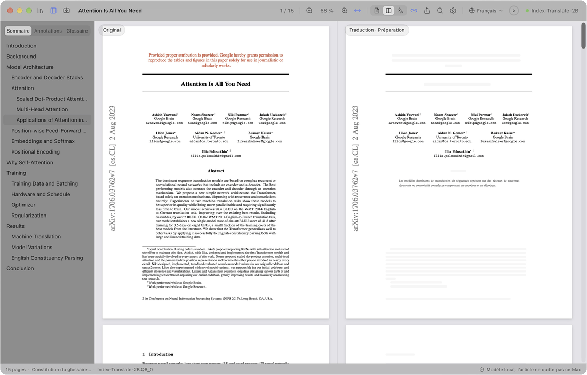
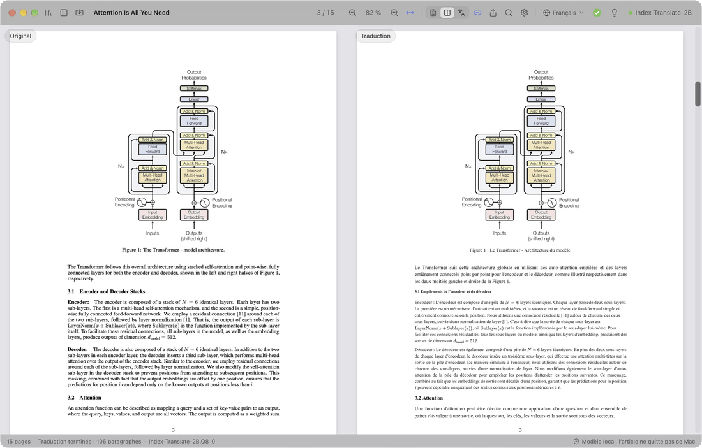
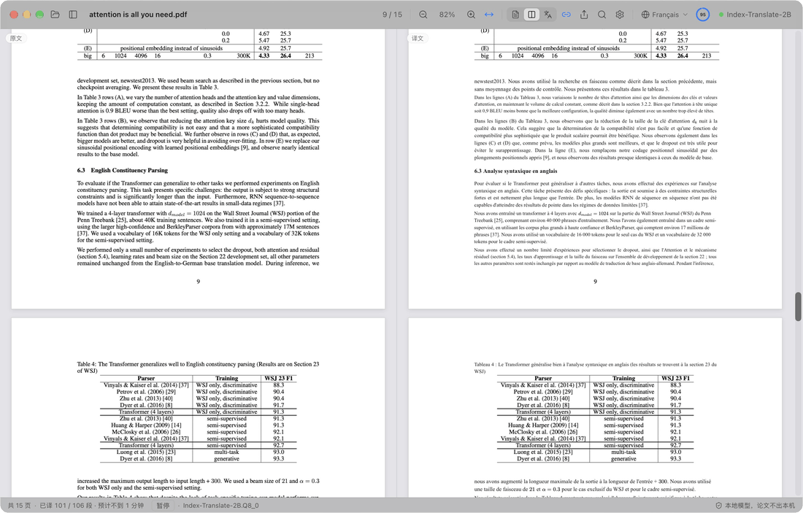
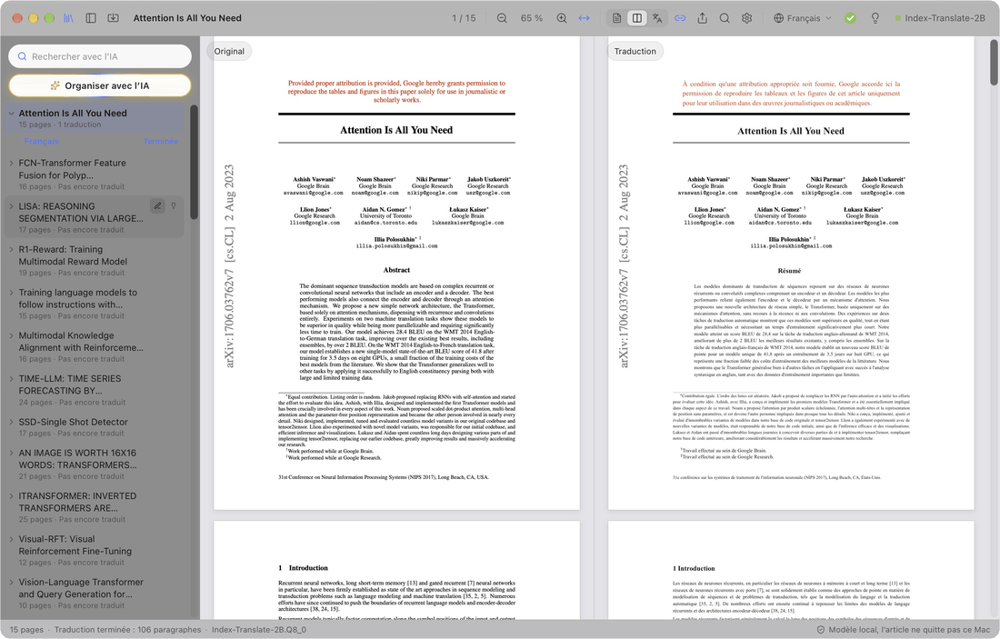
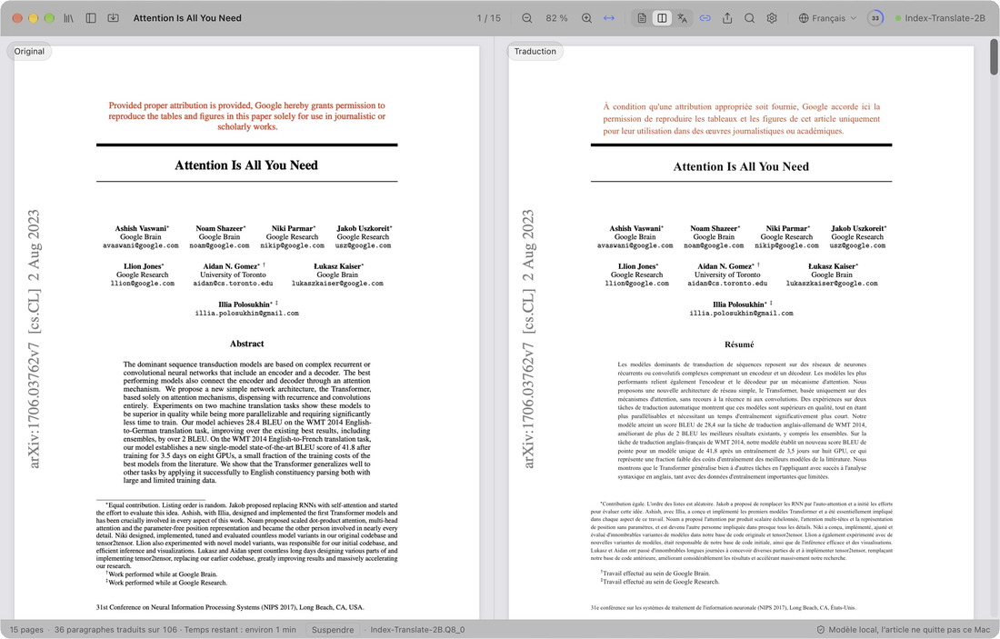
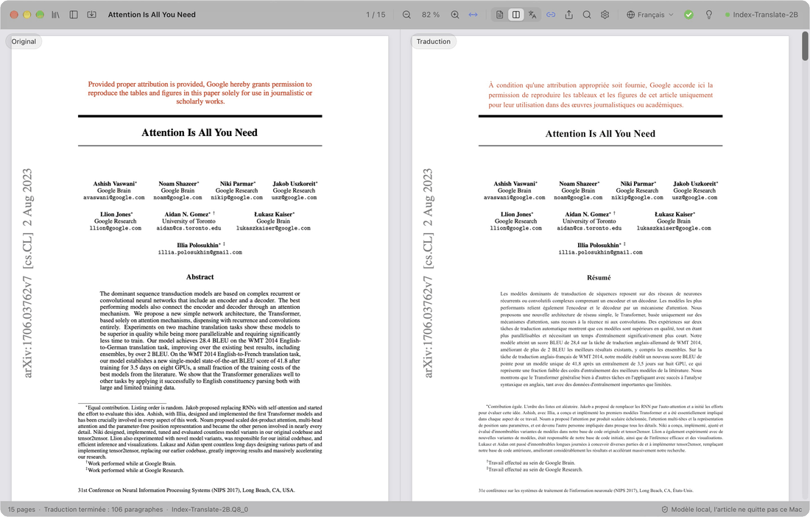

  

<h1 align="center">PaperDuet</h1>

  <em>Un traducteur d'articles IA léger, pensé pour les chercheurs !</em> 
  <a href="https://paperduet.com">paperduet.com</a>

  <a href="README.md">English</a> &middot; <a href="README.zh-CN.md">简体中文</a> &middot; <a href="README.zh-TW.md">繁體中文</a> &middot; <a href="README.ja.md">日本語</a> &middot; <a href="README.ko.md">한국어</a> &middot; <b>Français</b> &middot; <a href="README.de.md">Deutsch</a> &middot; <a href="README.es.md">Español</a> &middot; <a href="README.it.md">Italiano</a> &middot; <a href="README.ru.md">Русский</a>

  
  

  
  
  
  
  
  

  <strong>PaperDuet est un traducteur miroir IA léger pour les articles, qui conserve la mise en page d'origine.</strong> 
  Cinq modèles de traduction IA open source au choix. 
  Gratuit, entièrement en local !

   
  Enregistrement de la traduction complète d'Attention Is All You Need (15 pages)

PaperDuet est un traducteur miroir IA léger pour les articles scientifiques. Il place l'original et la traduction côte à côte, comme dans un miroir, et corrige et aligne formules, figures et tableaux page par page. Pas de clé d'API, rien à payer, et tout tourne sur votre ordinateur !

## Chaque page, sans effort

  

L'article original est à gauche, sa traduction à droite, et les deux côtés défilent et zooment ensemble. Colonnes, titres, légendes, notes de bas de page et références sont reconnus automatiquement, et les paragraphes qui continuent dans la colonne ou la page suivante sont recollés. Les deux côtés sont parfaitement alignés, ce qui rend la comparaison facile.

## Enregistrer ? Résumer ? C'est fait.

  

La barre d'outils indique où en est la traduction. Une fois l'article entièrement traduit, l'anneau devient une coche verte et un clic enregistre la traduction en PDF à côté de l'original. L'ampoule juste à côté ouvre le résumé IA : ce que le modèle retient après avoir lu tout l'article, question, méthode et résultats compris. Et vous choisissez parmi cinq modèles selon votre ordinateur et vos besoins.

## Pensez-y. Trouvez-le.

  

Tous les articles que vous avez lus sont dans la bibliothèque. « Organiser avec l'IA » les étiquette par domaine et par sujet, et ceux que vous choisissez remontent en tête. La recherche IA retrouve un article par son titre, son texte, sa traduction ou son résumé, en français comme en anglais.

## Un passage vous échappe ? Cliquez.

  

Les titres de section sont traduits d'abord, pour voir tout de suite la structure de l'article ; puis le titre, le résumé et l'introduction. Envie de lire un passage plus loin ? Double-cliquez dessus : il passe devant, sans attendre que la progression y arrive.

## Des notes ? C'est parti.

  

Surlignez, soulignez et annotez directement la traduction ; les phrases correspondantes de l'original sont marquées aussi. Le PDF original annoté s'exporte avec des annotations PDF standard, visibles dans Aperçu, Zotero et d'autres apps.

## Et ce n'est pas tout

- **Neuf langues de traduction.** Passez en un clic, depuis la barre d'outils, d'une langue à l'autre : 简体中文, 繁體中文, 日本語, 한국어, Français, Deutsch, Español, Italiano et Русский.
- **Un PDF traduit en un clic.** Une fois l'article entièrement traduit, un clic enregistre la traduction à côté, avec la mise en page d'origine.
- **Contrôles de qualité intégrés.** Formules, nombres et ordre des phrases sont vérifiés dans chaque réponse, avec de nouvelles tentatives automatiques, et un glossaire propre à chaque article garde les termes cohérents.
- **Vous décidez de ce qui est traduit.** Clic droit sur n'importe quel bloc pour le traduire ou garder l'original.
- **Lisez à votre façon.** Cherchez dans l'original et la traduction en même temps, parcourez un sommaire bilingue, pointez un paragraphe pour trouver son jumeau, et affichez l'original, la traduction ou les deux. PaperDuet se souvient de l'endroit où vous vous êtes arrêté.
- **Votre bibliothèque, avec la recherche IA.** Tous les articles lus ou importés sont dans la bibliothèque. La recherche IA retrouve un article par son titre, son texte, sa traduction ou son résumé, en français comme en anglais, et « Organiser avec l'IA » les classe par domaine et par sujet.
- **Un résumé de chaque article.** Une fois l'article traduit, cliquez sur l'ampoule : le modèle de traduction écrit un court résumé dans la langue de l'interface et le garde avec l'article.
- **Exportez où vous voulez.** Le PDF original avec vos marques, le PDF traduit et vos notes en Markdown, lisibles aussi dans d'autres applications.
- **Mises à jour en un clic.** La mise à jour est simple : un clic installe la nouvelle version.
- **Soigné jusque dans l'apparence.** Un design épuré en verre dépoli, avec modes clair, sombre et lecture de nuit.

  

## Cinq modèles, tous sur votre ordinateur

Choisissez un modèle au premier lancement de PaperDuet, et changez quand vous voulez dans Réglages › Modèle › Changer de modèle. Tous sont conçus pour la traduction et fonctionnent entièrement hors ligne une fois téléchargés.

| Modèle | Par | Taille | Idéal pour |
| --- | --- | --- | --- |
| [Index-Translate-2B](https://huggingface.co/IndexTeam/Index-Translate-2B) **(recommandé)** | équipe Index de bilibili | 2.1 GB | Le meilleur polyvalent, réglé pour les contrôles et le glossaire de PaperDuet |
| [Hy-MT2-1.8B](https://huggingface.co/tencent/Hy-MT2-1.8B-GGUF) | Tencent Hunyuan | 1.9 GB | La vitesse : le plus rapide et le plus léger |
| [LMT-60-4B](https://huggingface.co/NiuTrans/LMT-60-4B) | NiuTrans | 4.7 GB | Des traductions proches du texte source |
| [Hy-MT2-7B](https://huggingface.co/tencent/Hy-MT2-7B-GGUF) | Tencent Hunyuan | 8.0 GB | Les traductions les plus fluides, sur un ordinateur avec 16 Go de mémoire ou plus |
| [TranslateGemma-4B](https://huggingface.co/mradermacher/translategemma-4b-it-GGUF) (expérimental) | Google | 4.1 GB | Essayer le modèle de traduction de Google |

Avec le modèle recommandé, un article de 15 pages prend environ 2 minutes sur un M5 Pro, ou environ 1 minute avec « Paragraphes traduits simultanément » réglé sur 2 ou 3 dans Réglages › Modèle.

Vous avez déjà l'un de ces modèles grâce à LM Studio, llama.cpp ou Hugging Face ? PaperDuet le trouve et l'utilise sur place, sans second téléchargement.

## La confidentialité dès la conception

- Vos articles, traductions et notes restent sur votre ordinateur.
- Seulement si vous l'acceptez, PaperDuet envoie des données d'utilisation et de diagnostic anonymes (version, système, langue de l'interface, modèle et types d'erreurs), jamais le contenu des articles, et vous pouvez les désactiver à tout moment dans les réglages.
- En cas d’erreur, PaperDuet envoie un rapport au développeur : ce qui s’est passé, la version et le système, sans chemins de fichiers ni contenu des articles. Vous pouvez le désactiver dans Réglages › Données.
- PaperDuet ne se connecte que pour télécharger un modèle, vérifier les mises à jour et envoyer ces données et rapports ; tout sauf le téléchargement du modèle peut être désactivé.

## Pour commencer

Sur Mac, il faut une puce Apple (M1 ou plus récent) et macOS 13.3 ou plus récent ; sur PC, Windows 10 ou 11 en 64 bits.

**Mac**

1. Téléchargez le dernier `.dmg` depuis les [Releases](https://github.com/KalenHwei/PaperDuet/releases/latest).
2. Glissez PaperDuet dans Applications et ouvrez-le depuis là.
3. Au premier lancement seulement : PaperDuet n'est pas encore notarié par Apple, donc macOS vous demande de confirmer. Ouvrez Réglages Système › Confidentialité et sécurité, puis cliquez sur **Ouvrir quand même**. (Ou exécutez `xattr -dr com.apple.quarantine /Applications/PaperDuet.app` dans le Terminal.)
4. Choisissez un modèle. PaperDuet le télécharge, ou trouve la copie que vous avez déjà, et commence à traduire aussitôt.

**Windows**

1. Téléchargez le dernier programme d'installation Windows (`_x64-setup.exe`) depuis les [Releases](https://github.com/KalenHwei/PaperDuet/releases/latest).
2. Lancez-le. La première fois seulement : si Windows affiche « Windows a protégé votre ordinateur », cliquez sur **Informations complémentaires**, puis sur **Exécuter quand même**.
3. Choisissez un modèle. PaperDuet le télécharge, ou trouve la copie que vous avez déjà, et commence à traduire aussitôt.

C'est tout. Le moteur de traduction est intégré à l'app, et les mises à jour se font en un clic.

<b>Raccourcis clavier</b>

| Action | Raccourci |
| --- | --- |
| Ouvrir un PDF | ⌘O |
| Fermer l'article | ⌘W |
| Chercher des deux côtés | ⌘F |
| Résultat suivant / précédent | ⌘G / ⇧⌘G |
| Zoom avant / arrière / pleine largeur | ⌘+ / ⌘− / ⌘0 |
| Zoomer autour du pointeur | ⌘ + défilement, ou pincement sur le trackpad |
| Déplacer les pages | ⌘ + glisser |
| Traduire cette partie ensuite | Double-clic sur un texte pas encore traduit |
| Surligner la sélection | H |
| Ajouter une note à la sélection | N |
| Couleur de surlignage | 1 à 5 |
| Annuler / rétablir | ⌘Z / ⇧⌘Z |
| Afficher ou masquer la barre latérale | ⌘\ |
| Activer ou désactiver le défilement synchronisé | ⌘L |
| Tous les raccourcis | ⌘/ |

H, N et 1 à 5 agissent sur le texte sélectionné. Sous Windows, Ctrl remplace ⌘ et Maj remplace ⇧.

## FAQ

### Quel modèle choisir ?

Commencez par Index-Translate-2B. Pour plus de vitesse, prenez Hy-MT2-1.8B. Pour les traductions les plus fluides sur un ordinateur avec 16 Go de mémoire ou plus, prenez Hy-MT2-7B.

### Est-ce gratuit ?

Oui, pour les études et la recherche personnelles, ainsi que pour les universités, écoles, instituts de recherche et autres organismes à but non lucratif. Utiliser PaperDuet dans une entreprise ou pour son compte demande une licence commerciale : écrivez à [junystugh@gmail.com](mailto:junystugh@gmail.com).

## Feuille de route

- **Des traductions composées à partir d'arXiv.** Traduire la source LaTeX d'un article et la compiler avec les polices de la langue cible, pour une édition traduite entièrement composée.

## Journal des modifications

- **0.5.7** (2026-10-26) : Lecture plus juste des articles de revues, testée sur des articles de 20 grandes revues : colonnes, titres, références, tableaux, légendes et symboles propres aux éditeurs ; les articles de Science ne restent plus en grande partie non traduits, et les annexes après les références sont traduites.
- **0.5.6** (2026-10-25) : L’italien rejoint les langues de traduction et de l’interface ; en cas d’erreur, un rapport est envoyé au développeur pour corriger le problème (activé par défaut, désactivable dans Réglages › Données).
- **0.5.5** (2026-10-25) : Les lignes très espacées des articles de revue ne sont plus découpées en mots isolés, absents ou mal placés dans la traduction ; le résumé est traduit juste après le titre ; moins d’« Échec de l’analyse de la mise en page » ; les tirets des articles Elsevier ne s’affichent plus comme « e ».
- **0.5.4** (2026-10-24) : Interface allégée : les textes d'explication superflus ont disparu ; le champ de recherche IA affiche « Rechercher avec l’IA ».
- **0.5.3** (2026-10-24) : PaperDuet demande une fois si vous acceptez de partager des données d'utilisation et de diagnostic anonymes pour l'améliorer ; jamais le contenu des articles, et désactivable à tout moment dans Réglages › Données.
- **0.5.2** (2026-10-24) : « Recherche IA » 🔍 dans la bibliothèque : retrouvez un article lu par son titre, son texte original, sa traduction, son résumé ou ses étiquettes, en français comme en anglais ; la recherche et « Organiser avec l’IA » font remonter les articles trouvés et grisent les autres.
- **0.5.1** (2026-10-24) : une bibliothèque remplace le panneau des fichiers : tous les articles lus ou importés, à renommer sur place, avec leur résumé ; import de plusieurs PDF ou d'un dossier entier ; « Organiser avec l'IA » ✨ filtre les articles par domaine et par sujet ; corrections des tableaux illisibles et des paragraphes non traduits dans certains articles.
- **0.5.0** (2026-10-24) : résumé de l'article 💡 derrière l'ampoule une fois tout traduit ; le panneau des fichiers ouvre son dossier en un clic ; version Windows.
- **0.4.1** (2026-10-23) : descriptions plus claires dans la liste des modèles et dans les réglages.
- **0.4.0** (2026-10-23) : l'interface existe en 9 langues. Par défaut, elle suit la langue du système ; on la change dans Réglages › Apparence › Langue de l’interface.
- **0.3.2** (2026-10-23) : nouvelles corrections de l'alignement lors de la traduction vers d'autres langues.
- **0.3.1** (2026-10-23) : anneau de progression et barre d'outils améliorés.
- **0.3.0** (2026-10-23) : huit langues de traduction 🎉, à changer en un clic dans la barre d'outils ; anneau de progression et interactions améliorés.
- **0.2.1** (2026-10-23) : cinq modèles de traduction au choix ; nouvel écran de lancement.
- **0.2.0** (2026-10-23) : vérification des mises à jour et mise à jour en un clic dans l'app.
- **0.1.0** (2026-10-22) : première version.

Historique complet : [CHANGELOG.md](CHANGELOG.md).

## Licence

PaperDuet est gratuit pour un usage non commercial, sous la [PolyForm Noncommercial License 1.0.0](LICENSE). Utilisez-le et partagez-le à des fins personnelles, d'études, de recherche ou non lucratives ; si vous le partagez, joignez la licence et la ligne `Required Notice: Copyright (c) 2026 Kalen Yongda Wei`. Pour un usage commercial, écrivez à [junystugh@gmail.com](mailto:junystugh@gmail.com).

Copyright © 2026 Kalen Yongda Wei.

## Remerciements

PaperDuet repose sur [Tauri](https://tauri.app), [pdf.js](https://mozilla.github.io/pdf.js/), [pdf-lib](https://pdf-lib.js.org), [llama.cpp](https://github.com/ggml-org/llama.cpp), [React](https://react.dev), [Zustand](https://github.com/pmndrs/zustand) et [Lucide](https://lucide.dev). Les modèles de traduction viennent de l'équipe Index de bilibili (Index-Translate-2B), de Tencent Hunyuan (Hy-MT2), de NiuTrans (LMT) et de Google (TranslateGemma). Ils sont publiés sous Apache-2.0, sauf TranslateGemma, régi par les [conditions d'utilisation de Gemma](https://ai.google.dev/gemma/terms). Les textes complets des licences se trouvent dans l'app (Réglages › À propos › Licences tierces).

L'article des animations est [_Attention Is All You Need_](https://arxiv.org/abs/1706.03762) de Vaswani et al.
