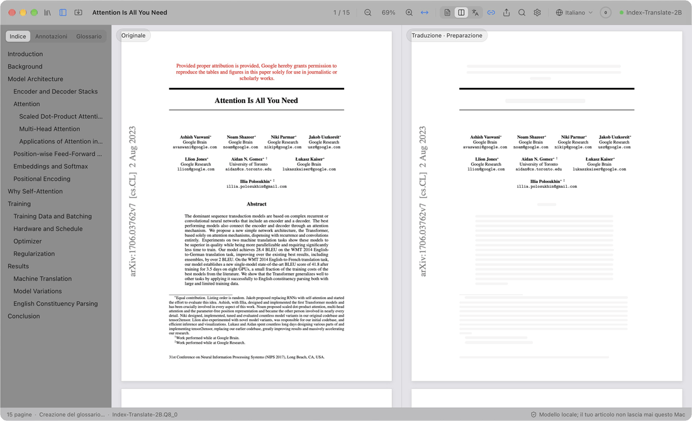
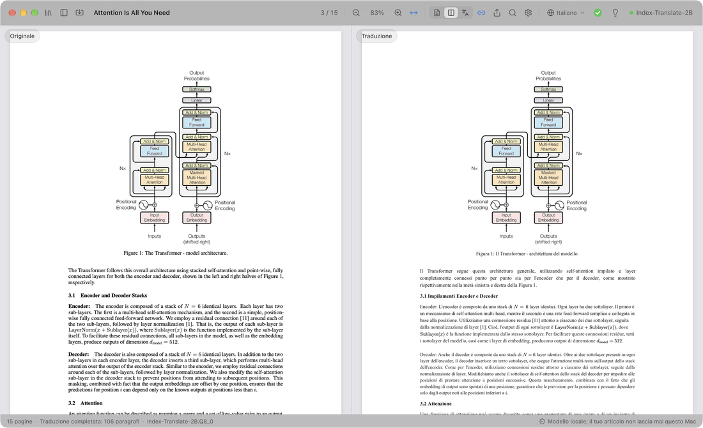
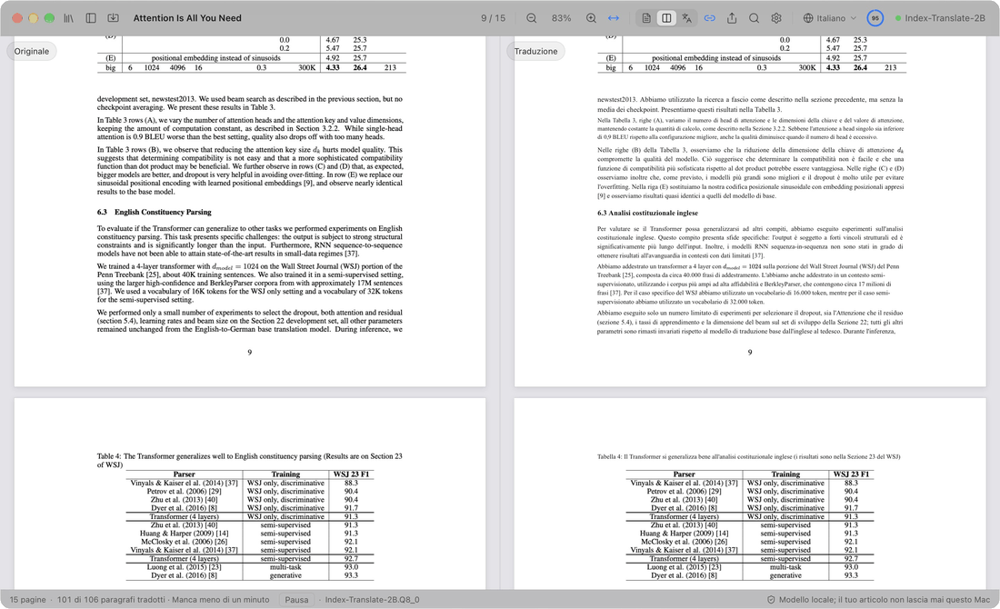
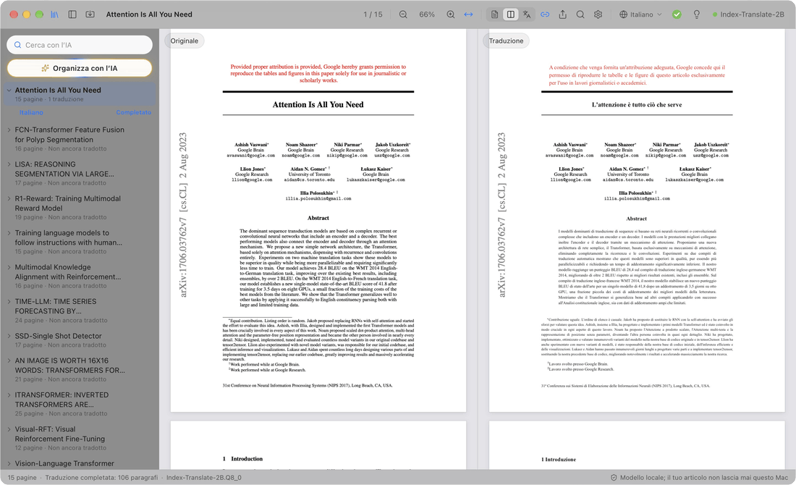
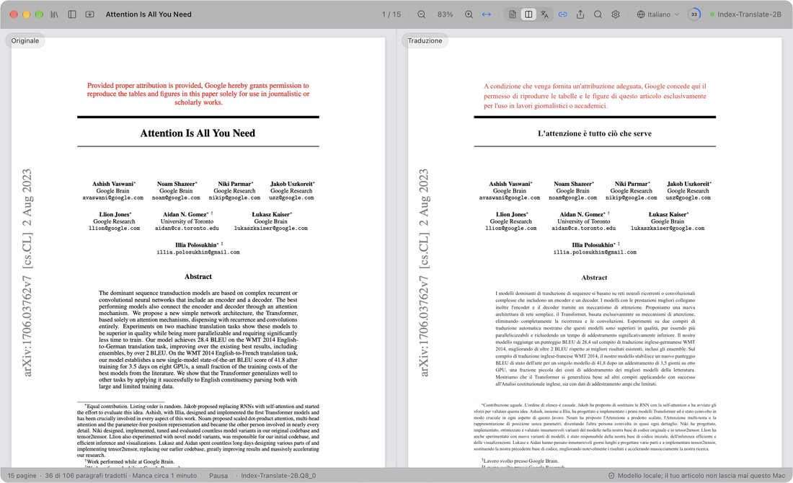
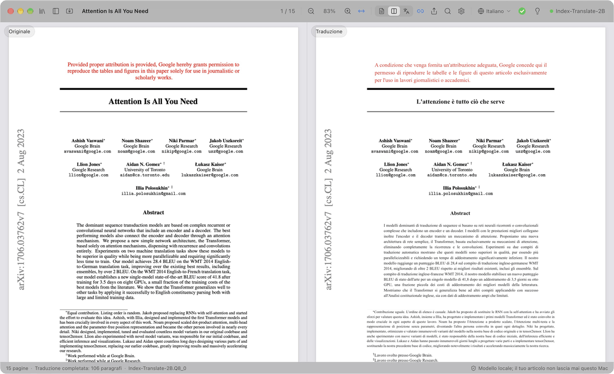

  

<h1 align="center">PaperDuet</h1>

  <em>Un traduttore di articoli con IA, leggero e pensato per chi fa ricerca!</em> 
  <a href="https://paperduet.com">paperduet.com</a>

  <a href="README.md">English</a> &middot; <a href="README.zh-CN.md">简体中文</a> &middot; <a href="README.zh-TW.md">繁體中文</a> &middot; <a href="README.ja.md">日本語</a> &middot; <a href="README.ko.md">한국어</a> &middot; <a href="README.fr.md">Français</a> &middot; <a href="README.de.md">Deutsch</a> &middot; <a href="README.es.md">Español</a> &middot; <b>Italiano</b> &middot; <a href="README.pl.md">Polski</a> &middot; <a href="README.ru.md">Русский</a>

  
  

  
  
  
  
  
  

  <strong>PaperDuet è un traduttore a specchio con IA, leggero, che mantiene l’impaginazione originale degli articoli.</strong> 
  Cinque modelli di traduzione IA open source tra cui scegliere. 
  Nessun costo, tutto in locale!

   
  Registrazione di Attention Is All You Need (15 pagine) tradotto da zero

PaperDuet è un traduttore a specchio con IA, leggero, per articoli scientifici. Affianca originale e traduzione come immagini allo specchio, con formule, figure e tabelle corrette e allineate pagina per pagina. Niente chiave API, nessun costo, e funziona interamente sul tuo computer!

## Ogni pagina, senza sforzo

  

A sinistra c’è l’articolo originale, a destra la sua traduzione, con scorrimento e zoom sincronizzati. Colonne, titoli, didascalie, note a piè di pagina e bibliografia vengono riconosciuti in automatico, e i paragrafi che continuano in un’altra colonna o pagina vengono riuniti. I due lati sono allineati con precisione, così confrontarli è facile.

## Salvare? Riassumere? Fatto.

  

La barra degli strumenti mostra l’avanzamento della traduzione. Quando l’articolo è tutto tradotto, l’anello diventa un segno di spunta verde e compare un fumetto: un clic salva la traduzione in PDF accanto all’originale. La lampadina lì accanto apre il riassunto IA, scritto dal modello dopo aver letto l’intero articolo: cosa si chiede, come funziona e cosa ha scoperto. E puoi scegliere tra cinque modelli, in base al tuo computer e alle tue esigenze!

## Pensalo. Trovalo.

  

Ogni articolo che hai letto è nella tua libreria. «Organizza con l’IA» assegna a ciascuno etichette per ambito e argomento, e gli articoli che scegli salgono in cima. La ricerca IA trova un articolo dal titolo, dal testo, dalla traduzione o dal riassunto, in italiano o in inglese.

## Non è chiaro? Fai clic.

  

Per primi vengono tradotti i titoli delle sezioni, così vedi subito la struttura dell’articolo; poi titolo, abstract e introduzione. Vuoi leggere adesso un passaggio più avanti? Fai doppio clic e verrà tradotto per primo, senza aspettare che l’avanzamento arrivi lì.

## Appunti? Ma certo.

  

Evidenzia, sottolinea e scrivi note direttamente sulla traduzione; anche le frasi corrispondenti dell’originale vengono segnate. Esporta il PDF originale con le tue note come annotazioni PDF standard, pronte per Anteprima, Zotero e altre app.

## E non è tutto

- **Dieci lingue in cui tradurre.** Passa con un clic, dalla barra degli strumenti, tra 简体中文, 繁體中文, 日本語, 한국어, Français, Deutsch, Español, Italiano, Polski e Русский.
- **Un PDF tradotto con un clic.** Quando l’articolo è tradotto per intero, un clic salva la traduzione accanto, con l’impaginazione originale.
- **Controlli di qualità integrati.** Formule, numeri e ordine delle frasi vengono verificati in ogni risposta, con nuovi tentativi automatici, e un glossario per ogni articolo mantiene coerenti i termini.
- **Decidi tu cosa tradurre.** Fai clic con il tasto destro su un blocco qualsiasi per tradurlo o tenere l’originale.
- **Leggi come preferisci.** Cerca nell’originale e nella traduzione insieme, sfoglia un indice bilingue, passa il puntatore su un paragrafo per trovare il suo gemello e mostra l’originale, la traduzione o entrambi. PaperDuet si ricorda dove avevi interrotto.
- **La tua libreria, con la ricerca IA.** Ogni articolo che leggi o importi è nella libreria. La ricerca IA lo ritrova dal titolo, dal testo, dalla traduzione o dal riassunto, in italiano o in inglese, e «Organizza con l’IA» ordina gli articoli per ambito e argomento.
- **Un riassunto di ogni articolo.** Quando un articolo è tradotto, fai clic sulla lampadina: il modello di traduzione scrive un breve riassunto nella lingua dell’interfaccia e lo conserva insieme all’articolo.
- **Esporta ovunque.** Il PDF originale con i tuoi segni, il PDF tradotto e le tue note in Markdown, leggibili anche in altre app.
- **Aggiornamenti con un clic.** Aggiornare è facile: un clic installa la nuova versione.
- **Bello da vedere.** Un design in vetro, pulito ed elegante, con modalità chiara, scura e di lettura notturna.

  

## Cinque modelli, tutti sul tuo computer

Scegli un modello la prima volta che apri PaperDuet e cambialo quando vuoi in Impostazioni › Modello › Cambia modello. Sono tutti pensati per la traduzione e, una volta scaricati, funzionano completamente offline.

| Modello | Di | Dimensione | Ideale per |
| --- | --- | --- | --- |
| [Index-Translate-2B](https://huggingface.co/IndexTeam/Index-Translate-2B) **(consigliato)** | team Index di bilibili | 2.1 GB | Il più completo, calibrato sui controlli e sul glossario di PaperDuet |
| [Hy-MT2-1.8B](https://huggingface.co/tencent/Hy-MT2-1.8B-GGUF) | Tencent Hunyuan | 1.9 GB | Velocità: il più rapido e leggero |
| [LMT-60-4B](https://huggingface.co/NiuTrans/LMT-60-4B) | NiuTrans | 4.7 GB | Traduzioni fedeli al testo di partenza |
| [Hy-MT2-7B](https://huggingface.co/tencent/Hy-MT2-7B-GGUF) | Tencent Hunyuan | 8.0 GB | La traduzione più scorrevole, su computer con 16 GB di memoria o più |
| [TranslateGemma-4B](https://huggingface.co/mradermacher/translategemma-4b-it-GGUF) (sperimentale) | Google | 4.1 GB | Provare il modello di traduzione di Google |

Con il modello consigliato, un articolo di 15 pagine richiede circa 2 minuti su un M5 Pro, o circa 1 minuto con «Paragrafi in parallelo» impostato su 2 o 3 in Impostazioni › Modello.

Hai già uno di questi modelli da LM Studio, llama.cpp o Hugging Face? PaperDuet lo trova e lo usa dov’è, senza scaricarlo di nuovo.

## Privacy fin dalla progettazione

- I tuoi articoli, le traduzioni e le note restano sul tuo computer.
- Solo se acconsenti, PaperDuet invia dati anonimi di utilizzo e diagnostica (versione, sistema, lingua dell’interfaccia, modello e tipi di errore), mai il contenuto degli articoli, e puoi disattivare l’invio in qualsiasi momento nelle Impostazioni.
- Quando qualcosa va storto, PaperDuet invia una segnalazione di errore allo sviluppatore: cosa non ha funzionato, la versione e il sistema, senza percorsi dei file né contenuto degli articoli. Puoi disattivarla in Impostazioni › Dati.
- PaperDuet si collega a internet solo per scaricare un modello, cercare aggiornamenti e inviare i dati e le segnalazioni qui sopra; puoi disattivare tutto tranne il download del modello.

## Per iniziare

Un Mac deve avere Apple silicon (M1 o successivo) e macOS 13.3 o successivo; un PC, Windows 10 o 11 a 64 bit.

**Mac**

1. Scarica l’ultimo `.dmg` da [Releases](https://github.com/KalenHwei/PaperDuet/releases/latest).
2. Trascina PaperDuet in Applicazioni e aprilo da lì.
3. Solo al primo avvio: PaperDuet non è ancora notarizzato da Apple, quindi macOS ti chiede di confermare. Apri Impostazioni di Sistema › Privacy e sicurezza e fai clic su **Apri comunque**. (Oppure esegui `xattr -dr com.apple.quarantine /Applications/PaperDuet.app` nel Terminale.)
4. Scegli un modello. PaperDuet lo scarica, o trova la copia che hai già, e inizia subito a tradurre.

**Windows**

1. Scarica l’ultimo programma di installazione per Windows (`_x64-setup.exe`) da [Releases](https://github.com/KalenHwei/PaperDuet/releases/latest).
2. Avvialo. Solo la prima volta: se Windows mostra «PC protetto da Windows», fai clic su **Ulteriori informazioni** e poi su **Esegui comunque**.
3. Scegli un modello. PaperDuet lo scarica, o trova la copia che hai già, e inizia subito a tradurre.

Tutto qui. Il motore di traduzione è integrato nell’app e gli aggiornamenti richiedono un clic.

<b>Abbreviazioni da tastiera</b>

| Azione | Abbreviazione |
| --- | --- |
| Apri un PDF | ⌘O |
| Chiudi l’articolo | ⌘W |
| Cerca su entrambi i lati | ⌘F |
| Risultato successivo / precedente | ⌘G / ⇧⌘G |
| Ingrandisci / riduci / adatta alla larghezza | ⌘+ / ⌘− / ⌘0 |
| Zoom attorno al puntatore | ⌘ + scorrimento, o pizzica sul trackpad |
| Sposta le pagine | ⌘ + trascinamento |
| Traduci prima questa parte | Doppio clic su un testo non ancora tradotto |
| Evidenzia la selezione | H |
| Aggiungi una nota alla selezione | N |
| Colore dell’evidenziazione | Da 1 a 5 |
| Annulla / ripeti | ⌘Z / ⇧⌘Z |
| Mostra o nascondi la barra laterale | ⌘\ |
| Attiva o disattiva lo scorrimento sincronizzato | ⌘L |
| Tutte le abbreviazioni | ⌘/ |

H, N e i tasti da 1 a 5 agiscono sul testo selezionato. Su Windows, usa Ctrl al posto di ⌘ e Maiusc al posto di ⇧.

## Domande frequenti

### Quale modello scelgo?

Inizia con Index-Translate-2B. Per più velocità, scegli Hy-MT2-1.8B. Per la traduzione più scorrevole su un computer con 16 GB di memoria o più, scegli Hy-MT2-7B.

### È gratis?

Sì, per lo studio e la ricerca personali, e per università, scuole, istituti di ricerca e altri enti non profit. Per usare PaperDuet in un’azienda o per conto di un’azienda serve una licenza commerciale: scrivi a [junystugh@gmail.com](mailto:junystugh@gmail.com).

## Roadmap

- **Traduzioni impaginate da arXiv.** Tradurre il sorgente LaTeX di un articolo e compilarlo con i font della lingua di destinazione, per un’edizione tradotta completamente impaginata.

## Registro delle modifiche

- **0.5.8** (2026-10-26): il polacco come lingua di traduzione e dell’interfaccia; correzioni: su macOS 26 e precedenti gli articoli non si potevano leggere né tradurre; su macOS 27 non si riusciva a salvare il PDF tradotto di alcuni articoli.
- **0.5.7** (2026-10-26): lettura più accurata degli articoli di rivista, provata su articoli di 20 grandi riviste: colonne, titoli, bibliografia, tabelle, didascalie e simboli propri degli editori; gli articoli di Science non restano più in gran parte non tradotti, e le appendici dopo la bibliografia vengono tradotte.
- **0.5.6** (2026-10-25): l’italiano come lingua di traduzione e dell’interfaccia; segnalazioni di errore allo sviluppatore quando qualcosa va storto, per aiutare a risolvere i problemi (attive per impostazione predefinita, si possono disattivare in Impostazioni › Dati).
- **0.5.5** (2026-10-25): le righe molto spaziate degli articoli di rivista non vengono più spezzate in parole sparse, che mancavano nella traduzione o finivano nel posto sbagliato; l’abstract viene tradotto subito dopo il titolo; meno errori «Analisi del layout non riuscita»; i trattini negli articoli Elsevier non vengono più letti come «e».
- **0.5.4** (2026-10-24): un’interfaccia più pulita, senza i testi esplicativi superflui; il campo di ricerca IA ora mostra «Cerca con l’IA».
- **0.5.3** (2026-10-24): PaperDuet ora chiede una volta se vuoi condividere dati anonimi di utilizzo e diagnostica per aiutare a migliorarlo; mai il contenuto degli articoli, e puoi disattivare la condivisione in qualsiasi momento in Impostazioni › Dati.
- **0.5.2** (2026-10-24): la ricerca IA 🔍 nella libreria trova gli articoli che hai letto per titolo, testo originale, traduzione, riassunto o etichette, in italiano o in inglese; la ricerca e «Organizza con l’IA» portano in cima gli articoli trovati e mettono in grigio gli altri.
- **0.5.1** (2026-10-24): una libreria al posto del pannello delle cartelle, con tutti gli articoli letti o importati, rinominati sul posto e riassunti; importazione di più PDF o di un’intera cartella; «Organizza con l’IA» ✨ filtra gli articoli per ambito e argomento; correzioni per tabelle illeggibili e paragrafi che in alcuni articoli non venivano tradotti.
- **0.5.0** (2026-10-24): un riassunto dell’articolo 💡 dietro la lampadina, quando l’articolo è tutto tradotto; il pannello delle cartelle apre la sua cartella con un clic; una versione per Windows.
- **0.4.1** (2026-10-23): descrizioni più chiare nell’elenco dei modelli e nelle Impostazioni.
- **0.4.0** (2026-10-23): l’interfaccia è disponibile in 9 lingue. Per impostazione predefinita segue la lingua del sistema, e puoi cambiarla in Impostazioni › Aspetto › Lingua dell’interfaccia.
- **0.3.2** (2026-10-23): altre correzioni dell’allineamento nella traduzione verso altre lingue.
- **0.3.1** (2026-10-23): miglioramenti all’anello di avanzamento e alla barra degli strumenti.
- **0.3.0** (2026-10-23): otto lingue in cui tradurre 🎉, da cambiare con un clic dalla barra degli strumenti; un anello di avanzamento migliore e interazioni più fluide.
- **0.2.1** (2026-10-23): cinque modelli di traduzione tra cui scegliere; una nuova schermata di avvio.
- **0.2.0** (2026-10-23): controllo degli aggiornamenti nell’app, con aggiornamento in un clic.
- **0.1.0** (2026-10-22): prima versione.

Cronologia completa: [CHANGELOG.md](CHANGELOG.md).

## Licenza

PaperDuet è gratuito per l’uso non commerciale ai sensi della [PolyForm Noncommercial License 1.0.0](LICENSE). Usalo e condividilo per scopi personali, di studio, di ricerca o non profit; quando lo condividi, includi la licenza e la riga `Required Notice: Copyright (c) 2026 Kalen Yongda Wei`. Per l’uso commerciale, scrivi a [junystugh@gmail.com](mailto:junystugh@gmail.com).

Copyright © 2026 Kalen Yongda Wei.

## Ringraziamenti

PaperDuet si basa su [Tauri](https://tauri.app), [pdf.js](https://mozilla.github.io/pdf.js/), [pdf-lib](https://pdf-lib.js.org), [llama.cpp](https://github.com/ggml-org/llama.cpp), [React](https://react.dev), [Zustand](https://github.com/pmndrs/zustand) e [Lucide](https://lucide.dev). I modelli di traduzione vengono dal team Index di bilibili (Index-Translate-2B), da Tencent Hunyuan (Hy-MT2), da NiuTrans (LMT) e da Google (TranslateGemma); sono distribuiti con licenza Apache-2.0, tranne TranslateGemma, soggetto ai [Termini di utilizzo di Gemma](https://ai.google.dev/gemma/terms). I testi completi delle licenze sono nell’app (Impostazioni › Info › Licenze di terze parti).

L’articolo nelle animazioni è [_Attention Is All You Need_](https://arxiv.org/abs/1706.03762) di Vaswani et al.
