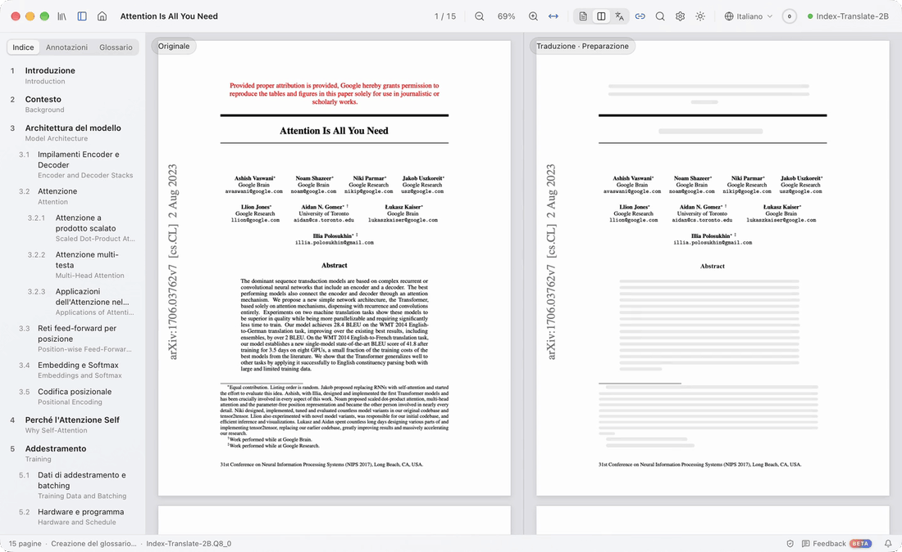
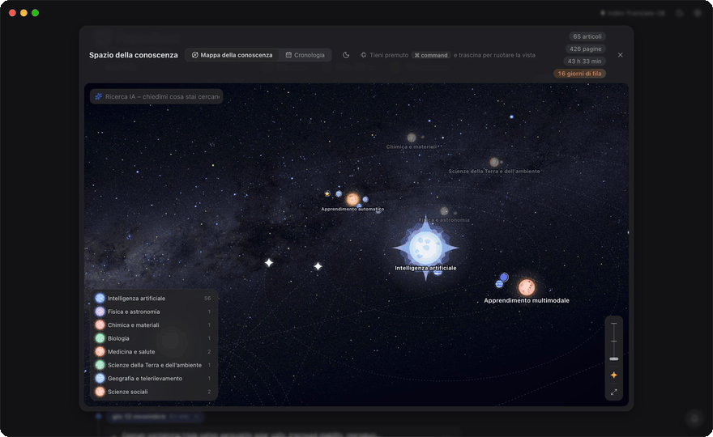
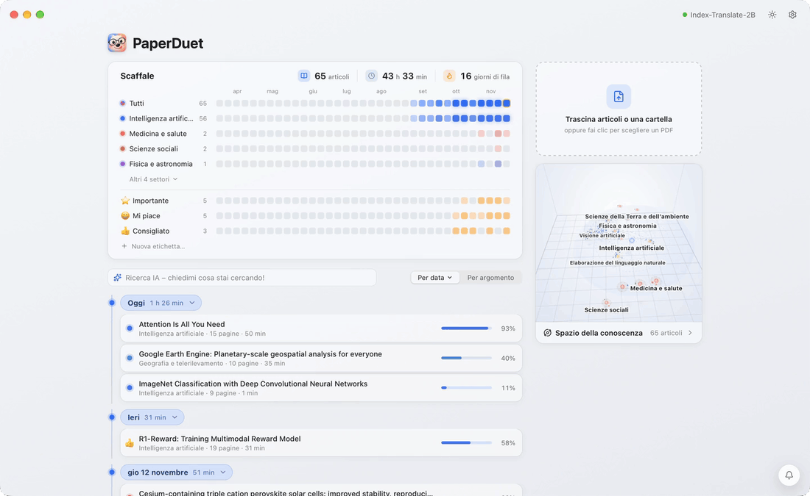
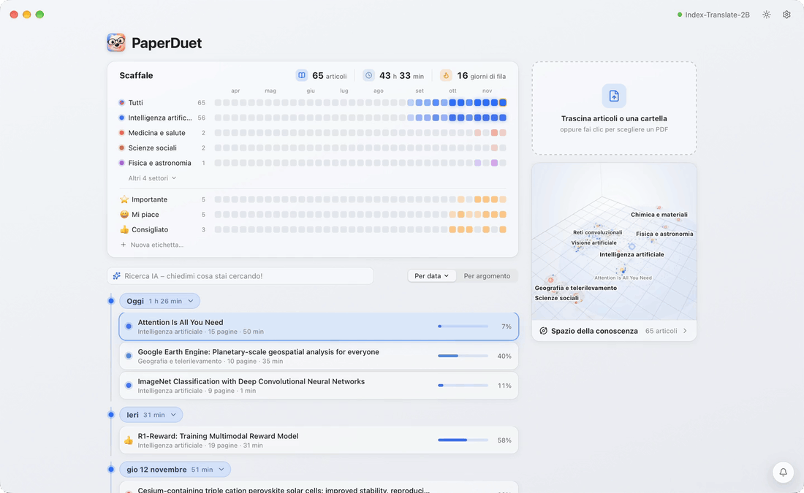
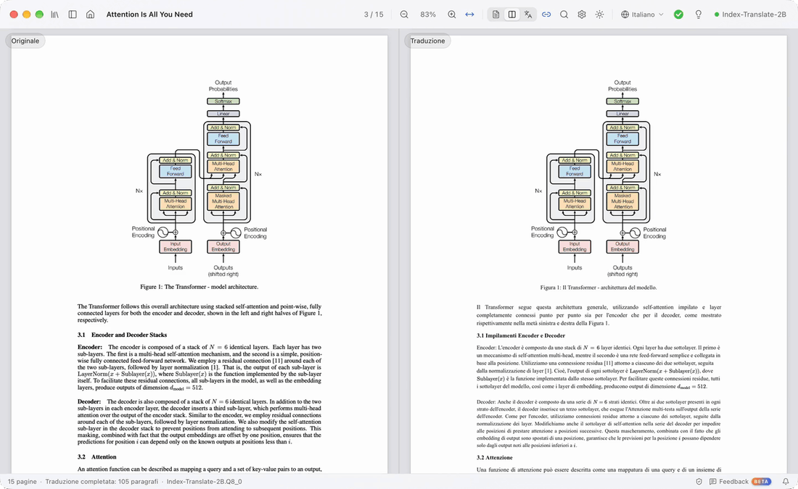
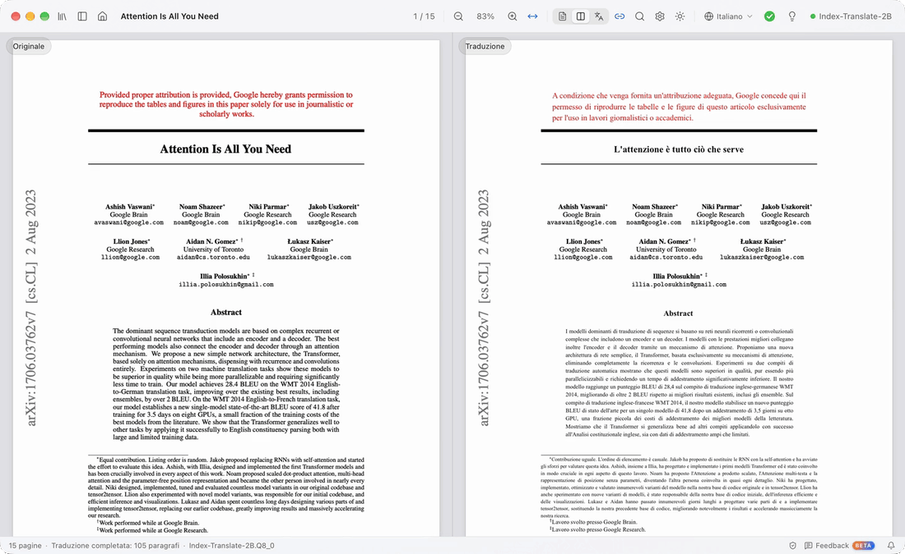
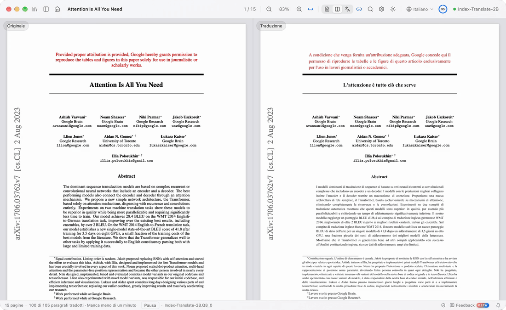

  

<h1 align="center">PaperDuet</h1>

  <em>Lo strumento dei ricercatori per gestire, studiare e capire gli articoli!</em> 
  <a href="https://paperduet.com">paperduet.com</a>

  <a href="README.md">English</a> &middot; <a href="README.zh-CN.md">简体中文</a> &middot; <a href="README.zh-TW.md">繁體中文</a> &middot; <a href="README.ja.md">日本語</a> &middot; <a href="README.ko.md">한국어</a> &middot; <a href="README.fr.md">Français</a> &middot; <a href="README.de.md">Deutsch</a> &middot; <a href="README.es.md">Español</a> &middot; <b>Italiano</b> &middot; <a href="README.pl.md">Polski</a> &middot; <a href="README.ru.md">Русский</a>

  
  
  

  
  
  
  
  
  

  <strong>PaperDuet ti aiuta a gestire, studiare e capire ogni articolo.</strong> 
  Sei modelli di traduzione IA open source girano sul tuo computer, oppure collega un’API online. 
  Gratis e senza registrazione!

PaperDuet è uno strumento per gestire, studiare e capire gli articoli: l’originale e la traduzione sono affiancati a specchio, con formule, figure e tabelle allineate pagina per pagina, e gli articoli che hai letto restano su uno scaffale e in uno spazio della conoscenza dove l’IA li ritrova. PaperDuet è gratuito: con un modello locale tutto gira sul tuo computer, e puoi collegare un’API online quando serve.

## Aprilo, ed è già in italiano

  

Trascina un PDF e la traduzione comincia. Prima i titoli: l’indice nella barra laterale è subito in italiano e vedi com’è costruito l’articolo; poi il titolo, l’abstract e l’introduzione. Sei modelli di traduzione open source girano sul tuo computer, oppure puoi collegare un’API online.

## La tua libreria è il tuo cielo stellato

  

Ecco Space: ora i tuoi articoli si aprono davanti a te come un cielo stellato. Puoi costruire, in modo più intuitivo, una base di conoscenza visiva tutta tua.

## Ogni progresso, registrato

  

Lo scaffale della pagina iniziale tiene il conto di quanti articoli hai letto, per quanto tempo in tutto e per quanti giorni di fila. Ogni casella è una settimana, più scura quanto più hai letto; fai clic su un campo e gli articoli e la cronologia sotto lo seguono. Con il clic destro metti le tue etichette a un articolo.

## Non trovi un articolo? Chiedilo all’IA!

  

Non serve ricordare il titolo: di’ in una frase che cosa cerchi e la ricerca IA lo trova in titoli, originali, traduzioni e riassunti, mostrando il passaggio trovato. Chiedi in italiano o in inglese.

## Ogni pagina, così com’era

  

L’originale a sinistra, la traduzione a destra; scorrono e si ingrandiscono insieme. Colonne, titoli, didascalie, note a piè di pagina e riferimenti vengono riconosciuti da soli, e formule, figure e tabelle restano al loro posto; punta un paragrafo e quello corrispondente dall’altra parte si illumina. Cambia lingua di traduzione e l’impaginazione resta la stessa.

## Vuoi prendere appunti? Fatto!

  

Evidenzia, sottolinea e scrivi note direttamente sulla traduzione; la frase corrispondente dell’originale viene segnata da sola. L’originale esportato con le tue note porta annotazioni PDF standard, così Anteprima, Zotero e altre app le mostrano così come sono.

## Finito? Portalo con te.

  

Quando tutto l’articolo è tradotto, l’anello nella barra degli strumenti diventa una spunta verde: un clic salva insieme il PDF tradotto, il Markdown e l’originale annotato nella cartella dell’articolo. La lampadina accanto è il riassunto IA, scritto dal modello dopo aver letto tutto l’articolo: la domanda, il metodo e i risultati a colpo d’occhio.

## E non è tutto

- **Dieci lingue in cui tradurre.** Passa con un clic, dalla barra degli strumenti, tra 简体中文, 繁體中文, 日本語, 한국어, Français, Deutsch, Español, Italiano, Polski e Русский.
- **Doppio clic per passare avanti.** Vuoi leggere prima un paragrafo più avanti? Fai doppio clic su di esso nell’originale e viene tradotto subito, senza aspettare che l’avanzamento ci arrivi.
- **Controlli di qualità integrati.** Formule, numeri e ordine delle frasi vengono verificati in ogni risposta, con nuovi tentativi automatici, e un glossario per ogni articolo mantiene coerenti i termini.
- **Decidi tu cosa tradurre.** Fai clic con il tasto destro su un blocco qualsiasi per tradurlo o tenere l’originale.
- **Leggi come preferisci.** Cerca nell’originale e nella traduzione insieme, sfoglia un indice bilingue, passa il puntatore su un paragrafo per trovare il suo gemello e mostra l’originale, la traduzione o entrambi. PaperDuet si ricorda dove avevi interrotto.
- **I tuoi termini.** Indica come vuoi tradurre un termine e tutto l’articolo lo segue.
- **Anche le scansioni.** I PDF in cui il testo è disegnato come forme anziché salvato come testo vengono letti con il riconoscimento del testo del sistema, su Mac e su Windows, e poi tradotti.
- **Cartelle sempre aggiornate.** Importa una cartella una volta e gli articoli che ci metti dopo compaiono da soli nella libreria.
- **Un clic per aggiornare, uno per fare pulizia.** Una nuova versione si installa con un clic; la cache si svuota con un clic nelle Impostazioni.
- **Bello da vedere.** Un design in vetro, pulito ed elegante, con modalità chiara, scura e di lettura notturna.

  

## Sei modelli, tutti sul tuo computer

Scegli un modello la prima volta che apri PaperDuet e cambialo quando vuoi in Impostazioni › Modello › Cambia modello. Sono tutti pensati per la traduzione e, una volta scaricati, funzionano completamente offline.

| Modello | Di | Dimensione | Ideale per |
| --- | --- | --- | --- |
| [Index-Translate-2B](https://huggingface.co/IndexTeam/Index-Translate-2B) **(consigliato)** | team Index di bilibili | 2.1 GB | Il più completo, calibrato sui controlli e sul glossario di PaperDuet |
| [Hy-MT2-1.8B](https://huggingface.co/tencent/Hy-MT2-1.8B-GGUF) | Tencent Hunyuan | 1.9 GB | Rapido e leggero |
| [LMT-60-4B](https://huggingface.co/NiuTrans/LMT-60-4B) | NiuTrans | 4.7 GB | Traduzioni fedeli al testo di partenza |
| [LMT-60-0.6B](https://huggingface.co/NiuTrans/LMT-60-0.6B) | NiuTrans | 0.8 GB | Computer meno potenti: il più piccolo e veloce |
| [Hy-MT2-7B](https://huggingface.co/tencent/Hy-MT2-7B-GGUF) | Tencent Hunyuan | 8.0 GB | La traduzione più scorrevole, su computer con 16 GB di memoria o più |
| [TranslateGemma-4B](https://huggingface.co/mradermacher/translategemma-4b-it-GGUF) (sperimentale) | Google | 4.1 GB | Provare il modello di traduzione di Google |

Con il modello consigliato, un articolo di 15 pagine richiede circa 2 minuti su un M5 Pro, o circa 1 minuto con «Paragrafi in parallelo» impostato su 2 o 3 in Impostazioni › Modello.

Hai già uno di questi modelli da LM Studio, llama.cpp o Hugging Face? PaperDuet lo trova e lo usa dov’è, senza scaricarlo di nuovo.

Il tuo computer fatica con i modelli locali? Scegli «Usa un’API» nella scelta del modello e inserisci la tua chiave API per usare OpenAI, Claude, DeepSeek, Qwen, Kimi, GLM, Doubao o qualsiasi servizio compatibile con OpenAI. I modelli locali si richiudono, e traduzione, riassunti, organizzazione e ricerca con l’IA passano tutti da quel servizio. La chiave resta sul tuo computer.

## Privacy fin dalla progettazione

- I tuoi articoli, le traduzioni e le note restano sul tuo computer. Con un’API, il testo da tradurre viene inviato al servizio scelto.
- Solo se acconsenti, PaperDuet invia dati anonimi di utilizzo e diagnostica (versione, sistema, lingua dell’interfaccia, modello e tipi di errore), mai il contenuto degli articoli, e puoi disattivare l’invio in qualsiasi momento nelle Impostazioni.
- Quando qualcosa va storto, PaperDuet invia una segnalazione di errore allo sviluppatore: cosa non ha funzionato, la versione e il sistema, senza percorsi dei file né contenuto degli articoli. Puoi disattivarla in Impostazioni › Dati.
- Quando scrivi un feedback nell’app e fai clic su Invia, quello che hai scritto (e la tua email, se la indichi) viene inviato allo sviluppatore insieme alla versione e al sistema.
- Con un modello locale, PaperDuet si collega a internet solo per scaricare un modello, cercare aggiornamenti e inviare i dati e le segnalazioni qui sopra e il tuo feedback; puoi disattivare tutto tranne il download del modello.

## Per iniziare

Un Mac deve avere Apple silicon (M1 o successivo) e macOS 13.3 o successivo; un PC, Windows 10 o 11 a 64 bit; Linux, Ubuntu 22.04 o successivo a 64 bit (o un’altra distribuzione altrettanto recente).

**Mac**

1. Scarica l’ultimo `.dmg` da [Releases](https://github.com/KalenHwei/PaperDuet/releases/latest).
2. Trascina PaperDuet in Applicazioni e aprilo da lì.
3. Solo al primo avvio: PaperDuet non è ancora notarizzato da Apple, quindi macOS ti chiede di confermare. Apri Impostazioni di Sistema › Privacy e sicurezza e fai clic su **Apri comunque**. (Oppure esegui `xattr -dr com.apple.quarantine /Applications/PaperDuet.app` nel Terminale.)
4. Scegli un modello. PaperDuet lo scarica, o trova la copia che hai già, e inizia subito a tradurre.

**Windows**

1. Scarica l’ultimo programma di installazione per Windows (`_x64-setup.exe`) da [Releases](https://github.com/KalenHwei/PaperDuet/releases/latest).
2. Avvialo. Solo la prima volta: se Windows mostra «PC protetto da Windows», fai clic su **Ulteriori informazioni** e poi su **Esegui comunque**.
3. Scegli un modello. PaperDuet lo scarica, o trova la copia che hai già, e inizia subito a tradurre.

**Linux**

1. Scarica l’ultimo `.deb` (Ubuntu, Debian) o `.AppImage` (altre distribuzioni, o senza permessi di amministratore) da [Releases](https://github.com/KalenHwei/PaperDuet/releases/latest).
2. `.deb`: esegui `sudo apt install ./PaperDuet_*_amd64.deb` in un terminale, poi apri PaperDuet dal menu delle applicazioni. `.AppImage`: non serve installarlo; esegui `chmod +x PaperDuet_*_amd64.AppImage` e aprilo.
3. Scegli un modello. PaperDuet lo scarica, o trova la copia che hai già, e inizia subito a tradurre.

Tutto qui. Il motore di traduzione è integrato nell’app e gli aggiornamenti richiedono un clic.

<b>Abbreviazioni da tastiera</b>

| Azione | Abbreviazione |
| --- | --- |
| Apri un PDF | ⌘O |
| Chiudi l’articolo | ⌘W |
| Cerca su entrambi i lati | ⌘F |
| Risultato successivo / precedente | ⌘G / ⇧⌘G |
| Ingrandisci / riduci / adatta alla larghezza | ⌘+ / ⌘− / ⌘0 |
| Zoom attorno al puntatore | ⌘ + scorrimento, o pizzica sul trackpad |
| Sposta le pagine | ⌘ + trascinamento |
| Traduci prima questa parte | Doppio clic su un testo non ancora tradotto |
| Evidenzia la selezione | H |
| Aggiungi una nota alla selezione | N |
| Colore dell’evidenziazione | Da 1 a 5 |
| Annulla / ripeti | ⌘Z / ⇧⌘Z |
| Mostra o nascondi la barra laterale | ⌘\ |
| Attiva o disattiva lo scorrimento sincronizzato | ⌘L |
| Tutte le abbreviazioni | ⌘/ |

H, N e i tasti da 1 a 5 agiscono sul testo selezionato. Su Windows e Linux, usa Ctrl al posto di ⌘ e Maiusc al posto di ⇧.

## Domande frequenti

### Quale modello scelgo?

Inizia con Index-Translate-2B. Per più velocità, scegli Hy-MT2-1.8B. Per la traduzione più scorrevole su un computer con 16 GB di memoria o più, scegli Hy-MT2-7B. Se il computer fatica, scegli «Usa un’API».

### È gratis?

Sì, per lo studio e la ricerca personali, e per università, scuole, istituti di ricerca e altri enti non profit. Per usare PaperDuet in un’azienda o per conto di un’azienda serve una licenza commerciale: scrivi a [support@paperduet.com](mailto:support@paperduet.com).

## Roadmap

- **Traduzioni impaginate da arXiv.** Tradurre il sorgente LaTeX di un articolo e compilarlo con i font della lingua di destinazione, per un’edizione tradotta completamente impaginata.

## Registro delle modifiche

- **0.8.6** (2026-11-13): corretti errori noti.
- **0.8.5** (2026-11-13): PaperDuet 0.8.5 è arrivato🎉! Lo spazio della conoscenza ora è fatto di galassie🌌. Più articoli ci sono, più la stella è grande e luminosa, e quando ne avrai letti abbastanza diventa un buco nero! Puoi anche trascinare le stelle: prova e guarda come si muovono. Puoi creare le tue categorie: clic destro su una categoria nello spazio della conoscenza o nello scaffale per aggiungerne una nuova. Trascina gli articoli su una categoria, oppure sceglila in «Sposta in» nel menu contestuale, e sono archiviati📂. Suddivisione automatica con IA✨: clic destro su una categoria, poi «Suddividi automaticamente», e l’IA integrata di PaperDuet raggruppa i suoi articoli per contenuto in alcune sottocategorie e dà loro un nome. Naturalmente puoi cambiare i nomi come preferisci! Inoltre sono state corrette le traduzioni illeggibili o mancanti di alcuni PDF, e lo spazio della conoscenza è più pulito. Vieni a provarlo🚀!
- **0.8.4** (2026-11-12): È arrivato PaperDuet 0.8.4 🎉! Schede: apri più articoli insieme. Passa sopra una scheda per l’anteprima, trascinala per cambiare l’ordine e fai clic destro per il menu completo. Oltre il numero impostato, le schede vanno in sospensione per risparmiare memoria e si riattivano con un clic ⚡️. La Mappa della conoscenza è più comoda: ricerca IA direttamente in alto a sinistra, e si possono mostrare le stelle degli argomenti. Con un clic destro su un campo, un sottocampo o una stella si esportano tutte le citazioni in una volta, o si salvano in un file 📚. Selezionare articoli: clic per selezionare, ⌘ o Ctrl per sceglierne più d’uno, doppio clic per aprire. Con il clic destro si possono etichettare, spostare o esportarne le citazioni (BibTeX / EndNote / RefMan / RefWorks) insieme. I PDF il cui testo è disegnato come forme (come alcuni articoli CVPR) ora si possono tradurre: su Mac e Windows il riconoscimento del testo del sistema legge il testo 🔍. Nuovo «Ritraduci» nel menu contestuale di un articolo: ritraduce l’intero articolo dall’inizio con il modello selezionato. Inoltre, corretti tra gli altri la traduzione che non compariva dopo lo zoom con lo scorrimento sincronizzato sui macOS meno recenti e il prompt di TranslateGemma che compariva nella traduzione, e si usa meno memoria. Provalo subito 🚀!
- **0.8.2** (2026-11-11): aggiunta una barra nella Mappa della conoscenza per regolare i livelli visibili.
- **0.8.1** (2026-11-11): corretti errori noti.
- **0.8.0** (2026-11-11): Arriva PaperDuet 0.8 🎉! Nuovo componente IA: la libreria si ordena da sola in base al contenuto, la Ricerca IA trova gli articoli per significato e porta dritto al passaggio più pertinente, e gli articoli simili sono collegati nello Spazio della conoscenza 🧠! Importare è molto più veloce: trascina articoli o una cartella e lo Scaffale e lo Spazio della conoscenza li classificano subito; la classificazione più fine si completa in silenzio in background e si ferma mentre traduci ⚡️. Lo Spazio della conoscenza mostra solo i nomi dei campi e il titolo di un articolo compare quando ci passi sopra, così non è più affollato. In basso a destra c’è una piccola campanella 🔔 con annunci, sondaggi e le novità di ogni aggiornamento. Inoltre, corretti alcuni sfarfallii e arresti anomali. Provalo subito 🚀!
- **0.7.9** (2026-11-10): glossario personalizzabile: aggiungi, modifica o elimina i termini nel Glossario, e quelli segnati «Usa in tutti gli articoli» valgono per ogni articolo; il pannello della libreria mostra subito lo Scaffale e la prima etichetta di un articolo compare davanti al suo nome; nelle Impostazioni si può svuotare la cache con un clic e vedere tutte le scorciatoie; corretto lo zoom con Control su Mac.
- **0.7.8** (2026-11-10): gli articoli scansionati si traducono correttamente; una cartella aggiunta può essere aggiornata automaticamente e i nuovi PDF vengono importati con un’etichetta tutta sua sullo Scaffale; nelle Impostazioni si può mantenere il nome dei file PDF come nome dell’articolo; le API personalizzate funzionano con servizi locali come Ollama; corretto il testo non tradotto nei moduli e dopo aver ridimensionato la finestra.
- **0.7.7** (2026-11-09): corretti alcuni problemi noti nella logica di interazione.
- **0.7.6** (2026-11-09): nuovo tour della pagina iniziale: lo Scaffale, la ricerca IA, Per data / Per argomento, il clic destro su un articolo e lo Spazio della conoscenza.
- **0.7.5** (2026-11-09): abbiamo rifatto da capo l’intera pagina iniziale 🎉! Il nuovo Scaffale riunisce cronologia di lettura, settori ed etichette: vedi a colpo d’occhio cosa hai letto ogni settimana. Lo Spazio della conoscenza diventa un piccolo universo: i settori sono soli, gli articoli pianeti e, in modalità scura, dietro di loro brilla la vera Via Lattea 🌌! Con un clic destro su un articolo puoi cambiarne la categoria, aggiungere etichette, rinominarlo o scrivere una nota. La ricerca IA capisce domande normali come «una volta ho letto un articolo sui Transformer» e lo trova subito 🔍! A traduzione finita, PDF tradotto, Markdown tradotto e note vengono salvati insieme nella cartella dell’articolo. Provalo subito 🚀!
- **0.7.4** (2026-11-08): corretto il problema di evidenziazione segnalato su GitHub.
- **0.7.3** (2026-11-08): evidenziatore (Maiusc per cambiare colore) e passaggio chiaro/scuro; la traduzione riprova da sola invece di fermarsi; screenshot nei feedback.
- **0.7.2** (2026-11-05): animazioni migliorate.
- **0.7.1** (2026-11-05): abbiamo migliorato l’esperienza d’uso della libreria.
- **0.7.0** (2026-11-05): abbiamo ricostruito l’AI Library 🎉! Arriva lo Spazio della conoscenza e l’AI Library è molto più comoda da usare. Anche i pulsanti della barra in alto sono più essenziali e pratici.
- **0.6.12** (2026-11-05): per risolvere i problemi di impaginazione, un modello visivo dell’impaginazione controlla ora ogni pagina: tabelle, formule, figure, intestazioni e piè di pagina non vengono più tradotti per errore e il testo scambiato per una tabella viene tradotto, rendendo la traduzione molto più precisa e robusta. Il modello si scarica in background insieme al modello di traduzione.
- **0.6.11** (2026-11-04): Grazie ai tanti utenti che ci hanno inviato segnalazioni di errori davvero preziose; per motivi di privacy non possiamo ringraziarli pubblicamente. Questo aggiornamento corregge soprattutto gli articoli interi che non venivano tradotti a causa di un bug di ricorsione, i paragrafi rimasti in parte non tradotti perché una regola di controllo li valutava in modo errato e le imprecisioni nel riconoscimento dell'impaginazione. Speriamo che offra a tutti un'esperienza migliore.
- **0.6.10** (2026-11-04): corretti i problemi di connessione all’API.
- **0.6.9** (2026-11-03): corretto lo scorrimento a scatti nella versione per Linux.
- **0.6.8** (2026-11-03): nuovo modello LMT-60-0.6B: il più piccolo (805 MB) e il più veloce, per computer meno potenti.
- **0.6.7** (2026-11-03): siamo felici di pubblicare la versione per Linux!
- **0.6.6** (2026-11-03): riconoscimento migliore dell'impaginazione di alcuni articoli di rivista: le due colonne non si mescolano più, l'abstract su uno sfondo colorato viene tradotto e l'indice mostra solo i titoli delle sezioni.
- **0.6.5** (2026-10-31): negli articoli con numeri di riga (ad esempio i manoscritti inviati) i numeri non finiscono più nella traduzione e non spezzano i paragrafi.
- **0.6.4** (2026-10-30): corretti alcuni problemi di formattazione noti.
- **0.6.3** (2026-10-29): risolti alcuni problemi noti nella logica dell’interfaccia.
- **0.6.2** (2026-10-28): su Windows si può scegliere dove tenere i modelli; quelli già scaricati vengono spostati lì.
- **0.6.1** (2026-10-28): corretti alcuni problemi di formattazione noti.
- **0.6.0** (2026-10-28): un breve tour delle funzioni principali la prima volta che apri un articolo e il feedback beta: inviaci la tua opinione direttamente dalla barra di stato.
- **0.5.17** (2026-10-28): corretti alcuni problemi di formattazione noti.
- **0.5.16** (2026-10-28): i paragrafi dei manoscritti (esportati da Word, con interlinea doppia) non restano più in inglese: le righe evidenziate vengono tradotte, i paragrafi con interlinea doppia vengono tradotti interi e non riga per riga, e le didascalie delle figure poste dopo la bibliografia vengono tradotte.
- **0.5.15** (2026-10-28): i simboli delle formule nelle riviste Elsevier non risultano più alterati: lettere greche, ≤, ∀, ≠ e lettere con il cappello (Ŝ, q̂) non appaiono più come lettere normali, e un apice posto molto in alto non finisce più nella riga sopra.
- **0.5.14** (2026-10-28): corretti alcuni errori di formattazione noti.
- **0.5.13** (2026-10-28): le formule non risultano più alterate: le equazioni in display con frazioni e sommatorie restano intere invece di essere tradotte a pezzi sopra se stesse, e le sommatorie nel testo, le radici e le righe di formule molto spaziate non spezzano più la frase.
- **0.5.12** (2026-10-27): gli articoli di riviste vengono resi con più precisione: righe di statistiche, sottotitoli numerati, frasi che proseguono nella colonna successiva, lettere greche come χ², nomi accentati e segni meno nelle tabelle non risultano più alterati; il PDF tradotto esportato ha una spaziatura tra le lettere uniforme. Grazie a momo su RedNote per i suggerimenti.
- **0.5.11** (2026-10-27): lo pseudocodice viene tradotto riga per riga, mantenendo numeri di riga, rientri e parole chiave; le tabelle vengono riconosciute meglio, il loro contenuto resta in originale e si traducono solo titoli e note, quindi non risultano più scomposte; le sommatorie nel testo non spariscono più dalla traduzione.
- **0.5.10** (2026-10-27): traduzione tramite un’API online: se il computer fatica con i modelli locali, scegli «Usa un’API» nella scelta del modello per usare OpenAI, Claude, DeepSeek, Qwen, Kimi, GLM, Doubao o qualsiasi servizio compatibile con OpenAI; l’elenco dei modelli locali si richiude.
- **0.5.9** (2026-10-26): correzione di problemi esistenti.
- **0.5.8** (2026-10-26): il polacco come lingua di traduzione e dell’interfaccia; correzioni: su macOS 26 e precedenti gli articoli non si potevano leggere né tradurre; su macOS 27 non si riusciva a salvare il PDF tradotto di alcuni articoli.
- **0.5.7** (2026-10-26): lettura più accurata degli articoli di rivista, provata su articoli di 20 grandi riviste: colonne, titoli, bibliografia, tabelle, didascalie e simboli propri degli editori; gli articoli di Science non restano più in gran parte non tradotti, e le appendici dopo la bibliografia vengono tradotte.
- **0.5.6** (2026-10-25): l’italiano come lingua di traduzione e dell’interfaccia; segnalazioni di errore allo sviluppatore quando qualcosa va storto, per aiutare a risolvere i problemi (attive per impostazione predefinita, si possono disattivare in Impostazioni › Dati).
- **0.5.5** (2026-10-25): le righe molto spaziate degli articoli di rivista non vengono più spezzate in parole sparse, che mancavano nella traduzione o finivano nel posto sbagliato; l’abstract viene tradotto subito dopo il titolo; meno errori «Analisi del layout non riuscita»; i trattini negli articoli Elsevier non vengono più letti come «e».
- **0.5.4** (2026-10-24): un’interfaccia più pulita, senza i testi esplicativi superflui; il campo di ricerca IA ora mostra «Cerca con l’IA».
- **0.5.3** (2026-10-24): PaperDuet ora chiede una volta se vuoi condividere dati anonimi di utilizzo e diagnostica per aiutare a migliorarlo; mai il contenuto degli articoli, e puoi disattivare la condivisione in qualsiasi momento in Impostazioni › Dati.
- **0.5.2** (2026-10-24): la ricerca IA 🔍 nella libreria trova gli articoli che hai letto per titolo, testo originale, traduzione, riassunto o etichette, in italiano o in inglese; la ricerca e «Organizza con l’IA» portano in cima gli articoli trovati e mettono in grigio gli altri.
- **0.5.1** (2026-10-24): una libreria al posto del pannello delle cartelle, con tutti gli articoli letti o importati, rinominati sul posto e riassunti; importazione di più PDF o di un’intera cartella; «Organizza con l’IA» ✨ filtra gli articoli per ambito e argomento; correzioni per tabelle illeggibili e paragrafi che in alcuni articoli non venivano tradotti.
- **0.5.0** (2026-10-24): un riassunto dell’articolo 💡 dietro la lampadina, quando l’articolo è tutto tradotto; il pannello delle cartelle apre la sua cartella con un clic; una versione per Windows.
- **0.4.1** (2026-10-23): descrizioni più chiare nell’elenco dei modelli e nelle Impostazioni.
- **0.4.0** (2026-10-23): l’interfaccia è disponibile in 9 lingue. Per impostazione predefinita segue la lingua del sistema, e puoi cambiarla in Impostazioni › Aspetto › Lingua dell’interfaccia.
- **0.3.2** (2026-10-23): altre correzioni dell’allineamento nella traduzione verso altre lingue.
- **0.3.1** (2026-10-23): miglioramenti all’anello di avanzamento e alla barra degli strumenti.
- **0.3.0** (2026-10-23): otto lingue in cui tradurre 🎉, da cambiare con un clic dalla barra degli strumenti; un anello di avanzamento migliore e interazioni più fluide.
- **0.2.1** (2026-10-23): cinque modelli di traduzione tra cui scegliere; una nuova schermata di avvio.
- **0.2.0** (2026-10-23): controllo degli aggiornamenti nell’app, con aggiornamento in un clic.
- **0.1.0** (2026-10-22): prima versione.

Cronologia completa: [CHANGELOG.md](CHANGELOG.md).

## Licenza

PaperDuet è gratuito per l’uso non commerciale ai sensi della [PolyForm Noncommercial License 1.0.0](LICENSE). Usalo e condividilo per scopi personali, di studio, di ricerca o non profit; quando lo condividi, includi la licenza e la riga `Required Notice: Copyright (c) 2026 Kalen Yongda Wei`. Per l’uso commerciale, scrivi a [support@paperduet.com](mailto:support@paperduet.com).

Copyright © 2026 Kalen Yongda Wei.

## Ringraziamenti

PaperDuet si basa su [Tauri](https://tauri.app), [pdf.js](https://mozilla.github.io/pdf.js/), [pdf-lib](https://pdf-lib.js.org), [llama.cpp](https://github.com/ggml-org/llama.cpp), [React](https://react.dev), [Zustand](https://github.com/pmndrs/zustand) e [Lucide](https://lucide.dev). I modelli di traduzione vengono dal team Index di bilibili (Index-Translate-2B), da Tencent Hunyuan (Hy-MT2), da NiuTrans (LMT) e da Google (TranslateGemma); sono distribuiti con licenza Apache-2.0, tranne TranslateGemma, soggetto ai [Termini di utilizzo di Gemma](https://ai.google.dev/gemma/terms). I testi completi delle licenze sono nell’app (Impostazioni › Info › Licenze di terze parti).

L’articolo nelle animazioni è [_Attention Is All You Need_](https://arxiv.org/abs/1706.03762) di Vaswani et al.
