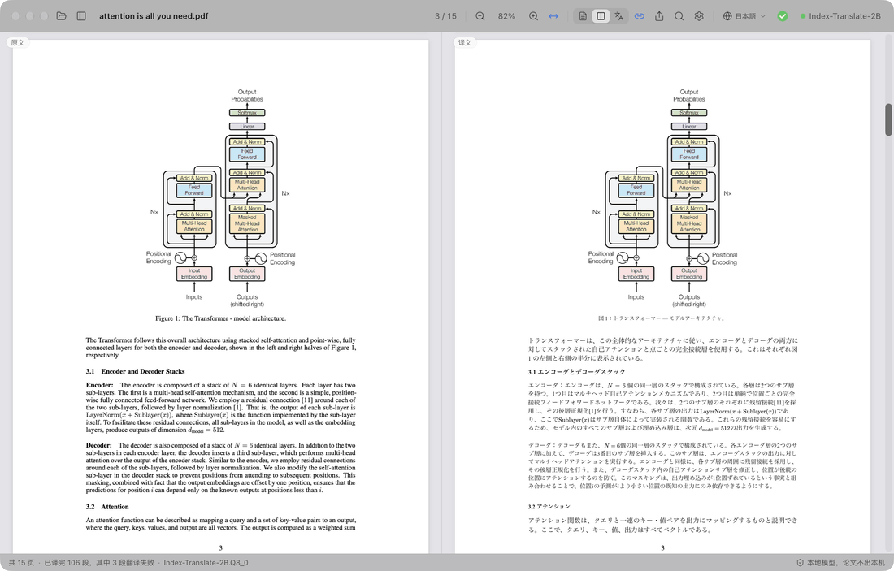
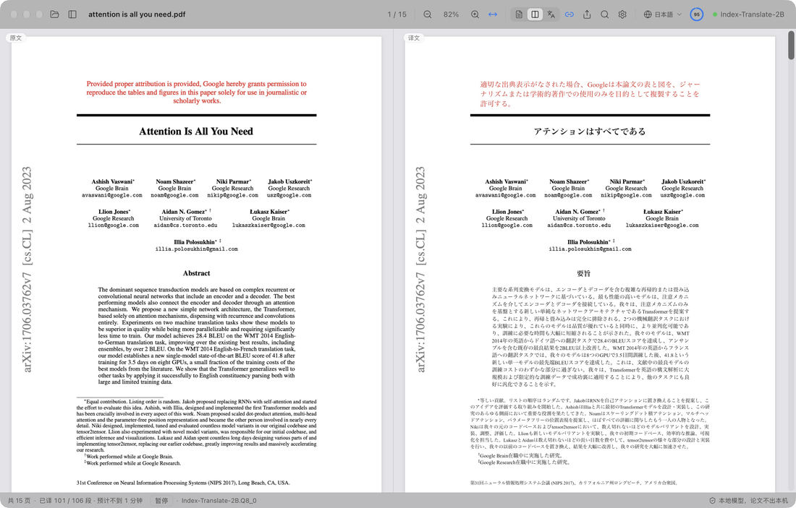
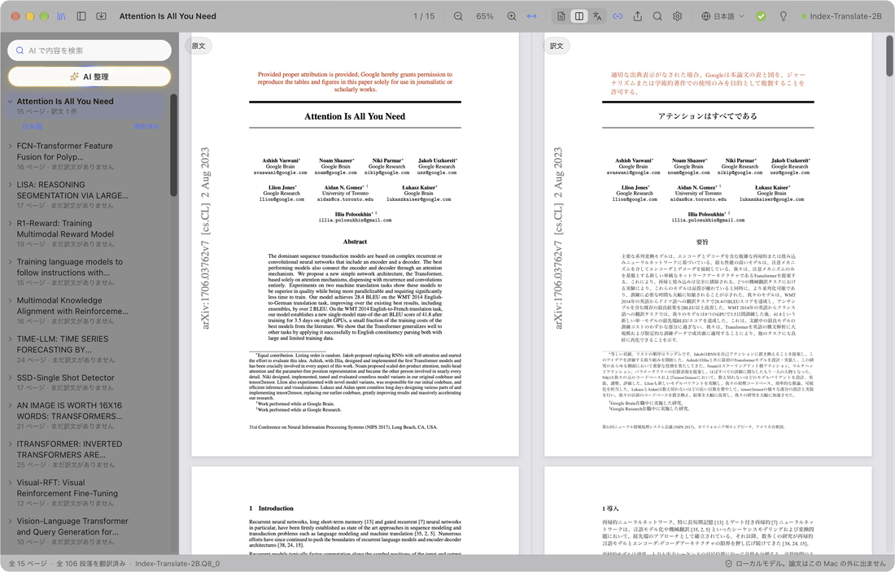
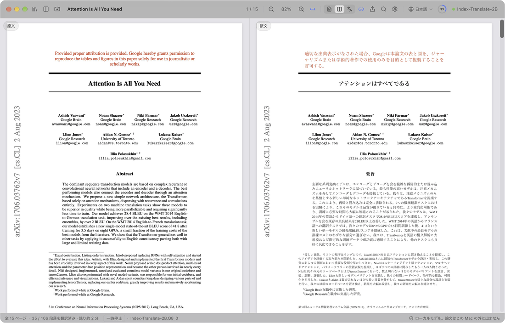
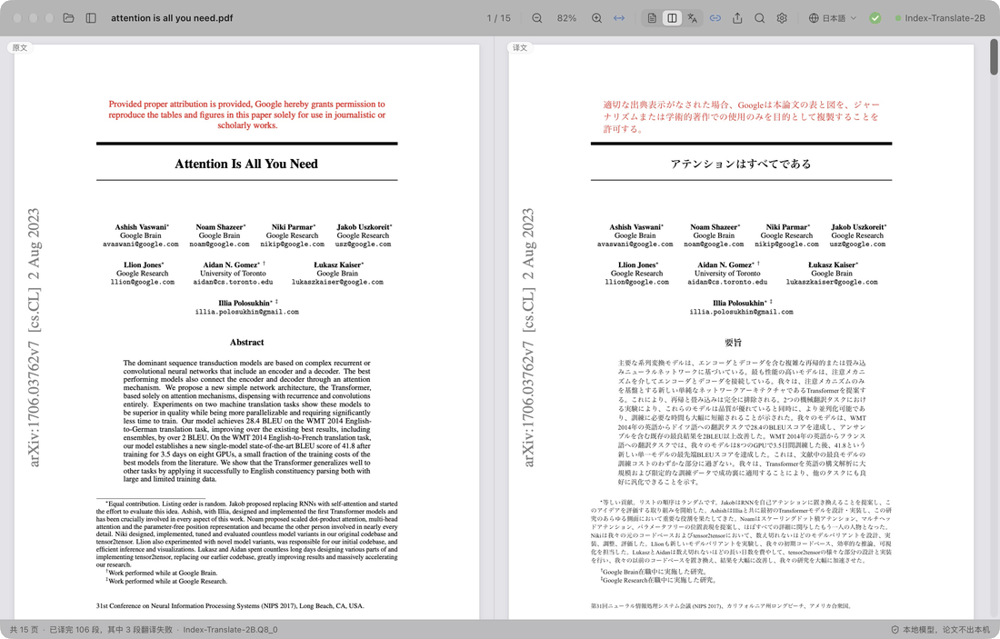

  

<h1 align="center">PaperDuet</h1>

  <em>研究者のための、軽量な論文 AI 翻訳ツール！</em> 
  <a href="https://paperduet.com">paperduet.com</a>

  <a href="README.md">English</a> &middot; <a href="README.zh-CN.md">简体中文</a> &middot; <a href="README.zh-TW.md">繁體中文</a> &middot; <b>日本語</b> &middot; <a href="README.ko.md">한국어</a> &middot; <a href="README.fr.md">Français</a> &middot; <a href="README.de.md">Deutsch</a> &middot; <a href="README.es.md">Español</a> &middot; <a href="README.it.md">Italiano</a> &middot; <a href="README.pl.md">Polski</a> &middot; <a href="README.ru.md">Русский</a>

  
  

  
  
  
  
  
  

  <strong>PaperDuet は、元のレイアウトを保ったまま論文を訳す、軽量な AI ミラー翻訳ツールです。</strong> 
  オープンソースの AI 翻訳モデルを 5 種類から選べます。 
  無料、すべてローカルで動作！

   
  Attention Is All You Need（15 ページ）を最初から翻訳したときの録画

PaperDuet は論文向けの軽量な AI ミラー翻訳ツールです。原文と訳文を鏡のように並べ、数式・図・表もページごとに整えて位置をそろえます。API キーも料金も不要で、すべてパソコンの中で動きます！

## どのページも見比べやすく

  

左に原文、右に訳文。両側は一緒にスクロールし、一緒に拡大縮小します。段組み、見出し、キャプション、脚注、参考文献は自動で認識し、段やページをまたぐ段落もつなげて訳します。左右がぴったりそろうので、見比べるのも簡単です。

## 保存も、AI 要約も。おまかせ。

  

翻訳の進み具合はツールバーに表示されます。全文を訳し終えるとリングが緑のチェックに変わり、ワンクリックで訳文を PDF として元の論文の隣に保存できます。隣の電球を開けば、モデルが全文を読んで書いた AI 要約が読めます。研究の問い、手法、結果がひと目でわかります。5 つのモデルから、パソコンと用途に合わせて選べます。

## 思いつけば、見つかる。

  

読んだ論文はすべてライブラリに。AI 整理が分野・領域・トピックごとにタグを付け、選んだタグの論文が上に浮かびます。AI 検索ならタイトル、原文、訳文、要約まで探せて、日本語でも英語でも検索できます。

## わからない？クリックしよう。

  

まず見出しを訳すので、論文の構成がすぐにわかります。続いてタイトル、要旨、序論。先に読みたい段落があれば、原文をダブルクリックするだけ。進捗を待たずに、そこから先に訳します。

## メモも、訳文の上で。

  

訳文に直接ハイライト、下線、メモ。原文の対応する文にも自動で同じ印が付きます。注釈付きの原文 PDF は標準の PDF 注釈で書き出すので、プレビューや Zotero などのアプリでもそのまま見られます。

## ほかにもいろいろ

- **10 の言語に翻訳**：ツールバーで简体中文、繁體中文、日本語、한국어、Français、Deutsch、Español、Italiano、Polski、Русскийをワンクリックで切り替えられます。
- **訳文 PDF をクリック 1 回で**：全文を訳し終えたら、クリック 1 回で元のレイアウトのまま論文の隣に保存します。
- **品質チェックを内蔵**：モデルの返答ごとに数式、数値、文の順番を確かめ、問題があれば自動でやり直します。論文ごとの用語集で訳語もそろえます。
- **何を訳すかはあなた次第**：どのブロックも右クリックで、翻訳するか原文のまま残すかを選べます。
- **好きなように読める**：原文と訳文をまとめて検索し、2 か国語の目次をたどり、段落にポインタを合わせれば反対側の対応箇所がわかります。原文だけ、訳文だけ、両方の表示を切り替えられ、読んでいた場所も覚えています。
- **論文ライブラリと AI 検索**：読んだ論文と読み込んだ論文は、サイドバーのライブラリにまとまります。AI 検索はタイトル・原文・訳文・要約から読んだ論文を探し出し、検索語は日本語でも英語でも使えます。AI 整理は分野とトピックで論文を分類します。
- **論文の要約**：全文を訳し終えたら電球をクリック。翻訳モデルが表示言語で短い要約を書き、論文と一緒に保存します。
- **どこへでも書き出し**：注釈付きの原文 PDF、訳文 PDF、Markdown 形式のノートを書き出せます。ほかのアプリでも開けます。
- **ワンクリックで更新**：新しいバージョンへの更新はかんたんで、クリック 1 回でインストールできます。
- **見た目にもこだわり**：すっきりしたすりガラスのデザインで、ライト、ダーク、夜間読書の各モードに対応しています。

  

## 5 つのモデルが、すべてパソコンの中に

PaperDuet を初めて開くときにモデルを選び、あとから「設定 › モデル › モデルを変更」でいつでも切り替えられます。どれも翻訳専用のモデルで、ダウンロードが済めば完全にオフラインで動きます。

| モデル | 提供元 | サイズ | 向いている用途 |
| --- | --- | --- | --- |
| [Index-Translate-2B](https://huggingface.co/IndexTeam/Index-Translate-2B) **（おすすめ）** | bilibili Index チーム | 2.1 GB | 総合力がいちばん高く、PaperDuet のチェックと用語集に合わせて調整済み |
| [Hy-MT2-1.8B](https://huggingface.co/tencent/Hy-MT2-1.8B-GGUF) | Tencent Hunyuan | 1.9 GB | 速さ重視：いちばん速く、いちばん軽い |
| [LMT-60-4B](https://huggingface.co/NiuTrans/LMT-60-4B) | NiuTrans | 4.7 GB | 原文に忠実な訳 |
| [Hy-MT2-7B](https://huggingface.co/tencent/Hy-MT2-7B-GGUF) | Tencent Hunyuan | 8.0 GB | いちばん流暢な訳文。メモリ 16 GB 以上のパソコン向け |
| [TranslateGemma-4B](https://huggingface.co/mradermacher/translategemma-4b-it-GGUF) （試験的） | Google | 4.1 GB | Google の翻訳モデルを試したいときに |

おすすめのモデルなら、15 ページの論文が M5 Pro で約 2 分。「設定 › モデル」で「同時に翻訳する段落数」を 2 か 3 にすれば約 1 分です。

LM Studio、llama.cpp、Hugging Face でこれらのモデルをすでにダウンロード済みですか？ PaperDuet が見つけてそのまま使うので、もう一度ダウンロードする必要はありません。

パソコンの性能が足りずローカルモデルが重いときは、モデル選択で「API を使う」を選び、自分の API キーを入れてください。OpenAI、Claude、DeepSeek、Qwen、Kimi、GLM、Doubao、または OpenAI 互換の任意のサービスにつなげられます。ローカルモデルの一覧は自動で折りたたまれ、翻訳、要約、AI 整理、AI 検索はすべてそのサービスで動きます。API キーはパソコンの中にだけ保存されます。

## プライバシーを最初から大切に

- 論文、訳文、メモはすべてパソコンの中にとどまります。API を使う場合は、翻訳するテキストが選んだサービスに送られます。
- 同意した場合に限り、匿名の使用状況と診断データ（バージョン、システム、表示言語、使用モデル、エラーの種類）を送信します。論文の内容は含まず、設定でいつでもオフにできます。
- エラーが起きたときは、開発者にエラー情報（何が起きたか、バージョン、システム）を送ります。ファイルのパスや論文の内容は含まず、「設定 › データ」でオフにできます。
- ローカルモデルを使う場合、インターネットに接続するのは、モデルのダウンロード、アップデートの確認、上のデータとエラー情報の送信のときだけです。モデルのダウンロード以外はオフにできます。

## はじめかた

Mac は Apple シリコン（M1 以降）と macOS 13.3 以降、Windows は Windows 10 または 11（64 ビット）が必要です。

**Mac**

1. [Releases](https://github.com/KalenHwei/PaperDuet/releases/latest) から最新の `.dmg` をダウンロードします。
2. PaperDuet を「アプリケーション」フォルダにドラッグし、そこから開きます。
3. 初回のみ：PaperDuet はまだ Apple の公証を受けていないため、macOS が確認を求めます。システム設定 › プライバシーとセキュリティ を開き、**このまま開く** をクリックしてください。（ターミナルで `xattr -dr com.apple.quarantine /Applications/PaperDuet.app` を実行しても構いません。）
4. モデルを選びます。PaperDuet がダウンロードするか、手元にあるものを見つけて、すぐに翻訳を始めます。

**Windows**

1. [Releases](https://github.com/KalenHwei/PaperDuet/releases/latest) から最新の Windows 用インストーラー（`_x64-setup.exe`）をダウンロードします。
2. インストーラーを実行します。初回のみ：「Windows によって PC が保護されました」と表示されたら、**詳細情報** をクリックし、**実行** をクリックします。
3. モデルを選びます。PaperDuet がダウンロードするか、手元にあるものを見つけて、すぐに翻訳を始めます。

これだけです。翻訳エンジンはアプリに組み込まれていて、アップデートもクリック 1 回です。

<b>キーボードショートカット</b>

| 操作 | ショートカット |
| --- | --- |
| PDF を開く | ⌘O |
| 論文を閉じる | ⌘W |
| 両側を検索 | ⌘F |
| 次 / 前の一致 | ⌘G / ⇧⌘G |
| 拡大 / 縮小 / 幅に合わせる | ⌘+ / ⌘− / ⌘0 |
| ポインタを中心に拡大縮小 | ⌘ + スクロール、またはトラックパッドでピンチ |
| ページを動かす | ⌘ + ドラッグ |
| この部分を次に訳す | まだ訳されていないテキストをダブルクリック |
| 選択範囲をハイライト | H |
| 選択範囲にメモを追加 | N |
| ハイライトの色 | 1〜5 |
| 取り消す / やり直す | ⌘Z / ⇧⌘Z |
| サイドバーの表示 / 非表示 | ⌘\ |
| スクロール同期のオン / オフ | ⌘L |
| すべてのショートカット | ⌘/ |

H、N、1〜5 は選択中のテキストに使えます。Windows では ⌘ の代わりに Ctrl、⇧ の代わりに Shift を使います。

## よくある質問

### どのモデルを選べばいいですか？

まずは Index-Translate-2B から。速さを求めるなら Hy-MT2-1.8B、メモリ 16 GB 以上のパソコンでいちばん流暢な訳文が欲しいなら Hy-MT2-7B を選んでください。パソコンで動かすのが重い場合は「API を使う」を選んでください。

### 無料ですか？

はい。個人の学習や研究、大学、学校、研究機関、その他の非営利団体での利用は無料です。企業内での利用や企業のための利用には商用ライセンスが必要です。[junystugh@gmail.com](mailto:junystugh@gmail.com) までご連絡ください。

## 今後の予定

- **arXiv の論文をきちんと組版して翻訳**：論文の LaTeX ソースを翻訳し、訳文の言語のフォントでコンパイルして、組版まで整った翻訳版を作ります。

## 更新履歴

- **0.5.14**（2026-10-28）：既知の書式の不具合をいくつか修正しました。
- **0.5.13**（2026-10-28）：数式まわりの文字化けを修正しました。分数や総和記号を含む別行立ての数式は丸ごと元のまま残し、断片ごとに翻訳されて重なったり総和記号が隠れたりしなくなりました。文中の総和記号や根号、字間の広い数式の行で文が分断されることもなくなりました。
- **0.5.12**（2026-10-27）：学術誌の論文をより正確に処理できるようになりました。統計結果の行、番号付きの小見出し、次の段に続く文、χ² などのギリシャ文字、人名のアクセント記号、表中のマイナス記号が崩れなくなり、書き出した訳文 PDF の字間も均一になりました。ご提案をくださった RedNote（小紅書）の momo さんに感謝します。
- **0.5.11**（2026-10-27）：擬似コードを行ごとに翻訳し、行番号・インデント・キーワードはそのまま残すようにしました。表の検出を改善し、表の中身は原文のまま表題と注だけを翻訳するので、表が崩れなくなりました。一部の論文で文中の総和の式が訳文から抜けていた問題を修正しました。
- **0.5.10**（2026-10-27）：オンライン API での翻訳を追加しました。パソコンでローカルモデルが重い場合は、モデル選択の「API を使う」から OpenAI、Claude、DeepSeek、Qwen、Kimi、GLM、Doubao、または OpenAI 互換の任意のサービスを使えます。選ぶとローカルモデルの一覧は自動で折りたたまれます。
- **0.5.9**（2026-10-26）：既存の不具合を修正しました。
- **0.5.8**（2026-10-26）：ポーランド語を追加しました（訳文の言語と表示言語）。macOS 26 以前で論文を読み込めず翻訳できない問題と、macOS 27 で一部の論文の訳文 PDF を保存できない問題を修正しました。
- **0.5.7**（2026-10-26）：学術誌の論文のレイアウト認識と翻訳がより正確になりました（20 誌の論文で一本ずつ検証）。段組み、見出し、参考文献、表、図のキャプション、出版社独自の記号を正しく読み取ります。Science などの論文で本文の大部分が訳されない問題を修正し、参考文献の後の付録も翻訳するようになりました。
- **0.5.6**（2026-10-25）：イタリア語を追加しました（訳文の言語と表示言語）。エラーが起きたときに開発者へエラー情報を送り、問題の修正に役立てます（初期設定でオン、「設定 › データ」でオフにできます）。
- **0.5.5**（2026-10-25）：ジャーナル論文で語間の広い行が単語ごとにばらばらになり、訳文が抜けたりずれたりする問題を修正しました。要旨はタイトルのすぐ後に訳します。「レイアウトの解析に失敗」が起きにくくなりました。Elsevier の論文のダッシュが e と表示されなくなりました。
- **0.5.4**（2026-10-24）：画面をすっきりさせ、各所の余計な説明文を削除しました。AI 検索欄の表示は「AI で内容を検索」になりました。
- **0.5.3**（2026-10-24）：匿名の使用状況と診断データを共有するかを一度だけ尋ねるようにしました。PaperDuet の改善に役立てます。論文の内容は含まず、「設定 › データ」でいつでもオフにできます。
- **0.5.2**（2026-10-24）：論文ライブラリに「AI 検索」🔍を追加しました。タイトル・原文・訳文・要約・タグから読んだ論文を探せて、検索語は日本語でも英語でも使えます。検索と「AI 整理」では、見つかった論文が上に並び、ほかの論文はグレーになります。
- **0.5.1**（2026-10-24）：フォルダ欄を論文ライブラリにしました。読んだ論文と読み込んだ論文がすべて並び、名前の変更や要約の表示ができます。PDF やフォルダをまとめて読み込めるようになり、「AI 整理」✨で分野とトピックによる絞り込みができます。一部の論文で表が文字化けしたり段落の翻訳に失敗したりする問題を修正しました。
- **0.5.0**（2026-10-24）：論文の要約を追加しました💡。全文の翻訳が終わったら電球のボタンから読めます。ファイル欄からフォルダをワンクリックで開けるようになり、Windows 版も出ました。
- **0.4.1**（2026-10-23）：モデル一覧と設定の説明文を改善しました。
- **0.4.0**（2026-10-23）：画面表示が 9 言語に対応しました。初期設定ではシステムの言語で表示され、「設定 › 外観 › 表示言語」で切り替えられます。
- **0.3.2**（2026-10-23）：多言語に翻訳するときの表示のずれをさらに修正しました。
- **0.3.1**（2026-10-23）：進捗リングとツールバーを改善しました。
- **0.3.0**（2026-10-23）：翻訳先の言語を 8 つ追加し🎉、ツールバーのワンクリックで切り替えられるようにしました。進捗リングと操作性も改善しました。
- **0.2.1**（2026-10-23）：5 種類の翻訳モデルから選べるようにしました。起動画面を追加しました。
- **0.2.0**（2026-10-23）：アプリ内でのアップデート確認とワンクリック更新。
- **0.1.0**（2026-10-22）：最初のリリース。

すべての履歴：[CHANGELOG.md](CHANGELOG.md)

## ライセンス

PaperDuet は [PolyForm Noncommercial License 1.0.0](LICENSE) のもと、非商用なら無料で使えます。個人、学習、研究、非営利の目的で使ったり共有したりできます。共有するときは、ライセンスと `Required Notice: Copyright (c) 2026 Kalen Yongda Wei` の 1 行を添えてください。商用利用については [junystugh@gmail.com](mailto:junystugh@gmail.com) までご連絡ください。

Copyright © 2026 Kalen Yongda Wei.

## 謝辞

PaperDuet は [Tauri](https://tauri.app)、[pdf.js](https://mozilla.github.io/pdf.js/)、[pdf-lib](https://pdf-lib.js.org)、[llama.cpp](https://github.com/ggml-org/llama.cpp)、[React](https://react.dev)、[Zustand](https://github.com/pmndrs/zustand)、[Lucide](https://lucide.dev) を使って作られています。翻訳モデルは bilibili Index チーム（Index-Translate-2B）、Tencent Hunyuan（Hy-MT2）、NiuTrans（LMT）、Google（TranslateGemma）によるものです。TranslateGemma は [Gemma 利用規約](https://ai.google.dev/gemma/terms)、それ以外は Apache-2.0 で公開されています。ライセンスの全文はアプリ内（設定 › 情報 › サードパーティのライセンス）で読めます。

アニメーションで使っている論文は、Vaswani らの [_Attention Is All You Need_](https://arxiv.org/abs/1706.03762) です。
