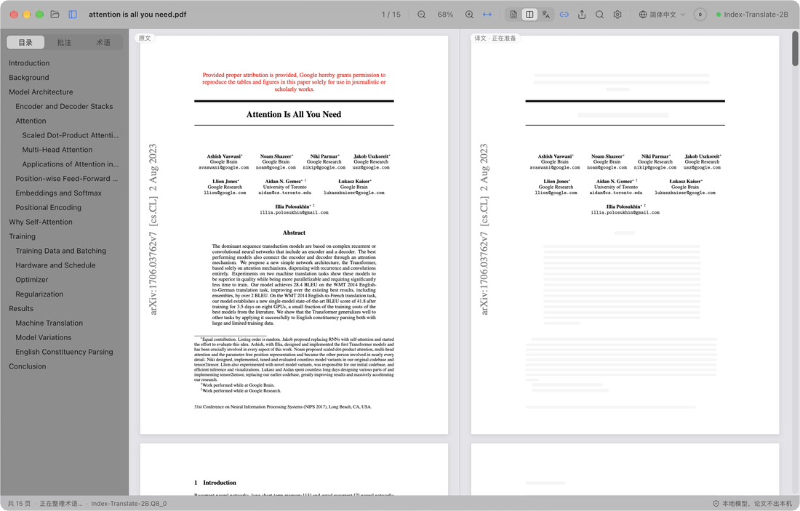
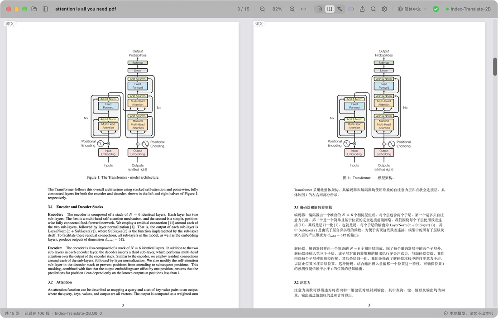
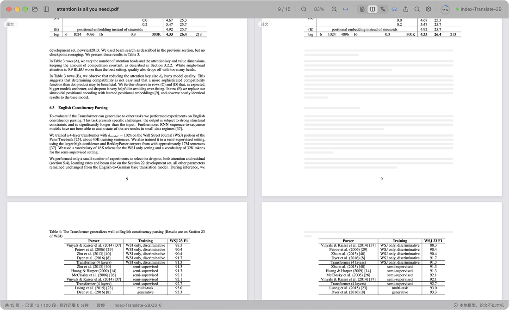
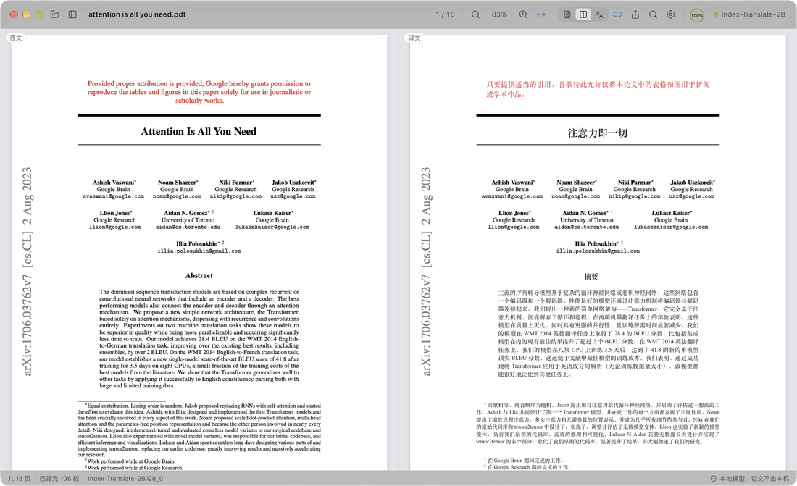
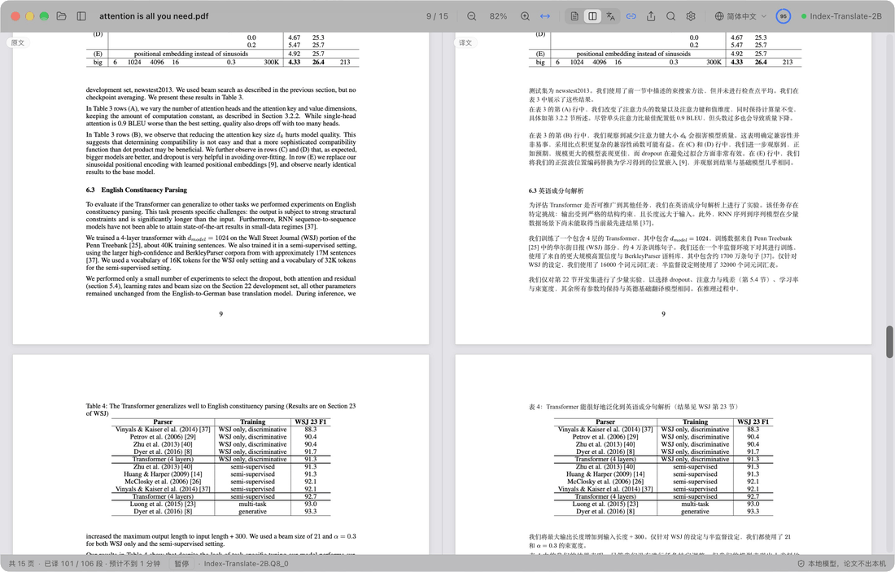

  

<h1 align="center">PaperDuet</h1>

  <em>論文のための、究極の AI ミラー翻訳ツール！</em>

  <a href="README.md">English</a> &middot; <a href="README.zh-CN.md">简体中文</a> &middot; <a href="README.zh-TW.md">繁體中文</a> &middot; <b>日本語</b> &middot; <a href="README.ko.md">한국어</a> &middot; <a href="README.fr.md">Français</a> &middot; <a href="README.de.md">Deutsch</a> &middot; <a href="README.es.md">Español</a> &middot; <a href="README.ru.md">Русский</a>

  
  
  
  
  

  

  <strong>PaperDuet は、元のレイアウトを保ったまま論文を訳す、軽量な AI ミラー翻訳ツールです。</strong> 
  オープンソースの AI 翻訳モデルを 5 種類から選べます。 
  ログイン不要、無料、すべてローカルで動作！ 
  Attention Is All You Need（15 ページ）を最初から翻訳したときの録画

  

PaperDuet は論文向けの軽量な AI ミラー翻訳ツールです。原文と訳文を鏡のように並べ、数式・図・表もページごとに整えて位置をそろえます。登録も API キーも料金も不要で、すべて Mac の中で動きます！

## どのページも見比べやすく

  

左に原文、右に訳文。両側は一緒にスクロールし、一緒に拡大縮小します。段組み、見出し、キャプション、脚注、参考文献は自動で認識し、段やページをまたぐ段落もつなげて訳します。左右がぴったりそろうので、見比べるのも簡単です。

## 速い！速い！速い！

  

まず見出しを訳すので、論文の構成がすぐにわかります。続いてタイトル、要旨、序論を訳すので、要点を早くつかめます。後ろの節を先に読みたいときは、原文の段落をダブルクリックするだけ。すぐにそこから訳し始めます！

## メモは？訳文にそのまま書き込むだけ！

  

どちら側でハイライト、下線、メモを付けても、反対側の対応する文にも同じ印が付きます。

## 進み具合は？スピードは？問題なし！

  

翻訳の進み具合はツールバーに表示されます。全文を訳し終えるとリングが緑のチェックに変わり、吹き出しが出ます。クリック 1 回で、訳文を PDF として原文の隣に保存できます。お使いの Mac や用途に合わせて、5 種類のモデルから選ぶこともできます！

## ほかにもいろいろ

- **8 つの言語に翻訳**：ツールバーで简体中文、繁體中文、日本語、한국어、Français、Deutsch、Español、Русскийを切り替えられます。訳文は言語ごとに別々に保存されます。
- **訳文 PDF をクリック 1 回で**：全文を訳し終えたら、クリック 1 回で元のレイアウトのまま `<ファイル名>_ja.pdf` を論文の隣に保存します（簡体字中国語は `_zh`、ほかの言語は `_fr` など）。
- **品質チェックを内蔵**：モデルの返答ごとに数式、数値、文の順番を確かめ、問題があれば自動でやり直します。論文ごとの用語集で訳語もそろえます。
- **何を訳すかはあなた次第**：どのブロックも右クリックで、翻訳するか英語のまま残すかを選べます。
- **好きなように読める**：原文と訳文をまとめて検索し、2 か国語の目次をたどり、段落にポインタを合わせれば反対側の対応箇所がわかります。原文だけ、訳文だけ、両方の表示を切り替えられ、読んでいた場所も覚えています。
- **どこへでも書き出し**：印を標準の注釈として残した原文 PDF、訳文 PDF、Markdown 形式のノートを書き出せます。
- **ワンクリックで更新**：新しいバージョンはアプリの中に表示され、署名を確認したうえでクリック 1 回でインストールできます。
- **見た目にもこだわり**：すっきりしたすりガラスのデザインで、ライト、ダーク、夜間読書の各モードに対応しています。

  

## 5 つのモデルが、すべて Mac の中に

PaperDuet を初めて開くときにモデルを選び、あとから 設定 › 模型 › 更换模型 でいつでも切り替えられます。どれも翻訳専用のモデルで、ダウンロードが済めば完全にオフラインで動きます。

| モデル | 提供元 | サイズ | 向いている用途 |
| --- | --- | --- | --- |
| [Index-Translate-2B](https://huggingface.co/IndexTeam/Index-Translate-2B) **（おすすめ）** | bilibili Index チーム | 2.1 GB | 総合力がいちばん高く、PaperDuet のチェックと用語集に合わせて調整済み |
| [Hy-MT2-1.8B](https://huggingface.co/tencent/Hy-MT2-1.8B-GGUF) | Tencent Hunyuan | 1.9 GB | 速さ重視：いちばん速く、いちばん軽い |
| [LMT-60-4B](https://huggingface.co/NiuTrans/LMT-60-4B) | NiuTrans | 4.7 GB | 原文に忠実な訳 |
| [Hy-MT2-7B](https://huggingface.co/tencent/Hy-MT2-7B-GGUF) | Tencent Hunyuan | 8.0 GB | いちばん流暢な訳文。メモリ 16 GB 以上の Mac 向け |
| [TranslateGemma-4B](https://huggingface.co/mradermacher/translategemma-4b-it-GGUF) （試験的） | Google | 4.1 GB | Google の翻訳モデルを試したいときに |

おすすめのモデルなら、15 ページの論文が M5 Pro で約 2 分。設定 › 模型 で「同时翻译几段」（同時に訳す段落数）を 2 か 3 にすれば約 1 分です。

LM Studio、llama.cpp、Hugging Face でこれらのモデルをすでにダウンロード済みですか？ PaperDuet が見つけてそのまま使うので、もう一度ダウンロードする必要はありません。

## プライバシーを最初から大切に

- 論文、訳文、メモはすべて Mac の中にとどまります。
- アカウントは不要で、利用データも集めません。
- インターネットに接続するのは、モデルのダウンロードとアップデートの確認のときだけです。アップデートの確認はオフにできます。

## はじめかた

Apple シリコン（M1 以降）を搭載した Mac と、macOS 13.3 以降が必要です。

1. [Releases](https://github.com/KalenHwei/PaperDuet/releases/latest) から最新の `.dmg` をダウンロードします。
2. PaperDuet を「アプリケーション」フォルダにドラッグし、そこから開きます。
3. 初回のみ：PaperDuet はまだ Apple の公証を受けていないため、macOS が確認を求めます。システム設定 › プライバシーとセキュリティ を開き、**このまま開く** をクリックしてください。（ターミナルで `xattr -dr com.apple.quarantine /Applications/PaperDuet.app` を実行しても構いません。）
4. モデルを選びます。PaperDuet がダウンロードするか、手元にあるものを見つけて、すぐに翻訳を始めます。

これだけです。翻訳エンジンはアプリに組み込まれていて、アップデートもクリック 1 回です。

<b>キーボードショートカット</b>

| 操作 | ショートカット |
| --- | --- |
| PDF を開く | ⌘O |
| 論文を閉じる | ⌘W |
| 両側を検索 | ⌘F |
| 次 / 前の一致 | ⌘G / ⇧⌘G |
| 拡大 / 縮小 / 幅に合わせる | ⌘+ / ⌘− / ⌘0 |
| ポインタを中心に拡大縮小 | ⌘ + スクロール、またはトラックパッドでピンチ |
| ページを動かす | ⌘ + ドラッグ |
| この部分を次に訳す | まだ訳されていないテキストをダブルクリック |
| 選択範囲をハイライト | H |
| 選択範囲にメモを追加 | N |
| ハイライトの色 | 1〜5 |
| 取り消す / やり直す | ⌘Z / ⇧⌘Z |
| サイドバーの表示 / 非表示 | ⌘\ |
| スクロール同期のオン / オフ | ⌘L |
| すべてのショートカット | ⌘/ |

H、N、1〜5 は選択中のテキストに使えます。

## よくある質問

### どのモデルを選べばいいですか？

まずは Index-Translate-2B から。速さを求めるなら Hy-MT2-1.8B、メモリ 16 GB 以上の Mac でいちばん流暢な訳文が欲しいなら Hy-MT2-7B を選んでください。

### 無料ですか？

はい。個人の学習や研究、大学、学校、研究機関、その他の非営利団体での利用は無料です。企業内での利用や企業のための利用には商用ライセンスが必要です。[junystugh@gmail.com](mailto:junystugh@gmail.com) までご連絡ください。

## 今後の予定

- **arXiv の論文をきちんと組版して翻訳**：論文の LaTeX ソースを翻訳し、訳文の言語のフォントでコンパイルして、組版まで整った翻訳版を作ります。
- **英語のインターフェース**。

## 更新履歴

- **0.3.1**（2026-10-23）：進捗リングの数字から % を外しました。全文を訳し終えるとリングが緑になって閉じ、チェックに変わります。チェックはツールバーのほかのアイコンと同じ大きさで、位置もそろっています。
- **0.3.0**（2026-10-23）：8 つの言語への翻訳に対応し、ツールバーで切り替えられるようにしました。訳し終えるとリングに緑のチェックが表示され、訳文 PDF は自動ではなくクリック 1 回で保存するようになりました。モデルを切り替えても試し訳をやり直さなくなりました。
- **0.2.1**（2026-10-23）：5 種類の翻訳モデルから選べるようにしました。起動画面を追加しました。
- **0.2.0**（2026-10-23）：アプリ内でのアップデート確認とワンクリック更新。
- **0.1.0**（2026-10-22）：最初のリリース。

すべての履歴：[CHANGELOG.md](CHANGELOG.md)

## ライセンス

PaperDuet は [PolyForm Noncommercial License 1.0.0](LICENSE) のもと、非商用なら無料で使えます。個人、学習、研究、非営利の目的で使ったり共有したりできます。共有するときは、ライセンスと `Required Notice: Copyright (c) 2026 Kalen Yongda Wei` の 1 行を添えてください。商用利用については [junystugh@gmail.com](mailto:junystugh@gmail.com) までご連絡ください。

Copyright © 2026 Kalen Yongda Wei.

## 謝辞

PaperDuet は [Tauri](https://tauri.app)、[pdf.js](https://mozilla.github.io/pdf.js/)、[pdf-lib](https://pdf-lib.js.org)、[llama.cpp](https://github.com/ggml-org/llama.cpp)、[React](https://react.dev)、[Zustand](https://github.com/pmndrs/zustand)、[Lucide](https://lucide.dev) を使って作られています。翻訳モデルは bilibili Index チーム（Index-Translate-2B）、Tencent Hunyuan（Hy-MT2）、NiuTrans（LMT）、Google（TranslateGemma）によるものです。TranslateGemma は [Gemma 利用規約](https://ai.google.dev/gemma/terms)、それ以外は Apache-2.0 で公開されています。ライセンスの全文はアプリ内（設定 › 关于 › 第三方许可证）で読めます。

アニメーションで使っている論文は、Vaswani らの [_Attention Is All You Need_](https://arxiv.org/abs/1706.03762) です。
