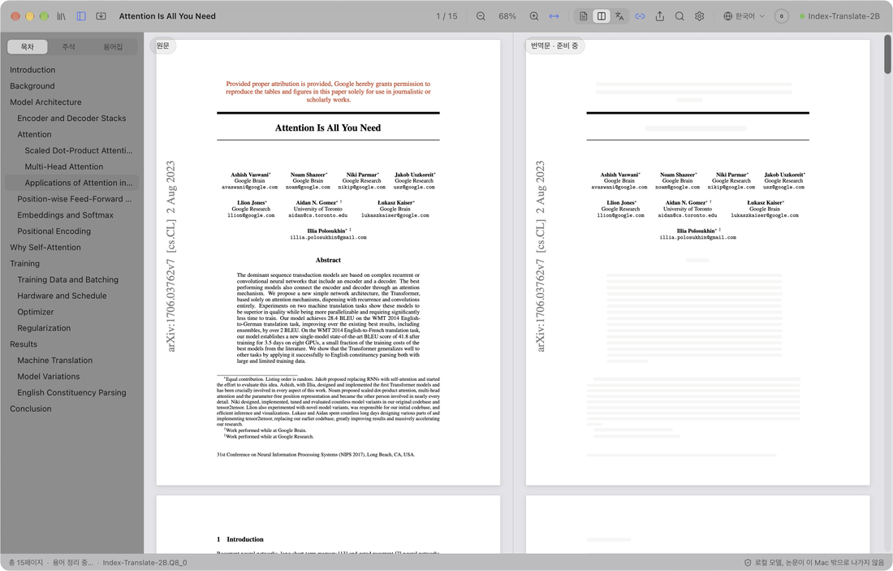
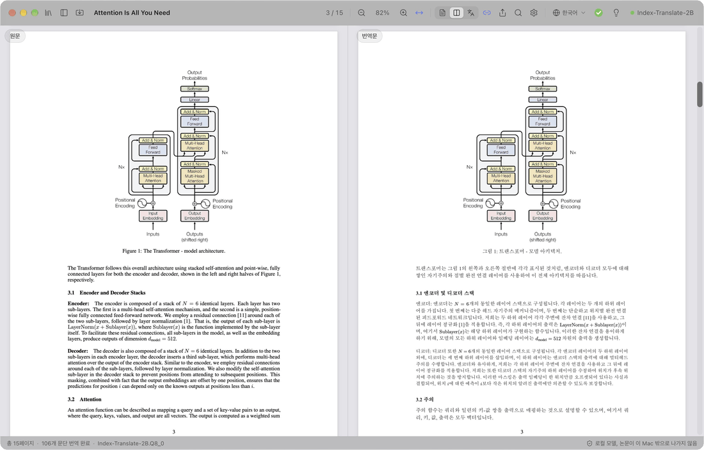
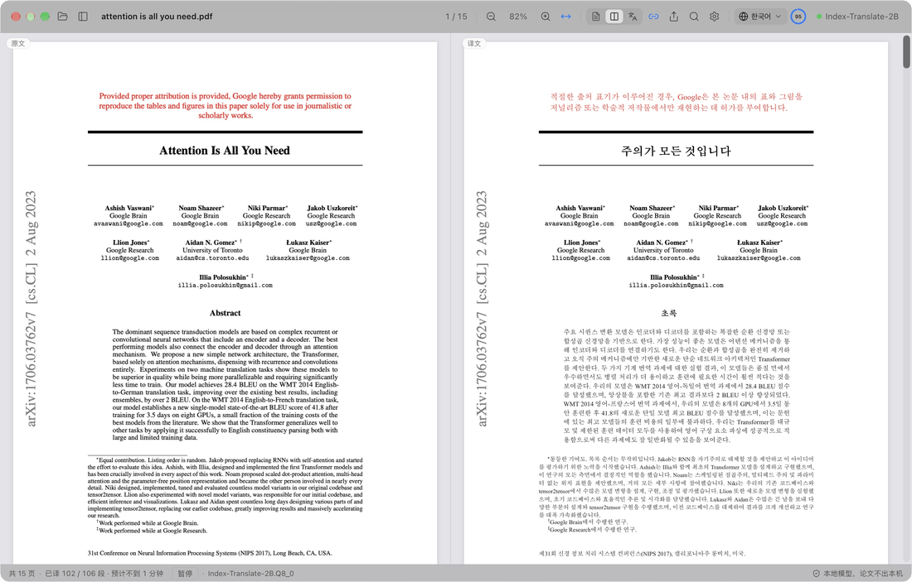
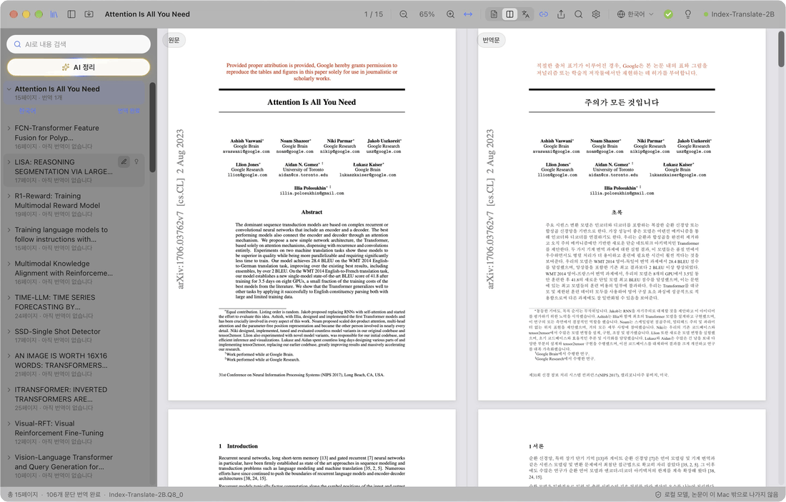
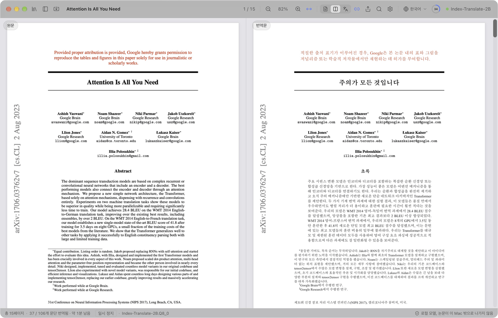
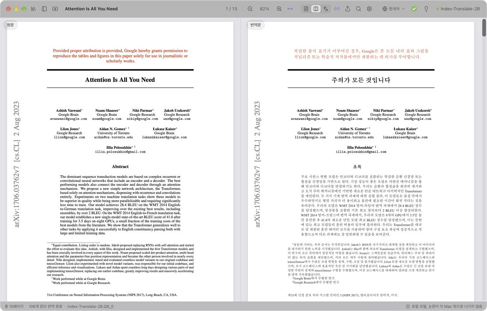

  

<h1 align="center">PaperDuet</h1>

  <em>연구자를 위한 가벼운 논문 AI 번역기!</em> 
  <a href="https://paperduet.com">paperduet.com</a>

  <a href="README.md">English</a> &middot; <a href="README.zh-CN.md">简体中文</a> &middot; <a href="README.zh-TW.md">繁體中文</a> &middot; <a href="README.ja.md">日本語</a> &middot; <b>한국어</b> &middot; <a href="README.fr.md">Français</a> &middot; <a href="README.de.md">Deutsch</a> &middot; <a href="README.es.md">Español</a> &middot; <a href="README.it.md">Italiano</a> &middot; <a href="README.pl.md">Polski</a> &middot; <a href="README.ru.md">Русский</a>

  
  

  
  
  
  
  
  

  <strong>PaperDuet는 원래 레이아웃을 그대로 유지하는 가벼운 AI 논문 미러 번역기입니다.</strong> 
  오픈소스 AI 번역 모델 5가지 중에서 고를 수 있습니다. 
  무료로, 완전히 로컬에서!

   
  Attention Is All You Need(15쪽)를 처음부터 번역하는 실제 화면

PaperDuet는 가벼운 AI 논문 미러 번역기입니다. 원문과 번역문을 거울처럼 나란히 놓고, 수식과 그림, 표를 페이지마다 바로잡아 맞춥니다. API 키도, 비용도 필요 없고, 모든 작업이 내 컴퓨터에서 이뤄집니다!

## 어느 페이지든 한눈에

  

왼쪽에는 논문 원문, 오른쪽에는 번역문이 있고, 양쪽이 함께 스크롤되고 함께 확대·축소됩니다. 단, 제목, 캡션, 각주, 참고문헌을 자동으로 인식하고, 다음 단이나 페이지로 이어지는 문단도 하나로 이어 붙입니다. 양쪽이 정확히 맞춰져 있어 비교하기 쉽습니다.

## 번역 저장? AI 요약? 문제없어요.

  

번역 진행 상황은 도구 막대에 표시됩니다. 논문 전체가 번역되면 링이 초록색 체크로 바뀌고, 클릭 한 번으로 번역문을 PDF로 원문 옆에 저장합니다. 옆의 전구를 열면 모델이 전체를 읽고 쓴 AI 요약이 나옵니다. 연구 질문, 방법, 결과가 한눈에 보입니다. 다섯 가지 모델 중 컴퓨터와 용도에 맞게 고를 수 있어요.

## 떠올리면, 찾아집니다.

  

읽은 논문은 모두 보관함에 모입니다. AI 정리가 분야, 세부 분야, 주제별로 태그를 달고, 고른 태그의 논문이 위로 떠오릅니다. AI 검색은 제목, 원문, 번역문, 요약까지 찾아 주며, 한국어로도 영어로도 검색할 수 있습니다.

## 모르겠다면? 클릭하세요.

  

먼저 제목들을 번역해 논문의 구조를 바로 보여 주고, 이어서 논문 제목, 초록, 서론을 번역합니다. 뒤쪽 문단을 먼저 보고 싶다면 원문을 더블클릭하세요. 진행을 기다릴 필요 없이 그 부분을 먼저 번역합니다.

## 메모요? 바로 됩니다.

  

번역문 위에 바로 하이라이트, 밑줄, 메모를 남기세요. 원문의 해당 문장에도 자동으로 같은 표시가 됩니다. 주석이 담긴 원문 PDF는 표준 PDF 주석으로 내보내므로 미리보기, Zotero 같은 앱에서도 그대로 보입니다.

## 이 밖에도

- **10개 언어로 번역**: 도구 막대에서 클릭 한 번으로 简体中文, 繁體中文, 日本語, 한국어, Français, Deutsch, Español, Italiano, Polski, Русский 사이를 전환할 수 있습니다.
- **클릭 한 번으로 번역 PDF**: 논문 전체 번역이 끝나면 클릭 한 번으로 원래 레이아웃 그대로 논문 옆에 저장합니다.
- **품질 검사 내장**: 모델이 답할 때마다 수식, 숫자, 문장 순서를 확인하고 문제가 있으면 자동으로 다시 시도합니다. 논문마다 용어집을 만들어 용어 번역도 일관되게 유지합니다.
- **번역할 부분은 내가 결정**: 어떤 블록이든 오른쪽 클릭으로 번역할지, 원문 그대로 둘지 고를 수 있습니다.
- **원하는 방식으로 읽기**: 원문과 번역문을 한 번에 검색하고, 이중 언어 목차를 따라가고, 문단에 포인터를 올려 반대쪽 짝을 찾을 수 있습니다. 원문만, 번역문만, 또는 둘 다 볼 수 있고, PaperDuet가 읽던 위치를 기억합니다.
- **논문 보관함과 AI 검색**: 읽거나 가져온 논문은 사이드바의 보관함에 모입니다. AI 검색은 제목, 원문, 번역문, 요약으로 읽은 논문을 다시 찾아 주고, 검색어는 한국어도 영어도 됩니다. AI 정리는 분야와 주제별로 논문을 나눕니다.
- **논문 요약**: 전체 번역이 끝나면 전구를 누르세요. 번역 모델이 인터페이스 언어로 짧은 요약을 써서 논문과 함께 저장합니다.
- **어디로든 내보내기**: 주석을 단 원문 PDF, 번역 PDF, Markdown 노트를 내보낼 수 있고, 다른 앱에서도 열 수 있습니다.
- **클릭 한 번으로 업데이트**: 새 버전으로 쉽게 업데이트하고, 클릭 한 번으로 설치합니다.
- **보기에도 좋게**: 깔끔하고 아름다운 유리 질감 디자인에 라이트, 다크, 야간 읽기 모드를 지원합니다.

  

## 5가지 모델, 모두 내 컴퓨터에서

PaperDuet를 처음 열 때 모델을 고르고, 나중에 설정 › 모델 › 모델 변경에서 언제든 바꿀 수 있습니다. 모두 번역 전용 모델이며, 한 번 다운로드하면 완전히 오프라인으로 동작합니다.

| 모델 | 제공 | 크기 | 추천 용도 |
| --- | --- | --- | --- |
| [Index-Translate-2B](https://huggingface.co/IndexTeam/Index-Translate-2B) **(추천)** | bilibili Index 팀 | 2.1 GB | 가장 뛰어난 만능형, PaperDuet의 검사와 용어집에 맞춰 조정됨 |
| [Hy-MT2-1.8B](https://huggingface.co/tencent/Hy-MT2-1.8B-GGUF) | Tencent Hunyuan | 1.9 GB | 속도: 가장 빠르고 가벼움 |
| [LMT-60-4B](https://huggingface.co/NiuTrans/LMT-60-4B) | NiuTrans | 4.7 GB | 원문에 충실한 번역 |
| [Hy-MT2-7B](https://huggingface.co/tencent/Hy-MT2-7B-GGUF) | Tencent Hunyuan | 8.0 GB | 가장 자연스러운 번역, 메모리 16GB 이상 컴퓨터용 |
| [TranslateGemma-4B](https://huggingface.co/mradermacher/translategemma-4b-it-GGUF) (실험적) | Google | 4.1 GB | Google의 번역 모델을 써 보고 싶을 때 |

추천 모델로는 15쪽 논문이 M5 Pro에서 약 2분, 설정 › 모델에서 "동시 번역 문단 수"를 2나 3으로 하면 약 1분 걸립니다.

LM Studio, llama.cpp, Hugging Face로 이미 이 모델들을 받아 두셨나요? PaperDuet가 찾아서 그 자리에서 사용하므로 다시 다운로드할 필요가 없습니다.

컴퓨터 사양이 낮아 로컬 모델이 버겁다면, 모델 선택에서 'API 사용'을 누르고 내 API 키를 입력하세요. OpenAI, Claude, DeepSeek, Qwen, Kimi, GLM, Doubao 또는 OpenAI 호환 서비스라면 어디든 연결할 수 있습니다. 로컬 모델 목록은 자동으로 접히고, 번역, 요약, AI 정리, AI 검색이 모두 그 서비스를 통해 이뤄집니다. API 키는 내 컴퓨터에만 저장됩니다.

## 처음부터 프라이버시 중심

- 논문, 번역문, 메모는 모두 내 컴퓨터에 남습니다. API를 사용할 때는 번역할 텍스트가 선택한 서비스로 전송됩니다.
- 동의한 경우에만 익명 사용 및 진단 데이터(버전, 시스템, 인터페이스 언어, 사용 모델, 오류 종류)를 보내며, 논문 내용은 포함하지 않고 설정에서 언제든지 끌 수 있습니다.
- 오류가 생기면 개발자에게 오류 정보(무슨 오류인지, 버전, 시스템)를 보냅니다. 파일 경로와 논문 내용은 포함하지 않으며 ‘설정 › 데이터’에서 끌 수 있습니다.
- 로컬 모델을 쓸 때는 인터넷에 모델을 다운로드하고, 업데이트를 확인하고, 위의 데이터와 오류 정보를 보낼 때만 연결하며, 모델 다운로드를 제외하고 모두 끌 수 있습니다.

## 시작하기

Mac은 Apple 실리콘(M1 이상)과 macOS 13.3 이상, Windows는 Windows 10 또는 11(64비트)이 필요합니다.

**Mac**

1. [Releases](https://github.com/KalenHwei/PaperDuet/releases/latest)에서 최신 `.dmg`를 다운로드합니다.
2. PaperDuet를 응용 프로그램 폴더로 드래그한 뒤 거기서 엽니다.
3. 처음 한 번만: PaperDuet는 아직 Apple의 공증을 받지 않아서 macOS가 확인을 요청합니다. 시스템 설정 › 개인정보 보호 및 보안을 열고 **그래도 열기**를 클릭하세요. (터미널에서 `xattr -dr com.apple.quarantine /Applications/PaperDuet.app`를 실행해도 됩니다.)
4. 모델을 고릅니다. PaperDuet가 모델을 다운로드하거나 이미 있는 사본을 찾아 바로 번역을 시작합니다.

**Windows**

1. [Releases](https://github.com/KalenHwei/PaperDuet/releases/latest)에서 최신 Windows 설치 프로그램(`_x64-setup.exe`)을 다운로드합니다.
2. 설치 프로그램을 실행합니다. 처음 한 번만: 'Windows의 PC 보호' 창이 뜨면 **추가 정보**를 누른 뒤 **실행**을 누릅니다.
3. 모델을 고릅니다. PaperDuet가 모델을 다운로드하거나 이미 있는 사본을 찾아 바로 번역을 시작합니다.

이게 전부입니다. 번역 엔진은 앱에 내장되어 있고, 업데이트도 클릭 한 번이면 됩니다.

<b>키보드 단축키</b>

| 동작 | 단축키 |
| --- | --- |
| PDF 열기 | ⌘O |
| 논문 닫기 | ⌘W |
| 양쪽 검색 | ⌘F |
| 다음 / 이전 결과 | ⌘G / ⇧⌘G |
| 확대 / 축소 / 폭에 맞추기 | ⌘+ / ⌘− / ⌘0 |
| 포인터 중심으로 확대·축소 | ⌘ + 스크롤 또는 트랙패드에서 핀치 |
| 페이지 이동 | ⌘ + 드래그 |
| 이 부분을 다음에 번역 | 아직 번역되지 않은 텍스트를 더블클릭 |
| 선택 영역 강조 | H |
| 선택 영역에 메모 추가 | N |
| 강조 색 | 1~5 |
| 실행 취소 / 다시 실행 | ⌘Z / ⇧⌘Z |
| 사이드바 보기 / 숨기기 | ⌘\ |
| 스크롤 동기화 켜기 / 끄기 | ⌘L |
| 모든 단축키 | ⌘/ |

H, N, 1~5는 선택한 텍스트에 적용됩니다. Windows에서는 ⌘ 대신 Ctrl, ⇧ 대신 Shift를 사용합니다.

## 자주 묻는 질문

### 어떤 모델을 골라야 하나요?

Index-Translate-2B로 시작하세요. 더 빠른 속도를 원하면 Hy-MT2-1.8B, 메모리 16GB 이상 컴퓨터에서 가장 자연스러운 번역을 원하면 Hy-MT2-7B를 고르세요. 컴퓨터가 버거워하면 'API 사용'을 고르세요.

### 무료인가요?

네. 개인 학습과 연구, 그리고 대학, 학교, 연구 기관, 기타 비영리 단체에서는 무료입니다. 회사에서 또는 회사를 위해 사용하려면 상업용 라이선스가 필요하니 [junystugh@gmail.com](mailto:junystugh@gmail.com)으로 연락해 주세요.

## 로드맵

- **arXiv 논문을 조판까지 번역**: 논문의 LaTeX 소스를 번역하고 번역 언어의 글꼴로 컴파일해, 제대로 조판된 번역본을 만듭니다.

## 변경 기록

- **0.5.13** (2026-10-28): 수식 주변이 깨지던 문제를 고쳤습니다. 분수와 합 기호가 있는 별행 수식은 통째로 원문 그대로 두어, 조각조각 번역되어 겹치거나 합 기호가 가려지지 않습니다. 문장 속 합 기호와 근호, 글자 간격이 넓은 수식 줄 때문에 문장이 끊기는 일도 없어졌습니다.
- **0.5.12** (2026-10-27): 학술지 논문을 더 정확하게 처리합니다. 통계 결과 줄, 번호가 붙은 소제목, 다음 단으로 이어지는 문장, χ² 같은 그리스 문자, 인명의 악센트, 표 안의 마이너스 기호가 더 이상 깨지지 않고, 내보낸 번역 PDF의 글자 간격도 고르게 됐습니다. 제안해 주신 RedNote(샤오훙수)의 momo 님께 감사드립니다.
- **0.5.11** (2026-10-27): 의사 코드를 줄마다 번역하며 줄 번호, 들여쓰기, 키워드는 그대로 둡니다. 표를 더 정확히 찾아 표 내용은 원문 그대로 두고 표 제목과 주석만 번역하므로 표가 흐트러지지 않습니다. 일부 논문에서 문장 안의 합 기호 수식이 번역문에서 빠지던 문제를 고쳤습니다.
- **0.5.10** (2026-10-27): 온라인 API 번역을 추가했습니다. 컴퓨터에서 로컬 모델이 버거우면 모델 선택에서 'API 사용'을 눌러 OpenAI, Claude, DeepSeek, Qwen, Kimi, GLM, Doubao 또는 OpenAI 호환 서비스를 쓸 수 있으며, 선택하면 로컬 모델 목록이 자동으로 접힙니다.
- **0.5.9** (2026-10-26): 기존 문제를 수정했습니다.
- **0.5.8** (2026-10-26): 폴란드어를 추가했습니다(번역 언어와 인터페이스 언어). macOS 26 이하에서 논문을 읽지 못해 번역되지 않던 문제와 macOS 27에서 일부 논문의 번역 PDF 저장이 실패하던 문제를 고쳤습니다.
- **0.5.7** (2026-10-26): 학술지 논문의 레이아웃 인식과 번역이 더 정확해졌습니다(20개 학술지의 논문으로 한 편씩 검증). 다단 배치, 제목, 참고문헌, 표, 그림 설명, 출판사 고유 기호를 바르게 읽습니다. Science 등의 논문에서 본문 대부분이 번역되지 않던 문제를 고쳤고, 참고문헌 뒤의 부록도 번역합니다.
- **0.5.6** (2026-10-25): 이탈리아어를 추가했습니다(번역 언어와 인터페이스 언어). 오류가 생기면 개발자에게 오류 정보를 보내 문제 해결에 활용합니다(기본으로 켜져 있으며 ‘설정 › 데이터’에서 끌 수 있습니다).
- **0.5.5** (2026-10-25): 저널 논문에서 간격이 넓은 줄이 단어별로 흩어져 번역문이 빠지거나 어긋나던 문제를 고쳤습니다. 초록은 제목 바로 다음에 번역합니다. ‘레이아웃 분석 실패’가 덜 일어납니다. Elsevier 논문의 대시가 더 이상 e로 표시되지 않습니다.
- **0.5.4** (2026-10-24): 화면을 더 간결하게 다듬어 곳곳의 불필요한 설명을 없앴습니다. AI 검색창 문구는 ‘AI로 내용 검색’으로 바꿨습니다.
- **0.5.3** (2026-10-24): 익명 사용 및 진단 데이터를 공유할지 한 번 묻도록 했습니다. PaperDuet 개선에 쓰이며, 논문 내용은 포함하지 않고 ‘설정 › 데이터’에서 언제든지 끌 수 있습니다.
- **0.5.2** (2026-10-24): 논문 보관함에 ‘AI 검색’🔍을 더했습니다. 제목, 원문, 번역문, 요약, 태그로 읽은 논문을 찾을 수 있고, 검색어는 한국어도 영어도 됩니다. 검색과 ‘AI 정리’에서는 찾은 논문이 위로 오고 나머지는 회색이 됩니다.
- **0.5.1** (2026-10-24): 폴더 패널을 논문 보관함으로 바꿨습니다. 읽거나 가져온 논문이 모두 모이고, 이름을 바꾸거나 요약을 볼 수 있습니다. PDF나 폴더를 한꺼번에 가져올 수 있고, ‘AI 정리’✨로 분야와 주제별로 논문을 거를 수 있습니다. 일부 논문에서 표가 깨지거나 문단 번역이 실패하던 문제를 고쳤습니다.
- **0.5.0** (2026-10-24): 논문 요약을 추가했습니다💡. 전체 번역이 끝나면 전구 버튼을 눌러 볼 수 있습니다. 파일 패널에서 폴더를 클릭 한 번으로 열 수 있고, Windows 버전도 나왔습니다.
- **0.4.1** (2026-10-23): 모델 목록과 설정의 설명을 다듬었습니다.
- **0.4.0** (2026-10-23): 인터페이스가 9개 언어를 지원합니다. 기본으로 시스템 언어를 따르며, 설정 › 모양 › 인터페이스 언어에서 바꿀 수 있습니다.
- **0.3.2** (2026-10-23): 여러 언어로 번역할 때 생기는 정렬 문제를 더 고쳤습니다.
- **0.3.1** (2026-10-23): 진행 링과 도구 막대를 개선했습니다.
- **0.3.0** (2026-10-23): 번역 언어 8개를 추가하고🎉 도구 막대에서 클릭 한 번으로 바꿀 수 있게 했습니다. 진행 링과 사용 흐름도 개선했습니다.
- **0.2.1** (2026-10-23): 5가지 번역 모델 중 선택, 시작 화면 추가.
- **0.2.0** (2026-10-23): 앱 안에서 업데이트 확인, 클릭 한 번으로 업데이트.
- **0.1.0** (2026-10-22): 첫 릴리스.

전체 기록: [CHANGELOG.md](CHANGELOG.md)

## 라이선스

PaperDuet는 [PolyForm Noncommercial License 1.0.0](LICENSE)에 따라 비상업적 용도라면 무료입니다. 개인, 학습, 연구, 비영리 목적으로 사용하고 공유할 수 있으며, 공유할 때는 라이선스와 `Required Notice: Copyright (c) 2026 Kalen Yongda Wei` 한 줄을 함께 넣어 주세요. 상업적 사용은 [junystugh@gmail.com](mailto:junystugh@gmail.com)으로 문의해 주세요.

Copyright © 2026 Kalen Yongda Wei.

## 감사의 말

PaperDuet는 [Tauri](https://tauri.app), [pdf.js](https://mozilla.github.io/pdf.js/), [pdf-lib](https://pdf-lib.js.org), [llama.cpp](https://github.com/ggml-org/llama.cpp), [React](https://react.dev), [Zustand](https://github.com/pmndrs/zustand), [Lucide](https://lucide.dev)로 만들었습니다. 번역 모델은 bilibili Index 팀(Index-Translate-2B), Tencent Hunyuan(Hy-MT2), NiuTrans(LMT), Google(TranslateGemma)이 만들었습니다. TranslateGemma는 [Gemma 이용 약관](https://ai.google.dev/gemma/terms)을, 나머지는 Apache-2.0을 따릅니다. 라이선스 전문은 앱 안(설정 › 정보 › 타사 라이선스)에서 볼 수 있습니다.

애니메이션에 나오는 논문은 Vaswani 외의 [_Attention Is All You Need_](https://arxiv.org/abs/1706.03762)입니다.
