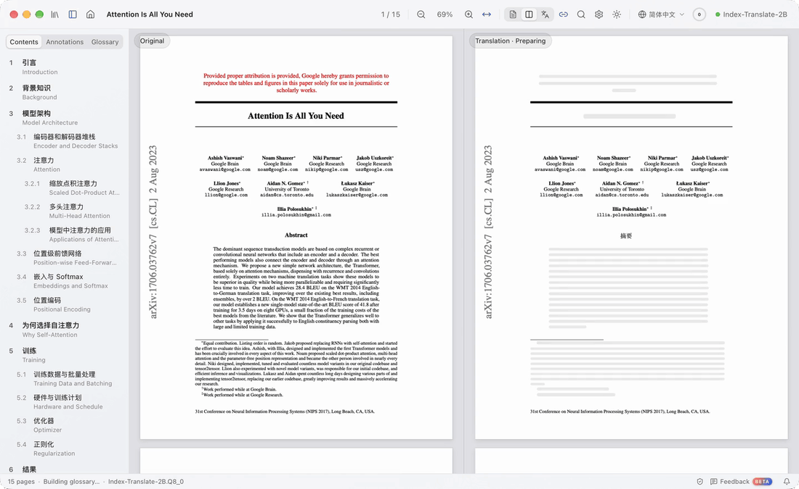
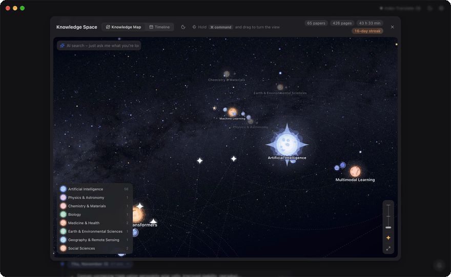
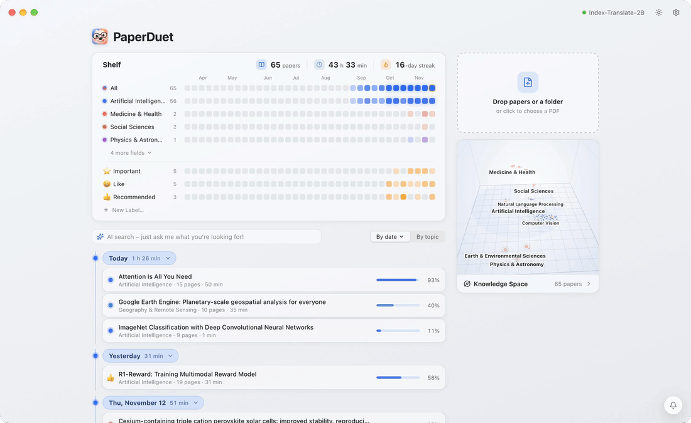
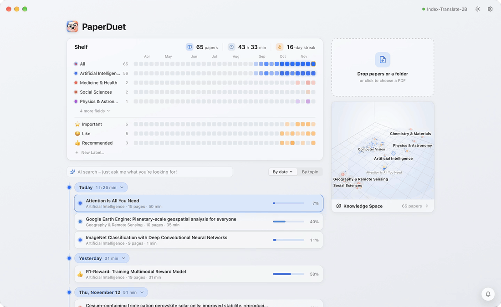
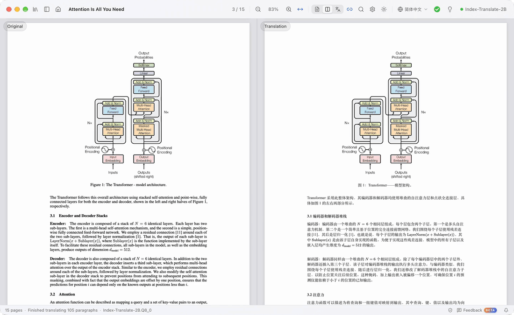
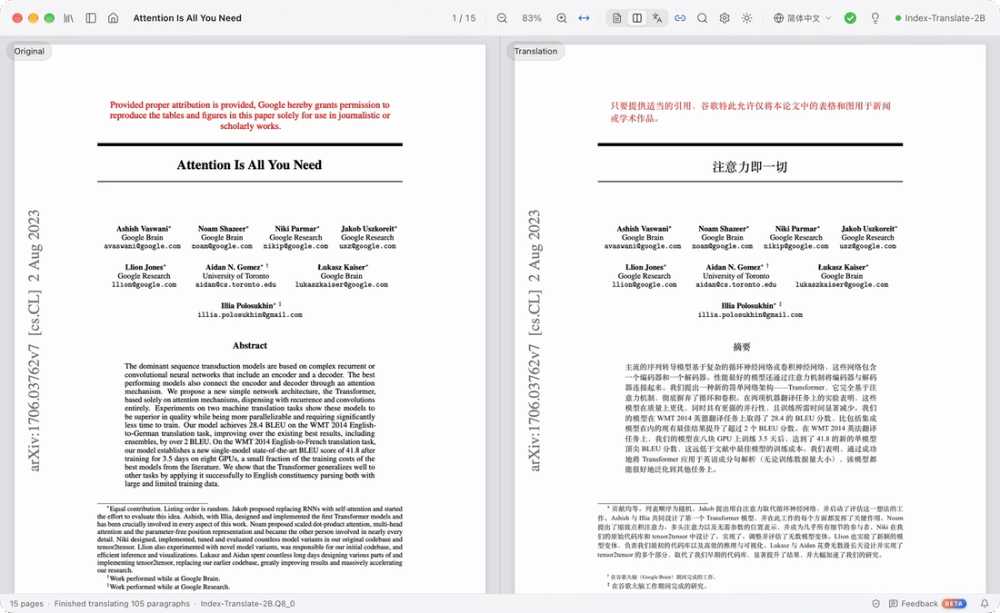
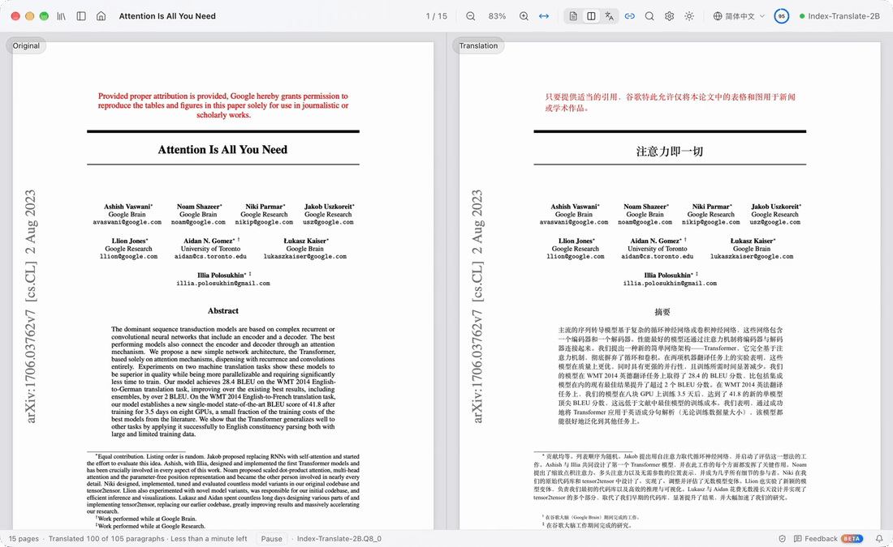

  

<h1 align="center">PaperDuet</h1>

  <em>A tool for researchers to manage, study and understand papers!</em> 
  <a href="https://paperduet.com">paperduet.com</a>

  <b>English</b> &middot; <a href="README.zh-CN.md">简体中文</a> &middot; <a href="README.zh-TW.md">繁體中文</a> &middot; <a href="README.ja.md">日本語</a> &middot; <a href="README.ko.md">한국어</a> &middot; <a href="README.fr.md">Français</a> &middot; <a href="README.de.md">Deutsch</a> &middot; <a href="README.es.md">Español</a> &middot; <a href="README.it.md">Italiano</a> &middot; <a href="README.pl.md">Polski</a> &middot; <a href="README.ru.md">Русский</a>

  
  
  

  
  
  
  
  
  

  <strong>PaperDuet helps you manage, study and understand every paper you read.</strong> 
  Six open-source AI translation models run on your computer, or connect an online API. 
  Free to use, no sign-up needed!

PaperDuet is a tool for managing, studying and understanding papers: the original and its translation sit side by side as mirror images, with formulas, figures and tables lined up page by page, and the papers you have read are kept on a shelf and in a Knowledge Space where AI finds them again. PaperDuet is free to use: with a local model everything runs on your computer, and you can connect an online API when you want to.

## Open it — in your language

  

Drop a PDF in and translation starts. The headings come first, so the outline in the sidebar is in your language at once and you can see how the paper is built; the title, the abstract and the introduction follow. Six open-source translation models run on your computer, or you can connect an online API.

## Your library is your night sky

  

Introducing Space: your papers now spread out before you like a night sky, so you can build a visual knowledge base of your own and see it at a glance.

## Every bit of progress, recorded

  

The shelf on the home page keeps count of how many papers you have read, for how long in all, and how many days in a row. Each square is a week, darker the longer you read; click a field and the papers and the timeline below follow it. A right-click puts your own labels on a paper.

## Can’t find a paper? Ask the AI!

  

No need to remember the title: say in a sentence what you are looking for, and AI Search finds it in titles, originals, translations and summaries, and shows the passage that matched. Ask in your own language or in English.

## Every page, just as it was

  

The original on the left, the translation on the right; both scroll and zoom together. Columns, headings, captions, footnotes and references are recognised by themselves, and formulas, figures and tables stay where they were; point at a paragraph and its counterpart on the other side lights up. Switch to another translation language and the layout stays the same.

## Taking notes? Sorted!

  

Highlight, underline and write notes right on the translation; the matching sentence of the original is marked by itself. The original exported with your notes carries standard PDF annotations, so Preview, Zotero and other apps show them as they are.

## Finished? Take it with you.

  

When the whole paper is translated, the ring in the toolbar turns into a green check: one click saves the translated PDF, the Markdown and the annotated original together into the paper's own folder. The light bulb beside it is the AI summary, written by the model once it has read the whole paper: the question, the method and the results at a glance.

## And there's more

- **Ten languages to translate into.** Switch between 简体中文, 繁體中文, 日本語, 한국어, Français, Deutsch, Español, Italiano, Polski and Русский in one click from the toolbar.
- **Double-click to jump the queue.** Want a later paragraph first? Double-click it in the original and it is translated next, without waiting for the progress to get there.
- **Quality checks built in.** Formulas, numbers and sentence order are checked in every reply, with automatic retries, and a glossary for each paper keeps terms consistent.
- **You decide what gets translated.** Right-click any block to translate it or keep the original.
- **Read your way.** Search the original and the translation at once, browse a bilingual outline, point at a paragraph to find its twin, and show the original, the translation or both. PaperDuet remembers where you left off.
- **Your own terms.** Tell PaperDuet how you want a term translated, and the whole paper follows it.
- **Scans can be read too.** PDFs whose text is drawn as shapes rather than stored as text are read with the system's own text recognition on a Mac and on Windows, then translated.
- **Folders that keep up to date.** Import a folder once, and papers put into it later show up in your library by themselves.
- **One click to update, one to clean up.** A new version installs with one click; the cache is cleared with one click in Settings.
- **Made to look good.** A clean, beautiful glass design, with light, dark and night reading modes.

  

## Six models, all on your computer

Pick a model the first time you open PaperDuet, and switch anytime in Settings › Model › Change Model. Every one of them is built for translation and runs fully offline once it is downloaded.

| Model | By | Size | Best for |
| --- | --- | --- | --- |
| [Index-Translate-2B](https://huggingface.co/IndexTeam/Index-Translate-2B) **(recommended)** | bilibili Index team | 2.1 GB | The best all-rounder, tuned for PaperDuet's checks and glossary |
| [Hy-MT2-1.8B](https://huggingface.co/tencent/Hy-MT2-1.8B-GGUF) | Tencent Hunyuan | 1.9 GB | Fast and light |
| [LMT-60-4B](https://huggingface.co/NiuTrans/LMT-60-4B) | NiuTrans | 4.7 GB | Translations that stay close to the source |
| [LMT-60-0.6B](https://huggingface.co/NiuTrans/LMT-60-0.6B) | NiuTrans | 0.8 GB | Modest computers: the smallest and fastest |
| [Hy-MT2-7B](https://huggingface.co/tencent/Hy-MT2-7B-GGUF) | Tencent Hunyuan | 8.0 GB | The most fluent Chinese, on computers with 16 GB of memory or more |
| [TranslateGemma-4B](https://huggingface.co/mradermacher/translategemma-4b-it-GGUF) (experimental) | Google | 4.1 GB | Trying Google's translation model |

With the recommended model, a 15-page paper takes about 2 minutes on an M5 Pro, or about 1 minute with "Paragraphs at Once" set to 2 or 3 in Settings › Model.

Already have one of these models from LM Studio, llama.cpp or Hugging Face? PaperDuet finds it and uses it where it is, with no second download.

Computer too slow for a local model? Pick **Use an API** in the model choice and enter your own API key to use OpenAI, Claude, DeepSeek, Qwen, Kimi, GLM, Doubao or any OpenAI-compatible service. The local models fold away, and translation, summaries, AI Organize and AI Search all go through that service. Your key stays on your computer.

## Private by design

- Your papers, translations and notes stay on your computer. With an API, the text to translate is sent to the service you chose.
- Only if you agree, PaperDuet sends anonymous usage and diagnostic data (version, system, interface language, model and kinds of errors), never paper content, and you can turn it off anytime in Settings.
- When something goes wrong, PaperDuet sends an error report to the developer: what went wrong, the version and the system, without file paths or paper content. You can turn this off in Settings › Data.
- When you write feedback in the app and click Send, what you wrote (and your email, if you give one) goes to the developer with the version and the system.
- With a local model, PaperDuet goes online only to download a model, to check for updates, to send the data and reports above and to send your feedback; you can turn off all but the model download.

## Get started

A Mac needs Apple silicon (M1 or later) and macOS 13.3 or later; a PC needs 64-bit Windows 10 or 11; Linux needs 64-bit Ubuntu 22.04 or later (or a similarly recent distribution).

**Mac**

1. Download the latest `.dmg` from [Releases](https://github.com/KalenHwei/PaperDuet/releases/latest).
2. Drag PaperDuet into Applications and open it from there.
3. First launch only: PaperDuet isn't notarized by Apple yet, so macOS asks you to confirm. Open System Settings › Privacy & Security and click **Open Anyway**. (Or run `xattr -dr com.apple.quarantine /Applications/PaperDuet.app` in Terminal.)
4. Pick a model. PaperDuet downloads it, or finds the copy you already have, and starts translating right away.

**Windows**

1. Download the latest Windows installer (`_x64-setup.exe`) from [Releases](https://github.com/KalenHwei/PaperDuet/releases/latest).
2. Run it. First time only: if Windows says “Windows protected your PC,” click **More info**, then **Run anyway**.
3. Pick a model. PaperDuet downloads it, or finds the copy you already have, and starts translating right away.

**Linux**

1. Download the latest `.deb` (Ubuntu, Debian) or `.AppImage` (other distributions, or without administrator rights) from [Releases](https://github.com/KalenHwei/PaperDuet/releases/latest).
2. `.deb`: run `sudo apt install ./PaperDuet_*_amd64.deb` in a terminal, then open PaperDuet from the applications menu. `.AppImage`: nothing to install; run `chmod +x PaperDuet_*_amd64.AppImage`, then open it.
3. Pick a model. PaperDuet downloads it, or finds the copy you already have, and starts translating right away.

That's all. The translation engine is built into the app, and updates take one click.

<b>Keyboard shortcuts</b>

| Action | Shortcut |
| --- | --- |
| Open a PDF                       | ⌘O                                           |
| Close the paper                  | ⌘W                                           |
| Search both sides                | ⌘F                                           |
| Next / previous match            | ⌘G / ⇧⌘G                                     |
| Zoom in / out / fit width        | ⌘+ / ⌘− / ⌘0                                 |
| Zoom around the pointer          | ⌘ + scroll, or pinch on the trackpad         |
| Move the pages                   | ⌘ + drag                                     |
| Translate this part next         | Double-click text that is not translated yet |
| Highlight the selection          | H                                            |
| Add a note to the selection      | N                                            |
| Highlight colour                 | 1 to 5                                       |
| Undo / redo                      | ⌘Z / ⇧⌘Z                                     |
| Show or hide the sidebar         | ⌘\                                           |
| Synchronized scrolling on or off | ⌘L                                           |
| All shortcuts                    | ⌘/                                           |

H, N and 1 to 5 work on selected text. On Windows and Linux, use Ctrl for ⌘ and Shift for ⇧.

## FAQ

### Which model should I choose?

Start with Index-Translate-2B. For more speed, pick Hy-MT2-1.8B. For the most fluent Chinese on a computer with 16 GB of memory or more, pick Hy-MT2-7B. If your computer struggles, pick **Use an API**.

### Is it free?

Yes, for personal study and research, and for universities, schools, research institutes and other non-profits. Using PaperDuet at or for a company needs a commercial license: write to [support@paperduet.com](mailto:support@paperduet.com).

## Roadmap

- **Typeset translations from arXiv.** Translate a paper's LaTeX source and compile it with Chinese fonts for a fully typeset Chinese edition.

## Changelog

- **0.8.6** (2026-11-13): fixed known bugs.
- **0.8.5** (2026-11-13): PaperDuet 0.8.5 is here🎉! The Knowledge Space is now made of galaxies🌌. The more papers, the larger and brighter the star, and once you have read enough of them it becomes a black hole! You can also drag the stars: try it and watch them move. You can make your own categories: right-click a category in the Knowledge Space or on the shelf to add a new one. Drag papers onto a category, or choose it under “Move to” in the right-click menu, and they are filed there📂. Automatic AI subdivision✨: right-click a category and click “Subdivide Automatically”, and PaperDuet’s built-in AI groups its papers by content into a few subcategories and names them for you. Of course, you can change the names to ones you like! Also fixed: garbled or missing translations for some PDFs. And the Knowledge Space looks cleaner. Come and try it🚀!
- **0.8.4** (2026-11-12): PaperDuet 0.8.4 is here 🎉! Tabs: open several papers at once. Hover over a tab to preview it, drag to reorder, and right-click for the full menu. Tabs beyond the number you set sleep to save memory and wake up when you click them ⚡️. The Knowledge Map is easier to use: AI Search right in the top-left corner, and the topics’ stars can be shown. Right-click a field, a subfield or a star to export all its citations at once, or save them to a file 📚. Selecting papers: click to select, hold ⌘ or Ctrl to select several, double-click to open. Right-click to tag, move or export citations (BibTeX / EndNote / RefMan / RefWorks) together. PDFs whose text is drawn as shapes (such as some CVPR papers) can now be translated: on Mac and Windows, the system’s own text recognition reads the text 🔍. New “Retranslate” in a paper’s right-click menu: the whole paper is translated again from the start with the model you have selected. Plus fixes for translations not showing after zooming with synced scrolling on older macOS, TranslateGemma’s prompt appearing in translations and more, and less memory used. Go try it 🚀!
- **0.8.2** (2026-11-11): added a bar to the Knowledge Map for adjusting which levels are visible.
- **0.8.1** (2026-11-11): fixed known bugs.
- **0.8.0** (2026-11-11): PaperDuet 0.8 is here 🎉! New AI component: your library sorts itself by content, AI Search finds papers by meaning and jumps straight to the most relevant passage, and similar papers are linked in the Knowledge Space 🧠! Much faster imports: drop in papers or a folder and the Shelf and the Knowledge Space sort them right away; the finer sorting finishes quietly in the background and pauses while you translate ⚡️. The Knowledge Space shows only field names, and a paper’s title appears when you point at it, so it no longer gets crowded. A new bell 🔔 in the bottom-right corner holds announcements, polls and the notes for every update. Plus fixes for some flickering and crashes. Go try it 🚀!
- **0.7.9** (2026-11-10): custom glossary terms: add, change or remove terms in the Glossary, and terms marked “Use in All Papers” are used in every paper; the library panel shows the shelf right away, and a paper’s first label stands in front of it; Settings can clear the cache in one click and list every shortcut; fixed zooming with Control on a Mac.
- **0.7.8** (2026-11-10): scanned papers translate properly; a folder you bring in can be kept up to date, its new PDFs imported under a shelf label of its own; Settings can keep the PDFs’ file names as paper names; custom APIs work with local services such as Ollama; fixed text left untranslated in forms and after resizing the window.
- **0.7.7** (2026-11-09): fixed known issues in the interaction logic.
- **0.7.6** (2026-11-09): a new tour of the home page: the Shelf, AI Search, By date / By topic, right-clicking a paper and the Knowledge Space.
- **0.7.5** (2026-11-09): we rebuilt the entire home page 🎉! The new Shelf brings your reading history, fields and labels together, so you can see at a glance what you read each week. The Knowledge Space is now a little universe — fields are suns, papers are planets, and in dark mode the real Milky Way shines behind them 🌌! Right-click a paper to change its category, add labels, rename it or write a note. AI Search understands plain questions like “I once read a paper about Transformers” and finds it right away 🔍! When a translation finishes, the translated PDF, the translated Markdown and your notes are saved together in the paper’s own folder. Go try it 🚀!
- **0.7.4** (2026-11-08): fixed the highlighting issue reported on GitHub.
- **0.7.3** (2026-11-08): a highlighter (hold Shift to change its color) and a light/dark switch; translation retries on its own instead of stopping; feedback can include screenshots.
- **0.7.2** (2026-11-05): smoother animations.
- **0.7.1** (2026-11-05): we made the library nicer to use.
- **0.7.0** (2026-11-05): we rebuilt the AI Library 🎉! It adds the Knowledge Space, and working with the library is much smoother. The toolbar buttons are also simpler and more practical.
- **0.6.12** (2026-11-05): to fix layout problems, a visual page layout model now checks the layout: tables, formulas, pictures, page headers and footers are no longer translated by mistake, and text taken for a table is translated, which makes translations far more accurate and robust. The layout model downloads in the background with the translation model.
- **0.6.11** (2026-11-04): Thank you to the many users who have sent us so many valuable error reports; for privacy reasons we cannot thank you by name. This update mainly fixes whole papers that could not be translated because of a recursion bug, paragraphs partly left untranslated because a checking rule misjudged them, and inaccurate layout recognition. We hope this update brings everyone a better experience.
- **0.6.10** (2026-11-04): API connection issues are fixed.
- **0.6.9** (2026-11-03): laggy scrolling in the Linux version is fixed.
- **0.6.8** (2026-11-03): a new model, LMT-60-0.6B: the smallest (805 MB) and fastest, for modest computers.
- **0.6.7** (2026-11-03): we're happy to release PaperDuet for Linux!
- **0.6.6** (2026-11-03): journal papers whose layout was misread: the two columns no longer run together, an abstract on a shaded panel is translated, and the outline lists only the section headings.
- **0.6.5** (2026-10-31): papers with line numbers (manuscripts, for example): the numbers no longer get into the translation or break paragraphs apart.
- **0.6.4** (2026-10-30): fixed some known formatting issues.
- **0.6.3** (2026-10-29): fixed some known interface logic issues.
- **0.6.2** (2026-10-28): on Windows, you can choose where the models are kept; models already downloaded move along.
- **0.6.1** (2026-10-28): fixed some known formatting issues.
- **0.6.0** (2026-10-28): a short tour of the main controls the first time you open a paper, and Beta feedback: send us a note right from the status bar.
- **0.5.17** (2026-10-28): fixed some known formatting issues.
- **0.5.16** (2026-10-28): paragraphs of manuscripts (exported from Word, double-spaced) no longer stay in English: lines with a highlight behind them are translated, double-spaced paragraphs are translated whole instead of line by line, and figure legends after the references are translated.
- **0.5.15** (2026-10-28): formula symbols in Elsevier journals are no longer garbled: Greek letters, ≤, ∀, ≠ and hatted letters (Ŝ, q̂) no longer show up as plain letters, and a superscript set high no longer jumps to the line above.
- **0.5.14** (2026-10-28): fixed some known formatting errors.
- **0.5.13** (2026-10-28): formulas no longer come out garbled: display equations with fractions and sums are kept whole instead of being translated piece by piece over themselves, and inline sums, square roots and widely spaced lines of formulas no longer break their sentence apart.
- **0.5.12** (2026-10-27): journal papers come out more accurately: lines of statistics, numbered subsection headings, sentences running on into the next column, Greek letters such as χ², accented names and minus signs in tables are no longer garbled; the exported translated PDF has even letter spacing. Special thanks to momo on RedNote for the suggestions.
- **0.5.11** (2026-10-27): pseudo-code is translated line by line, keeping its line numbers, indentation and keywords; tables are found more reliably, their cells stay in the original and only titles and notes are translated, so they no longer come out jumbled; sums within a sentence no longer go missing from the translation.
- **0.5.10** (2026-10-27): translation through an online API: if your computer struggles with the local models, pick Use an API in the model choice to use OpenAI, Claude, DeepSeek, Qwen, Kimi, GLM, Doubao or any OpenAI-compatible service; the local model list folds away when you do.
- **0.5.9** (2026-10-26): fixed existing problems.
- **0.5.8** (2026-10-26): Polish as a translation and interface language; fixes: on macOS 26 and earlier, papers could not be read or translated; on macOS 27, saving the translated PDF failed for some papers.
- **0.5.7** (2026-10-26): better reading and translation of journal papers, tested paper by paper on articles from 20 journals: columns, headings, reference lists, tables, captions and publishers' own symbols; Science papers are no longer left largely in English, and appendices after the references are translated.
- **0.5.6** (2026-10-25): Italian as a translation and interface language; error reports to the developer when something goes wrong, to help fix problems (on by default, can be turned off in Settings › Data).
- **0.5.5** (2026-10-25): fixed loosely set lines in journal papers being split into stray words, which left words out of the translation or put them in the wrong place; the abstract is translated right after the title; fewer "Layout analysis failed" errors; dashes in Elsevier papers no longer read as "e".
- **0.5.4** (2026-10-24): a cleaner interface without the extra explanatory text; the AI search field now reads "Search with AI".
- **0.5.3** (2026-10-24): PaperDuet now asks once whether you'd like to share anonymous usage and diagnostic data to help improve it; never paper content, and you can turn it off anytime in Settings › Data.
- **0.5.2** (2026-10-24): AI Search 🔍 in the library finds papers you've read by title, original text, translation, summary or tags, in English or Chinese; search and AI Organize move the papers found to the top and grey out the rest.
- **0.5.1** (2026-10-24): a library in place of the folder panel, with every paper read or imported, renamed in place and summarised; import many PDFs or a whole folder; AI Organize ✨ filters papers by field and topic; fixes for garbled tables and paragraphs that failed to translate in some papers.
- **0.5.0** (2026-10-24): a paper summary 💡 behind the light bulb once the whole paper is translated; the folder panel opens its folder in one click; a Windows version.
- **0.4.1** (2026-10-23): clearer descriptions in the model list and in Settings.
- **0.4.0** (2026-10-23): the interface comes in 9 languages. It follows your system language by default, and you can switch it in Settings › Appearance › Interface Language.
- **0.3.2** (2026-10-23): further alignment fixes when translating into other languages.
- **0.3.1** (2026-10-23): improvements to the progress ring and the toolbar.
- **0.3.0** (2026-10-23): eight languages to translate into 🎉, switched in one click from the toolbar; a better progress ring and smoother interactions.
- **0.2.1** (2026-10-23): five translation models to choose from; a new launch screen.
- **0.2.0** (2026-10-23): update checks inside the app, with one-click updates.
- **0.1.0** (2026-10-22): first release.

Full history: [CHANGELOG.md](CHANGELOG.md).

## License

PaperDuet is free for noncommercial use under the [PolyForm Noncommercial License 1.0.0](LICENSE). Use it and share it for personal, study, research or non-profit purposes; when you share it, include the license and the line `Required Notice: Copyright (c) 2026 Kalen Yongda Wei`. For commercial use, write to [support@paperduet.com](mailto:support@paperduet.com).

Copyright © 2026 Kalen Yongda Wei.

## Acknowledgments

PaperDuet is built on [Tauri](https://tauri.app), [pdf.js](https://mozilla.github.io/pdf.js/), [pdf-lib](https://pdf-lib.js.org), [llama.cpp](https://github.com/ggml-org/llama.cpp), [React](https://react.dev), [Zustand](https://github.com/pmndrs/zustand) and [Lucide](https://lucide.dev). The translation models come from the bilibili Index team (Index-Translate-2B), Tencent Hunyuan (Hy-MT2), NiuTrans (LMT) and Google (TranslateGemma); they are released under Apache-2.0, except TranslateGemma, which is under the [Gemma Terms of Use](https://ai.google.dev/gemma/terms). Full license texts are in the app (Settings › About › Third-Party Licenses).

The paper in the animations is [_Attention Is All You Need_](https://arxiv.org/abs/1706.03762) by Vaswani et al.
