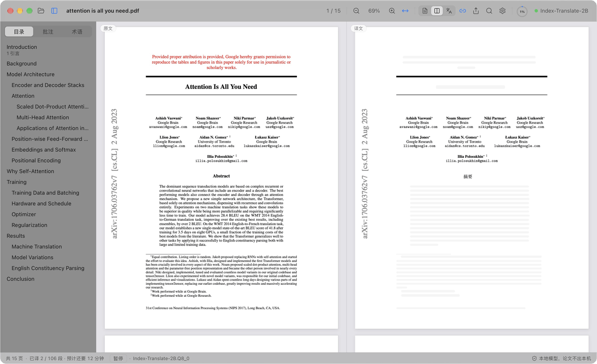

  

<h1 align="center">PaperDuet</h1>

  <em>The Best Lightweight Paper Translator for Researchers!</em>

  
  
  
  
  

  

  <strong>A lightweight mirror translator for papers that keeps the original layout.</strong> 
  Five open-source AI translation models to choose from. 
  No sign-in, no fees, fully local. 
  Attention Is All You Need (15 pages), translated from scratch on a MacBook Pro with M5 Pro. Animation at 1.3× speed.

  

  <b>English</b> &middot; <a href="README.zh-CN.md">简体中文</a>

Stop switching between a translator and your PDF. PaperDuet puts a paper and its Chinese translation side by side, page for page, with every formula, figure and table right where it was. The translation runs on your Mac: no account, no API key, no subscription, and your papers never leave your computer.

## Every page, mirrored

  

The right side is the original page with the English replaced by Chinese, in exactly the same place. Formulas, figures and tables stay untouched, and both sides scroll and zoom together, so Figure 2 always sits next to Figure 2. Columns, headings, captions, footnotes and references are recognised automatically, and paragraphs that run across columns or pages are joined up.

## Start reading in seconds

  

Headings go first, so the outline turns Chinese almost instantly. The title, abstract and introduction come next, then the rest of the paper. Want a later section right now? Double-click it and it jumps to the front of the queue.

## Highlights in both languages

  

Highlight, underline or add a note on either side, and it shows up on the matching sentence on the other. You can also polish any translation by hand, with full undo and redo.

## Pause and resume anytime

  

The ring in the toolbar shows your progress. Point at it to stop, click to pause, click again to carry on. Every paragraph is saved the moment it is translated, so when you come back to a paper, its translation is waiting for you.

## And there's more

- **A Chinese PDF, automatically.** Once a paper is fully translated, `<name>_zh.pdf` is saved next to it in the original layout, with selectable text, and it stays in sync with your edits.
- **Quality checks built in.** Formulas, numbers and sentence order are checked in every reply, with automatic retries, and a glossary for each paper keeps terms consistent.
- **You decide what gets translated.** Right-click any block to translate it or keep it in English.
- **Read your way.** Search both languages at once, browse a bilingual outline, point at a paragraph to find its twin, and show the original, the translation or both. PaperDuet remembers where you left off.
- **Export anywhere.** The original PDF with your marks as standard annotations, the Chinese PDF, and your notes as Markdown.
- **One-click updates.** New versions show up right in the app, signed and verified, and install with one click.
- **Made for the Mac.** Native glass materials, light and dark appearance, a night reading mode, and animations that respect Reduce Motion. The interface is in Simplified Chinese.

  

## Five models, all on your Mac

Pick a model the first time you open PaperDuet, and switch anytime in Settings › 模型 › 更换模型. Every one of them is built for translation and runs fully offline once it is downloaded.

| Model | By | Size | Best for |
| --- | --- | --- | --- |
| [Index-Translate-2B](https://huggingface.co/IndexTeam/Index-Translate-2B) **(recommended)** | bilibili Index team | 2.1 GB | The best all-rounder, tuned for PaperDuet's checks and glossary |
| [Hy-MT2-1.8B](https://huggingface.co/tencent/Hy-MT2-1.8B-GGUF) | Tencent Hunyuan | 1.9 GB | Speed: the fastest and lightest |
| [LMT-60-4B](https://huggingface.co/NiuTrans/LMT-60-4B) | NiuTrans | 4.7 GB | Translations that stay close to the source |
| [Hy-MT2-7B](https://huggingface.co/tencent/Hy-MT2-7B-GGUF) | Tencent Hunyuan | 8.0 GB | The most fluent Chinese, on Macs with 16 GB of memory or more |
| [TranslateGemma-4B](https://huggingface.co/mradermacher/translategemma-4b-it-GGUF) (experimental) | Google | 4.1 GB | Trying Google's translation model |

With the recommended model, a 15-page paper takes about 2 minutes on an M5 Pro, or about 1 minute with "同时翻译几段" (paragraphs at once) set to 2 or 3 in Settings › 模型.

Already have one of these models from LM Studio, llama.cpp or Hugging Face? PaperDuet finds it and uses it where it is, with no second download.

## Private by design

- Your papers, translations and notes stay on your Mac.
- No account, no usage tracking, no crash reports.
- PaperDuet goes online only to download a model and to check for updates, and you can turn the update check off.

## Get started

You need a Mac with Apple silicon (M1 or later) and macOS 13.3 or later.

1. Download the latest `.dmg` from [Releases](https://github.com/KalenHwei/PaperDuet/releases/latest).
2. Drag PaperDuet into Applications and open it from there.
3. First launch only: PaperDuet isn't notarized by Apple yet, so macOS asks you to confirm. Open System Settings › Privacy & Security and click **Open Anyway**. (Or run `xattr -dr com.apple.quarantine /Applications/PaperDuet.app` in Terminal.)
4. Pick a model. PaperDuet downloads it, or finds the copy you already have, and starts translating right away.

That's all. The translation engine is built into the app, and new versions install from inside it.

<b>Keyboard shortcuts</b>

| Action                           | Shortcut                                     |
| -------------------------------- | -------------------------------------------- |
| Open a PDF                       | ⌘O                                           |
| Close the paper                  | ⌘W                                           |
| Search both sides                | ⌘F                                           |
| Next / previous match            | ⌘G / ⇧⌘G                                     |
| Zoom in / out / fit width        | ⌘+ / ⌘− / ⌘0                                 |
| Zoom around the pointer          | ⌘ + scroll, or pinch on the trackpad         |
| Move the pages                   | ⌘ + drag                                     |
| Translate this part next         | Double-click text that is not translated yet |
| Highlight the selection          | H                                            |
| Add a note to the selection      | N                                            |
| Highlight colour                 | 1 to 5                                       |
| Undo / redo                      | ⌘Z / ⇧⌘Z                                     |
| Show or hide the sidebar         | ⌘\                                           |
| Synchronized scrolling on or off | ⌘L                                           |
| All shortcuts                    | ⌘/                                           |

H, N and 1 to 5 work on selected text.

## FAQ

### Which model should I choose?

Start with Index-Translate-2B. For more speed, pick Hy-MT2-1.8B. For the most fluent Chinese on a Mac with 16 GB of memory or more, pick Hy-MT2-7B.

### Is it free?

Yes, for personal study and research, and for universities, schools, research institutes and other non-profits. Using PaperDuet at or for a company needs a commercial license: write to [junystugh@gmail.com](mailto:junystugh@gmail.com).

## Roadmap

- **Typeset translations from arXiv.** Translate a paper's LaTeX source and compile it with Chinese fonts for a fully typeset Chinese edition.
- **An English interface.**

## License

PaperDuet is free for noncommercial use under the [PolyForm Noncommercial License 1.0.0](LICENSE). Use it and share it for personal, study, research or non-profit purposes; when you share it, include the license and the line `Required Notice: Copyright (c) 2026 Kalen Yongda Wei`. For commercial use, write to [junystugh@gmail.com](mailto:junystugh@gmail.com).

Copyright © 2026 Kalen Yongda Wei.

## Acknowledgments

PaperDuet is built on [Tauri](https://tauri.app), [pdf.js](https://mozilla.github.io/pdf.js/), [pdf-lib](https://pdf-lib.js.org), [llama.cpp](https://github.com/ggml-org/llama.cpp), [React](https://react.dev), [Zustand](https://github.com/pmndrs/zustand) and [Lucide](https://lucide.dev). The translation models come from the bilibili Index team (Index-Translate-2B), Tencent Hunyuan (Hy-MT2), NiuTrans (LMT) and Google (TranslateGemma); they are released under Apache-2.0, except TranslateGemma, which is under the [Gemma Terms of Use](https://ai.google.dev/gemma/terms). Full license texts are in the app (Settings › 关于 › 第三方许可证).

The paper in the animations is [_Attention Is All You Need_](https://arxiv.org/abs/1706.03762) by Vaswani et al.
