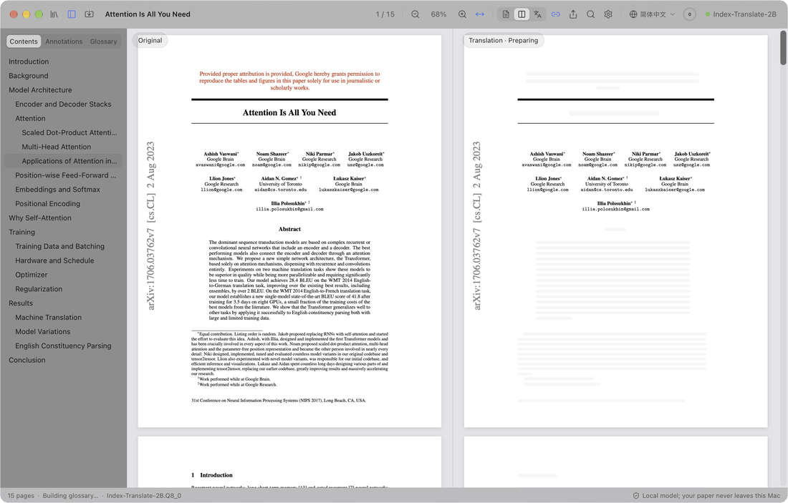
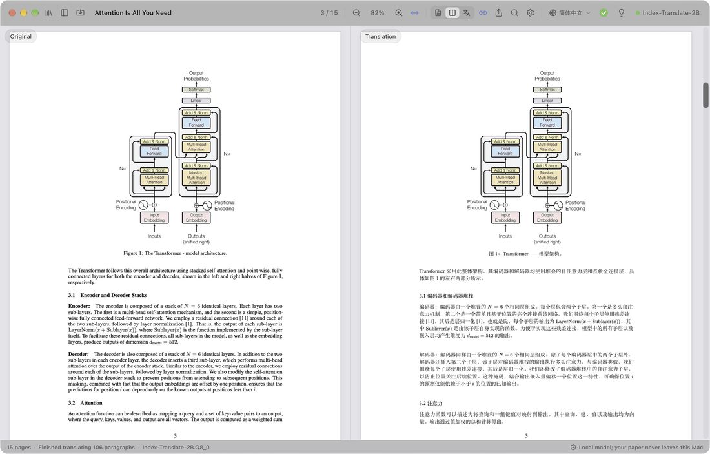
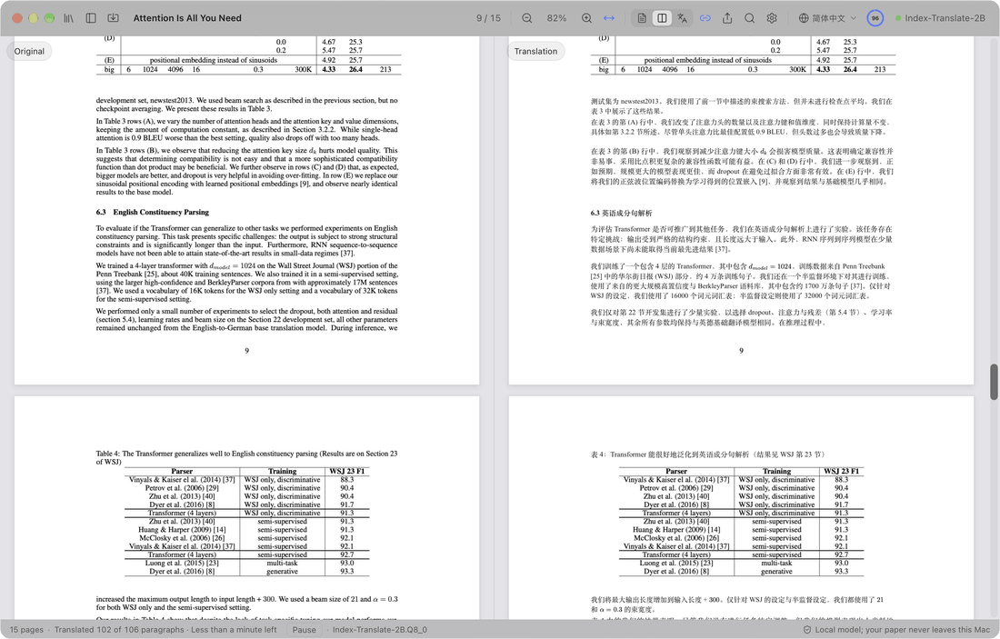
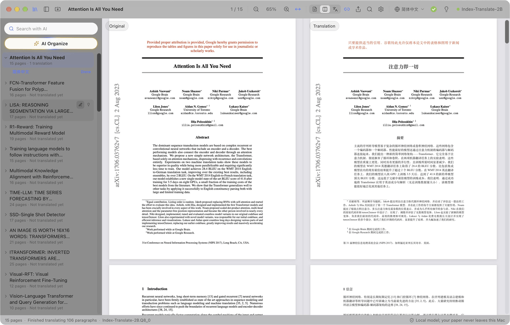
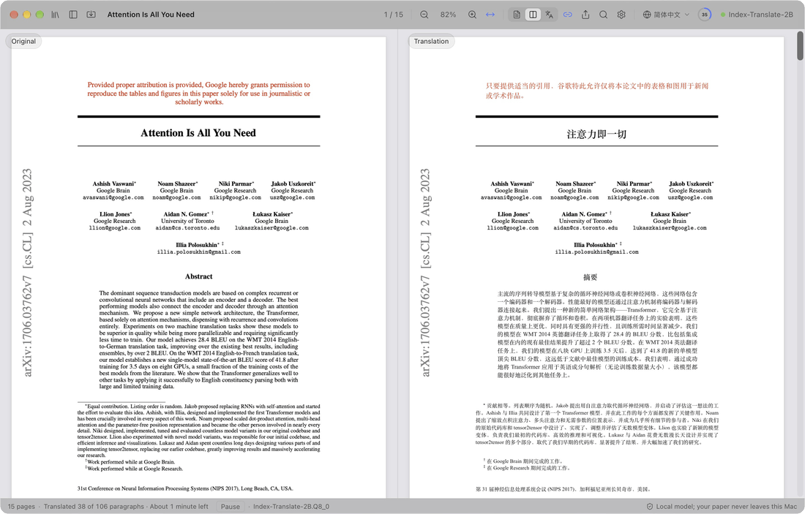
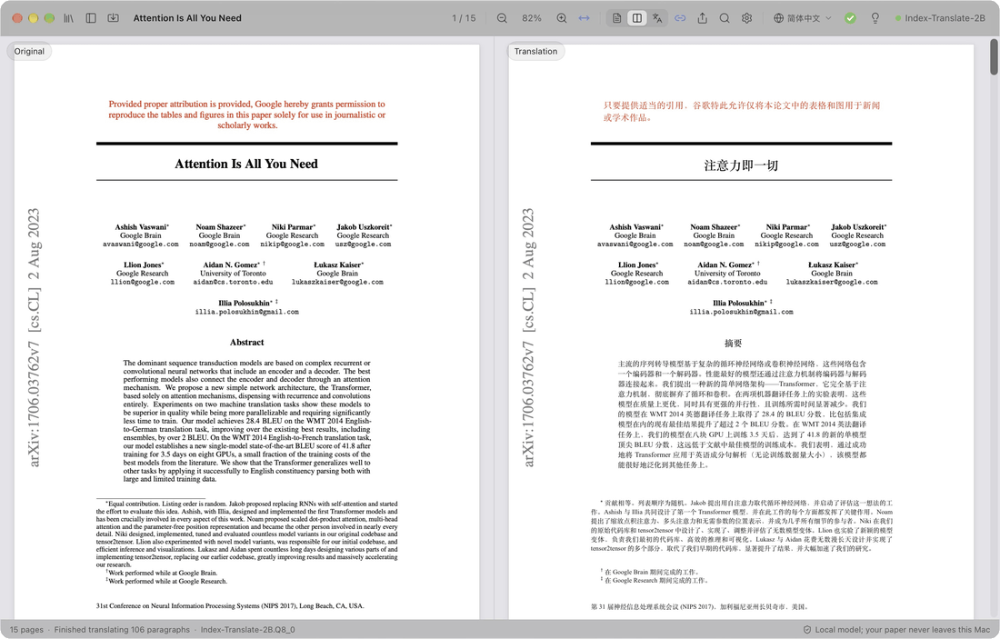
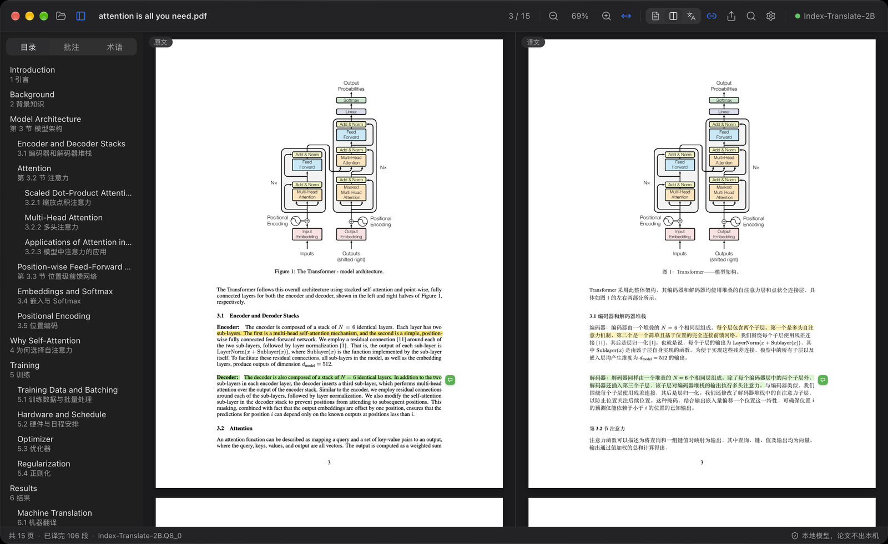

  

<h1 align="center">PaperDuet</h1>

  <em>A lightweight AI paper translator built for researchers!</em> 
  <a href="https://paperduet.com">paperduet.com</a>

  <b>English</b> &middot; <a href="README.zh-CN.md">简体中文</a> &middot; <a href="README.zh-TW.md">繁體中文</a> &middot; <a href="README.ja.md">日本語</a> &middot; <a href="README.ko.md">한국어</a> &middot; <a href="README.fr.md">Français</a> &middot; <a href="README.de.md">Deutsch</a> &middot; <a href="README.es.md">Español</a> &middot; <a href="README.ru.md">Русский</a>

  
  

  
  
  
  
  
  

  <strong>PaperDuet is a lightweight AI mirror translator for papers that keeps the original layout.</strong> 
  Five open-source AI translation models to choose from. 
  No fees, fully local!

   
  A recording of Attention Is All You Need (15 pages) being translated from scratch

PaperDuet is a lightweight AI mirror translator for papers. It lays out the original and the translation as mirror images, with formulas, figures and tables corrected and aligned page by page. No API key, no fees, and it runs entirely on your computer!

## Every page, made easy

  

The original paper is on the left and its translation on the right, and both sides scroll and zoom together. Columns, headings, captions, footnotes and references are recognised automatically, and paragraphs that run across columns or pages are joined up. The two sides line up exactly, so comparing them is easy.

## Saving translation? AI summary? No problem!

  

The toolbar shows the translation progress. When the whole paper is done, the ring turns into a green check and a bubble pops up: one click saves the translation as a PDF next to the original. The light bulb next to it is the AI summary: open it to read what the paper asks, how it works and what it found, written by the model after reading the whole paper. You can also choose from five models to suit your computer and your needs!

## Think it. Find it.

  

Every paper you've read lives in your library. AI Organize tags each one by field and topic, and the papers you pick rise to the top. AI Search finds a paper by its title, its text, its translation or its summary, in English or Chinese.

## Don't get it? Go click it.

  

Headings are translated first, so you can see how the paper is structured; then the title, abstract and introduction. Want a later passage now? Double-click it and it jumps the queue, no waiting for the progress to get there.

## Taking notes? You got it!

  

Highlight, underline and write notes right on the translation; the matching sentences in the original are marked too. Export the original PDF with your notes as standard PDF annotations, ready for Preview, Zotero and other apps.

## And there's more

- **Eight languages to translate into.** Switch between 简体中文, 繁體中文, 日本語, 한국어, Français, Deutsch, Español and Русский in one click from the toolbar.
- **A translated PDF in one click.** Once a paper is fully translated, one click saves the translation next to it in the original layout.
- **Quality checks built in.** Formulas, numbers and sentence order are checked in every reply, with automatic retries, and a glossary for each paper keeps terms consistent.
- **You decide what gets translated.** Right-click any block to translate it or keep the original.
- **Read your way.** Search the original and the translation at once, browse a bilingual outline, point at a paragraph to find its twin, and show the original, the translation or both. PaperDuet remembers where you left off.
- **Your library, with AI search.** Every paper you read or import is in the library. AI Search finds one again by its title, text, translation or summary, in English or Chinese, and AI Organize sorts papers by field and topic.
- **A summary of every paper.** Once a paper is translated, click the light bulb: the translation model writes a short summary in your interface language and keeps it with the paper.
- **Export anywhere.** The original PDF with your marks, the translated PDF and your notes as Markdown, all readable in other apps too.
- **One-click updates.** Updating is easy: one click installs the new version.
- **Made to look good.** A clean, beautiful glass design, with light, dark and night reading modes.

  

## Five models, all on your computer

Pick a model the first time you open PaperDuet, and switch anytime in Settings › Model › Change Model. Every one of them is built for translation and runs fully offline once it is downloaded.

| Model | By | Size | Best for |
| --- | --- | --- | --- |
| [Index-Translate-2B](https://huggingface.co/IndexTeam/Index-Translate-2B) **(recommended)** | bilibili Index team | 2.1 GB | The best all-rounder, tuned for PaperDuet's checks and glossary |
| [Hy-MT2-1.8B](https://huggingface.co/tencent/Hy-MT2-1.8B-GGUF) | Tencent Hunyuan | 1.9 GB | Speed: the fastest and lightest |
| [LMT-60-4B](https://huggingface.co/NiuTrans/LMT-60-4B) | NiuTrans | 4.7 GB | Translations that stay close to the source |
| [Hy-MT2-7B](https://huggingface.co/tencent/Hy-MT2-7B-GGUF) | Tencent Hunyuan | 8.0 GB | The most fluent Chinese, on computers with 16 GB of memory or more |
| [TranslateGemma-4B](https://huggingface.co/mradermacher/translategemma-4b-it-GGUF) (experimental) | Google | 4.1 GB | Trying Google's translation model |

With the recommended model, a 15-page paper takes about 2 minutes on an M5 Pro, or about 1 minute with "Paragraphs at Once" set to 2 or 3 in Settings › Model.

Already have one of these models from LM Studio, llama.cpp or Hugging Face? PaperDuet finds it and uses it where it is, with no second download.

## Private by design

- Your papers, translations and notes stay on your computer.
- Only if you agree, PaperDuet sends anonymous usage and diagnostic data (version, system, interface language, model and kinds of errors), never paper content, and you can turn it off anytime in Settings.
- PaperDuet goes online only to download a model, to check for updates and to send that data; you can turn off the last two.

## Get started

A Mac needs Apple silicon (M1 or later) and macOS 13.3 or later; a PC needs 64-bit Windows 10 or 11.

**Mac**

1. Download the latest `.dmg` from [Releases](https://github.com/KalenHwei/PaperDuet/releases/latest).
2. Drag PaperDuet into Applications and open it from there.
3. First launch only: PaperDuet isn't notarized by Apple yet, so macOS asks you to confirm. Open System Settings › Privacy & Security and click **Open Anyway**. (Or run `xattr -dr com.apple.quarantine /Applications/PaperDuet.app` in Terminal.)
4. Pick a model. PaperDuet downloads it, or finds the copy you already have, and starts translating right away.

**Windows**

1. Download the latest Windows installer (`_x64-setup.exe`) from [Releases](https://github.com/KalenHwei/PaperDuet/releases/latest).
2. Run it. First time only: if Windows says “Windows protected your PC,” click **More info**, then **Run anyway**.
3. Pick a model. PaperDuet downloads it, or finds the copy you already have, and starts translating right away.

That's all. The translation engine is built into the app, and updates take one click.

<b>Keyboard shortcuts</b>

| Action                           | Shortcut                                     |
| -------------------------------- | -------------------------------------------- |
| Open a PDF                       | ⌘O                                           |
| Close the paper                  | ⌘W                                           |
| Search both sides                | ⌘F                                           |
| Next / previous match            | ⌘G / ⇧⌘G                                     |
| Zoom in / out / fit width        | ⌘+ / ⌘− / ⌘0                                 |
| Zoom around the pointer          | ⌘ + scroll, or pinch on the trackpad         |
| Move the pages                   | ⌘ + drag                                     |
| Translate this part next         | Double-click text that is not translated yet |
| Highlight the selection          | H                                            |
| Add a note to the selection      | N                                            |
| Highlight colour                 | 1 to 5                                       |
| Undo / redo                      | ⌘Z / ⇧⌘Z                                     |
| Show or hide the sidebar         | ⌘\                                           |
| Synchronized scrolling on or off | ⌘L                                           |
| All shortcuts                    | ⌘/                                           |

H, N and 1 to 5 work on selected text. On Windows, use Ctrl for ⌘ and Shift for ⇧.

## FAQ

### Which model should I choose?

Start with Index-Translate-2B. For more speed, pick Hy-MT2-1.8B. For the most fluent Chinese on a computer with 16 GB of memory or more, pick Hy-MT2-7B.

### Is it free?

Yes, for personal study and research, and for universities, schools, research institutes and other non-profits. Using PaperDuet at or for a company needs a commercial license: write to [junystugh@gmail.com](mailto:junystugh@gmail.com).

## Roadmap

- **Typeset translations from arXiv.** Translate a paper's LaTeX source and compile it with Chinese fonts for a fully typeset Chinese edition.

## Changelog

- **0.5.4** (2026-10-24): a cleaner interface without the extra explanatory text; the AI search field now reads "Search with AI".
- **0.5.3** (2026-10-24): PaperDuet now asks once whether you'd like to share anonymous usage and diagnostic data to help improve it; never paper content, and you can turn it off anytime in Settings › Data.
- **0.5.2** (2026-10-24): AI Search 🔍 in the library finds papers you've read by title, original text, translation, summary or tags, in English or Chinese; search and AI Organize move the papers found to the top and grey out the rest.
- **0.5.1** (2026-10-24): a library in place of the folder panel, with every paper read or imported, renamed in place and summarised; import many PDFs or a whole folder; AI Organize ✨ filters papers by field and topic; fixes for garbled tables and paragraphs that failed to translate in some papers.
- **0.5.0** (2026-10-24): a paper summary 💡 behind the light bulb once the whole paper is translated; the folder panel opens its folder in one click; a Windows version.
- **0.4.1** (2026-10-23): clearer descriptions in the model list and in Settings.
- **0.4.0** (2026-10-23): the interface comes in 9 languages. It follows your system language by default, and you can switch it in Settings › Appearance › Interface Language.
- **0.3.2** (2026-10-23): further alignment fixes when translating into other languages.
- **0.3.1** (2026-10-23): improvements to the progress ring and the toolbar.
- **0.3.0** (2026-10-23): eight languages to translate into 🎉, switched in one click from the toolbar; a better progress ring and smoother interactions.
- **0.2.1** (2026-10-23): five translation models to choose from; a new launch screen.
- **0.2.0** (2026-10-23): update checks inside the app, with one-click updates.
- **0.1.0** (2026-10-22): first release.

Full history: [CHANGELOG.md](CHANGELOG.md).

## License

PaperDuet is free for noncommercial use under the [PolyForm Noncommercial License 1.0.0](LICENSE). Use it and share it for personal, study, research or non-profit purposes; when you share it, include the license and the line `Required Notice: Copyright (c) 2026 Kalen Yongda Wei`. For commercial use, write to [junystugh@gmail.com](mailto:junystugh@gmail.com).

Copyright © 2026 Kalen Yongda Wei.

## Acknowledgments

PaperDuet is built on [Tauri](https://tauri.app), [pdf.js](https://mozilla.github.io/pdf.js/), [pdf-lib](https://pdf-lib.js.org), [llama.cpp](https://github.com/ggml-org/llama.cpp), [React](https://react.dev), [Zustand](https://github.com/pmndrs/zustand) and [Lucide](https://lucide.dev). The translation models come from the bilibili Index team (Index-Translate-2B), Tencent Hunyuan (Hy-MT2), NiuTrans (LMT) and Google (TranslateGemma); they are released under Apache-2.0, except TranslateGemma, which is under the [Gemma Terms of Use](https://ai.google.dev/gemma/terms). Full license texts are in the app (Settings › About › Third-Party Licenses).

The paper in the animations is [_Attention Is All You Need_](https://arxiv.org/abs/1706.03762) by Vaswani et al.
