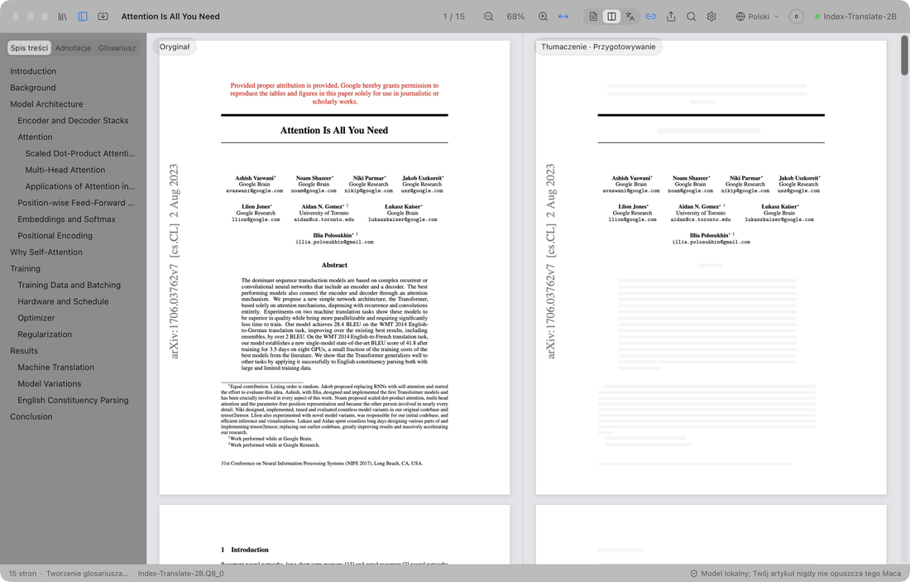
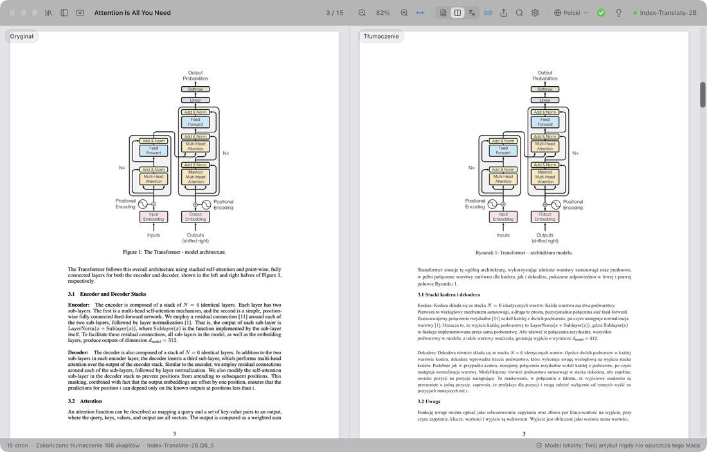
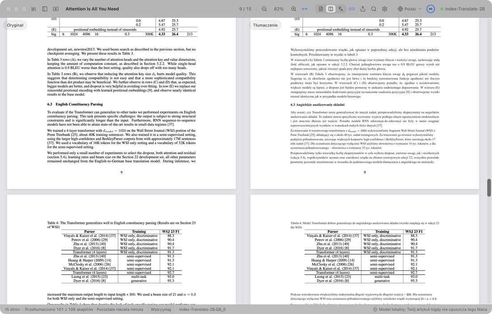
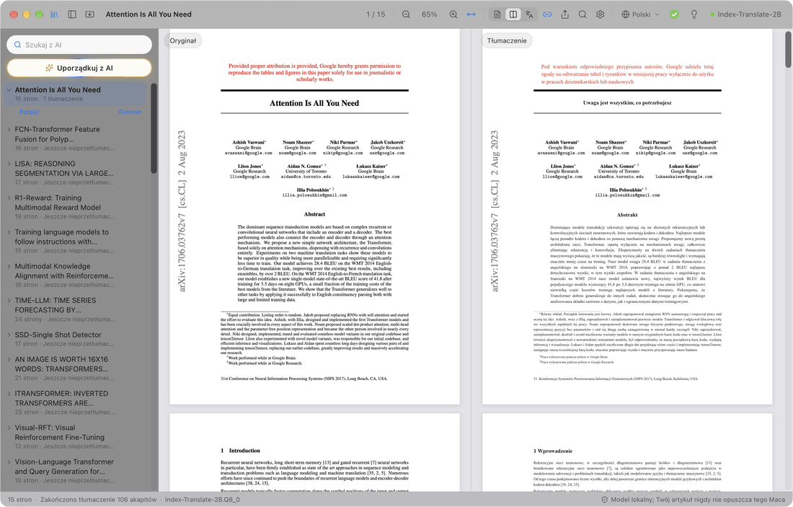
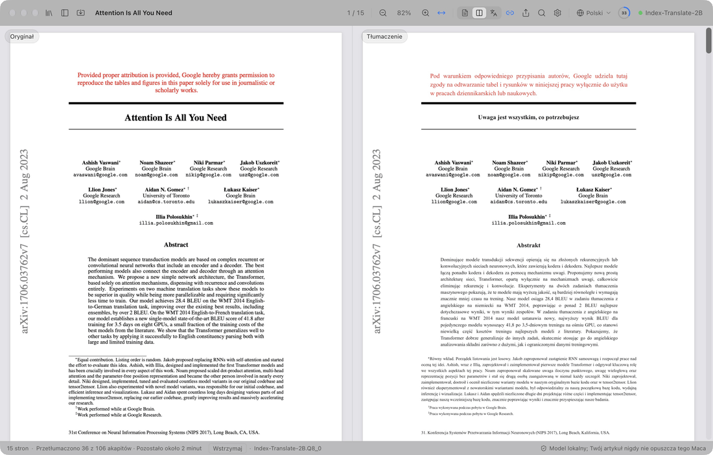
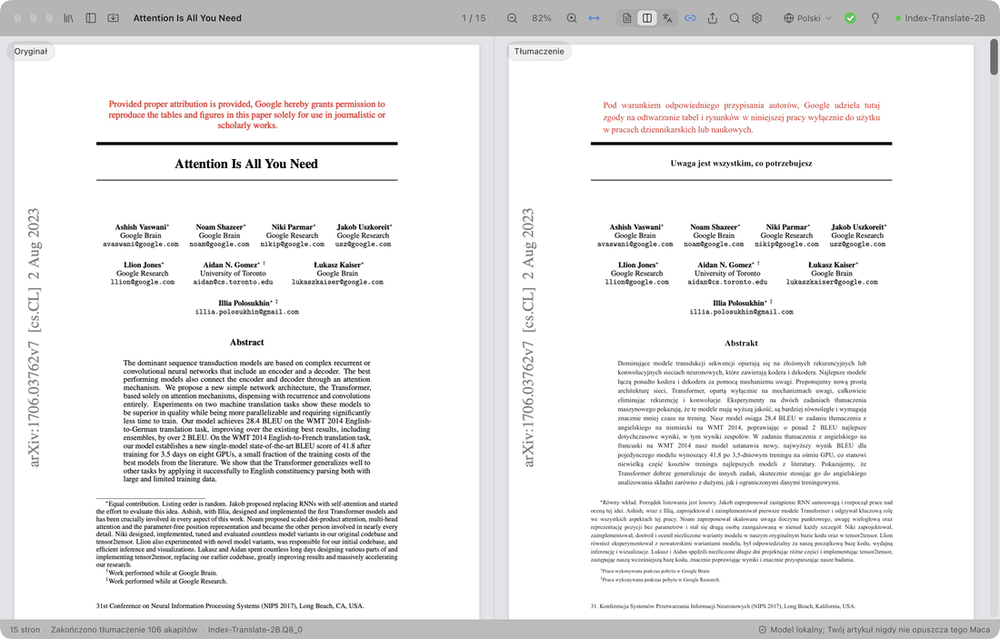

  

<h1 align="center">PaperDuet</h1>

  <em>Lekki tłumacz artykułów naukowych oparty na AI, stworzony z myślą o badaczach!</em> 
  <a href="https://paperduet.com">paperduet.com</a>

  <a href="README.md">English</a> &middot; <a href="README.zh-CN.md">简体中文</a> &middot; <a href="README.zh-TW.md">繁體中文</a> &middot; <a href="README.ja.md">日本語</a> &middot; <a href="README.ko.md">한국어</a> &middot; <a href="README.fr.md">Français</a> &middot; <a href="README.de.md">Deutsch</a> &middot; <a href="README.es.md">Español</a> &middot; <a href="README.it.md">Italiano</a> &middot; <b>Polski</b> &middot; <a href="README.ru.md">Русский</a>

  
  

  
  
  
  
  

  <strong>PaperDuet to lekki lustrzany tłumacz artykułów oparty na AI, który zachowuje ich oryginalny układ.</strong> 
  Pięć modeli tłumaczeniowych AI typu open source działa na Twoim komputerze, możesz też podłączyć API online. 
  Za darmo i bez rejestracji!

   
  Nagranie tłumaczenia Attention Is All You Need (15 stron) od zera

PaperDuet to lekki lustrzany tłumacz artykułów naukowych oparty na AI. Układa oryginał i tłumaczenie obok siebie jak lustrzane odbicia, a wzory, rysunki i tabele poprawia i wyrównuje strona po stronie. Za darmo: z modelem lokalnym wszystko działa na Twoim komputerze, a w razie potrzeby możesz podłączyć API online.

## Każda strona – bez wysiłku

  

Po lewej jest oryginalny artykuł, po prawej jego tłumaczenie, a obie strony przewijają się i powiększają razem. Kolumny, nagłówki, podpisy, przypisy dolne i bibliografia są rozpoznawane automatycznie, a akapity, które przechodzą do innej kolumny lub na kolejną stronę, zostają połączone. Obie strony są dokładnie wyrównane, więc łatwo je porównywać.

## Zachować tłumaczenie? Streszczenie AI? Nie ma sprawy!

  

Pasek narzędzi pokazuje postęp tłumaczenia. Gdy cały artykuł jest gotowy, pierścień zmienia się w zielony haczyk i pojawia się dymek: jedno kliknięcie zachowuje tłumaczenie jako PDF obok oryginału. Żarówka obok kryje streszczenie AI, które model pisze po przeczytaniu całego artykułu: jakie pytanie stawia artykuł, jaką metodę proponuje i co udało się ustalić. Do tego możesz wybrać jeden z pięciu modeli, dopasowany do Twojego komputera i potrzeb!

## Pomyśl. Znajdź.

  

Każdy przeczytany artykuł trafia do Twojej biblioteki. „Uporządkuj z AI” oznacza każdy z nich tagami według dziedziny i tematu, a wybrane przez Ciebie artykuły przesuwają się na górę. Wyszukiwanie AI znajduje artykuł po tytule, treści, tłumaczeniu lub streszczeniu, po polsku lub po angielsku.

## Nie rozumiesz? Kliknij.

  

Najpierw tłumaczone są nagłówki sekcji, więc od razu widzisz strukturę artykułu; potem tytuł, abstrakt i wstęp. Chcesz przeczytać teraz fragment z dalszej części? Kliknij go dwukrotnie, a zostanie przetłumaczony poza kolejnością, bez czekania, aż postęp tam dotrze.

## Notatki? Jasne!

  

Wyróżniaj, podkreślaj i pisz notatki bezpośrednio na tłumaczeniu; odpowiadające im zdania w oryginale też zostają oznaczone. Eksportuj oryginalny PDF z notatkami jako standardowe adnotacje PDF, gotowe do otwarcia w Podglądzie, Zotero i innych aplikacjach.

## I to nie wszystko

- **Dziesięć języków tłumaczenia.** Jednym kliknięciem na pasku narzędzi przełączasz się między językami: 简体中文, 繁體中文, 日本語, 한국어, Français, Deutsch, Español, Italiano, Polski i Русский.
- **Przetłumaczony PDF jednym kliknięciem.** Gdy artykuł jest w całości przetłumaczony, jedno kliknięcie zachowuje tłumaczenie obok niego, w oryginalnym układzie.
- **Wbudowana kontrola jakości.** Wzory, liczby i kolejność zdań są sprawdzane w każdej odpowiedzi modelu, z automatycznymi ponownymi próbami, a glosariusz tworzony dla każdego artykułu dba o spójność terminów.
- **Ty decydujesz, co tłumaczyć.** Kliknij prawym przyciskiem dowolny blok, aby go przetłumaczyć lub zostawić oryginał.
- **Czytaj po swojemu.** Przeszukuj oryginał i tłumaczenie jednocześnie, przeglądaj dwujęzyczny spis treści, wskaż akapit, aby znaleźć jego odpowiednik, i wyświetlaj oryginał, tłumaczenie albo oba naraz. PaperDuet pamięta ostatnio czytane miejsce.
- **Twoja biblioteka z wyszukiwaniem AI.** Każdy przeczytany lub zaimportowany artykuł jest w bibliotece. Wyszukiwanie AI odnajdzie go po tytule, treści, tłumaczeniu lub streszczeniu, po polsku lub po angielsku, a „Uporządkuj z AI” grupuje artykuły według dziedziny i tematu.
- **Streszczenie każdego artykułu.** Gdy artykuł jest przetłumaczony, kliknij żarówkę: model tłumaczeniowy napisze krótkie streszczenie w języku interfejsu i zachowa je razem z artykułem.
- **Eksportuj, dokąd chcesz.** Oryginalny PDF z Twoimi oznaczeniami, przetłumaczony PDF i notatki w formacie Markdown, czytelne także w innych aplikacjach.
- **Uaktualnienia jednym kliknięciem.** Uaktualnianie jest proste: jedno kliknięcie instaluje nową wersję.
- **Zaprojektowany, by cieszyć oko.** Czysty, elegancki szklany wygląd z motywem jasnym, ciemnym i trybem czytania nocnego.

  

## Pięć modeli, wszystkie na Twoim komputerze

Wybierz model przy pierwszym uruchomieniu PaperDuet, a zmienisz go w dowolnej chwili w Ustawieniach › Model › Zmień model. Wszystkie są stworzone do tłumaczenia i po pobraniu działają całkowicie offline.

| Model | Twórca | Rozmiar | Kiedy wybrać |
| --- | --- | --- | --- |
| [Index-Translate-2B](https://huggingface.co/IndexTeam/Index-Translate-2B) **(zalecany)** | Zespół Index z bilibili | 2.1 GB | Najlepszy wszechstronny wybór; kontrole i glosariusz PaperDuet są dostrojone właśnie do niego |
| [Hy-MT2-1.8B](https://huggingface.co/tencent/Hy-MT2-1.8B-GGUF) | Tencent Hunyuan | 1.9 GB | Gdy liczy się szybkość: najszybszy i najlżejszy |
| [LMT-60-4B](https://huggingface.co/NiuTrans/LMT-60-4B) | NiuTrans | 4.7 GB | Gdy tłumaczenie ma być bliskie oryginałowi |
| [Hy-MT2-7B](https://huggingface.co/tencent/Hy-MT2-7B-GGUF) | Tencent Hunyuan | 8.0 GB | Gdy chcesz najpłynniejszego tłumaczenia, na komputerze z 16 GB pamięci lub więcej |
| [TranslateGemma-4B](https://huggingface.co/mradermacher/translategemma-4b-it-GGUF) (eksperymentalny) | Google | 4.1 GB | Gdy chcesz wypróbować model tłumaczeniowy Google |

Z zalecanym modelem tłumaczenie 15-stronicowego artykułu trwa na M5 Pro około 2 minut, a po ustawieniu opcji „Akapitów jednocześnie” na 2 lub 3 w Ustawieniach › Model – około minuty.

Masz już któryś z tych modeli z LM Studio, llama.cpp lub Hugging Face? PaperDuet go znajdzie i użyje tam, gdzie jest, bez ponownego pobierania.

Komputer nie radzi sobie z lokalnymi modelami? Wybierz „Użyj API” przy wyborze modelu i wpisz własny klucz API, aby korzystać z OpenAI, Claude, DeepSeek, Qwen, Kimi, GLM, Doubao lub dowolnej usługi zgodnej z OpenAI. Lista lokalnych modeli się zwinie, a tłumaczenie, streszczenia oraz porządkowanie i wyszukiwanie z AI będą działać przez tę usługę. Klucz zostaje na Twoim komputerze.

## Prywatność od podstaw

- Twoje artykuły, tłumaczenia i notatki zostają na Twoim komputerze. Przy korzystaniu z API tłumaczony tekst trafia do wybranej usługi.
- Tylko jeśli się zgodzisz, PaperDuet wysyła anonimowe dane o użytkowaniu i diagnostyce (wersja, system, język interfejsu, model i rodzaje błędów), nigdy treść artykułów, a wysyłanie możesz w każdej chwili wyłączyć w Ustawieniach.
- Gdy coś pójdzie nie tak, PaperDuet wysyła twórcy raport o błędzie: co się nie udało, wersję i system, bez ścieżek plików i treści artykułów. Możesz to wyłączyć w Ustawieniach › Dane.
- Gdy napiszesz w aplikacji opinię i klikniesz Wyślij, Twój tekst (i adres e-mail, jeśli go podasz) trafia do twórcy razem z wersją i systemem.
- Z modelem lokalnym PaperDuet łączy się z internetem tylko po to, by pobrać model, sprawdzić uaktualnienia i wysłać powyższe dane i raporty oraz Twoje opinie; wyłączyć możesz wszystko oprócz pobierania modelu.

## Pierwsze kroki

Na Macu potrzebujesz czipu Apple (M1 lub nowszego) i systemu macOS 13.3 lub nowszego; na PC – 64-bitowego systemu Windows 10 lub 11.

**Mac**

1. Pobierz najnowszy plik `.dmg` z [Releases](https://github.com/KalenHwei/PaperDuet/releases/latest).
2. Przeciągnij PaperDuet do folderu Aplikacje i otwórz go stamtąd.
3. Tylko przy pierwszym uruchomieniu: PaperDuet nie przeszedł jeszcze notaryzacji Apple, więc macOS poprosi Cię o potwierdzenie. Otwórz Ustawienia systemowe › Prywatność i ochrona i kliknij **Otwórz mimo to**. (Możesz też wykonać w Terminalu polecenie `xattr -dr com.apple.quarantine /Applications/PaperDuet.app`.)
4. Wybierz model. PaperDuet go pobierze albo znajdzie kopię, którą już masz, i od razu zacznie tłumaczyć.

**Windows**

1. Pobierz najnowszy instalator dla Windows (`_x64-setup.exe`) z [Releases](https://github.com/KalenHwei/PaperDuet/releases/latest).
2. Uruchom go. Tylko za pierwszym razem: jeśli Windows wyświetli komunikat „System Windows ochronił ten komputer”, kliknij **Więcej informacji**, a potem **Uruchom mimo to**.
3. Wybierz model. PaperDuet go pobierze albo znajdzie kopię, którą już masz, i od razu zacznie tłumaczyć.

To wszystko. Silnik tłumaczenia jest wbudowany w aplikację, a uaktualnienie wymaga jednego kliknięcia.

<b>Skróty klawiszowe</b>

| Czynność | Skrót |
| --- | --- |
| Otwórz PDF | ⌘O |
| Zamknij artykuł | ⌘W |
| Szukaj po obu stronach | ⌘F |
| Następny / poprzedni wynik | ⌘G / ⇧⌘G |
| Powiększ / pomniejsz / dopasuj do szerokości | ⌘+ / ⌘− / ⌘0 |
| Powiększ wokół wskaźnika | ⌘ + przewijanie albo zsunięcie lub rozsunięcie palców na gładziku |
| Przesuń strony | ⌘ + przeciąganie |
| Przetłumacz ten fragment jako następny | Dwukrotne kliknięcie nieprzetłumaczonego tekstu |
| Wyróżnij zaznaczenie | H |
| Dodaj notatkę do zaznaczenia | N |
| Kolor wyróżnienia | Od 1 do 5 |
| Cofnij / przywróć | ⌘Z / ⇧⌘Z |
| Pokaż lub ukryj pasek boczny | ⌘\ |
| Włącz lub wyłącz przewijanie synchroniczne | ⌘L |
| Wszystkie skróty | ⌘/ |

H, N i klawisze od 1 do 5 działają na zaznaczonym tekście. W systemie Windows używaj Ctrl zamiast ⌘ i Shift zamiast ⇧.

## Często zadawane pytania

### Który model wybrać?

Zacznij od Index-Translate-2B. Jeśli zależy Ci na szybkości, wybierz Hy-MT2-1.8B. Po najpłynniejsze tłumaczenie na komputerze z 16 GB pamięci lub więcej sięgnij po Hy-MT2-7B. Jeśli komputer sobie nie radzi, wybierz „Użyj API”.

### Czy PaperDuet jest bezpłatny?

Tak, do osobistej nauki i badań, a także dla uczelni, szkół, instytutów badawczych i innych organizacji non-profit. Korzystanie z PaperDuet w firmie lub na rzecz firmy wymaga licencji komercyjnej: napisz na [junystugh@gmail.com](mailto:junystugh@gmail.com).

## Plany

- **Złożone tłumaczenia artykułów z arXiv.** Tłumaczenie kodu źródłowego LaTeX artykułu i kompilacja z fontami języka docelowego, aby otrzymać przetłumaczone wydanie w pełnym składzie.

## Historia zmian

- **0.6.3** (2026-10-29): rozwiązano znane problemy z logiką interfejsu.
- **0.6.2** (2026-10-28): w systemie Windows można wybrać folder na modele; pobrane już modele zostaną tam przeniesione.
- **0.6.1** (2026-10-28): poprawiono kilka znanych problemów z formatowaniem.
- **0.6.0** (2026-10-28): krótki przewodnik po najważniejszych funkcjach przy pierwszym otwarciu artykułu oraz opinie w wersji beta: wyślij nam swoje uwagi prosto z paska stanu.
- **0.5.17** (2026-10-28): poprawiono kilka znanych problemów z formatowaniem.
- **0.5.16** (2026-10-28): akapity rękopisów (eksportowanych z Worda, z podwójną interlinią) nie zostają już po angielsku: wyróżnione wiersze są tłumaczone, akapity z podwójną interlinią są tłumaczone w całości, a nie wiersz po wierszu, a podpisy rycin umieszczone po bibliografii są tłumaczone.
- **0.5.15** (2026-10-28): symbole we wzorach w czasopismach Elsevier nie są już zniekształcane: litery greckie, ≤, ∀, ≠ i litery z daszkiem (Ŝ, q̂) nie wyświetlają się już jako zwykłe litery, a wysoko podniesiony indeks górny nie trafia już do wiersza powyżej.
- **0.5.14** (2026-10-28): poprawiono kilka znanych błędów formatowania.
- **0.5.13** (2026-10-28): wzory nie są już zniekształcane: wzory wyświetlane z ułamkami i sumami pozostają w całości zamiast być tłumaczone kawałkami na samych sobie, a sumy w tekście, pierwiastki i mocno rozstrzelone wiersze ze wzorami nie rozbijają już zdania.
- **0.5.12** (2026-10-27): artykuły z czasopism są odwzorowywane dokładniej: wiersze ze statystykami, numerowane śródtytuły, zdania przechodzące do następnej kolumny, greckie litery takie jak χ², nazwiska ze znakami diakrytycznymi i znaki minus w tabelach już się nie psują; wyeksportowany przetłumaczony PDF ma równe odstępy między literami. Dziękujemy momo z RedNote za sugestie.
- **0.5.11** (2026-10-27): pseudokod jest tłumaczony wiersz po wierszu z zachowaniem numerów wierszy, wcięć i słów kluczowych; tabele są lepiej rozpoznawane, ich zawartość zostaje w oryginale, a tłumaczone są tylko tytuły i przypisy, więc już się nie rozjeżdżają; sumy w tekście nie znikają już z tłumaczenia.
- **0.5.10** (2026-10-27): tłumaczenie przez API online: jeśli komputer nie radzi sobie z lokalnymi modelami, wybierz „Użyj API” przy wyborze modelu, by korzystać z OpenAI, Claude, DeepSeek, Qwen, Kimi, GLM, Doubao lub dowolnej usługi zgodnej z OpenAI; lista lokalnych modeli się wtedy zwija.
- **0.5.9** (2026-10-26): poprawki istniejących błędów.
- **0.5.8** (2026-10-26): polski jako język tłumaczenia i interfejsu; poprawki: w macOS 26 i starszych nie dało się odczytać ani przetłumaczyć artykułów; w macOS 27 dla niektórych artykułów nie udawało się zachować przetłumaczonego PDF.
- **0.5.7** (2026-10-26): dokładniejsze odczytywanie i tłumaczenie artykułów z czasopism, sprawdzone artykuł po artykule na tekstach z 20 czasopism: kolumny, nagłówki, bibliografia, tabele, podpisy i symbole charakterystyczne dla wydawców; artykuły z Science nie zostają już w dużej części nieprzetłumaczone, a dodatki po bibliografii są tłumaczone.
- **0.5.6** (2026-10-25): włoski jako język tłumaczenia i interfejsu; raporty o błędach wysyłane do twórcy, gdy coś pójdzie nie tak, aby pomóc w naprawianiu problemów (domyślnie włączone, można je wyłączyć w Ustawieniach › Dane).
- **0.5.5** (2026-10-25): naprawiono rozbijanie luźno złożonych wierszy w artykułach z czasopism na pojedyncze słowa, przez co słowa wypadały z tłumaczenia lub trafiały w złe miejsce; abstrakt jest tłumaczony zaraz po tytule; rzadziej pojawia się błąd „Analiza układu nie powiodła się”; myślniki w artykułach Elsevier nie są już odczytywane jako „e”.
- **0.5.4** (2026-10-24): czystszy interfejs bez zbędnych tekstów objaśniających; pole wyszukiwania AI pokazuje teraz „Szukaj z AI”.
- **0.5.3** (2026-10-24): PaperDuet pyta teraz jednorazowo, czy chcesz udostępniać anonimowe dane o użytkowaniu i diagnostyce, aby pomóc go ulepszać; nigdy treść artykułów, a udostępnianie możesz w każdej chwili wyłączyć w Ustawieniach › Dane.
- **0.5.2** (2026-10-24): wyszukiwanie AI 🔍 w bibliotece znajduje przeczytane artykuły po tytule, tekście oryginału, tłumaczeniu, streszczeniu lub tagach, po polsku lub po angielsku; wyszukiwanie i „Uporządkuj z AI” przesuwają znalezione artykuły na górę, a pozostałe wyszarzają.
- **0.5.1** (2026-10-24): biblioteka zamiast panelu folderów, ze wszystkimi przeczytanymi lub zaimportowanymi artykułami, z nazwami zmienianymi na miejscu i streszczeniami; import wielu plików PDF lub całego folderu; „Uporządkuj z AI” ✨ filtruje artykuły według dziedziny i tematu; poprawki nieczytelnych tabel i akapitów, których w niektórych artykułach nie udawało się przetłumaczyć.
- **0.5.0** (2026-10-24): streszczenie artykułu 💡 pod żarówką, gdy cały artykuł jest przetłumaczony; panel folderów otwiera swój folder jednym kliknięciem; wersja dla Windows.
- **0.4.1** (2026-10-23): jaśniejsze opisy na liście modeli i w Ustawieniach.
- **0.4.0** (2026-10-23): interfejs jest dostępny w 9 językach. Domyślnie korzysta z języka systemu, a zmienić go możesz w Ustawieniach › Wygląd › Język interfejsu.
- **0.3.2** (2026-10-23): kolejne poprawki wyrównania przy tłumaczeniu na inne języki.
- **0.3.1** (2026-10-23): ulepszenia pierścienia postępu i paska narzędzi.
- **0.3.0** (2026-10-23): osiem języków tłumaczenia 🎉, przełączanych jednym kliknięciem na pasku narzędzi; lepszy pierścień postępu i płynniejsza obsługa.
- **0.2.1** (2026-10-23): pięć modeli tłumaczeniowych do wyboru; nowy ekran startowy.
- **0.2.0** (2026-10-23): sprawdzanie uaktualnień w aplikacji i uaktualnianie jednym kliknięciem.
- **0.1.0** (2026-10-22): pierwsze wydanie.

Pełna historia: [CHANGELOG.md](CHANGELOG.md).

## Licencja

PaperDuet jest bezpłatny do użytku niekomercyjnego na warunkach [PolyForm Noncommercial License 1.0.0](LICENSE). Możesz go używać i udostępniać do celów osobistych, edukacyjnych, badawczych lub non-profit; udostępniając go, dołącz licencję i wiersz `Required Notice: Copyright (c) 2026 Kalen Yongda Wei`. W sprawie użytku komercyjnego napisz na [junystugh@gmail.com](mailto:junystugh@gmail.com).

Copyright © 2026 Kalen Yongda Wei.

## Podziękowania

PaperDuet powstał w oparciu o [Tauri](https://tauri.app), [pdf.js](https://mozilla.github.io/pdf.js/), [pdf-lib](https://pdf-lib.js.org), [llama.cpp](https://github.com/ggml-org/llama.cpp), [React](https://react.dev), [Zustand](https://github.com/pmndrs/zustand) i [Lucide](https://lucide.dev). Modele tłumaczeniowe pochodzą od zespołu Index z bilibili (Index-Translate-2B), Tencent Hunyuan (Hy-MT2), NiuTrans (LMT) i Google (TranslateGemma); są udostępniane na licencji Apache-2.0, z wyjątkiem TranslateGemma, który podlega [warunkom korzystania z Gemma](https://ai.google.dev/gemma/terms). Pełne teksty licencji znajdziesz w aplikacji (Ustawienia › O programie › Licencje stron trzecich).

Artykuł w animacjach to [_Attention Is All You Need_](https://arxiv.org/abs/1706.03762) autorstwa Vaswaniego i in.
