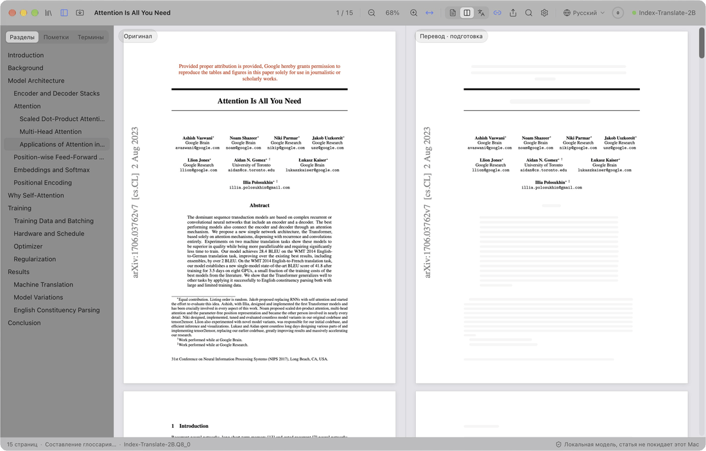
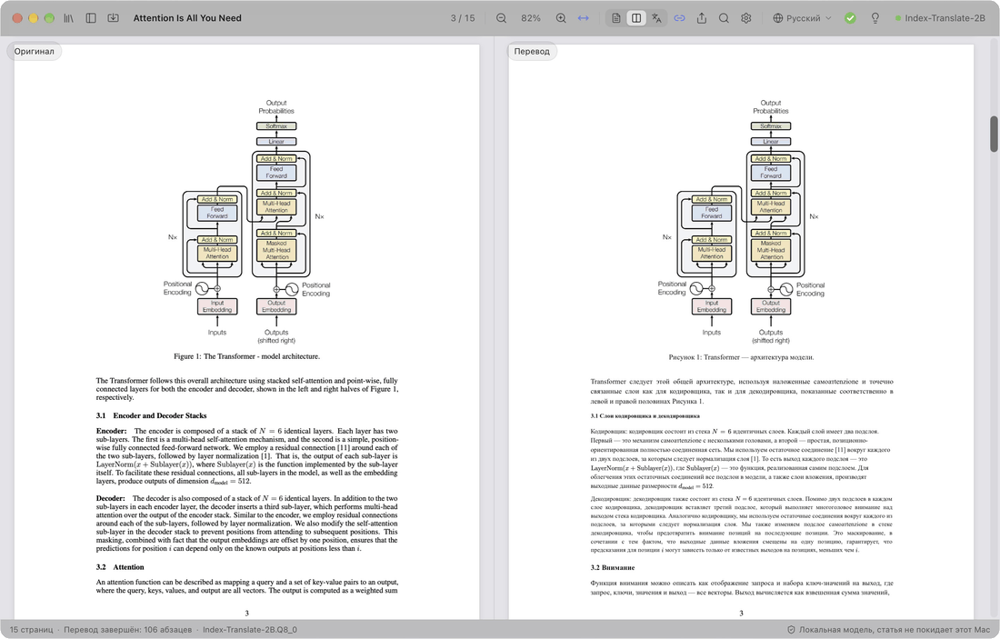
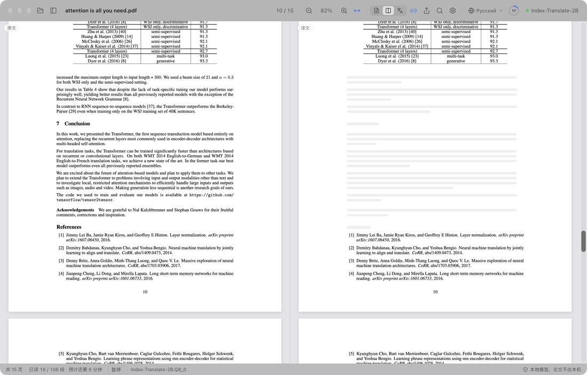
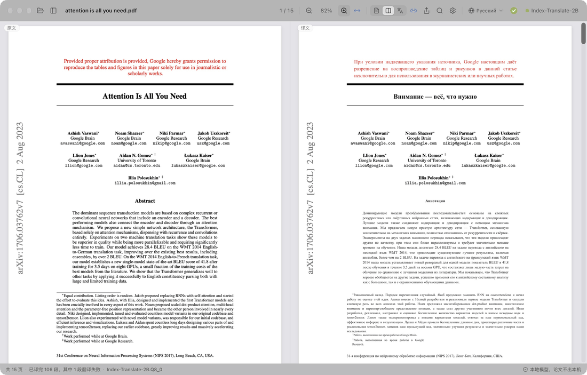
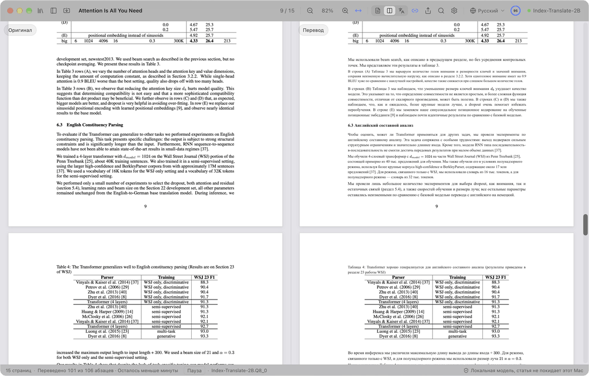

  

<h1 align="center">PaperDuet</h1>

  <em>Лёгкий ИИ-переводчик научных статей, созданный для исследователей!</em>

  <a href="README.md">English</a> &middot; <a href="README.zh-CN.md">简体中文</a> &middot; <a href="README.zh-TW.md">繁體中文</a> &middot; <a href="README.ja.md">日本語</a> &middot; <a href="README.ko.md">한국어</a> &middot; <a href="README.fr.md">Français</a> &middot; <a href="README.de.md">Deutsch</a> &middot; <a href="README.es.md">Español</a> &middot; <b>Русский</b>

  
  
  
  
  

  

  <strong>PaperDuet — лёгкий ИИ-переводчик статей с зеркальной вёрсткой, который сохраняет исходное оформление.</strong> 
  Пять открытых ИИ-моделей перевода на выбор. 
  Без регистрации, бесплатно, полностью локально! 
  Запись перевода Attention Is All You Need (15 страниц) с самого начала

  

PaperDuet — лёгкий ИИ-переводчик научных статей с зеркальной вёрсткой. Оригинал и перевод стоят друг напротив друга, как в зеркале, а формулы, рисунки и таблицы выправляются и выравниваются постранично. Ни регистрации, ни API-ключа, ни оплаты, и всё работает на вашем Mac!

## Каждая страница — без усилий

  

Слева — оригинал статьи, справа — перевод, и обе стороны прокручиваются и масштабируются вместе. Колонки, заголовки, подписи, сноски и список литературы распознаются автоматически, а абзацы, которые продолжаются в следующей колонке или на следующей странице, склеиваются. Стороны точно выровнены друг с другом, поэтому сравнивать их легко.

## Быстрее! Быстрее! Быстрее!

  

Сначала переводятся заголовки, чтобы сразу было видно, как устроена статья; затем название, аннотация и введение, чтобы быстро уловить главное. Хотите сначала прочитать раздел ближе к концу? Дважды щёлкните по любому его абзацу в оригинале, и перевод начнётся сразу!

## Заметки? Делайте их прямо в переводе!

  

Выделяйте, подчёркивайте или комментируйте на одной стороне, и соответствующее предложение на другой стороне отметится тоже.

## Прогресс? Скорость? Без проблем!

  

Панель инструментов показывает, как идёт перевод. Когда вся статья переведена, кольцо превращается в зелёную галочку и появляется подсказка: один щелчок, и перевод сохраняется в PDF рядом с оригиналом. А ещё можно выбрать одну из пяти моделей под ваш Mac и ваши задачи!

## И это ещё не всё

- **Восемь языков перевода.** Переключайтесь между языками 简体中文, 繁體中文, 日本語, 한국어, Français, Deutsch, Español и Русский одним щелчком на панели инструментов.
- **Переведённый PDF в один щелчок.** Когда статья переведена целиком, один щелчок сохраняет перевод рядом с ней с исходной вёрсткой.
- **Встроенная проверка качества.** В каждом ответе сверяются формулы, числа и порядок предложений, при ошибках запрос повторяется автоматически, а глоссарий для каждой статьи держит термины единообразными.
- **Вы решаете, что переводить.** Щёлкните правой кнопкой по любому блоку, чтобы перевести его или оставить оригинал.
- **Читайте как удобно.** Ищите сразу в оригинале и переводе, листайте двуязычное оглавление, наведите указатель на абзац, чтобы найти его пару, и показывайте оригинал, перевод или оба. PaperDuet помнит, где вы остановились.
- **Экспорт куда угодно.** Исходный PDF с вашими пометками, переведённый PDF и заметки в Markdown; всё это открывается и в других приложениях.
- **Обновления в один щелчок.** Обновляться просто: один щелчок ставит новую версию.
- **Красиво до мелочей.** Чистый дизайн с эффектом матового стекла, светлая и тёмная темы и режим ночного чтения.

  

## Пять моделей, все на вашем Mac

Выберите модель при первом запуске PaperDuet и меняйте её когда угодно в Настройках › Модель › Сменить модель. Все они созданы для перевода и после загрузки работают полностью офлайн.

| Модель | Разработчик | Размер | Лучше всего для |
| --- | --- | --- | --- |
| [Index-Translate-2B](https://huggingface.co/IndexTeam/Index-Translate-2B) **(рекомендуется)** | команда Index из bilibili | 2.1 GB | Лучшая универсальная модель, настроенная под проверки и глоссарий PaperDuet |
| [Hy-MT2-1.8B](https://huggingface.co/tencent/Hy-MT2-1.8B-GGUF) | Tencent Hunyuan | 1.9 GB | Скорость: самая быстрая и лёгкая |
| [LMT-60-4B](https://huggingface.co/NiuTrans/LMT-60-4B) | NiuTrans | 4.7 GB | Перевод близко к исходному тексту |
| [Hy-MT2-7B](https://huggingface.co/tencent/Hy-MT2-7B-GGUF) | Tencent Hunyuan | 8.0 GB | Самый гладкий перевод, для Mac с 16 ГБ памяти и больше |
| [TranslateGemma-4B](https://huggingface.co/mradermacher/translategemma-4b-it-GGUF) (экспериментальная) | Google | 4.1 GB | Попробовать модель перевода от Google |

С рекомендуемой моделью 15-страничная статья переводится на M5 Pro примерно за 2 минуты, а если в Настройках › Модель поставить «Абзацев одновременно» на 2 или 3, примерно за 1 минуту.

Одна из этих моделей уже есть у вас через LM Studio, llama.cpp или Hugging Face? PaperDuet найдёт её и использует на месте, без повторной загрузки.

## Конфиденциальность по умолчанию

- Ваши статьи, переводы и заметки остаются на вашем Mac.
- Учётная запись не нужна, данные об использовании не собираются.
- PaperDuet выходит в сеть, только чтобы скачать модель и проверить обновления, а проверку обновлений можно отключить.

## Начало работы

Нужен Mac с Apple silicon (M1 или новее) и macOS 13.3 или новее.

1. Скачайте последний `.dmg` со страницы [Releases](https://github.com/KalenHwei/PaperDuet/releases/latest).
2. Перетащите PaperDuet в «Программы» и откройте его оттуда.
3. Только при первом запуске: PaperDuet пока не нотаризован Apple, поэтому macOS попросит подтверждение. Откройте Системные настройки › Конфиденциальность и безопасность и нажмите **Все равно открыть**. (Или выполните в Терминале `xattr -dr com.apple.quarantine /Applications/PaperDuet.app`.)
4. Выберите модель. PaperDuet скачает её или найдёт уже имеющуюся копию и сразу начнёт переводить.

Вот и всё. Движок перевода встроен в приложение, а обновления ставятся в один щелчок.

<b>Сочетания клавиш</b>

| Действие | Сочетание |
| --- | --- |
| Открыть PDF | ⌘O |
| Закрыть статью | ⌘W |
| Искать с обеих сторон | ⌘F |
| Следующий / предыдущий результат | ⌘G / ⇧⌘G |
| Увеличить / уменьшить / по ширине | ⌘+ / ⌘− / ⌘0 |
| Масштаб вокруг указателя | ⌘ + прокрутка или щипок на трекпаде |
| Перемещать страницы | ⌘ + перетаскивание |
| Перевести эту часть следующей | Двойной щелчок по ещё не переведённому тексту |
| Выделить выбранное | H |
| Добавить заметку к выбранному | N |
| Цвет выделения | 1–5 |
| Отменить / повторить | ⌘Z / ⇧⌘Z |
| Показать или скрыть боковую панель | ⌘\ |
| Включить или выключить синхронную прокрутку | ⌘L |
| Все сочетания клавиш | ⌘/ |

H, N и 1–5 действуют на выделенный текст.

## Частые вопросы

### Какую модель выбрать?

Начните с Index-Translate-2B. Если нужна скорость, берите Hy-MT2-1.8B. Для самого гладкого перевода на Mac с 16 ГБ памяти и больше берите Hy-MT2-7B.

### Это бесплатно?

Да, для личной учёбы и исследований, а также для университетов, школ, научных институтов и других некоммерческих организаций. Для использования PaperDuet в компании или в её интересах нужна коммерческая лицензия: пишите на [junystugh@gmail.com](mailto:junystugh@gmail.com).

## Планы

- **Свёрстанные переводы из arXiv.** Переводить LaTeX-исходник статьи и компилировать его со шрифтами целевого языка, чтобы получить полностью свёрстанное издание перевода.

## История изменений

- **0.4.0** (2026-10-23): интерфейс доступен на девяти языках (тех же, что и эта страница). По умолчанию он следует языку macOS, а сменить его можно в Настройках › Оформление › Язык интерфейса.
- **0.3.2** (2026-10-23): меньше абзацев остаётся на английском: большие числа, записанные через 万 (японский, корейский, китайский), проходят проверку, а предложение, в котором не хватает только ссылки на раздел или источник, сохраняет перевод.
- **0.3.1** (2026-10-23): кольцо прогресса показывает число без знака процента; когда статья готова, оно становится зелёным и сворачивается в галочку того же размера, что и остальные значки панели инструментов, и на одной линии с ними.
- **0.3.0** (2026-10-23): восемь языков перевода с переключением на панели инструментов; когда статья готова, кольцо показывает зелёную галочку, а переведённый PDF сохраняется одним щелчком, а не автоматически; смена модели больше не запускает пробный перевод заново.
- **0.2.1** (2026-10-23): пять моделей перевода на выбор; экран запуска.
- **0.2.0** (2026-10-23): проверка обновлений и обновление в один щелчок в приложении.
- **0.1.0** (2026-10-22): первая версия.

Полная история: [CHANGELOG.md](CHANGELOG.md).

## Лицензия

PaperDuet бесплатен для некоммерческого использования по [PolyForm Noncommercial License 1.0.0](LICENSE). Используйте и распространяйте его в личных, учебных, исследовательских или некоммерческих целях; при распространении прикладывайте лицензию и строку `Required Notice: Copyright (c) 2026 Kalen Yongda Wei`. По вопросам коммерческого использования пишите на [junystugh@gmail.com](mailto:junystugh@gmail.com).

Copyright © 2026 Kalen Yongda Wei.

## Благодарности

PaperDuet построен на [Tauri](https://tauri.app), [pdf.js](https://mozilla.github.io/pdf.js/), [pdf-lib](https://pdf-lib.js.org), [llama.cpp](https://github.com/ggml-org/llama.cpp), [React](https://react.dev), [Zustand](https://github.com/pmndrs/zustand) и [Lucide](https://lucide.dev). Модели перевода созданы командой Index из bilibili (Index-Translate-2B), Tencent Hunyuan (Hy-MT2), NiuTrans (LMT) и Google (TranslateGemma). Они распространяются по Apache-2.0, кроме TranslateGemma, на которую действуют [условия использования Gemma](https://ai.google.dev/gemma/terms). Полные тексты лицензий есть в приложении (Настройки › О программе › Лицензии сторонних компонентов).

Статья в анимациях — [_Attention Is All You Need_](https://arxiv.org/abs/1706.03762), Vaswani et al.
