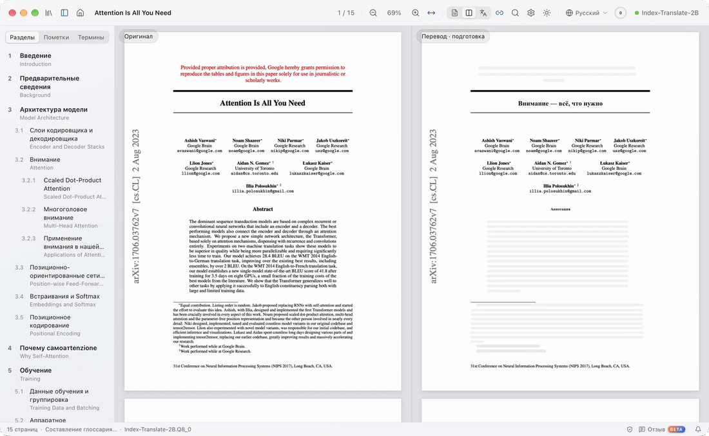
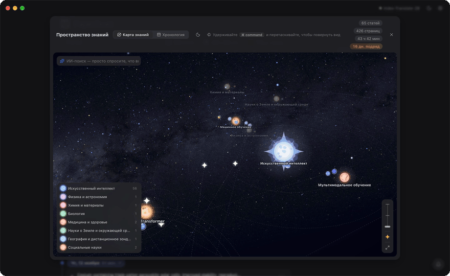
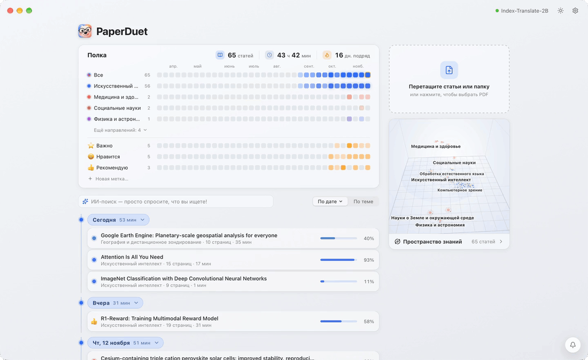
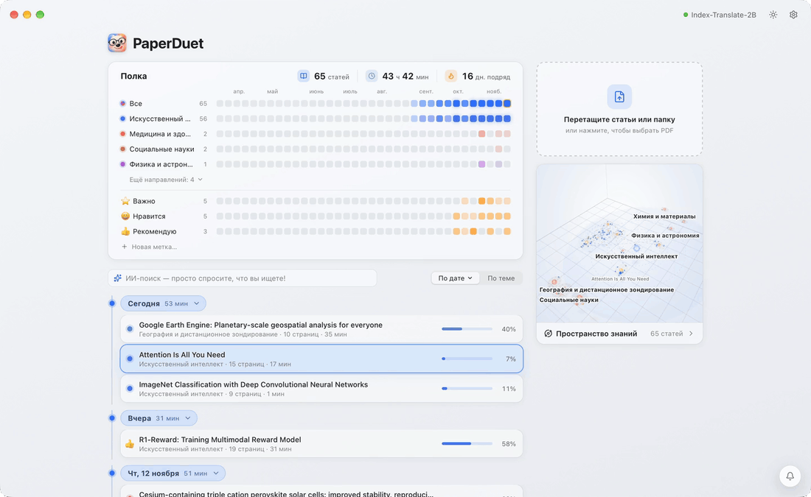
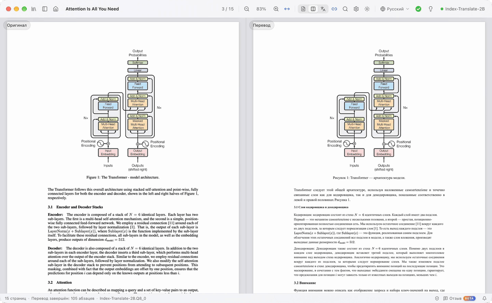
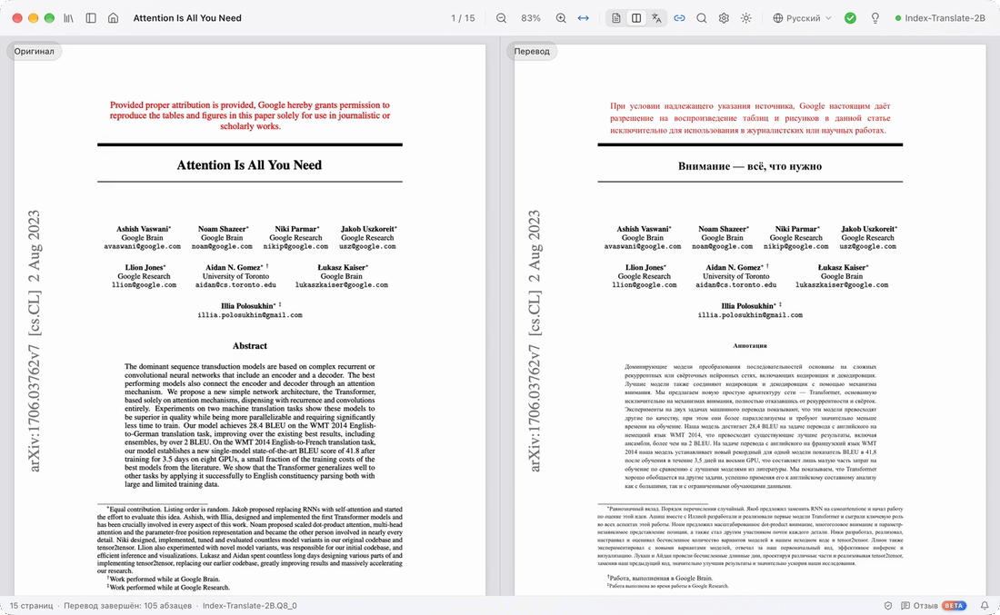
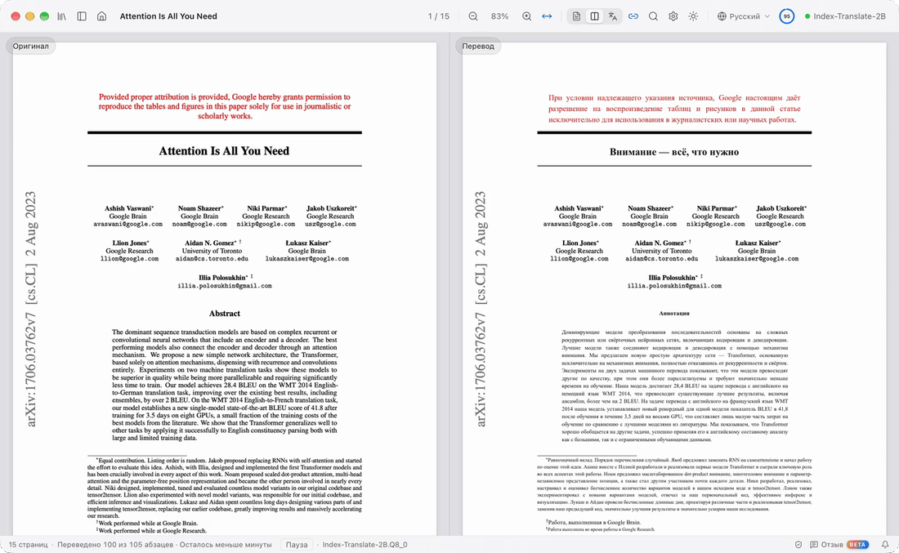

  

<h1 align="center">PaperDuet</h1>

  <em>Инструмент для исследователей: упорядочить, изучить и понять статьи!</em> 
  <a href="https://paperduet.com">paperduet.com</a>

  <a href="README.md">English</a> &middot; <a href="README.zh-CN.md">简体中文</a> &middot; <a href="README.zh-TW.md">繁體中文</a> &middot; <a href="README.ja.md">日本語</a> &middot; <a href="README.ko.md">한국어</a> &middot; <a href="README.fr.md">Français</a> &middot; <a href="README.de.md">Deutsch</a> &middot; <a href="README.es.md">Español</a> &middot; <a href="README.it.md">Italiano</a> &middot; <a href="README.pl.md">Polski</a> &middot; <b>Русский</b>

  
  
  

  
  
  
  
  
  

  <strong>PaperDuet помогает упорядочить, изучить и понять каждую статью.</strong> 
  Шесть открытых ИИ-моделей перевода работают на вашем компьютере, а можно подключить онлайн-API. 
  Бесплатно и без регистрации!

PaperDuet — инструмент для того, чтобы упорядочивать, изучать и понимать статьи: оригинал и перевод стоят рядом как зеркальные отражения, формулы, рисунки и таблицы выровнены страница за страницей, а прочитанные статьи лежат на полке и в пространстве знаний, где ИИ находит их снова. PaperDuet бесплатен: с локальной моделью всё работает на вашем компьютере, а при желании можно подключить онлайн-API.

## Открыли — и уже по-русски

  

Перетащите PDF, и перевод начнётся. Сначала заголовки: оглавление в боковой панели сразу на русском, и видно, как устроена статья; затем название, аннотация и введение. Шесть открытых моделей перевода работают на вашем компьютере, либо можно подключить онлайн-API.

## Ваша библиотека — ваше звёздное небо

  

Представляем Space: теперь ваши статьи раскрываются перед вами как звёздное небо. Вы можете нагляднее выстроить собственную визуальную базу знаний.

## Каждый шаг вперёд — на счету

  

Полка на главной странице ведёт счёт: сколько статей вы прочитали, сколько времени всего и сколько дней подряд. Каждая клетка — неделя, тем темнее, чем дольше вы читали; щёлкните область, и статьи с лентой времени ниже последуют за ней. Правым щелчком можно поставить статье свои метки.

## Не можете найти статью? Спросите ИИ!

  

Помнить название не нужно: скажите одной фразой, что вы ищете, и ИИ-поиск найдёт это в названиях, оригиналах, переводах и кратких изложениях и покажет найденный фрагмент. Спрашивайте по-русски или по-английски.

## Каждая страница — как была

  

Слева оригинал, справа перевод; обе стороны прокручиваются и масштабируются вместе. Колонки, заголовки, подписи, сноски и список литературы распознаются сами, а формулы, рисунки и таблицы остаются на своих местах; наведите указатель на абзац, и соответствующий ему на другой стороне подсветится. Смените язык перевода, и вёрстка останется прежней.

## Нужны заметки? Сделаем!

  

Выделяйте, подчёркивайте и пишите заметки прямо в переводе; соответствующее предложение оригинала отмечается само. Оригинал, экспортированный с вашими заметками, содержит стандартные аннотации PDF, так что «Просмотр», Zotero и другие приложения показывают их как есть.

## Дочитали? Заберите с собой.

  

Когда вся статья переведена, кольцо на панели инструментов превращается в зелёную галочку: один щелчок сохраняет PDF с переводом, Markdown и оригинал с аннотациями вместе в папку статьи. Лампочка рядом — краткое изложение от ИИ, написанное моделью после чтения всей статьи: вопрос, метод и результаты с одного взгляда.

## И это ещё не всё

- **Десять языков перевода.** Переключайтесь между языками 简体中文, 繁體中文, 日本語, 한국어, Français, Deutsch, Español, Italiano, Polski и Русский одним щелчком на панели инструментов.
- **Двойной щелчок — вне очереди.** Хотите сначала прочитать абзац подальше? Дважды щёлкните его в оригинале, и он будет переведён следующим, не дожидаясь, пока до него дойдёт очередь.
- **Встроенная проверка качества.** В каждом ответе сверяются формулы, числа и порядок предложений, при ошибках запрос повторяется автоматически, а глоссарий для каждой статьи держит термины единообразными.
- **Вы решаете, что переводить.** Щёлкните правой кнопкой по любому блоку, чтобы перевести его или оставить оригинал.
- **Читайте как удобно.** Ищите сразу в оригинале и переводе, листайте двуязычное оглавление, наведите указатель на абзац, чтобы найти его пару, и показывайте оригинал, перевод или оба. PaperDuet помнит, где вы остановились.
- **Свои термины.** Укажите, как переводить термин, и вся статья будет следовать этому.
- **Сканы тоже читаются.** PDF, в которых текст нарисован фигурами, а не сохранён как текст, на Mac и в Windows читает системное распознавание текста, после чего они переводятся.
- **Папки, которые не отстают.** Импортируйте папку один раз, и статьи, положенные в неё позже, сами появятся в библиотеке.
- **Один щелчок — обновить, один — очистить.** Новая версия ставится одним щелчком; кэш очищается одним щелчком в Настройках.
- **Красиво до мелочей.** Чистый дизайн с эффектом матового стекла, светлая и тёмная темы и режим ночного чтения.

  

## Шесть моделей, все на вашем компьютере

Выберите модель при первом запуске PaperDuet и меняйте её когда угодно в Настройках › Модель › Сменить модель. Все они созданы для перевода и после загрузки работают полностью офлайн.

| Модель | Разработчик | Размер | Лучше всего для |
| --- | --- | --- | --- |
| [Index-Translate-2B](https://huggingface.co/IndexTeam/Index-Translate-2B) **(рекомендуется)** | команда Index из bilibili | 2.1 GB | Лучшая универсальная модель, настроенная под проверки и глоссарий PaperDuet |
| [Hy-MT2-1.8B](https://huggingface.co/tencent/Hy-MT2-1.8B-GGUF) | Tencent Hunyuan | 1.9 GB | Быстрая и лёгкая |
| [LMT-60-4B](https://huggingface.co/NiuTrans/LMT-60-4B) | NiuTrans | 4.7 GB | Перевод близко к исходному тексту |
| [LMT-60-0.6B](https://huggingface.co/NiuTrans/LMT-60-0.6B) | NiuTrans | 0.8 GB | Не самые мощные компьютеры: самая маленькая и быстрая |
| [Hy-MT2-7B](https://huggingface.co/tencent/Hy-MT2-7B-GGUF) | Tencent Hunyuan | 8.0 GB | Самый гладкий перевод, для компьютеров с 16 ГБ памяти и больше |
| [TranslateGemma-4B](https://huggingface.co/mradermacher/translategemma-4b-it-GGUF) (экспериментальная) | Google | 4.1 GB | Попробовать модель перевода от Google |

С рекомендуемой моделью 15-страничная статья переводится на M5 Pro примерно за 2 минуты, а если в Настройках › Модель поставить «Абзацев одновременно» на 2 или 3, примерно за 1 минуту.

Одна из этих моделей уже есть у вас через LM Studio, llama.cpp или Hugging Face? PaperDuet найдёт её и использует на месте, без повторной загрузки.

Компьютер не тянет локальные модели? Выберите «Использовать API» при выборе модели и введите свой API-ключ, чтобы подключить OpenAI, Claude, DeepSeek, Qwen, Kimi, GLM, Doubao или любой сервис, совместимый с OpenAI. Список локальных моделей свернётся, а перевод, краткое содержание, разбор и поиск с ИИ будут работать через этот сервис. Ключ хранится только на вашем компьютере.

## Конфиденциальность по умолчанию

- Ваши статьи, переводы и заметки остаются на вашем компьютере. При работе через API переводимый текст отправляется выбранному сервису.
- Только с вашего согласия PaperDuet отправляет анонимные данные об использовании и диагностике (версия, система, язык интерфейса, модель и типы ошибок), никогда не содержимое статей; отключить это можно в любой момент в настройках.
- При ошибке PaperDuet отправляет разработчику отчёт: что случилось, версию и систему, без путей к файлам и содержимого статей. Отключить можно в «Настройки › Данные».
- Когда вы пишете отзыв в приложении и нажимаете «Отправить», ваш текст (и адрес эл. почты, если вы его указали) отправляется разработчику вместе с версией и системой.
- С локальной моделью PaperDuet выходит в интернет только чтобы скачать модель, проверить обновления и отправить эти данные, отчёты и ваши отзывы; всё, кроме скачивания модели, можно отключить.

## Начало работы

Для Mac нужен Apple silicon (M1 или новее) и macOS 13.3 или новее, для ПК — 64-разрядная Windows 10 или 11, для Linux — 64-разрядная Ubuntu 22.04 или новее (или другой столь же свежий дистрибутив).

**Mac**

1. Скачайте последний `.dmg` со страницы [Releases](https://github.com/KalenHwei/PaperDuet/releases/latest).
2. Перетащите PaperDuet в «Программы» и откройте его оттуда.
3. Только при первом запуске: PaperDuet пока не нотаризован Apple, поэтому macOS попросит подтверждение. Откройте Системные настройки › Конфиденциальность и безопасность и нажмите **Все равно открыть**. (Или выполните в Терминале `xattr -dr com.apple.quarantine /Applications/PaperDuet.app`.)
4. Выберите модель. PaperDuet скачает её или найдёт уже имеющуюся копию и сразу начнёт переводить.

**Windows**

1. Скачайте последний установщик для Windows (`_x64-setup.exe`) со страницы [Releases](https://github.com/KalenHwei/PaperDuet/releases/latest).
2. Запустите его. Только в первый раз: если Windows покажет «Система Windows защитила ваш компьютер», нажмите **Подробнее**, затем **Выполнить в любом случае**.
3. Выберите модель. PaperDuet скачает её или найдёт уже имеющуюся копию и сразу начнёт переводить.

**Linux**

1. Скачайте последний `.deb` (Ubuntu, Debian) или `.AppImage` (другие дистрибутивы или без прав администратора) со страницы [Releases](https://github.com/KalenHwei/PaperDuet/releases/latest).
2. `.deb`: выполните в терминале `sudo apt install ./PaperDuet_*_amd64.deb` и откройте PaperDuet из меню приложений. `.AppImage`: устанавливать не нужно — выполните `chmod +x PaperDuet_*_amd64.AppImage` и откройте файл.
3. Выберите модель. PaperDuet скачает её или найдёт уже имеющуюся копию и сразу начнёт переводить.

Вот и всё. Движок перевода встроен в приложение, а обновления ставятся в один щелчок.

<b>Сочетания клавиш</b>

| Действие | Сочетание |
| --- | --- |
| Открыть PDF | ⌘O |
| Закрыть статью | ⌘W |
| Искать с обеих сторон | ⌘F |
| Следующий / предыдущий результат | ⌘G / ⇧⌘G |
| Увеличить / уменьшить / по ширине | ⌘+ / ⌘− / ⌘0 |
| Масштаб вокруг указателя | ⌘ + прокрутка или щипок на трекпаде |
| Перемещать страницы | ⌘ + перетаскивание |
| Перевести эту часть следующей | Двойной щелчок по ещё не переведённому тексту |
| Выделить выбранное | H |
| Добавить заметку к выбранному | N |
| Цвет выделения | 1–5 |
| Отменить / повторить | ⌘Z / ⇧⌘Z |
| Показать или скрыть боковую панель | ⌘\ |
| Включить или выключить синхронную прокрутку | ⌘L |
| Все сочетания клавиш | ⌘/ |

H, N и 1–5 действуют на выделенный текст. В Windows и Linux вместо ⌘ используйте Ctrl, вместо ⇧ — Shift.

## Частые вопросы

### Какую модель выбрать?

Начните с Index-Translate-2B. Если нужна скорость, берите Hy-MT2-1.8B. Для самого гладкого перевода на компьютере с 16 ГБ памяти и больше берите Hy-MT2-7B. Если компьютер не справляется, выберите «Использовать API».

### Это бесплатно?

Да, для личной учёбы и исследований, а также для университетов, школ, научных институтов и других некоммерческих организаций. Для использования PaperDuet в компании или в её интересах нужна коммерческая лицензия: пишите на [support@paperduet.com](mailto:support@paperduet.com).

## Планы

- **Свёрстанные переводы из arXiv.** Переводить LaTeX-исходник статьи и компилировать его со шрифтами целевого языка, чтобы получить полностью свёрстанное издание перевода.

## История изменений

- **0.8.6** (2026-11-13): Исправлены известные ошибки.
- **0.8.5** (2026-11-13): PaperDuet 0.8.5 уже здесь🎉! Пространство знаний теперь выглядит как галактики🌌. Чем больше статей, тем крупнее и ярче звезда, а когда вы прочтёте достаточно, она станет чёрной дырой! Звёзды можно перетаскивать: попробуйте и посмотрите, как они движутся. Теперь можно создавать собственные категории: правый щелчок по категории в пространстве знаний или на полке добавляет новую. Перетащите статьи на категорию или выберите её в «Переместить в» в контекстном меню, и они окажутся на месте📂. Автоматическое разделение с помощью ИИ✨: щёлкните категорию правой кнопкой и выберите «Разделить автоматически» — встроенный ИИ PaperDuet сгруппирует её статьи по содержанию в несколько подкатегорий и даст им названия. Конечно, названия можно поменять на свои! Кроме того, исправлен нечитаемый или отсутствующий перевод некоторых PDF, а пространство знаний стало чище. Попробуйте🚀!
- **0.8.4** (2026-11-12): Вышел PaperDuet 0.8.4 🎉! Вкладки: можно открыть несколько статей сразу. Наведите указатель на вкладку — появится предпросмотр, перетащите — изменится порядок, правый щелчок открывает полное меню. Вкладки сверх заданного числа засыпают, чтобы экономить память, и просыпаются по щелчку ⚡️. Карта знаний стала удобнее: ИИ-поиск прямо в левом верхнем углу, а звёзды тем можно показать. Правый щелчок по области, подобласти или звезде экспортирует все её ссылки разом или сохраняет их в файл 📚. Выбор статей: щелчок — выбрать, с ⌘ или Ctrl — выбрать несколько, двойной щелчок — открыть. Правым щелчком их можно вместе пометить тегами, переместить или экспортировать ссылки (BibTeX / EndNote / RefMan / RefWorks). PDF, в которых текст нарисован фигурами (например, некоторые статьи CVPR), теперь можно переводить: на Mac и Windows текст читает встроенное распознавание текста системы 🔍. Новое в контекстном меню статьи: «Перевести заново» — вся статья переводится заново с начала выбранной моделью. Кроме того, исправлены, в частности, пропадание перевода после масштабирования при синхронной прокрутке на старых macOS и появление промпта TranslateGemma в переводе, а памяти используется меньше. Попробуйте прямо сейчас 🚀!
- **0.8.2** (2026-11-11): На Карту знаний добавлена полоса для настройки видимых уровней.
- **0.8.1** (2026-11-11): Исправлены известные ошибки.
- **0.8.0** (2026-11-11): Встречайте PaperDuet 0.8 🎉! Новый ИИ-компонент: библиотека сама сортируется по содержанию, ИИ-поиск находит статьи по смыслу и сразу ведёт к самому подходящему фрагменту, а похожие статьи связаны в Пространстве знаний 🧠! Импорт стал намного быстрее: перетащите статьи или папку — Полка и Пространство знаний сразу их предварительно рассортируют, а более точная сортировка тихо завершится в фоне и приостанавливается, пока вы переводите ⚡️. В Пространстве знаний видны только названия областей, а название статьи появляется при наведении — больше никакой тесноты. В правом нижнем углу появился колокольчик 🔔: объявления, опросы и описание каждого обновления — всё там. Кроме того, исправлены некоторые мерцания и сбои. Попробуйте 🚀!
- **0.7.9** (2026-11-10): Собственный глоссарий: термины можно добавлять, изменять и удалять в Глоссарии, а отмеченные «Во всех статьях» применяются в каждой статье; в панели библиотеки сразу видна Полка, а первая метка статьи стоит перед её названием; в настройках можно одним нажатием очистить кэш и посмотреть все сочетания клавиш; исправлено масштабирование с Control на Mac.
- **0.7.8** (2026-11-10): Отсканированные статьи теперь переводятся правильно; добавленную папку можно автоматически обновлять, новые PDF из неё импортируются со своей меткой на Полке; в настройках можно сохранять имена PDF-файлов как названия статей; пользовательские API работают с локальными сервисами, например Ollama; исправлен непереведённый текст в формах и после изменения размера окна.
- **0.7.7** (2026-11-09): Исправлены известные проблемы в логике работы интерфейса.
- **0.7.6** (2026-11-09): Новый обзор главной страницы: Полка, ИИ-поиск, «По дате / По теме», правый щелчок по статье и Пространство знаний.
- **0.7.5** (2026-11-09): Мы полностью переделали главную страницу 🎉! Новая Полка собирает вместе историю чтения, направления и метки — сразу видно, что вы читали каждую неделю. Пространство знаний превратилось в маленькую вселенную: направления — это солнца, статьи — планеты, а в тёмной теме за ними сияет настоящий Млечный Путь 🌌! Щёлкните по статье правой кнопкой, чтобы сменить категорию, добавить метки, переименовать её или написать заметку. ИИ-поиск понимает обычные вопросы вроде «я как-то читал статью про трансформеры» и сразу её находит 🔍! После перевода переведённый PDF, переведённый Markdown и ваши заметки сохраняются вместе в отдельной папке статьи. Скорее попробуйте 🚀!
- **0.7.4** (2026-11-08): Исправлена проблема с выделением, о которой сообщили на GitHub.
- **0.7.3** (2026-11-08): Маркер (Shift — смена цвета) и переключатель светлой и тёмной темы; перевод сам повторяет попытку, а не останавливается; к отзыву можно приложить снимки экрана.
- **0.7.2** (2026-11-05): Улучшены анимации.
- **0.7.1** (2026-11-05): Мы сделали библиотеку удобнее.
- **0.7.0** (2026-11-05): Мы переделали AI Library 🎉! Появилось Пространство знаний, а работать с AI Library стало заметно удобнее. Кнопки верхней панели стали проще и практичнее.
- **0.6.12** (2026-11-05): Чтобы решить проблемы с вёрсткой, добавлена визуальная модель разметки страниц: таблицы, формулы, рисунки, колонтитулы больше не переводятся по ошибке, а текст, принятый за таблицу, переводится, поэтому перевод стал намного точнее и надёжнее. Модель разметки скачивается в фоне вместе с моделью перевода.
- **0.6.11** (2026-11-04): Спасибо многим пользователям, которые прислали нам очень ценные сообщения об ошибках; из соображений конфиденциальности мы не можем поблагодарить их публично. В этом обновлении в основном исправлены статьи, которые не переводились целиком из-за ошибки рекурсии, абзацы, частично оставшиеся без перевода из-за ошибки правила проверки, и неточности распознавания макета страницы. Надеемся, что это обновление сделает работу удобнее для всех.
- **0.6.10** (2026-11-04): Исправлены проблемы с подключением к API.
- **0.6.9** (2026-11-03): Исправлена прокрутка рывками в версии для Linux.
- **0.6.8** (2026-11-03): Новая модель LMT-60-0.6B: самая маленькая (805 МБ) и самая быстрая, для не самых мощных компьютеров.
- **0.6.7** (2026-11-03): Рады представить версию для Linux!
- **0.6.6** (2026-11-03): Улучшено распознавание вёрстки некоторых журнальных статей: две колонки больше не смешиваются, аннотация на цветной подложке переводится, а в оглавлении остаются только заголовки разделов.
- **0.6.5** (2026-10-31): В статьях с нумерацией строк (например, в рукописях) номера больше не попадают в перевод и не разбивают абзацы.
- **0.6.4** (2026-10-30): Исправлены некоторые известные проблемы с форматированием.
- **0.6.3** (2026-10-29): Исправлены известные проблемы в логике интерфейса.
- **0.6.2** (2026-10-28): В Windows можно выбрать папку для моделей; уже скачанные модели переносятся туда.
- **0.6.1** (2026-10-28): Исправлены некоторые известные проблемы с форматированием.
- **0.6.0** (2026-10-28): Короткое знакомство с основными функциями при первом открытии статьи и бета-отзывы: отправляйте нам своё мнение прямо из строки состояния.
- **0.5.17** (2026-10-28): Исправлены некоторые известные проблемы с форматированием.
- **0.5.16** (2026-10-28): Абзацы рукописей (экспортированных из Word, с двойным интервалом) больше не остаются на английском: выделенные строки переводятся, абзацы с двойным интервалом переводятся целиком, а не построчно, а подписи к рисункам после списка литературы тоже переводятся.
- **0.5.15** (2026-10-28): Символы формул в журналах Elsevier больше не искажаются: греческие буквы, ≤, ∀, ≠ и буквы с крышкой (Ŝ, q̂) больше не отображаются как обычные буквы, а высоко поднятый верхний индекс больше не попадает в строку выше.
- **0.5.14** (2026-10-28): Исправлены некоторые известные ошибки форматирования.
- **0.5.13** (2026-10-28): Формулы больше не искажаются: выключные формулы с дробями и суммами сохраняются целиком, а не переводятся по кусочкам поверх самих себя, а суммы в тексте, корни и сильно разреженные строки с формулами больше не разрывают предложение.
- **0.5.12** (2026-10-27): Журнальные статьи обрабатываются точнее: строки со статистикой, нумерованные подзаголовки, предложения, продолжающиеся в следующей колонке, греческие буквы вроде χ², имена с диакритикой и знаки минуса в таблицах больше не искажаются; в экспортированном PDF с переводом межбуквенные интервалы стали ровными. Спасибо momo из RedNote за предложения.
- **0.5.11** (2026-10-27): Псевдокод переводится построчно: номера строк, отступы и ключевые слова сохраняются. Таблицы распознаются надёжнее, их содержимое остаётся на языке оригинала, а переводятся только заголовки и примечания, поэтому таблицы больше не разваливаются; суммы в тексте больше не пропадают из перевода.
- **0.5.10** (2026-10-27): Перевод через онлайн-API: если компьютер не тянет локальные модели, выберите «Использовать API» при выборе модели — подойдут OpenAI, Claude, DeepSeek, Qwen, Kimi, GLM, Doubao или любой сервис, совместимый с OpenAI; список локальных моделей при этом сворачивается.
- **0.5.9** (2026-10-26): Исправление известных ошибок.
- **0.5.8** (2026-10-26): Добавлен польский — как язык перевода и интерфейса; исправления: в macOS 26 и более ранних статьи не читались и не переводились; в macOS 27 у некоторых статей не сохранялся переведённый PDF.
- **0.5.7** (2026-10-26): Статьи из журналов читаются и переводятся точнее (проверено на статьях из 20 ведущих журналов): колонки, заголовки, списки литературы, таблицы, подписи к рисункам и особые символы издательств; статьи из Science больше не остаются в основном непереведёнными, а приложения после списка литературы тоже переводятся.
- **0.5.6** (2026-10-25): Добавлен итальянский — как язык перевода и интерфейса; при ошибках разработчику отправляется отчёт, чтобы исправить проблему (включено по умолчанию, отключается в «Настройки › Данные»).
- **0.5.5** (2026-10-25): Строки журнальных статей с растянутыми пробелами больше не распадаются на отдельные слова, которые пропадали из перевода или оказывались не на месте; аннотация переводится сразу после названия; реже бывает «Не удалось проанализировать вёрстку»; тире в статьях Elsevier больше не отображаются как «e».
- **0.5.4** (2026-10-24): Интерфейс стал проще: убраны лишние пояснения; поле ИИ-поиска теперь называется «Искать с помощью ИИ».
- **0.5.3** (2026-10-24): PaperDuet один раз спрашивает, готовы ли вы делиться анонимными данными об использовании и диагностике, чтобы улучшать приложение; содержимое статей не отправляется, отключить можно в «Настройки › Данные».
- **0.5.2** (2026-10-24): «ИИ-поиск» 🔍 в библиотеке находит прочитанные статьи по названию, исходному тексту, переводу, краткому содержанию и меткам, на русском или английском; поиск и «Разобрать с ИИ» поднимают найденные статьи наверх, а остальные делают серыми.
- **0.5.1** (2026-10-24): вместо панели папки — библиотека со всеми прочитанными и импортированными статьями: их можно переименовать на месте и посмотреть краткое содержание; импорт нескольких PDF или целой папки; «Разобрать с ИИ» ✨ отбирает статьи по области и теме; исправлены нечитаемые таблицы и непереведённые абзацы в некоторых статьях.
- **0.5.0** (2026-10-24): краткое содержание статьи 💡 по кнопке с лампочкой, когда вся статья переведена; панель файлов открывает свою папку в один щелчок; версия для Windows.
- **0.4.1** (2026-10-23): более понятные описания в списке моделей и в настройках.
- **0.4.0** (2026-10-23): интерфейс доступен на 9 языках. По умолчанию он следует языку системы, а сменить его можно в Настройках › Оформление › Язык интерфейса.
- **0.3.2** (2026-10-23): ещё исправления выравнивания при переводе на другие языки.
- **0.3.1** (2026-10-23): доработаны кольцо прогресса и панель инструментов.
- **0.3.0** (2026-10-23): восемь языков перевода 🎉 с переключением в один щелчок на панели инструментов; доработаны кольцо прогресса и управление.
- **0.2.1** (2026-10-23): пять моделей перевода на выбор; новый экран запуска.
- **0.2.0** (2026-10-23): проверка обновлений и обновление в один щелчок в приложении.
- **0.1.0** (2026-10-22): первая версия.

Полная история: [CHANGELOG.md](CHANGELOG.md).

## Лицензия

PaperDuet бесплатен для некоммерческого использования по [PolyForm Noncommercial License 1.0.0](LICENSE). Используйте и распространяйте его в личных, учебных, исследовательских или некоммерческих целях; при распространении прикладывайте лицензию и строку `Required Notice: Copyright (c) 2026 Kalen Yongda Wei`. По вопросам коммерческого использования пишите на [support@paperduet.com](mailto:support@paperduet.com).

Copyright © 2026 Kalen Yongda Wei.

## Благодарности

PaperDuet построен на [Tauri](https://tauri.app), [pdf.js](https://mozilla.github.io/pdf.js/), [pdf-lib](https://pdf-lib.js.org), [llama.cpp](https://github.com/ggml-org/llama.cpp), [React](https://react.dev), [Zustand](https://github.com/pmndrs/zustand) и [Lucide](https://lucide.dev). Модели перевода созданы командой Index из bilibili (Index-Translate-2B), Tencent Hunyuan (Hy-MT2), NiuTrans (LMT) и Google (TranslateGemma). Они распространяются по Apache-2.0, кроме TranslateGemma, на которую действуют [условия использования Gemma](https://ai.google.dev/gemma/terms). Полные тексты лицензий есть в приложении (Настройки › О программе › Лицензии сторонних компонентов).

Статья в анимациях — [_Attention Is All You Need_](https://arxiv.org/abs/1706.03762), Vaswani et al.
