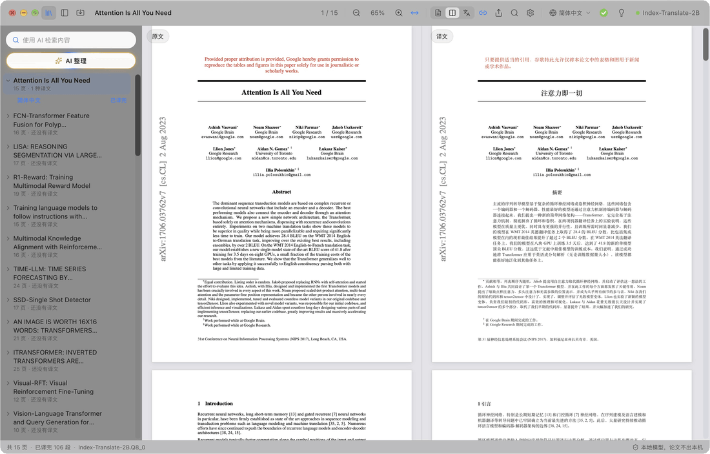

  

<h1 align="center">PaperDuet</h1>

  <em>专为科研人员打造的轻量化论文 AI 翻译器！</em> 
  <a href="https://paperduet.com">paperduet.com</a>

  <a href="README.md">English</a> &middot; <b>简体中文</b> &middot; <a href="README.zh-TW.md">繁體中文</a> &middot; <a href="README.ja.md">日本語</a> &middot; <a href="README.ko.md">한국어</a> &middot; <a href="README.fr.md">Français</a> &middot; <a href="README.de.md">Deutsch</a> &middot; <a href="README.es.md">Español</a> &middot; <a href="README.it.md">Italiano</a> &middot; <a href="README.pl.md">Polski</a> &middot; <a href="README.ru.md">Русский</a>

  
  

  
  
  
  
  

  <strong> PaperDuet 是一款能保留格式的轻量级论文镜像AI翻译器。</strong> 
  可选五种开源 AI 翻译模型。 
  无需付费，完全本地！

   
  从零翻译 Attention Is All You Need（15 页）的实录

PaperDuet 是一款轻量级论文镜像AI翻译器，将原文与翻译镜像排列，公式、图片、表格逐页修正、对齐。 PaperDuet 无需 API 密钥，无需付费，完全本地运行！

## 每一页，都方便

  

左边为 Paper 原文，右边为 Paper 翻译，两边一起滚动、一起缩放。分栏、标题、图注、脚注和参考文献都能自动识别，跨栏、跨页的段落也会自动接上。两边完全对齐，方便对照。

## 保存译文？AI 概要？没问题！

  

在工具栏上提供了翻译进度。全文翻译完，圆环变成绿色的勾，并弹出提示：点一下就能把译文保存为 PDF，放在原文旁边。旁边的小灯泡是 AI 概要：点开就能看到模型读完全文后写的总结，研究问题、方法和结果一目了然。另外可选五种模型，根据你的配置与需求自由选择！

## 想到，就找到。

  

读过的论文都收在论文库里。AI 整理按领域、方向和主题自动打标签，点选标签，相关论文就浮到最前面；AI 检索可以搜标题、原文、译文和概要，中文、英文检索词都能用。

## 看不懂？点一下。

  

最先翻译各级标题，方便理解整体框架；然后是论文标题、摘要和引言。想先看后面哪一段？双击原文，它就插队先译，不用等进度走到那里。

## 想做笔记？安排！

  

直接在译文上高亮、划线、写批注，原文对应的句子会自动同步标记。导出带批注的原文 PDF，用的是标准 PDF 批注，“预览”、Zotero 等应用都能直接看到。

## 还有这些

- **十种译文语言**：在工具栏一键切换简体中文、繁體中文、日本語、한국어、Français、Deutsch、Español、Italiano、Polski、Русский。
- **一键保存译文 PDF**：整篇译完后点一下，按原格式在论文旁边保存。
- **内置质量检查**：每次回复都核对公式、数字和句子顺序，出错自动重试；每篇论文自动整理术语表，前后译法一致。
- **翻译什么你说了算**：右键任意一块，选择翻译它或保留原文。
- **怎么读都顺手**：原文和译文同时搜索、双语目录、鼠标指向一段就能找到另一边对应的段落，可以只看原文、只看译文或者两边都看。PaperDuet 支持“上次读到”功能。
- **论文库与 AI 搜索**：读过和导入的论文都在侧栏的论文库里。AI 搜索按标题、原文、译文和概要找回读过的论文，中英文检索词都可以；AI 整理按领域和主题归类。
- **论文概要**：全文译完后点灯泡，翻译模型会用界面语言写一段概要，随论文保存。
- **导出到任何地方**：带标注的原文 PDF、译文 PDF、Markdown 笔记，跨应用也能看。
- **一键更新**：新版本更新便捷，一键安装。
- **为美观而生**：简约、漂亮的毛玻璃材质，支持浅色、深色和夜间阅读模式。

  

## 五个模型，全在你的电脑上

第一次打开时选一个，之后随时在“设置 › 模型 › 更换模型”里换。五个都是专门做翻译的模型，下载好以后完全离线运行。

| 模型 | 来自 | 大小 | 适合 |
| --- | --- | --- | --- |
| [Index-Translate-2B](https://huggingface.co/IndexTeam/Index-Translate-2B)**（推荐）** | 哔哩哔哩 Index 团队 | 2.1 GB | 综合最好，PaperDuet 的检查和术语表专门为它调过 |
| [Hy-MT2-1.8B](https://huggingface.co/tencent/Hy-MT2-1.8B-GGUF) | 腾讯混元 | 1.9 GB | 追求速度，最快也最轻 |
| [LMT-60-4B](https://huggingface.co/NiuTrans/LMT-60-4B) | 小牛翻译 NiuTrans | 4.7 GB | 贴近原文的译法 |
| [Hy-MT2-7B](https://huggingface.co/tencent/Hy-MT2-7B-GGUF) | 腾讯混元 | 8.0 GB | 中文最通顺，适合 16 GB 以上内存的电脑 |
| [TranslateGemma-4B](https://huggingface.co/mradermacher/translategemma-4b-it-GGUF)（实验性） | Google | 4.1 GB | 想试试 Google 的翻译模型 |

用推荐的模型，15 页的论文在 M5 Pro 上大约 2 分钟译完；在“设置 › 模型”里把“同时翻译几段”调到 2 或 3，大约 1 分钟。

已经用 LM Studio、llama.cpp 或 Hugging Face 下过这些模型？PaperDuet 会自动找到并直接使用，不用再下一遍。

电脑带不动本地模型？在模型选择里点 **使用 API**，填上自己的 API 密钥，就能接入 OpenAI、Claude、DeepSeek、通义千问、Kimi、智谱 GLM、豆包，或任何兼容 OpenAI 接口的服务。本地模型会自动折叠，翻译、概要、AI 整理和 AI 搜索都改由这个服务完成。密钥只保存在你的电脑上。

## 隐私

- 论文、译文和笔记都留在你的电脑上。使用 API 时，要翻译的文字会发送给你选择的服务商。
- 只有经你同意，才会发送匿名的使用和诊断数据（版本、系统、界面语言、所用模型和出错类型），不含论文内容，随时可以在设置里关掉。
- 出错时会把报错信息发给开发者：出了什么错、版本和系统，不含文件路径和论文内容；可以在“设置 › 数据”里关掉。
- 你在应用里写反馈并点“发送”时，写下的内容（和你自愿填写的邮箱）会连同版本和系统发给开发者。
- 使用本地模型时，只在下载模型、检查更新、发送上面的数据和报错信息，以及你发送反馈时联网，除了下载模型都可以关掉。

## 开始使用

Mac 需要 Apple 芯片（M1 及以后）和 macOS 13.3 及以上；Windows 需要 Windows 10 或 11（64 位）。

**Mac**

1. 从 [Releases](https://github.com/KalenHwei/PaperDuet/releases/latest) 下载最新的 `.dmg`。
2. 把 PaperDuet 拖进“应用程序”，从那里打开。
3. 仅第一次：PaperDuet 还没有经过 Apple 公证，macOS 会让你确认一下。打开“系统设置 › 隐私与安全性”，点 **仍要打开**。（也可以在终端里运行 `xattr -dr com.apple.quarantine /Applications/PaperDuet.app`。）
4. 选一个模型。PaperDuet 会下载它，或者直接用你已有的那份，然后马上开始翻译。

**Windows**

1. 从 [Releases](https://github.com/KalenHwei/PaperDuet/releases/latest) 下载最新的 Windows 安装程序（`_x64-setup.exe`）。
2. 运行安装程序。仅第一次：如果 Windows 提示“Windows 已保护你的电脑”，点 **更多信息**，再点 **仍要运行**。
3. 选一个模型。PaperDuet 会下载它，或者直接用你已有的那份，然后马上开始翻译。

就这么简单。翻译引擎已集成在应用里，支持一键升级。

<b>快捷键</b>

| 操作                 | 快捷键                            |
| -------------------- | --------------------------------- |
| 打开 PDF             | ⌘O                                |
| 关闭当前论文         | ⌘W                                |
| 查找（两边同时搜）   | ⌘F                                |
| 下一处、上一处       | ⌘G、⇧⌘G                           |
| 放大、缩小、适合宽度 | ⌘+、⌘−、⌘0                        |
| 以鼠标位置为中心缩放 | 按住 ⌘ 滚动滚轮，或触控板双指捏合 |
| 拖动页面             | 按住 ⌘ 用左键拖                   |
| 先翻译这一部分       | 在还没译的原文上双击              |
| 高亮选中内容         | H                                 |
| 为选中内容加备注     | N                                 |
| 切换高亮颜色         | 1 到 5                            |
| 撤销、重做           | ⌘Z、⇧⌘Z                           |
| 收起或展开侧栏       | ⌘\                                |
| 开关同步滚动         | ⌘L                                |
| 快捷键一览           | ⌘/                                |

H、N、1 到 5 作用于选中的文字。Windows 上用 Ctrl 代替 ⌘，用 Shift 代替 ⇧。

## 常见问题

### 选哪个模型好？

先用 Index-Translate-2B。想要更快，选 Hy-MT2-1.8B；想要最通顺的中文，并且电脑有 16 GB 以上内存，选 Hy-MT2-7B。电脑带不动的话，选 **使用 API**。

### 收费吗？

个人学习、科研免费，高校、中小学、科研院所和其他非营利机构使用也免费。在公司里或为公司使用需要商业授权，请写信到 [junystugh@gmail.com](mailto:junystugh@gmail.com)。

## 后续计划

- **arXiv 论文重新排版**：直接翻译论文的 LaTeX 源码，用中文字体重新编译，得到真正排版好的中文版。

## 更新日志

- **0.6.2**（2026-10-28）：Windows 版可以自选模型的保存位置，已下载的模型会一起移过去。
- **0.6.1**（2026-10-28）：修复了一些已知格式问题。
- **0.6.0**（2026-10-28）：新增新手引导，第一次打开论文时带你认识主要功能；新增 Beta 反馈，在状态栏就能直接给我们发意见。
- **0.5.17**（2026-10-28）：修复了一些已知格式问题。
- **0.5.16**（2026-10-28）：修复投稿稿件（Word 导出、双倍行距）里部分段落直接显示英文、不翻译的问题；双倍行距的段落按整段翻译，不再逐行翻译；放在参考文献后面的图注会翻译。
- **0.5.15**（2026-10-28）：修复 Elsevier 期刊论文里的公式符号乱码：希腊字母、≤、∀、≠ 和带帽子的字母（如 Ŝ、q̂）不再显示成普通字母；抬得很高的上标不再跑到上一行。
- **0.5.14**（2026-10-28）：修复了一些已知格式错误。
- **0.5.13**（2026-10-28）：修复公式附近的乱码：带分式、求和号的行间公式整块保留原样，不再被拆成碎片翻译、遮住求和号；行内求和公式、根号和字距很宽的公式行不再把句子拆开；“1, 2, . . . , n”的省略号不再变成“。。。”。
- **0.5.12**（2026-10-27）：期刊论文的版面和翻译更准确：统计结果行、编号小节标题、跨栏的句子、χ² 等希腊字母、人名重音和表格里的负号不再出错，“H1.”“图 1”“注：”等标号的标点更规范；导出的译文 PDF 字距更均匀。特殊感谢小红书用户 momo 的建议。
- **0.5.11**（2026-10-27）：伪代码逐行翻译，保留行号、缩进和关键字；表格识别更准确，表格内容保留原文、只翻译表题和表注，不再错乱；修复部分论文行内求和公式在译文中缺失。
- **0.5.10**（2026-10-27）：新增 API 翻译：电脑带不动本地模型时，可在模型选择里点“使用 API”，支持 OpenAI、Claude、DeepSeek、通义千问、Kimi、智谱 GLM、豆包和任何兼容 OpenAI 接口的服务；选中后本地模型列表自动折叠。
- **0.5.9**（2026-10-26）：修复已有问题。
- **0.5.8**（2026-10-26）：新增波兰语（译文语言和界面语言）；修复 macOS 26 及更早系统上论文无法读取、无法翻译的问题；修复 macOS 27 上部分论文保存译文 PDF 失败的问题。
- **0.5.7**（2026-10-26）：期刊论文的版面识别和翻译更准确（逐篇测试了 20 种期刊的论文）：分栏、标题、参考文献、表格、图注和出版商的特殊符号；Science 等论文不再大段漏译，参考文献后面的附录也会翻译。
- **0.5.6**（2026-10-25）：新增意大利语（译文语言和界面语言）；出错时向开发者发送报错信息，帮助修复问题（默认开启，可在“设置 › 数据”里关闭）。
- **0.5.5**（2026-10-25）：修复期刊论文中排得较松的行被拆成零散单词、译文缺词和错位；摘要紧跟标题优先翻译；减少“版面分析失败”；Elsevier 论文的破折号不再显示为 e。
- **0.5.4**（2026-10-24）：界面更简洁，去掉各处多余的说明文字；AI 搜索框改为“使用 AI 检索内容”。
- **0.5.3**（2026-10-24）：新增一次性询问：是否自愿共享匿名的使用和诊断数据，帮助改进 PaperDuet；不含论文内容，可随时在“设置 › 数据”里关闭。
- **0.5.2**（2026-10-24）：论文库新增“AI 搜索”🔍，按标题、原文、译文、概要和标签找到读过的论文，中文或英文检索词都可以；搜索和 AI 整理会把找到的论文排到前面，其余的变灰。
- **0.5.1**（2026-10-24）：文件夹侧栏改为论文库，读过和导入的论文都在这里，可改名、看概要；新增批量导入；新增“AI 整理”✨，按领域和主题筛选论文；修复部分论文的表格乱码和段落翻译失败。
- **0.5.0**（2026-10-24）：新增论文概要💡，全文译完后点灯泡查看；文件栏一键打开所在文件夹；新增 Windows 版。
- **0.4.1**（2026-10-23）：模型列表和设置里的说明文字优化。
- **0.4.0**（2026-10-23）：界面支持 9 种语言，默认跟随系统语言，可在“设置 › 外观 › 界面语言”里切换。
- **0.3.2**（2026-10-23）：进一步修复多语种翻译时界面对齐问题。
- **0.3.1**（2026-10-23）：进度圆环与工具栏优化。
- **0.3.0**（2026-10-23）：新增八种译文语言🎉，工具栏一键切换；进度圆环优化，交互逻辑优化。
- **0.2.1**（2026-10-23）：新增可选五种翻译模型；新增启动界面。
- **0.2.0**（2026-10-23）：应用内检查更新，一键升级。
- **0.1.0**（2026-10-22）：第一个版本。

完整记录见 [CHANGELOG.md](CHANGELOG.md)。

## 许可证

PaperDuet 按 [PolyForm Noncommercial 1.0.0](LICENSE) 许可证免费用于非商业用途：个人、学习、科研和非营利用途都可以使用和分享；分享时请附上许可证和这一行 `Required Notice: Copyright (c) 2026 Kalen Yongda Wei`。商业使用请写信到 [junystugh@gmail.com](mailto:junystugh@gmail.com)。

Copyright © 2026 Kalen Yongda Wei.

## 致谢

PaperDuet 基于 [Tauri](https://tauri.app)、[pdf.js](https://mozilla.github.io/pdf.js/)、[pdf-lib](https://pdf-lib.js.org)、[llama.cpp](https://github.com/ggml-org/llama.cpp)、[React](https://react.dev)、[Zustand](https://github.com/pmndrs/zustand) 和 [Lucide](https://lucide.dev) 构建。翻译模型来自哔哩哔哩 Index 团队（Index-Translate-2B）、腾讯混元（Hy-MT2）、小牛翻译（LMT）和 Google（TranslateGemma），除 TranslateGemma 遵循 [Gemma 使用条款](https://ai.google.dev/gemma/terms) 外均为 Apache-2.0 许可证。完整的许可证文本见应用内“设置 › 关于 › 第三方许可证”。

动图里的论文是 Vaswani 等人的 [_Attention Is All You Need_](https://arxiv.org/abs/1706.03762)。
