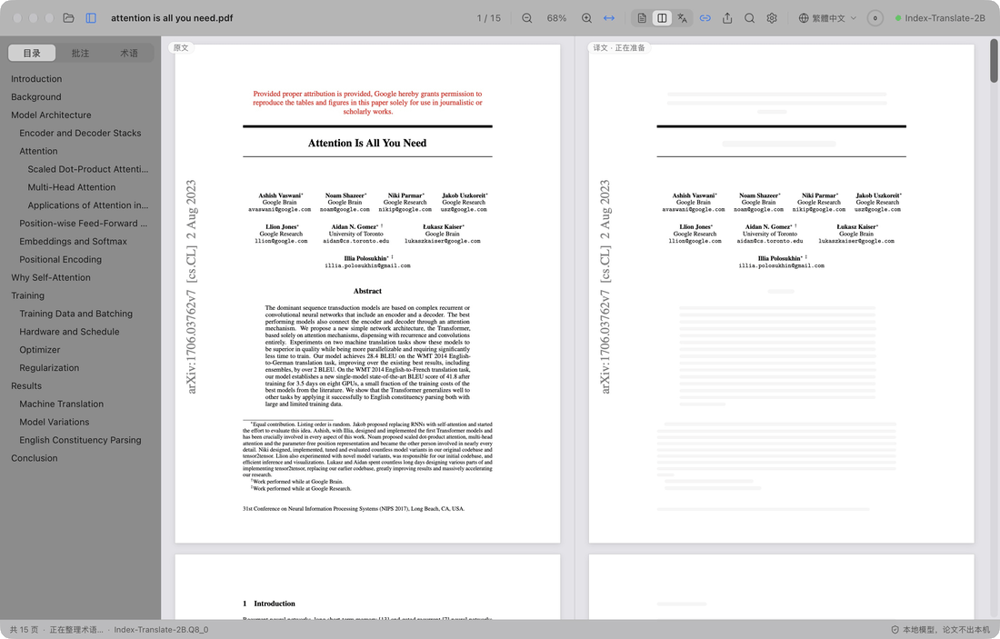
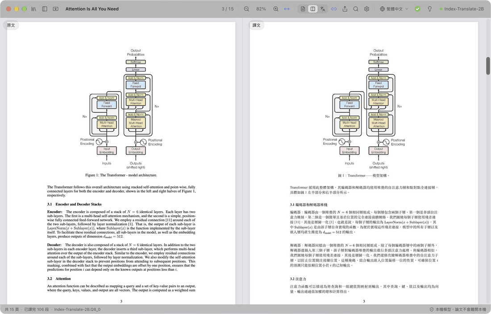
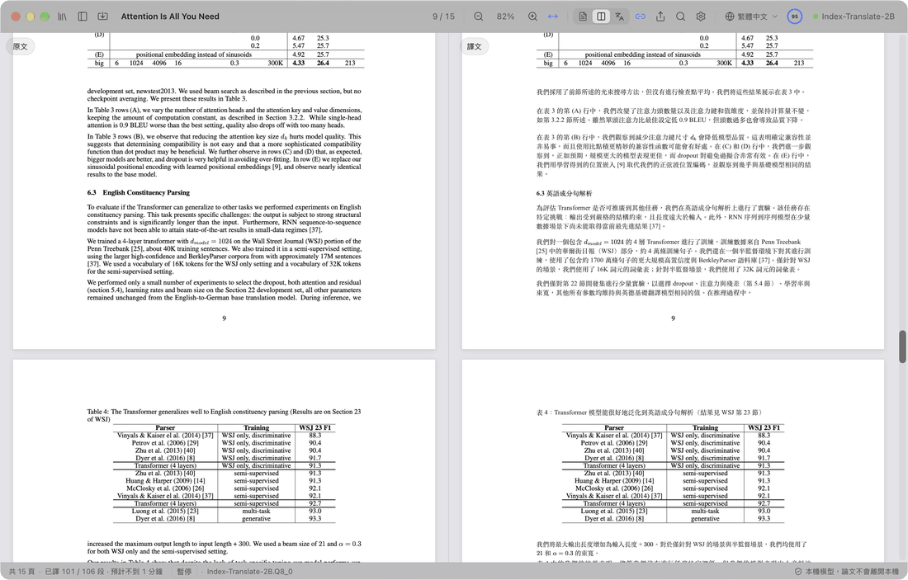
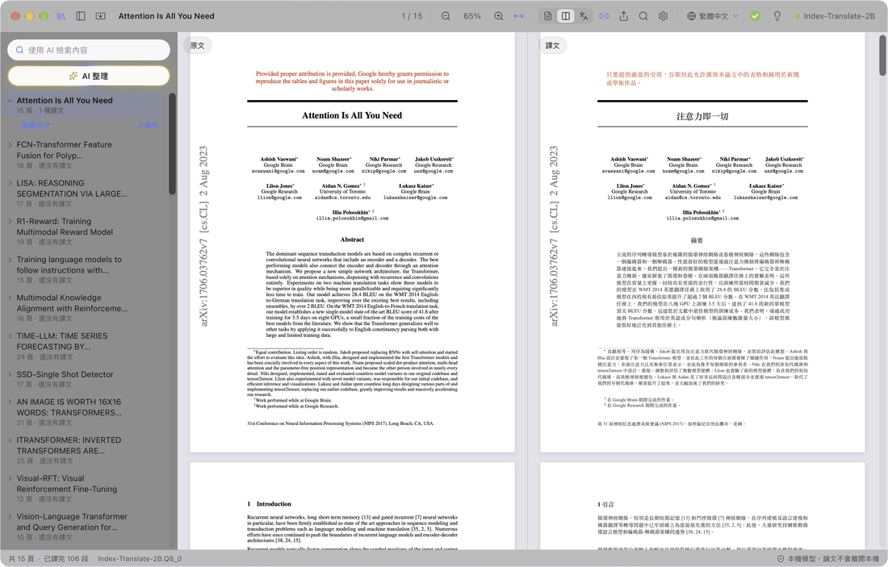
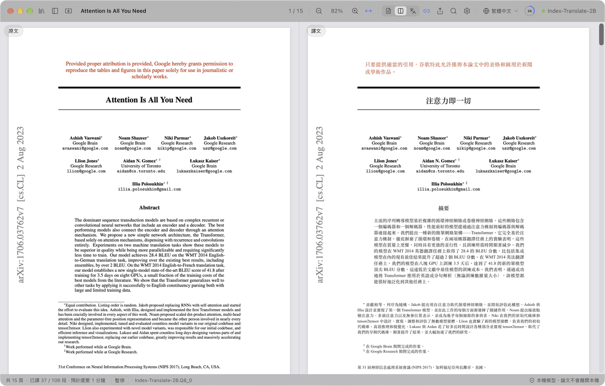
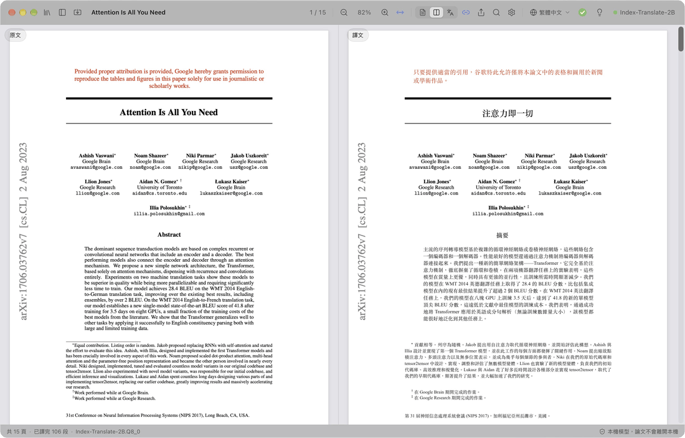

  

<h1 align="center">PaperDuet</h1>

  <em>專為研究人員打造的輕量化論文 AI 翻譯器！</em> 
  <a href="https://paperduet.com">paperduet.com</a>

  <a href="README.md">English</a> &middot; <a href="README.zh-CN.md">简体中文</a> &middot; <b>繁體中文</b> &middot; <a href="README.ja.md">日本語</a> &middot; <a href="README.ko.md">한국어</a> &middot; <a href="README.fr.md">Français</a> &middot; <a href="README.de.md">Deutsch</a> &middot; <a href="README.es.md">Español</a> &middot; <a href="README.it.md">Italiano</a> &middot; <a href="README.pl.md">Polski</a> &middot; <a href="README.ru.md">Русский</a>

  
  

  
  
  
  
  

  <strong>PaperDuet 是一款保留原始版面的輕量 AI 論文鏡像翻譯器。</strong> 
  五種開源 AI 翻譯模型任你選。 
  免付費、完全在本機執行！

   
  從頭翻譯 Attention Is All You Need（15 頁）的實際錄影

PaperDuet 是一款輕量的 AI 論文鏡像翻譯器。它把原文和譯文像鏡子一樣並排擺放，公式、圖片、表格逐頁修正、對齊。不用 API 金鑰、不用付費，全部在你的電腦上執行！

## 每一頁都輕鬆對照

  

左邊是論文原文，右邊是譯文，兩邊一起捲動、一起縮放。分欄、標題、圖說、註腳和參考文獻都會自動辨識，跨欄、跨頁的段落也會自動接起來。左右完全對齊，對照起來很輕鬆。

## 存譯文？AI 概要？沒問題！

  

工具列會顯示翻譯進度。整篇翻完後，圓環變成綠色勾號並跳出提示：點一下就能把譯文存成 PDF，放在原文旁邊。旁邊的小燈泡是 AI 概要：點開就能看到模型讀完全文後寫的總結，研究問題、方法和結果一目了然。另外有五種模型可選，依你的電腦和需求自由搭配！

## 想到，就找到。

  

讀過的論文都收在論文庫裡。AI 整理依領域、方向和主題自動貼上標籤，點選標籤，相關論文就浮到最前面；AI 檢索可以搜標題、原文、譯文和概要，中文、英文檢索詞都能用。

## 看不懂？點一下。

  

先翻各級標題，馬上看出論文的架構；接著是標題、摘要和引言。想先看後面哪一段？在原文上點兩下，它就插隊先翻，不用等進度走到那裡。

## 想做筆記？安排！

  

直接在譯文上畫重點、加底線、寫筆記，原文對應的句子會自動同步標記。匯出帶標註的原文 PDF，用的是標準 PDF 註解，「預覽程式」、Zotero 等 App 都能直接看到。

## 還有這些

- **十種譯文語言**：在工具列一鍵切換简体中文、繁體中文、日本語、한국어、Français、Deutsch、Español、Italiano、Polski、Русский。
- **一鍵儲存譯文 PDF**：整篇翻完後點一下，就會依原始版面存到論文旁邊。
- **內建品質檢查**：每次回覆都會核對公式、數字和句子順序，出錯自動重試；每篇論文自動整理術語表，讓譯法前後一致。
- **翻譯什麼由你決定**：在任一區塊按右鍵，選擇翻譯它或保留原文。
- **想怎麼讀都順手**：原文和譯文同時搜尋、雙語目錄、指標移到段落上就能找到另一邊對應的段落，可以只看原文、只看譯文或兩邊都看。PaperDuet 支援「上次讀到」功能。
- **論文庫與 AI 搜尋**：讀過和匯入的論文都在側欄的論文庫裡。AI 搜尋依標題、原文、譯文和概要找回讀過的論文，中英文檢索詞都可以；AI 整理依領域和主題歸類。
- **論文概要**：整篇翻完後點燈泡，翻譯模型會用介面語言寫一段概要，隨論文儲存。
- **匯出到任何地方**：帶標註的原文 PDF、譯文 PDF、Markdown 筆記，換到其他 App 也能看。
- **一鍵更新**：新版本更新方便，一鍵安裝。
- **為美感而生**：簡潔漂亮的毛玻璃設計，支援淺色、深色和夜間閱讀模式。

  

## 五種模型，全在你的電腦上

第一次打開 PaperDuet 時選一個模型，之後隨時可以在「設定 › 模型 › 更換模型」裡更換。五種都是翻譯專用模型，下載後完全離線執行。

| 模型 | 來自 | 大小 | 適合 |
| --- | --- | --- | --- |
| [Index-Translate-2B](https://huggingface.co/IndexTeam/Index-Translate-2B) **（推薦）** | 嗶哩嗶哩 Index 團隊 | 2.1 GB | 綜合表現最好，PaperDuet 的檢查和術語表專門為它調整過 |
| [Hy-MT2-1.8B](https://huggingface.co/tencent/Hy-MT2-1.8B-GGUF) | 騰訊混元 | 1.9 GB | 追求速度：最快也最輕 |
| [LMT-60-4B](https://huggingface.co/NiuTrans/LMT-60-4B) | 小牛翻譯 NiuTrans | 4.7 GB | 貼近原文的譯法 |
| [Hy-MT2-7B](https://huggingface.co/tencent/Hy-MT2-7B-GGUF) | 騰訊混元 | 8.0 GB | 譯文最通順，適合 16 GB 以上記憶體的電腦 |
| [TranslateGemma-4B](https://huggingface.co/mradermacher/translategemma-4b-it-GGUF) （實驗性） | Google | 4.1 GB | 想試試 Google 的翻譯模型 |

用推薦的模型，15 頁的論文在 M5 Pro 上大約 2 分鐘翻完；在「設定 › 模型」把「同時翻譯幾段」調成 2 或 3，大約 1 分鐘。

已經用 LM Studio、llama.cpp 或 Hugging Face 下載過這些模型？PaperDuet 會自動找到並直接使用，不必重新下載。

電腦跑不動本機模型？在模型選擇裡點「使用 API」，填上自己的 API 金鑰，就能接上 OpenAI、Claude、DeepSeek、通義千問、Kimi、智譜 GLM、豆包，或任何相容 OpenAI 介面的服務。本機模型會自動收合，翻譯、概要、AI 整理和 AI 搜尋都改由這個服務完成。金鑰只存在你的電腦上。

## 隱私為先

- 論文、譯文和筆記都留在你的電腦上。使用 API 時，要翻譯的文字會傳送給你選擇的服務商。
- 只有經你同意，才會傳送匿名的使用和診斷資料（版本、系統、介面語言、所用模型和出錯類型），不含論文內容，隨時可以在設定裡關掉。
- 出錯時會把錯誤資訊傳給開發者：出了什麼錯、版本和系統，不含檔案路徑和論文內容；可以在「設定 › 資料」裡關掉。
- 你在應用程式裡寫回饋並點「傳送」時，寫下的內容（和你自願填寫的電子郵件）會連同版本和系統傳給開發者。
- 使用本機模型時，只有下載模型、檢查更新、傳送上面的資料與錯誤資訊，以及你傳送回饋時才會連網，除了下載模型都可以關掉。

## 開始使用

Mac 需要 Apple 晶片（M1 以後）和 macOS 13.3 以上；Windows 需要 Windows 10 或 11（64 位元）。

**Mac**

1. 從 [Releases](https://github.com/KalenHwei/PaperDuet/releases/latest) 下載最新的 `.dmg`。
2. 把 PaperDuet 拖進「應用程式」，從那裡打開。
3. 僅限第一次：PaperDuet 還沒有通過 Apple 公證，macOS 會請你確認。打開「系統設定 › 隱私權與安全性」，按下 **強制打開**。（也可以在終端機執行 `xattr -dr com.apple.quarantine /Applications/PaperDuet.app`。）
4. 選一個模型。PaperDuet 會下載它，或找到你已有的那份，然後馬上開始翻譯。

**Windows**

1. 從 [Releases](https://github.com/KalenHwei/PaperDuet/releases/latest) 下載最新的 Windows 安裝程式（`_x64-setup.exe`）。
2. 執行安裝程式。僅限第一次：如果 Windows 顯示「Windows 已保護您的電腦」，按 **其他資訊**，再按 **仍要執行**。
3. 選一個模型。PaperDuet 會下載它，或找到你已有的那份，然後馬上開始翻譯。

就這麼簡單。翻譯引擎已經內建在 App 裡，更新也只要點一下。

<b>鍵盤快速鍵</b>

| 動作 | 快速鍵 |
| --- | --- |
| 打開 PDF | ⌘O |
| 關閉論文 | ⌘W |
| 兩邊同時搜尋 | ⌘F |
| 下一個 / 上一個結果 | ⌘G / ⇧⌘G |
| 放大 / 縮小 / 符合寬度 | ⌘+ / ⌘− / ⌘0 |
| 以指標為中心縮放 | ⌘ + 捲動，或在觸控板上雙指捏合 |
| 移動頁面 | ⌘ + 拖移 |
| 接著翻譯這部分 | 在還沒翻譯的文字上點兩下 |
| 標記選取內容 | H |
| 為選取內容加筆記 | N |
| 標記顏色 | 1 到 5 |
| 還原 / 重做 | ⌘Z / ⇧⌘Z |
| 顯示或隱藏側欄 | ⌘\ |
| 開關同步捲動 | ⌘L |
| 所有快速鍵 | ⌘/ |

H、N、1 到 5 作用於選取的文字。Windows 上用 Ctrl 代替 ⌘，用 Shift 代替 ⇧。

## 常見問題

### 該選哪個模型？

先用 Index-Translate-2B。想要更快，選 Hy-MT2-1.8B；想要最通順的譯文，而且電腦有 16 GB 以上記憶體，選 Hy-MT2-7B。電腦跑不動的話，選「使用 API」。

### 要付費嗎？

個人學習和研究免費，大學、學校、研究機構和其他非營利組織使用也免費。在公司內使用或為公司使用需要商業授權，請寫信到 [junystugh@gmail.com](mailto:junystugh@gmail.com)。

## 未來計畫

- **arXiv 論文重新排版**：直接翻譯論文的 LaTeX 原始碼，用譯文語言的字型重新編譯，得到排版完整的譯本。

## 更新紀錄

- **0.6.2**（2026-10-28）：Windows 版可以自選模型的儲存位置，已下載的模型會一起移過去。
- **0.6.1**（2026-10-28）：修正了一些已知的格式問題。
- **0.6.0**（2026-10-28）：新增新手導覽，第一次打開論文時帶你認識主要功能；新增 Beta 回饋，在狀態列就能直接傳意見給我們。
- **0.5.17**（2026-10-28）：修正了一些已知的格式問題。
- **0.5.16**（2026-10-28）：修正投稿稿件（Word 匯出、雙倍行距）中部分段落直接顯示英文、沒有翻譯的問題；雙倍行距的段落整段翻譯，不再逐行翻譯；放在參考文獻後面的圖說會翻譯。
- **0.5.15**（2026-10-28）：修正 Elsevier 期刊論文中的公式符號亂碼：希臘字母、≤、∀、≠ 和帶帽子的字母（如 Ŝ、q̂）不再顯示成普通字母；位置很高的上標不再跑到上一行。
- **0.5.14**（2026-10-28）：修正了一些已知的格式錯誤。
- **0.5.13**（2026-10-28）：修正公式附近的亂碼：含分式、求和號的行間公式整塊保留原樣，不再被拆成碎片翻譯、遮住求和號；行內求和公式、根號和字距很寬的公式行不再把句子拆開；「1, 2, . . . , n」的刪節號不再變成「。。。」。
- **0.5.12**（2026-10-27）：期刊論文的版面和翻譯更準確：統計結果行、編號小節標題、跨欄的句子、χ² 等希臘字母、人名重音和表格中的負號不再出錯，「H1.」「圖 1」「註：」等標號的標點更規範；匯出的譯文 PDF 字距更均勻。感謝小紅書使用者 momo 的建議。
- **0.5.11**（2026-10-27）：虛擬碼逐行翻譯，保留行號、縮排和關鍵字；表格辨識更準確，表格內容保留原文、只翻譯表題和表註，不再錯亂；修正部分論文行內求和公式在譯文中缺失。
- **0.5.10**（2026-10-27）：新增 API 翻譯：電腦跑不動本機模型時，可在模型選擇裡點「使用 API」，支援 OpenAI、Claude、DeepSeek、通義千問、Kimi、智譜 GLM、豆包和任何相容 OpenAI 介面的服務；選取後本機模型清單自動收合。
- **0.5.9**（2026-10-26）：修正既有問題。
- **0.5.8**（2026-10-26）：新增波蘭文（譯文語言和介面語言）；修正 macOS 26 及更早系統上論文無法讀取、無法翻譯的問題；修正 macOS 27 上部分論文儲存譯文 PDF 失敗的問題。
- **0.5.7**（2026-10-26）：期刊論文的版面辨識和翻譯更準確（逐篇測試了 20 種頂尖期刊的論文）：分欄、標題、參考文獻、表格、圖說和出版商的特殊符號；Science 等論文不再大段漏譯，參考文獻後面的附錄也會翻譯。
- **0.5.6**（2026-10-25）：新增義大利文（譯文語言和介面語言）；出錯時向開發者傳送錯誤資訊，幫助修正問題（預設開啟，可在「設定 › 資料」裡關閉）。
- **0.5.5**（2026-10-25）：修正期刊論文中排得較鬆的行被拆成零散單字、譯文缺字和錯位的問題；摘要緊接標題優先翻譯；減少「版面分析失敗」；Elsevier 論文的破折號不再顯示為 e。
- **0.5.4**（2026-10-24）：介面更簡潔，去掉各處多餘的說明文字；AI 搜尋框改為「使用 AI 檢索內容」。
- **0.5.3**（2026-10-24）：新增一次性詢問：是否自願分享匿名的使用和診斷資料，幫助改進 PaperDuet；不含論文內容，可隨時在「設定 › 資料」裡關閉。
- **0.5.2**（2026-10-24）：論文庫新增「AI 搜尋」🔍，依標題、原文、譯文、概要和標籤找到讀過的論文，中文或英文檢索詞都可以；搜尋和 AI 整理會把找到的論文排到前面，其餘的變灰。
- **0.5.1**（2026-10-24）：檔案夾側欄改為論文庫，讀過和匯入的論文都在這裡，可重新命名、看概要；新增批次匯入；新增「AI 整理」✨，依領域和主題篩選論文；修正部分論文的表格亂碼和段落翻譯失敗。
- **0.5.0**（2026-10-24）：新增論文概要💡，全文譯完後點燈泡查看；檔案欄一鍵打開所在資料夾；新增 Windows 版。
- **0.4.1**（2026-10-23）：模型列表和設定裡的說明文字優化。
- **0.4.0**（2026-10-23）：介面支援 9 種語言，預設跟隨系統語言，可在「設定 › 外觀 › 介面語言」裡切換。
- **0.3.2**（2026-10-23）：進一步修正多語言翻譯時的介面對齊問題。
- **0.3.1**（2026-10-23）：進度圓環與工具列優化。
- **0.3.0**（2026-10-23）：新增八種譯文語言🎉，工具列一鍵切換；進度圓環優化，互動邏輯優化。
- **0.2.1**（2026-10-23）：新增五種可選的翻譯模型；新增啟動畫面。
- **0.2.0**（2026-10-23）：App 內檢查更新，一鍵升級。
- **0.1.0**（2026-10-22）：第一個版本。

完整紀錄見 [CHANGELOG.md](CHANGELOG.md)。

## 授權

PaperDuet 依 [PolyForm Noncommercial License 1.0.0](LICENSE) 授權，非商業用途免費：個人、學習、研究和非營利用途都可以使用和分享；分享時請附上授權條款和這一行 `Required Notice: Copyright (c) 2026 Kalen Yongda Wei`。商業用途請寫信到 [junystugh@gmail.com](mailto:junystugh@gmail.com)。

Copyright © 2026 Kalen Yongda Wei.

## 致謝

PaperDuet 以 [Tauri](https://tauri.app)、[pdf.js](https://mozilla.github.io/pdf.js/)、[pdf-lib](https://pdf-lib.js.org)、[llama.cpp](https://github.com/ggml-org/llama.cpp)、[React](https://react.dev)、[Zustand](https://github.com/pmndrs/zustand) 和 [Lucide](https://lucide.dev) 打造。翻譯模型來自嗶哩嗶哩 Index 團隊（Index-Translate-2B）、騰訊混元（Hy-MT2）、小牛翻譯（LMT）和 Google（TranslateGemma）；除了 TranslateGemma 採用 [Gemma 使用條款](https://ai.google.dev/gemma/terms) 外，其餘都以 Apache-2.0 授權釋出。完整授權條款可以在 App 內查看（設定 › 關於 › 第三方授權條款）。

動畫中的論文是 Vaswani 等人的 [_Attention Is All You Need_](https://arxiv.org/abs/1706.03762)。
